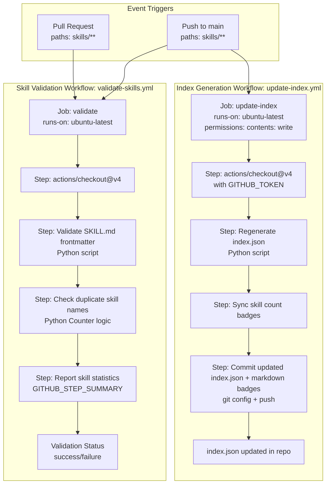
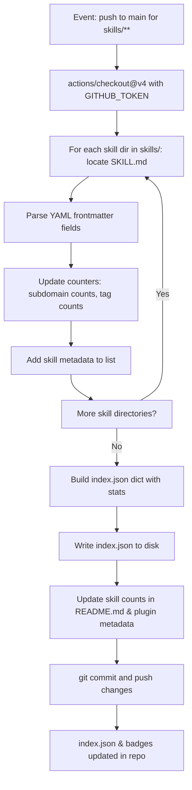
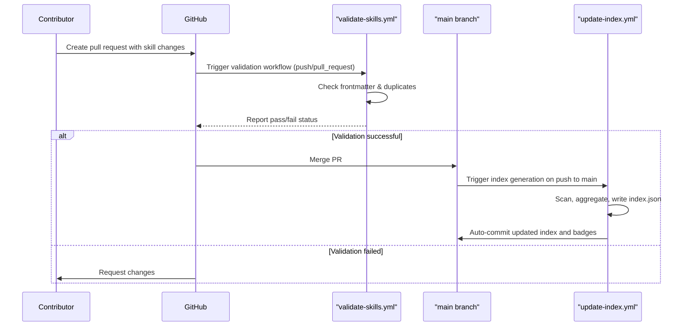
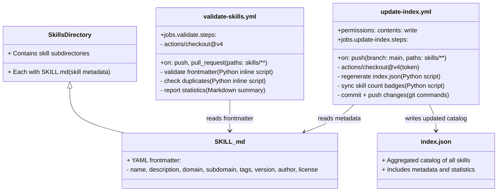
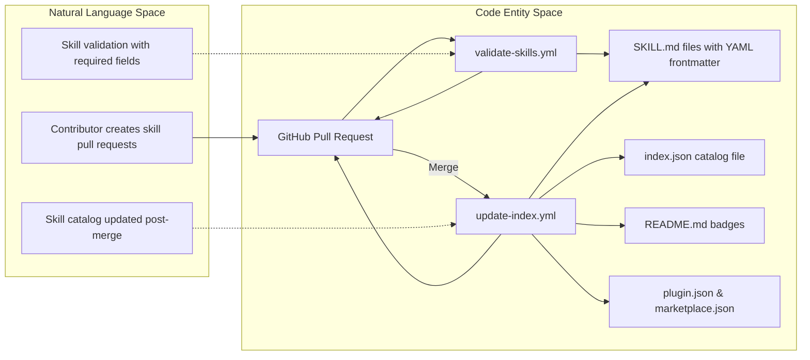

<!-- source: DeepWiki mcp.deepwiki.com · repo mukul975/Anthropic-Cybersecurity-Skills · page 6 Automation & CI/CD · fetched 2026-10-26 -->

# Automation & CI/CD

<details>
<summary>Relevant source files</summary>

The following files were used as context for generating this wiki page:

- [.claude-plugin/marketplace.json](.claude-plugin/marketplace.json)
- [.claude-plugin/plugin.json](.claude-plugin/plugin.json)
- [.github/workflows/sync-marketplace-version.yml](.github/workflows/sync-marketplace-version.yml)
- [.github/workflows/update-index.yml](.github/workflows/update-index.yml)
- [.github/workflows/validate-skills.yml](.github/workflows/validate-skills.yml)
- [CODE_OF_CONDUCT.md](CODE_OF_CONDUCT.md)
- [README.md](README.md)

</details>


## Purpose and Scope

This document provides a high-level overview of the automated continuous integration and deployment (CI/CD) infrastructure implemented in the Anthropic Cybersecurity Skills repository. The automation primarily focuses on maintaining data quality and ensuring catalog consistency across the 817+ cybersecurity skills present in the repository.

Two primary GitHub Actions workflows power this automation:

- **Skill Validation Workflow:** Automatically validates the YAML frontmatter of every `SKILL.md` file, detects duplicate skill names, and aggregates skill statistics.
- **Index Generation Workflow:** Automatically regenerates the master `index.json` catalog reflecting all available skills, updating metadata and statistics, and commits the changes to the main branch.

For detailed information on each workflow, see the child pages:  
- [Skill Validation Workflow](#6.1) — Frontmatter validation, duplicate detection, and reporting  
- [Index Generation Workflow](#6.2) — Metadata aggregation and automatic index updates

---

## Automation Architecture Overview

The repository adopts an automation-first approach leveraging GitHub Actions to preserve repository integrity and streamline contribution integration. All proposed changes to skills trigger the validation workflow, ensuring data correctness before merge. Once on the `main` branch, any change to skills triggers the index generation workflow that consolidates skill metadata into a unified JSON catalog.



Sources: [.github/workflows/validate-skills.yml:1-129](), [.github/workflows/update-index.yml:1-113]()

---

## Workflow Trigger Matrix

| Workflow                 | Trigger Event           | Branch Filter | Path Filter    | Purpose                          |
|--------------------------|------------------------|---------------|----------------|---------------------------------|
| `validate-skills.yml`    | `push` and `pull_request` | Any           | `skills/**`    | Validate skill frontmatter pre-merge |
| `update-index.yml`       | `push`                 | `main`        | `skills/**`    | Regenerate skill catalog post-merge  |

The split ensures that skill validation runs early on proposed changes while index regeneration updates the repository only after successful merges to `main`.

Sources: [.github/workflows/validate-skills.yml:3-9](), [.github/workflows/update-index.yml:3-9]()

---

## Skill Validation Workflow (validate-skills.yml) Overview

This workflow performs three key validation tasks, implemented as sequential Python inline scripts:

1. **Frontmatter Validation:**  
   Scans every `SKILL.md` file under `skills/` for the presence of YAML frontmatter and ensures all required fields are present and correctly formatted.

2. **Duplicate Skill Name Detection:**  
   Aggregates all skill `name` fields and checks for duplicates, which would otherwise cause conflicts in the skill index.

3. **Skill Statistics Reporting:**  
   Counts skills by subdomain and adds a markdown summary to the GitHub Actions UI for visibility on the skill distribution.

### Validation Execution Flow Diagram

```mermaid
flowchart TD
    Start["Event: push or pull_request for skills/**"] --> Checkout["actions/checkout@v4"]
    Checkout --> ValidateFM["Validate frontmatter in SKILL.md<br/>Check REQUIRED_FIELDS and name format"]
    ValidateFM --> DupCheck["Check for duplicate skill names"]
    DupCheck --> ReportStats["Generate skill counts by subdomain"]
    ReportStats --> End["Output validation summary and exit status"]
    
    ValidateFM -- "Errors found?" -->|Yes| Fail["Fail workflow: exit(1)"]
    DupCheck -- "Duplicates?" -->|Yes| Fail
```

### Required Fields Checked

- `name`
- `description`
- `domain`
- `subdomain`
- `tags`
- `version`
- `author`
- `license`

Each field is verified to exist within the YAML frontmatter of every skill definition.

### Name Formatting Rules

- Must be kebab-case: lowercase alphanumeric and hyphens only (`^[a-z0-9-]+$`)
- Maximum length of 64 characters

These constraints ensure URL-safe, human-readable skill identifiers consistent with directory names.

Sources: [.github/workflows/validate-skills.yml:18-128]()

---

## Index Generation Workflow (update-index.yml) Overview

After successful merges to the `main` branch, this workflow regenerates the full skill index (`index.json`) from the individual skill metadata.

### Core Steps

- **Checkout latest code** with write permissions.
- **Scan** all directories under `skills/` for `SKILL.md` files.
- **Parse** each skill's YAML frontmatter extracting key fields: `name`, `description`, `domain`, `subdomain`, `tags`, `version`, `author`, `license`.
- **Aggregate** statistics: total skills, skills per domain/subdomain, and tag frequencies.
- **Write** a fresh `index.json` file formatted with the aggregated metadata.
- **Update** `README.md` badge counts and `.claude-plugin/marketplace.json` & `plugin.json` to keep metadata in sync.
- **Commit & push** updated files back to the repository automatically.

### Index Generation Flowchart



### Index JSON Top-Level Structure (example)

```json
{
  "version": "1.1.0",
  "generated_at": "2024-06-01T12:00:00Z",
  "repository": "https://github.com/mukul975/Anthropic-Cybersecurity-Skills",
  "domain": "cybersecurity",
  "total_skills": 817,
  "skills": [
    {
      "name": "example-skill",
      "description": "A brief summary of the skill",
      "domain": "cybersecurity",
      "subdomain": "cloud-security",
      "tags": ["T1234", "attack-pattern"],
      "version": "1.0",
      "author": "mukul975",
      "license": "Apache-2.0",
      "path": "skills/example-skill"
    }
    // ... other skills ...
  ]
}
```

### Git Commit Automation Details

- Sets Git user name and email as `mukul975` using GitHub noreply email.
- Adds changed files (`index.json`, `README.md`, and relevant plugin JSON files).
- Commits with message `"chore: auto-update index.json and skill count"`.
- Only commits if changes exist to avoid empty commits.
- Pushes changes back to `main`.

Sources: [.github/workflows/update-index.yml:11-113]()

---

## Workflow Permissions and Security

| Workflow           | Permission Required      | Scope           | Reason                            |
|--------------------|-------------------------|-----------------|---------------------------------|
| `validate-skills.yml` | Default (read-only)      | Repository read  | Only reads skill files for validation |
| `update-index.yml`  | `contents: write` access | Repository write | Updates index.json and pushes changes |

Granting minimal permissions ensures the repository's security posture and reduces exposure.

Sources: [.github/workflows/update-index.yml:12-16]()

---

## Integration in Contribution Cycle

These automation workflows tightly integrate with the contribution process:



This flow ensures every accepted skill complies with standards and the catalog stays current.

Sources: [.github/workflows/validate-skills.yml:3-129](), [.github/workflows/update-index.yml:3-113]()

---

# See Also

- [Skill Validation Workflow](#6.1) — Details on `validate-skills.yml`  
- [Index Generation Workflow](#6.2) — Details on `update-index.yml`

---

# Bridging Natural Language to Code Entities: Workflow Associations



Sources: [.github/workflows/validate-skills.yml:1-129](), [.github/workflows/update-index.yml:1-113]()

---

# Bridging Natural Language Concepts with Code Artifacts in Automation



Sources: [.github/workflows/validate-skills.yml:1-129](), [.github/workflows/update-index.yml:1-113]()

---

# Summary

The Anthropic Cybersecurity Skills repository leverages two core GitHub Actions workflows—`validate-skills.yml` and `update-index.yml`—to automate verification and catalog generation. This automation ensures the integrity, uniqueness, and comprehensive metadata aggregation of 817 structured skills covering 29 security domains and mapped to 6 frameworks. The resulting streamlined CI/CD pipeline supports rapid iteration and reliable deployment of cybersecurity skills for AI agents.

For in-depth workflow explanations and scripts, refer to the child pages:
- [Skill Validation Workflow](#6.1)  
- [Index Generation Workflow](#6.2)

---

# Sources

- [.github/workflows/validate-skills.yml:1-129]()  
- [.github/workflows/update-index.yml:1-113]()  
- [README.md:1-129]()  
- [.claude-plugin/marketplace.json:1-37]()

---

