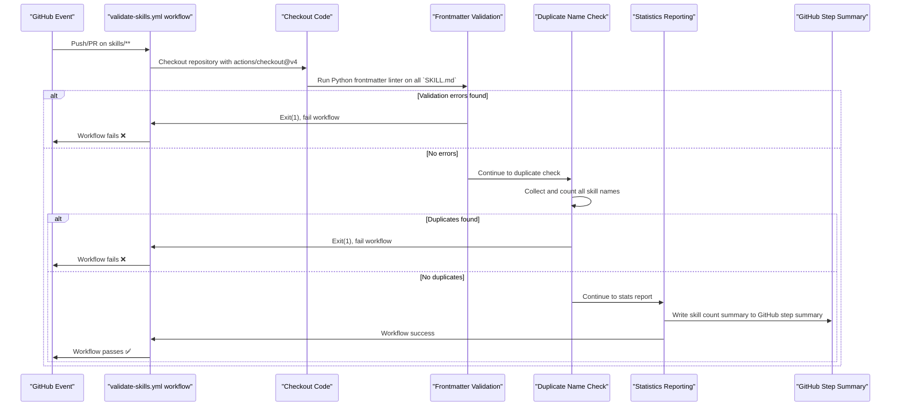
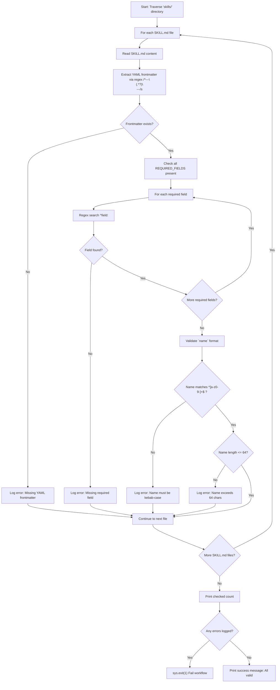
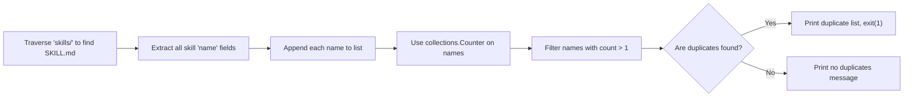
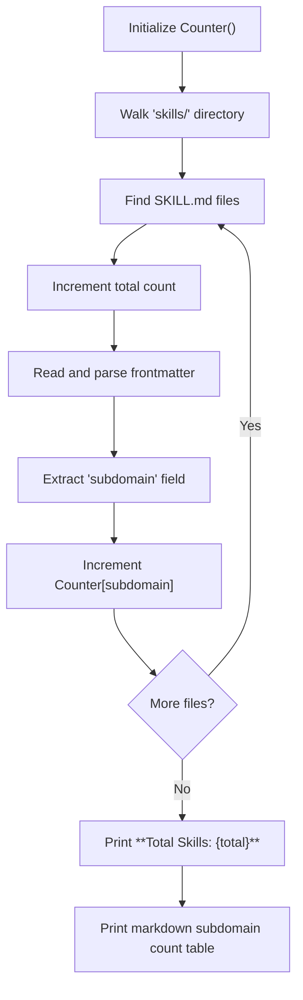
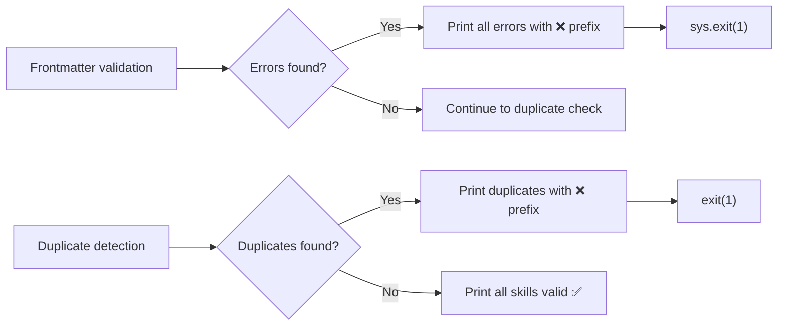
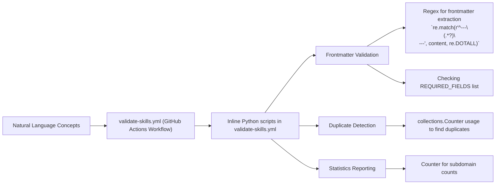
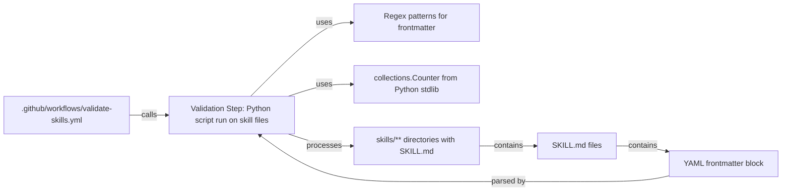

<!-- source: DeepWiki mcp.deepwiki.com · repo mukul975/Anthropic-Cybersecurity-Skills · page 6.1 Skill Validation Workflow · fetched 2026-10-26 -->

# Skill Validation Workflow

<details>
<summary>Relevant source files</summary>

The following files were used as context for generating this wiki page:

- [.claude-plugin/marketplace.json](.claude-plugin/marketplace.json)
- [.claude-plugin/plugin.json](.claude-plugin/plugin.json)
- [.github/workflows/sync-marketplace-version.yml](.github/workflows/sync-marketplace-version.yml)
- [.github/workflows/update-index.yml](.github/workflows/update-index.yml)
- [.github/workflows/validate-skills.yml](.github/workflows/validate-skills.yml)
- [CODE_OF_CONDUCT.md](CODE_OF_CONDUCT.md)
- [README.md](README.md)
- [tools/README.md](tools/README.md)
- [tools/validate-skill.py](tools/validate-skill.py)

</details>


This document describes the `validate-skills.yml` GitHub Actions workflow that automatically validates all `SKILL.md` files in the repository. The validation ensures data quality by checking YAML frontmatter structure, required metadata fields, naming conventions, duplicate skill names, and provides skill statistics reporting. This workflow acts as a quality gate for skill contributions, preventing invalid or duplicate skills from entering the main codebase.

For the process that runs after validation to aggregate metadata and generate the skill index, see the [Index Generation Workflow](#6.2).

**Sources:** [.github/workflows/validate-skills.yml:1-129]()

---

## Purpose and Scope

The skill validation workflow runs automatically on:

- `push` events modifying any file in `skills/**`
- `pull_request` events touching files in `skills/**`

It performs three primary validation tasks on all skill directories containing `SKILL.md` files:

1. **Frontmatter Validation** – Checks presence and correctness of YAML frontmatter in each `SKILL.md`
2. **Duplicate Detection** – Ensures all skills have unique `name` fields
3. **Statistics Reporting** – Outputs skill count and distribution by subdomain for visibility

This ensures consistent, well-formed skill metadata throughout the repository.

**Sources:** [.github/workflows/validate-skills.yml:3-9]()

---

## Workflow Architecture

The validation workflow proceeds through sequential steps in a single job:



**Diagram: Skill Validation Execution Sequence**

This structure ensures the workflow halts early on validation defects or duplicates, blocking merges until fixed, and provides final statistics on skill counts.

**Sources:** [.github/workflows/validate-skills.yml:11-128]()

---

## Validation Step 1: Frontmatter Structure

The first step verifies the correctness of the YAML frontmatter inside every skill's `SKILL.md`.

### Required Fields

Every `SKILL.md` must contain the following eight fields in YAML frontmatter (the block between `---` markers):

| Field         | Description                           | Validation                               |
|---------------|-----------------------------------|-----------------------------------------|
| `name`        | Unique skill identifier             | Kebab-case, max 64 characters           |
| `description` | Brief summary of skill             | Must be present                          |
| `domain`      | Main domain category               | Must be present (typically "cybersecurity") |
| `subdomain`   | Specific skill taxonomy category   | Must be present, validated separately   |
| `tags`        | List of keywords                   | Must be present                          |
| `version`     | Skill version                     | Must be present                          |
| `author`      | Creator or maintainer information  | Must be present                          |
| `license`     | License identifier                 | Must be present                          |

**Sources:** [.github/workflows/validate-skills.yml:25]()

### Validation Logic Flow



**Diagram: Frontmatter Validation Decision Tree**

**Sources:** [.github/workflows/validate-skills.yml:18-68]()

### Key Code Entities

- `REQUIRED_FIELDS`: List of strings detailing mandatory frontmatter keys [line 25]()
- `os.walk('skills')`: Directory traversal to locate all `SKILL.md` files [line 29]()
- Regex `^---\n(.*?)\n---` with `re.DOTALL` to extract YAML block from markdown [line 38]()
- Regex search for each required field in frontmatter using `re.MULTILINE` [line 47]()
- Name format enforcement with regex `^[a-z0-9-]+$` [line 54]()
- Length check for name with `len(name) <= 64` [line 56-57]()

---

## Validation Step 2: Duplicate Detection

After validating individual files, the workflow checks for any duplicate skill names across the entire repository.

### Detection Algorithm



**Diagram: Duplicate Detection Flow**

### Implementation Details

The duplicate checker:

- Parses all `SKILL.md` frontmatter names with regex: `^name:\s*(.+)$`
- Collects and strips each skill name
- Counts occurrences via `collections.Counter(names)`
- Identifies duplicates by filtering counts > 1
- Fails workflow if duplicates exist, ensuring all skill names remain unique

**Sources:** [.github/workflows/validate-skills.yml:70-95]()

---

## Validation Step 3: Statistics Reporting

Regardless of validation success or failure, the workflow emits a summary of skill counts by subdomain for monitoring and visibility.

### Reporting Mechanism

The report is appended to the GitHub Actions step summary via the `$GITHUB_STEP_SUMMARY` environment variable:

```bash
echo "## Skill Database Stats" >> $GITHUB_STEP_SUMMARY
```

This renders as a visible markdown section in the workflow results.

**Sources:** [.github/workflows/validate-skills.yml:100-101]()

### Statistics Aggregation Flow



**Diagram: Statistics Generation Process**

### Output Format

The markdown output includes:

| Output Element | Source Data | Output Format |
|----------------|-------------|---------------|
| Total skills   | `total` variable | `**Total Skills: {total}**` |
| Table header   | Static text    | `| Subdomain | Count |` with separator line |
| Table rows     | `subdomain_counts.items()` | `| {subdomain} | {count} |` |
| Sorting       | Descending by count | Sorted via `sorted(..., key=lambda x: -x[1])` |

**Sources:** [.github/workflows/validate-skills.yml:102-128]()

---

## Error Handling and Exit Codes

### Validation Error Workflow

The workflow halts with a non-zero exit code upon encountering:

- Missing or malformed YAML frontmatter
- Missing required fields
- Invalid skill name formats or length
- Duplicate skill names

If errors are found, the workflow prints clear error messages prefixed with `❌` and fails.



**Diagram: Error Handling Flow**

### Exit Conditions Summary

| Condition                  | Exit Code | Output Summary                             |
|----------------------------|-----------|--------------------------------------------|
| Frontmatter validation errors | 1         | Prints detailed errors per file             |
| Duplicate skill names found | 1         | Lists duplicate skill names                 |
| No validation errors       | 0         | `✅ All {count} skills valid` message       |
| Statistics reporting         | Always runs | Writes skill count summary to step output  |

**Sources:** [.github/workflows/validate-skills.yml:61-67](), [.github/workflows/validate-skills.yml:91-94](), [.github/workflows/validate-skills.yml:98]()

---

## Validation Rules Summary

| Validation Category       | Rule                                                                | Implementation                                                                           |
|---------------------------|---------------------------------------------------------------------|------------------------------------------------------------------------------------------|
| **YAML Frontmatter Presence** | `SKILL.md` must contain YAML frontmatter between `---` delimiters        | Regex `re.match(r'^---\n(.*?)\n---', content, re.DOTALL)`                                |
| **Required Fields**         | `name`, `description`, `domain`, `subdomain`, `tags`, `version`, `author`, `license` | Loop checking presence with `re.search(rf'^{field}:', fm, re.MULTILINE)`                 |
| **Name Format**             | Lowercase letters, numbers, hyphens only; must be <=64 chars              | Regex `re.match(r'^[a-z0-9-]+$', name)` and length check                                 |
| **Unique Skill Names**      | No duplicate `name` values across all skills                           | `collections.Counter()` counting and filtering names with count > 1                      |

These form the core correctness constraints enforced by the validation workflow.

**Sources:** [.github/workflows/validate-skills.yml:25](), [.github/workflows/validate-skills.yml:38-57](), [.github/workflows/validate-skills.yml:90]()

---

## Integration with Development Workflow

The skill validation workflow is integrated tightly into the repository's continuous integration (CI) process:

- **Pull Requests:** Validation runs on every PR changing `skills/**`, blocking merges on failures to maintain data integrity
- **Pushes:** Validation also runs on `push` events modifying skills to catch issues early

This workflow acts as an automated gatekeeper ensuring that only well-formed, uniquely named skills with complete metadata are accepted into the repository.

It maintains consistency and quality for the auto-generated skill index, improving reliability of consuming agent platforms.

**Sources:** [.github/workflows/validate-skills.yml:3-9]()

---

# Bridging Natural Language and Code Entities in Skill Validation

The diagrams below illustrate the relationship between system components named in natural language and their corresponding code entities (functions, scripts, file names) within the repository, clarifying how conceptual validation tasks map to actual implementations.



**Diagram: Natural Language to Code Entity Mapping (Validation Workflow Components)**



**Diagram: Workflow to Codebase Entities and Data Flow**

---

This documentation provides a comprehensive technical overview of the skill validation process crucial for maintaining the integrity and quality of the Anthropic Cybersecurity Skills repository.

**Sources:** [.github/workflows/validate-skills.yml:1-129]()

---

