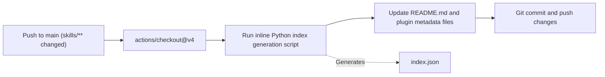
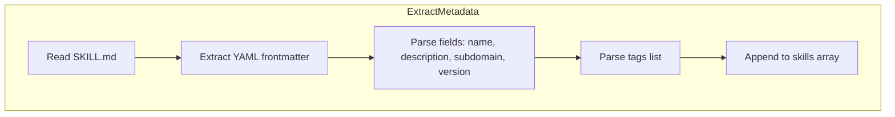
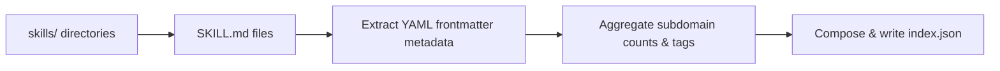
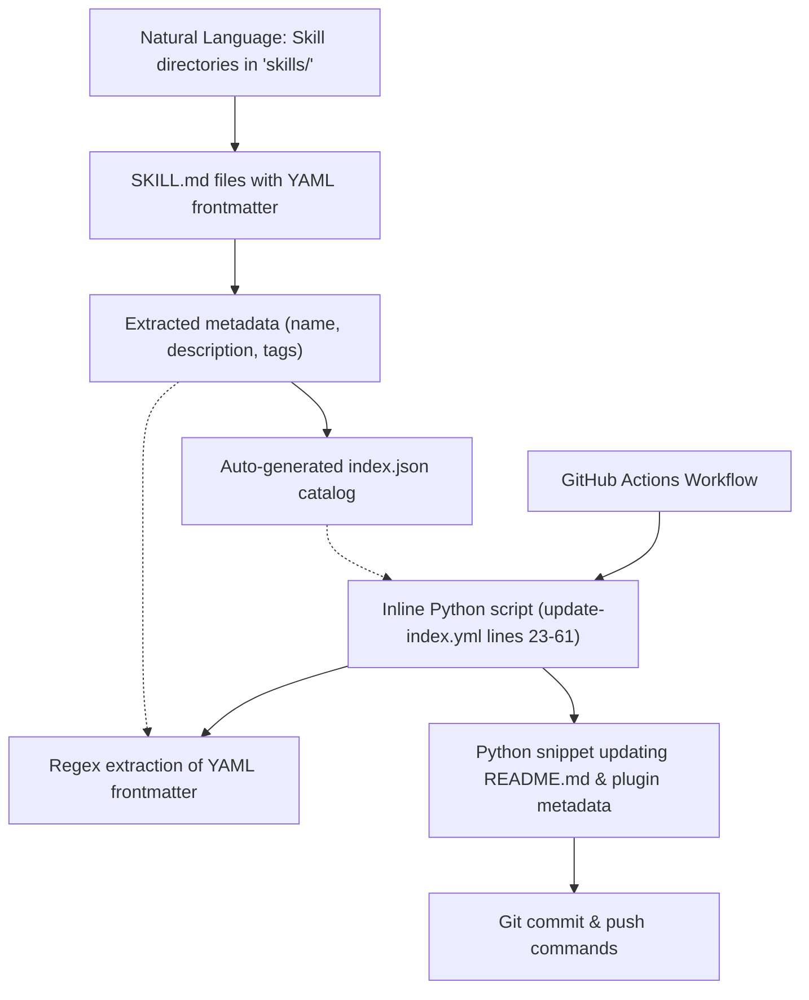

<!-- source: DeepWiki mcp.deepwiki.com · repo mukul975/Anthropic-Cybersecurity-Skills · page 6.2 Index Generation Workflow · fetched 2026-10-26 -->

# Index Generation Workflow

<details>
<summary>Relevant source files</summary>

The following files were used as context for generating this wiki page:

- [.claude-plugin/marketplace.json](.claude-plugin/marketplace.json)
- [.claude-plugin/plugin.json](.claude-plugin/plugin.json)
- [.github/workflows/sync-marketplace-version.yml](.github/workflows/sync-marketplace-version.yml)
- [.github/workflows/update-index.yml](.github/workflows/update-index.yml)
- [.github/workflows/validate-skills.yml](.github/workflows/validate-skills.yml)
- [CODE_OF_CONDUCT.md](CODE_OF_CONDUCT.md)
- [README.md](README.md)
- [index.json](index.json)
- [skills/analyzing-linux-audit-logs-for-intrusion/SKILL.md](skills/analyzing-linux-audit-logs-for-intrusion/SKILL.md)
- [skills/analyzing-windows-amcache-artifacts/SKILL.md](skills/analyzing-windows-amcache-artifacts/SKILL.md)
- [skills/detecting-oauth-token-theft/SKILL.md](skills/detecting-oauth-token-theft/SKILL.md)
- [skills/implementing-devsecops-security-scanning/SKILL.md](skills/implementing-devsecops-security-scanning/SKILL.md)
- [skills/implementing-privileged-session-monitoring/SKILL.md](skills/implementing-privileged-session-monitoring/SKILL.md)

</details>


This page documents the automated index generation workflow that scans all skill directories, extracts YAML frontmatter metadata, and auto-generates the `index.json` catalog file. This process keeps the central skill index synchronized with the skill collection, enabling efficient AI agent skill discovery and platform integration.

For details on the skill validation workflow, see [Skill Validation Workflow](#6.1).

---

## Purpose and Scope

The `update-index.yml` workflow defined in GitHub Actions runs automatically on pushes to the `main` branch affecting the `skills/**` directory. This workflow:

- Iterates through every skill subdirectory under `skills/`
- Reads the `SKILL.md` markdown file in each skill directory
- Extracts YAML frontmatter metadata such as `name`, `description`, `subdomain`, `tags`, and `version`
- Aggregates statistics across all skills (counts by subdomain, top tags)
- Generates a consolidated `index.json` file containing all skill metadata and summary stats
- Updates related files such as `README.md` badges and plugin metadata files for skill count synchronization
- Commits and pushes the updated index and metadata

This automated process removes manual maintenance overhead and ensures the index.json and related metadata are always current and consistent with the skills collection.

**Sources:**  
[.github/workflows/update-index.yml:1-113]()

---

## Workflow Trigger Configuration

The workflow is triggered on:

- Any push to the `main` branch modifying files under `skills/**` or `.github/workflows/update-index.yml`
- Manual invocation via `workflow_dispatch`

Trigger snippet:

```yaml
on:
  push:
    branches: [main]
    paths:
      - 'skills/**'
      - '.github/workflows/update-index.yml'
  workflow_dispatch:
```

This ensures the index updates only when skill files or the workflow itself changes.

**Sources:**  
[.github/workflows/update-index.yml:3-10]()

---

## Workflow Execution Environment and Steps

The workflow runs on the latest Ubuntu environment (`ubuntu-latest`) with repository write permissions enabled (`contents: write`).

Execution steps:

1. **Checkout repository** (`actions/checkout@v4`) to access all skill files.
2. **Run inline Python script** to scan skills, extract metadata, generate `index.json`, and update file counts.
3. **Synchronize skill counts** into `README.md`, `.claude-plugin/marketplace.json`, and `.claude-plugin/plugin.json`.
4. **Commit and push** the updated files back to the repository.

### Mermaid Diagram: Workflow Execution Flow



**Sources:**  
[.github/workflows/update-index.yml:11-113]()

---

## Index Generation Process: Python Script Details

The core of the workflow is an inline Python script that performs the following:

### 1. Skill Directory Scanning and SKILL.md Reading

- Lists all subdirectories in `skills/`.
- For each skill directory, checks for the existence of `SKILL.md`.
- Reads the entire content of `SKILL.md` if present.

```python
skills_dir = "skills"
skills = []

for skill_name in sorted(os.listdir(skills_dir)):
    skill_md = os.path.join(skills_dir, skill_name, "SKILL.md")
    if not os.path.isfile(skill_md):
        continue
    with open(skill_md, "r", encoding="utf-8") as f:
        content = f.read()
```

### 2. YAML Frontmatter Extraction

Uses regular expressions to extract the YAML frontmatter delimited by `---` at the top of `SKILL.md`.

```python
fm_match = re.match(r"^---\n(.*?)\n---", content, re.DOTALL)
if fm_match:
    fm = fm_match.group(1)
else:
    fm = ""
```

### 3. Metadata Field Extraction

Helper functions extract individual metadata fields (`name`, `description`, `subdomain`, `version`) and tags array from the frontmatter using regex:

```python
def get_field(field, text):
    m = re.search(rf"^{field}:\s*(.+)$", text, re.MULTILINE)
    return m.group(1).strip().strip('"') if m else ""

def get_tags(text):
    m = re.search(r"^tags:\s*\[(.+)\]", text, re.MULTILINE)
    if m:
        return [t.strip() for t in m.group(1).split(",")]
    else:
        return []
```

Extracted fields are used to build a skill dictionary appended to the `skills` list.

### 4. Skill Entry Structure

Each skill entry in the index includes:

| Field       | Description                                    | Value Source                                               |
|-------------|------------------------------------------------|-------------------------------------------------------------|
| `name`       | The skill's unique name                          | Parsed from frontmatter `name`                              |
| `description`| Short description extracted from frontmatter   | Frontmatter `description`                                   |
| `domain`     | Domain name (fixed)                             | Set to `"cybersecurity"`                                    |
| `subdomain`  | Skill subdomain category                        | Extracted from frontmatter `subdomain`                      |
| `tags`       | List of keywords/tags                           | Extracted from frontmatter `tags`                            |
| `version`    | Skill version number                            | Extracted from frontmatter `version` or `"1.0"` default     |
| `author`     | Skill author                                   | Hardcoded to `"mukul975"`                                   |
| `license`    | License name                                   | Hardcoded to `"Apache-2.0"`                                 |
| `path`       | Repository path to skill directory             | Computed as `f"skills/{skill_name}"`                         |

---

### Mermaid Diagram: Skill Metadata Extraction Flow



**Sources:**  
[.github/workflows/update-index.yml:24-64]()

---

## Statistics Aggregation

The script concurrently aggregates:

- **Subdomain Skill Counts:** Number of skills per subdomain.
- **Tag Frequencies:** Counts of each tag used across skills.

This is implemented using Python's `collections.Counter` for efficient counting:

```python
from collections import Counter

subdomain_counts = Counter()
tag_counter = Counter()

for skill in skills:
    subdomain = get_field("subdomain", fm)
    subdomain_counts[subdomain] += 1
    tags = get_tags(fm)
    for t in tags:
        tag_counter[t] += 1

top_tags = sorted(tag_counter.items(), key=lambda x: -x[1])[:20]
```

The final aggregated statistics (`subdomain_counts` and `top_tags`) are included in the generated index.

---

## Index JSON Structure

The final `index.json` contains metadata and skill catalog as a JSON object with fields:

| Field             | Description                                                 |
|-------------------|-------------------------------------------------------------|
| `version`          | Index format version (e.g., `"1.1.0"`)                      |
| `generated_at`     | Timestamp in UTC ISO 8601 string                            |
| `repository`       | GitHub repo URL                                             |
| `domain`           | Skill domain, fixed as `"cybersecurity"`                   |
| `total_skills`     | Total number of skills indexed                              |
| `skills`           | Array of skill metadata entries                              |

Example snippet (abbreviated):

```json
{
  "version": "1.1.0",
  "generated_at": "2026-06-22T17:08:43Z",
  "repository": "https://github.com/mukul975/Anthropic-Cybersecurity-Skills",
  "domain": "cybersecurity",
  "total_skills": 817,
  "skills": [
    {
      "name": "abusing-dpapi-for-credential-access",
      "description": "Extract DPAPI-protected secrets such as credentials and browser data offline and online.",
      "domain": "cybersecurity",
      "path": "skills/abusing-dpapi-for-credential-access"
    },
    ...
  ]
}
```

The `index.json` is written with no extraneous whitespace for compactness.

---

### Mermaid Diagram: Data Flow from Skill Files to Index JSON



**Sources:**  
[index.json:1-66]()  
[.github/workflows/update-index.yml:22-62]()

---

## README and Marketplace Syncing

After regenerating the index, the script updates:

- `README.md` skill count badges and mentions.
- `.claude-plugin/marketplace.json` `metadata.version` and description skill count.
- `.claude-plugin/plugin.json` versioning and skill count mentions.

This keeps the documentation and plugin metadata consistent with actual skill inventory.

---

## Commit and Push Automation

If the `index.json` or related files changed, the workflow configures git user and email, adds files, commits with message `"chore: auto-update index.json and skill count"`, and pushes to `main`.

The commit only occurs if changes exist to prevent redundant commits.

```bash
git config user.name "mukul975"
git config user.email "mukuljangra5@gmail.com"
git add index.json README.md .claude-plugin/marketplace.json .claude-plugin/plugin.json
git diff --staged --quiet || git commit -m "chore: auto-update index.json and skill count"
git push
```

---

## Summary and Benefits

This workflow centralizes skill metadata extraction and indexing, enabling:

- Up-to-date skill discovery via a single, authoritative `index.json`
- Automated synchronization of documentation and marketplace metadata
- Minimal manual overhead for maintainers adding or modifying skills
- Easy integration with AI agent platforms and plugin systems that consume the index

---

## System Overview: Bridging Natural Language to Code Entities

### Mermaid Diagram: Natural Language to Code Element Mapping



---

## Technical References

- Workflow YAML file: `.github/workflows/update-index.yml` [lines 1-113]()
- Index JSON example: `index.json` [lines 1-66]()
- README.md skill badge sync: `.github/workflows/update-index.yml` [lines 64-102]()

---

**Sources:**  
[.github/workflows/update-index.yml:1-113]()  
[index.json:1-66]()

---

