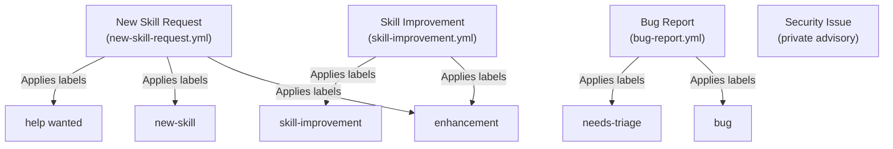
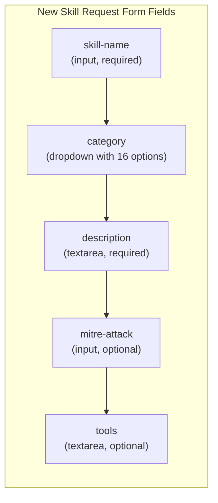
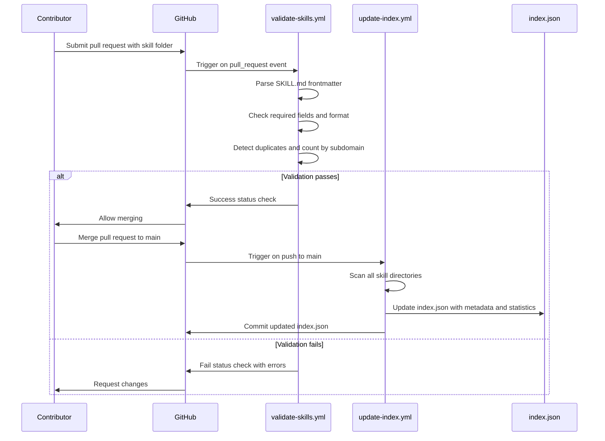
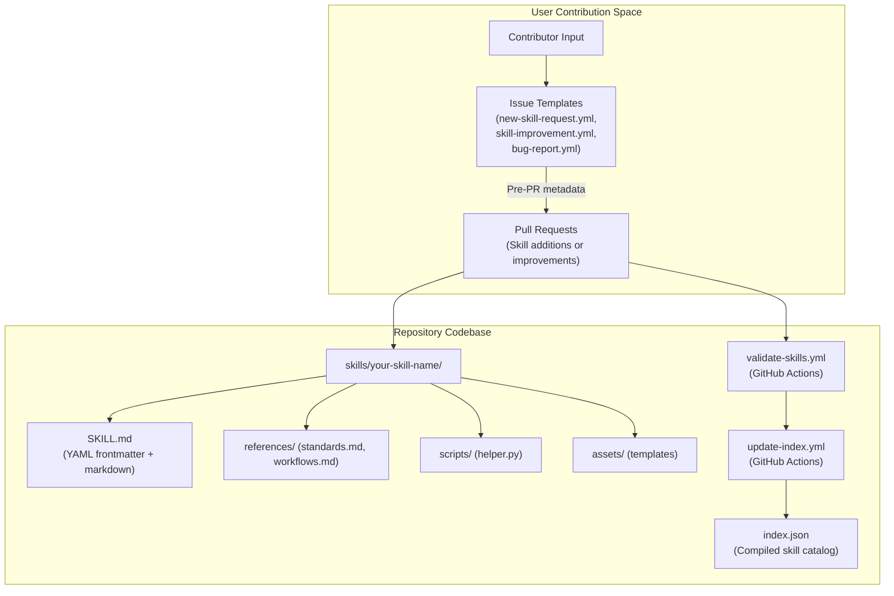
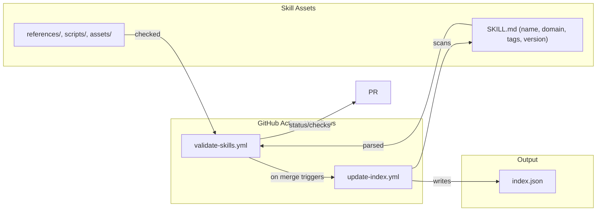

<!-- source: DeepWiki mcp.deepwiki.com · repo mukul975/Anthropic-Cybersecurity-Skills · page 7 Contributing · fetched 2026-10-26 -->

# Contributing

<details>
<summary>Relevant source files</summary>

The following files were used as context for generating this wiki page:

- [.github/ISSUE_TEMPLATE/bug-report.yml](.github/ISSUE_TEMPLATE/bug-report.yml)
- [.github/ISSUE_TEMPLATE/config.yml](.github/ISSUE_TEMPLATE/config.yml)
- [.github/ISSUE_TEMPLATE/new-skill-request.yml](.github/ISSUE_TEMPLATE/new-skill-request.yml)
- [.github/ISSUE_TEMPLATE/skill-improvement.yml](.github/ISSUE_TEMPLATE/skill-improvement.yml)
- [CONTRIBUTING.md](CONTRIBUTING.md)
- [LICENSE](LICENSE)

</details>


This page outlines the high-level contribution framework for the Anthropic Cybersecurity Skills repository, enabling community members to add new skills, enhance existing ones, and report bugs or issues. Contributions must adhere to standardized skill structures, metadata conventions, and quality guidelines to maintain consistency across the collection of 817 cybersecurity capabilities spanning 29 subdomains.

Detailed procedures and technical requirements for each contribution aspect are covered in dedicated child pages linked below:

- [Contribution Guidelines](#7.1) — Skill structure, naming conventions, quality checklist, and PR process.
- [Issue Templates](#7.2) — Structured GitHub issue templates for bug reports, skill improvements, and new skill requests.
- [Skill Development Workflow](#7.3) — End-to-end process from idea through PR merge including validation and index updates.

---

## Contribution Pathways

Contributors can engage via multiple purpose-driven pathways, which utilize structured GitHub issue templates and apply workflow labels for maintainers:

| Contribution Type       | Goal                                  | GitHub Issue Template                | Labels Applied                    |
|------------------------|--------------------------------------|------------------------------------|---------------------------------|
| New Skill Request       | Propose a new cybersecurity skill    | `.github/ISSUE_TEMPLATE/new-skill-request.yml`  | `enhancement`, `new-skill`, `help wanted` |
| Skill Improvement      | Suggest edits or updates to existing skills | `.github/ISSUE_TEMPLATE/skill-improvement.yml` | `enhancement`, `skill-improvement`       |
| Bug Report             | Report validation errors or broken scripts | `.github/ISSUE_TEMPLATE/bug-report.yml`         | `bug`, `needs-triage`                      |
| Security Issue         | Privately disclose security vulnerabilities | GitHub Security Advisory (private)  | N/A                                 |

Each issue template enforces structured inputs to capture all necessary data for precise triage and processing by maintainers.

### Association Between Templates and Labels



**Sources:** [.github/ISSUE_TEMPLATE/new-skill-request.yml:1-59](), [.github/ISSUE_TEMPLATE/skill-improvement.yml:1-42](), [.github/ISSUE_TEMPLATE/bug-report.yml:1-51](), [.github/ISSUE_TEMPLATE/config.yml:1-9]()  

---

## Issue Template Architecture

The issue templates leverage GitHub's YAML form schema to create user-friendly, structured submission forms. They gather required metadata to ensure contributions are actionable and properly categorized.

### Example Form Field Breakdown for New Skill Request



**Key Points:**

- Names require kebab-case gerund style (e.g., `analyzing-network-traffic-with-wireshark`).
- Category dropdown aligns with cybersecurity domains for taxonomy consistency.
- Descriptions fuel agent discovery and classification.
- Optional fields enable linking to MITRE ATT&CK techniques and toolsets.

The skill improvement and bug report templates follow similar structured patterns tailored for their use cases.

**Sources:** [.github/ISSUE_TEMPLATE/new-skill-request.yml:10-59](), [.github/ISSUE_TEMPLATE/skill-improvement.yml:7-41](), [.github/ISSUE_TEMPLATE/bug-report.yml:10-51]()  

---

## Skill Structure and Validation Overview

Skills are packaged in standardized directories under `skills/` containing a `SKILL.md` file with required YAML frontmatter metadata and detailed Markdown instructions, optionally supplemented by reference documents, scripts, and assets.

### Skill Directory Layout

```
skills/
└── your-skill-name/
    ├── SKILL.md              (required YAML frontmatter + markdown)
    ├── references/           (optional)
    │   ├── standards.md      (cve, mitre, nist links)
    │   └── workflows.md      (detailed procedures)
    ├── scripts/              (optional, e.g., helper scripts)
    └── assets/               (optional templates, checklists)
```

### YAML Frontmatter Required Fields

| Field       | Description                             | Constraints                         |
|-------------|---------------------------------------|-----------------------------------|
| `name`      | Lowercase kebab-case unique skill ID  | 1–64 characters, gerund style     |
| `description` | Clear summary and discovery keywords | Multi-line text                   |
| `domain`    | Must be `"cybersecurity"`              | Fixed string                     |
| `subdomain` | One of 29 cybersecurity categories    | Controlled vocabulary             |
| `tags`      | List of relevant tools, frameworks     | Array of strings                 |
| `version`   | Semantic versioning (e.g., "1.0")      | String                          |
| `author`    | GitHub username of contributor         | String                          |
| `license`   | Must be `"Apache-2.0"`                  | Fixed string                    |

### Markdown Sections for Skill Description

- `## When to Use` — Conditions triggering the skill.
- `## Prerequisites` — Setup or permissions required.
- `## Workflow` — Numbered real commands steps.
- `## Key Concepts` — Tabular explanation of terms.
- `## Tools & Systems` — Tools covered in detail.
- `## Common Scenarios` — Practical use cases.
- `## Output Format` — Expected outputs or results.

---

## Contribution Validation and Indexing Pipeline

To maintain high quality and consistency, each contribution triggers automated GitHub Actions workflows for validation and indexing:



This CI/CD pipeline ensures merged skills are structurally compliant and immediately reflected in the central skill catalog consumed by 26+ AI platforms.

**Sources:** [CONTRIBUTING.md:1-75]()  

---

## Quality Assurance Checklist

Before submitting contributions, ensure your skill meets the repository's quality standards:

- Name is lowercase kebab-case (1–64 chars), in gerund form.
- Description is clear, includes keywords for agent skill discovery.
- Instructions contain executable commands and real tool references.
- Domain is `"cybersecurity"` with an accurate subdomain selected.
- Tags include relevant tools, MITRE ATT&CK technique IDs, and frameworks.
- License is set to `"Apache-2.0"` ensuring compatibility.
- PR follows proper submission title format (`Add skill: your-skill-name` or `Improve skill: skill-name`).

The automatic validation workflow enforces many of these rules but content accuracy and clarity remain the contributor's responsibility.

**Sources:** [CONTRIBUTING.md:36-42,73-74]()  

---

## Pull Request Submission Process

When ready to contribute:

1. Create a new directory for the skill under `skills/` with a valid `SKILL.md`.
2. Add optional support files if needed (`references/`, `scripts/`, `assets/`).
3. Submit a pull request with an appropriate title.
4. The `validate-skills.yml` workflow runs automatically and provides feedback.
5. On passing validation, maintainers review for content quality and merge.
6. Once merged, `update-index.yml` regenerates the central `index.json` catalog automatically.

This process keeps the skill library up-to-date, vetted, and consumable by all integrated AI agent platforms using the agentskills.io specification.

**Sources:** [CONTRIBUTING.md:34]()  

---

## Code of Conduct and Licensing

All contributors must adhere to the [Contributor Covenant](CODE_OF_CONDUCT.md) which fosters a respectful community environment.

By contributing, you agree to license your work under Apache-2.0, consistent with the project's open-source licensing model, ensuring rights are granted for free use, modification, and redistribution across platforms.

**Sources:** [CONTRIBUTING.md:70-74](), [LICENSE]()  

---

# Bridging Natural Language Skill Contributions to Code Entities

The following diagrams illustrate how natural language contributions and related metadata map to code entities within the repository. This helps contributors understand the relationships between GitHub workflows, issue templates, skill files, and the generated catalogs.





These diagrams demonstrate the linkage from natural language input via GitHub forms and markdown skill files to automated validation, indexing, and final consumption by AI agent integration plugins.

---

For detailed instructions and technical specifications related to all aspects of contributing, please consult the child pages:

- [Contribution Guidelines](#7.1)
- [Issue Templates](#7.2)
- [Skill Development Workflow](#7.3)

---

