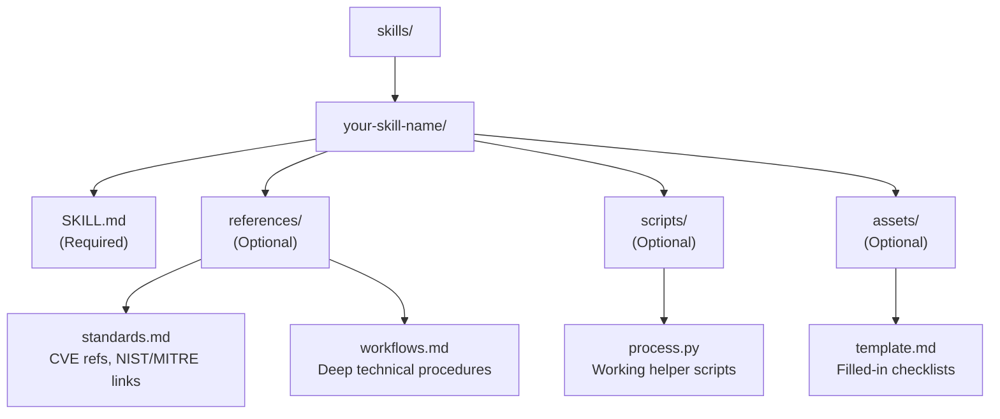
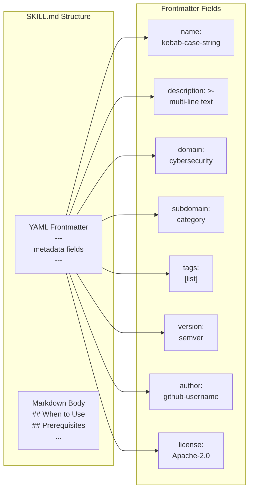
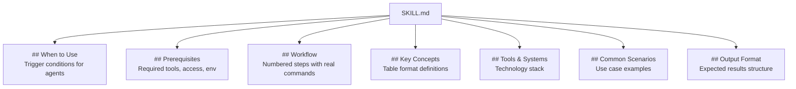
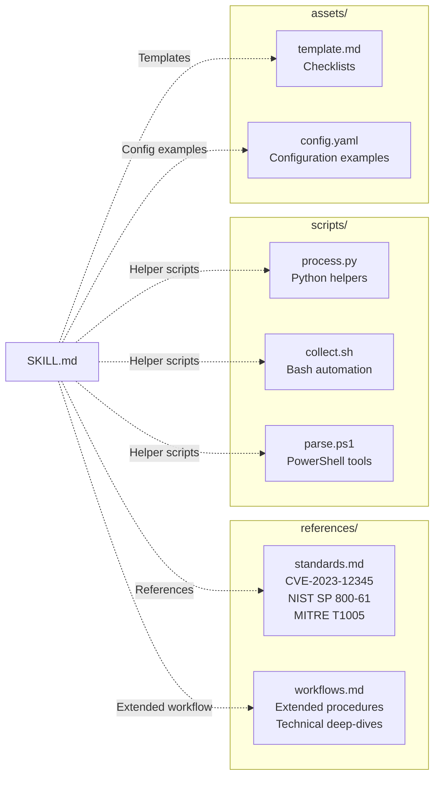
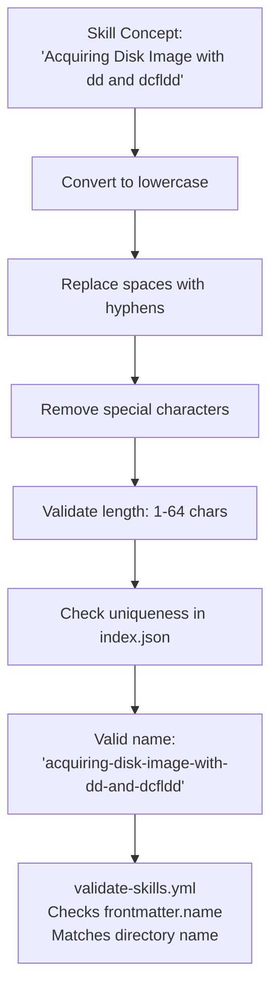
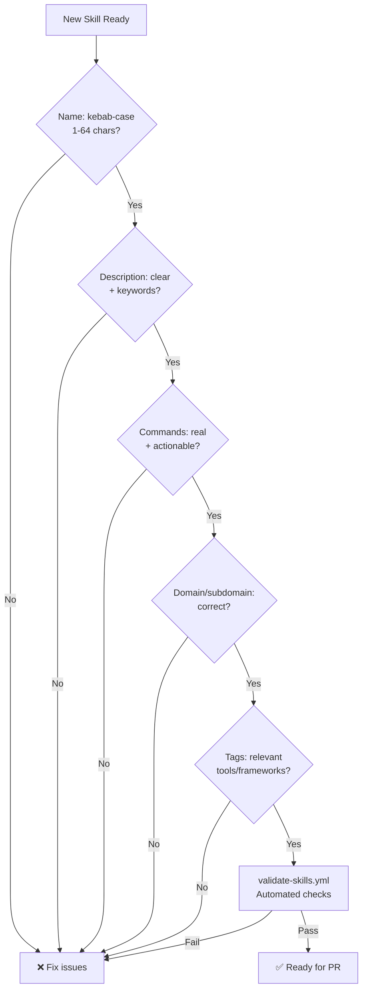
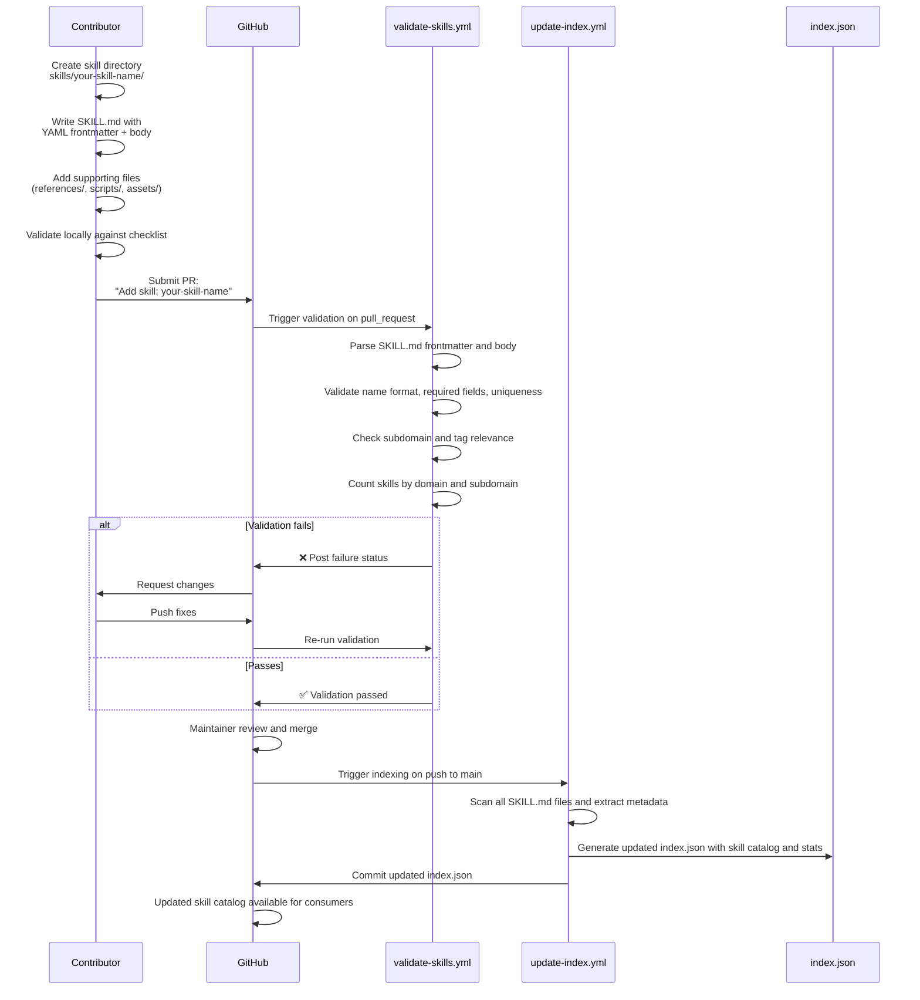
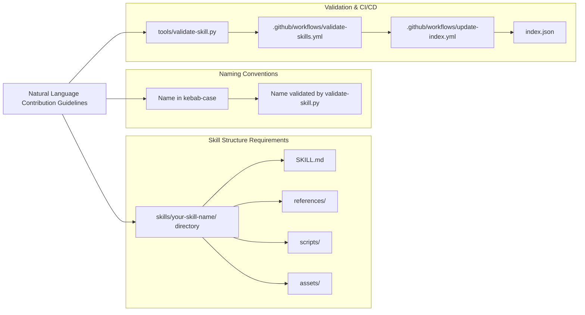
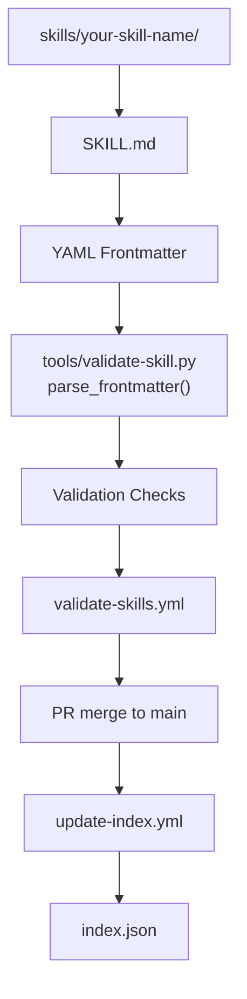

<!-- source: DeepWiki mcp.deepwiki.com · repo mukul975/Anthropic-Cybersecurity-Skills · page 7.1 Contribution Guidelines · fetched 2026-10-26 -->

# Contribution Guidelines

<details>
<summary>Relevant source files</summary>

The following files were used as context for generating this wiki page:

- [CONTRIBUTING.md](CONTRIBUTING.md)
- [LICENSE](LICENSE)
- [tools/README.md](tools/README.md)
- [tools/validate-skill.py](tools/validate-skill.py)

</details>


This document details the technical requirements, structure, and quality standards for contributing skills to the Anthropic-Cybersecurity-Skills repository. It covers skill directory structure, YAML frontmatter specifications, Markdown body requirements, naming conventions, quality checklists, and the pull request (PR) submission workflow.

Contributors should carefully follow these guidelines to ensure their contributions integrate smoothly with the automated validation, indexing workflows, and the agentskills.io standard used by the repository.

---

## Skill Directory Structure

Each skill must conform to a standardized directory layout. This consistency enables automated validation (`validate-skills.yml` workflow), automated indexing (`update-index.yml` workflow), and supports plugin marketplace packaging.

### Directory Layout



- `SKILL.md` is mandatory and holds the main skill definition including YAML frontmatter and Markdown content.
- `references/` may include `standards.md` and `workflows.md` for documenting relevant compliance standards and extended workflow details.
- `scripts/` hosts working helper scripts (Python, shell, PowerShell, etc.).
- `assets/` contains templates, checklists, or config examples.

**Sources:** [CONTRIBUTING.md:5-33]()

### File Organization Rules

| Component                  | Status      | Purpose                                          | Location                                |
|----------------------------|-------------|------------------------------------------------|----------------------------------------|
| `SKILL.md`                | **Required** | Primary skill definition with YAML frontmatter + Markdown body | `skills/your-skill-name/SKILL.md`      |
| `references/`             | Optional     | Standards documentation, CVE references, NIST/MITRE links   | `skills/your-skill-name/references/`   |
| `references/standards.md` | Optional     | Real standard numbers and compliance references                  | `skills/your-skill-name/references/standards.md` |
| `references/workflows.md` | Optional     | Deep technical procedures and extended workflows                 | `skills/your-skill-name/references/workflows.md` |
| `scripts/`                | Optional     | Working helper scripts (executable code)                          | `skills/your-skill-name/scripts/`      |
| `assets/`                 | Optional     | Templates, checklists, configuration examples                    | `skills/your-skill-name/assets/`       |

**Sources:** [CONTRIBUTING.md:29-33]()

---

## YAML Frontmatter Requirements

Every `SKILL.md` file must begin with YAML frontmatter enclosed by triple dashes (`---`) containing standardized metadata fields. These fields drive the skills catalog (`index.json`) and validation workflows.

### Required Frontmatter Schema



### Field Specifications

| Field       | Type             | Validation                                    | Purpose                                          |
|-------------|------------------|-----------------------------------------------|--------------------------------------------------|
| `name`      | `string`          | 1-64 chars, lowercase, hyphen-separated (kebab-case) | Unique skill identifier matching directory name  |
| `description`| `multiline string` | Minimum 50 characters, includes agent-discovery keywords | Skill purpose and activation criteria            |
| `domain`    | `string`          | Must be exactly `cybersecurity`                 | Top-level skill categorization (fixed value)     |
| `subdomain` | `string`          | Must match one of the 24 accepted subdomains   | Secondary categorization for taxonomy and mapping|
| `tags`      | `array[string]`    | At least 2 relevant tags                        | Search keywords, framework references, tools     |
| `version`   | `string`          | Semantic versioning format (e.g. "1.0")         | Skill version control                             |
| `author`    | `string`          | GitHub username of contributor                  | Attribution                                      |
| `license`   | `string`          | Must be `Apache-2.0`                            | Legal licensing requirement                       |

### Frontmatter Example

```yaml
---
name: your-skill-name
description: >-
  Clear description of what this skill does and when
  an AI agent should activate it. Include keywords.
domain: cybersecurity
subdomain: [category]
tags: [tag1, tag2, tag3]
version: "1.0"
author: your-github-username
license: Apache-2.0
---
```

**Sources:** [CONTRIBUTING.md:6-19, 37-41]()

---

## Markdown Body Structure

After the YAML frontmatter, the Markdown body must include specific sections to provide comprehensive, actionable information for AI agents and users.

### Required Sections



### Section Requirements

| Section               | Format             | Content Requirements                                               |
|-----------------------|--------------------|-------------------------------------------------------------------|
| `## When to Use`      | Prose              | Clear activation criteria outlining when AI agents should invoke the skill |
| `## Prerequisites`    | List               | Required tools, credentials, environment or system access details |
| `## Workflow`         | Numbered list      | Step-by-step instructions with **real commands**, no placeholders  |
| `## Key Concepts`     | Table              | Definitions of key terms and concepts used in the skill           |
| `## Tools & Systems`  | List               | Names and versions of involved tools, systems, or frameworks      |
| `## Common Scenarios` | Prose/List         | Typical use cases or scenarios demonstrating skill utility        |
| `## Output Format`    | Code blocks/Tables | Expected output format and structure examples                      |

### Command Authenticity Requirement

Workflow steps **must use real, executable commands** referencing genuine tool names to ensure practical applicability.

- **✅ Correct example:**
  ```bash
  dcfldd if=/dev/sda of=/mnt/evidence/disk.dd hash=md5,sha256 hashlog=/mnt/evidence/disk.dd.log bs=64K conv=noerror,sync
  ```
- **❌ Incorrect example:**
  ```bash
  [tool-name] [source] [destination] [options]
  ```

**Sources:** [CONTRIBUTING.md:21-28, 39]()

---

## Supporting Files Structure

Skills can include optional supplementary files in well-defined subdirectories to enhance technical clarity and automation.

### File Type Mapping



### Supporting File Guidelines

| Directory           | File Types            | Content Standards                                              |
|---------------------|-----------------------|----------------------------------------------------------------|
| `references/`       | Markdown              | Real standard references (NIST SP 800, CVEs, MITRE ATT&CK IDs)  |
| `scripts/`          | `.py`, `.sh`, `.ps1`  | Fully executable helper scripts with error handling and docs    |
| `assets/`           | `.md`, `.yaml` etc.   | Real filled-in templates, checklists, examples (no placeholders) |

**Sources:** [CONTRIBUTING.md:29-33]()

---

## Naming Conventions

Skill names must be kebab-case (lowercase, hyphen-separated), of length 1 to 64 characters, and must correspond exactly to your directory name and the `name` field in YAML.

### Naming Rules Flow



### Validation Criteria

| Rule                | Specification                        | Example                                           |
|---------------------|-----------------------------------|--------------------------------------------------|
| Case                | Lowercase only                    | `acquiring-disk-image` ✅ / `Acquiring-Disk-Image` ❌ |
| Separator           | Hyphens only (kebab-case)         | `disk-image-acquisition` ✅ / `disk_image_acquisition` ❌ |
| Length              | Length 1-64 characters            | `a` to max `64-char-name` valid; longer names fail |
| Characters          | Alphanumeric + hyphens only       | `api-security-test` ✅ / `api-security-test!` ❌    |
| Uniqueness          | No duplicates in repo             | Handled by automated validator                     |

**Sources:** [CONTRIBUTING.md:37]()

---

## Quality Checklist

Before submitting a PR, contributors must run validation to ensure their skill meets all quality criteria enforced by the `validate-skills.yml` GitHub Actions workflow.

### Pre-Submission Validation Flowchart



### Checklist Items Validated by CI

- [ ] Skill `name` is lowercase kebab-case, 1-64 characters
- [ ] Description is clear, at least 50 characters, includes keywords
- [ ] Workflow steps contain real, executable commands with actual tools
- [ ] `domain` is `cybersecurity`, `subdomain` is a valid predefined category
- [ ] Tags include relevant tools, frameworks, and techniques references

**Sources:** [CONTRIBUTING.md:36-41](), [tools/validate-skill.py:1-200]()

---

## Subdomain Selection and Validation

Skills must be categorized under one of the predefined 24 cybersecurity subdomains. This ensures consistent taxonomy for framework mappings like NIST CSF 2.0 and MITRE ATT&CK.

### Subdomain Categories Overview

```mermaid
graph TD
    Root["24 Subdomains"]
    
    subgraph "Application Security"
        Web["web-application-security"]
        API["api-security"]
        Mobile["mobile-security"]
    end
    
    subgraph "Infrastructure Security"
        Network["network-security"]
        Cloud["cloud-security"]
        Container["container-security"]
        Endpoint["endpoint-security"]
    end
    
    subgraph "Offensive Security"
        Pentest["penetration-testing"]
        RedTeam["red-teaming"]
        ThreatHunt["threat-hunting"]
    end
    
    subgraph "Defensive Security"
        SOC["soc-operations"]
        IR["incident-response"]
        Phish["phishing-defense"]
        Ransomware["ransomware-defense"]
    end
    
    subgraph "Analysis & Intelligence"
        Forensics["digital-forensics"]
        Malware["malware-analysis"]
        ThreatIntel["threat-intelligence"]
    end
    
    subgraph "Governance & Compliance"
        IAM["identity-access-management"]
        Compliance["compliance-governance"]
        VulnMgmt["vulnerability-management"]
    end
    
    subgraph "Specialized Domains"
        Crypto["cryptography"]
        ZeroTrust["zero-trust-architecture"]
        OTICS["ot-ics-security"]
        DevSecOps["devsecops"]
    end
    
    Root --> Web
    Root --> API
    Root --> Mobile
    Root --> Network
    Root --> Cloud
    Root --> Container
    Root --> Endpoint
    Root --> Pentest
    Root --> RedTeam
    Root --> ThreatHunt
    Root --> SOC
    Root --> IR
    Root --> Phish
    Root --> Ransomware
    Root --> Forensics
    Root --> Malware
    Root --> ThreatIntel
    Root --> IAM
    Root --> Compliance
    Root --> VulnMgmt
    Root --> Crypto
    Root --> ZeroTrust
    Root --> OTICS
    Root --> DevSecOps
```



### Subdomain Reference Table

| Subdomain                  | Focus Area                                      | Example Skills                  |
|----------------------------|------------------------------------------------|--------------------------------|
| `web-application-security` | Web app vulnerability testing, OWASP Top 10   | SQL injection, XSS             |
| `network-security`          | Network monitoring, firewalls                   | Wireshark, segmentation        |
| `penetration-testing`       | Ethical hacking techniques                      | Metasploit, exploit dev        |
| `red-teaming`               | Adversary simulation                            | C2 infrastructure, lateral moves|
| `digital-forensics`         | Evidence collection and analysis                | Disk imaging, timeline analysis|
| `malware-analysis`          | Reverse engineering and behavior analysis       | Static analysis, sandboxing    |
| `threat-intelligence`       | Tracking threat actors and indicators           | OSINT, TTP mappings            |
| `cloud-security`            | Cloud platform security                          | IAM policies, S3 auditing      |
| `container-security`        | Docker, Kubernetes security                      | Image scanning, runtime sec    |
| `identity-access-management`| IAM systems and privilege management            | SSO configuration, privilege  |
| `cryptography`              | Encryption and key management                    | TLS config, certificates       |
| `vulnerability-management` | Vulnerability scanning and patching             | CVE tracking, risk priorit.   |
| `compliance-governance`     | Regulatory compliance, risk management           | GDPR, audit logging            |
| `zero-trust-architecture`  | Zero-trust security models                       | Micro-segmentation, identity   |
| `ot-ics-security`           | Operational technology and ICS                    | SCADA security, OT monitoring  |
| `devsecops`                 | Security in CI/CD pipelines                      | SAST/DAST integration          |
| `soc-operations`            | Security operations center workflows             | SIEM, alert triage             |
| `incident-response`         | Incident containment and recovery                 | Root cause, forensics          |
| `phishing-defense`          | Anti-phishing techniques                          | Email analysis, simulations    |
| `ransomware-defense`        | Ransomware detection and prevention               | Backup validation, detection   |
| `api-security`              | API authentication, input validation              | OAuth, rate limiting           |
| `mobile-security`           | Mobile app security testing                       | Reverse engineering            |
| `endpoint-security`         | Endpoint detection and response                   | EDR rules, host forensics     |
| `threat-hunting`            | Proactive threat discovery                        | Behavioral analysis            |

**Sources:** [CONTRIBUTING.md:43-68](), [tools/validate-skill.py:18-62]()

---

## Submission Process

The pull request (PR) workflow ensures submitted skills comply with all repository standards before merge and indexing.

### Contribution Workflow Sequence



**Sources:** [CONTRIBUTING.md:34]()

### PR Title Format

PR titles must strictly follow:

```
Add skill: your-skill-name
```

Where `your-skill-name` matches exactly the skill directory and `name` in frontmatter.

**Sources:** [CONTRIBUTING.md:34]()

### Post-Merge Automation Details

- The `update-index.yml` GitHub Action scans all skill directories in `skills/`.
- It parses and extracts YAML frontmatter metadata from each `SKILL.md`.
- Aggregates total skill count and subdomain distribution.
- Generates/upserts `index.json` in repository root, reflecting new skill catalog state.
- Commits and pushes the updated index automatically to keep the catalog current without manual intervention.

**Sources:** [CONTRIBUTING.md:34]()

---

## Governance and Licensing

All contributions must adhere to the project’s governance and legal standards.

### Contributor Agreement

By submitting contributions, contributors agree to:

- Comply with the repository’s [Contributor Covenant Code of Conduct](CODE_OF_CONDUCT.md).
- License all contributed content under the Apache License 2.0.

### Automated Enforcement

Validation workflows confirm `license: Apache-2.0` compliance in `SKILL.md` frontmatter on every commit and PR.

**Sources:** [CONTRIBUTING.md:70-74]()

---

# Bridging Natural Language to Code Entities Diagrams

## Diagram 1: Mapping Natural Language Contribution Guidelines to Code Entities



## Diagram 2: Data Flow from SKILL.md Frontmatter to Skill Catalog Index



---

This page fully details the contribution guidelines for Anthropic-Cybersecurity-Skills, ensuring contributors understand the required skill structure, naming conventions, quality checks, and the submission lifecycle to maintain a high-quality, consistent, and automatable skill repository.

---

**Sources:**  
- [CONTRIBUTING.md:1-75]()  
- [tools/validate-skill.py:1-186]()  
- [tools/README.md:1-31]()

---

