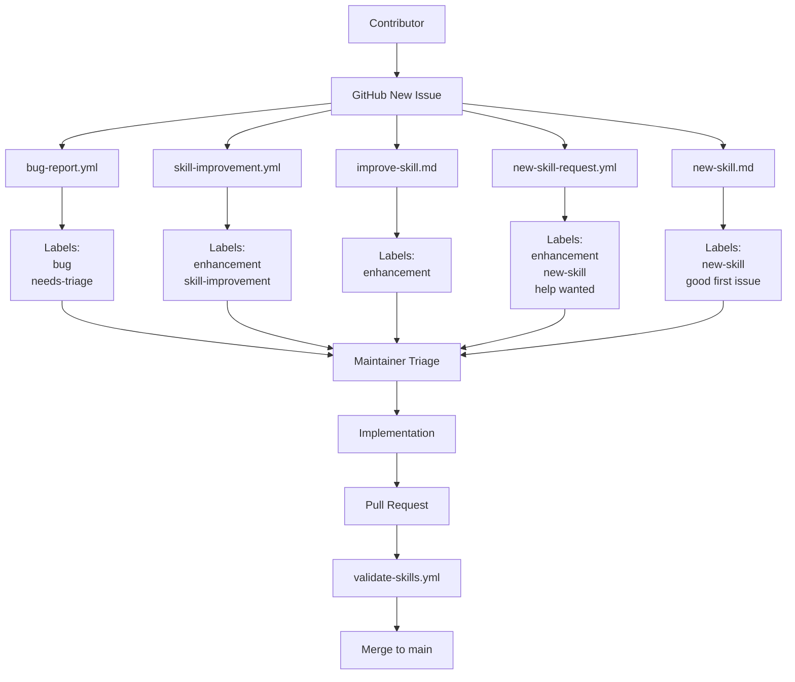
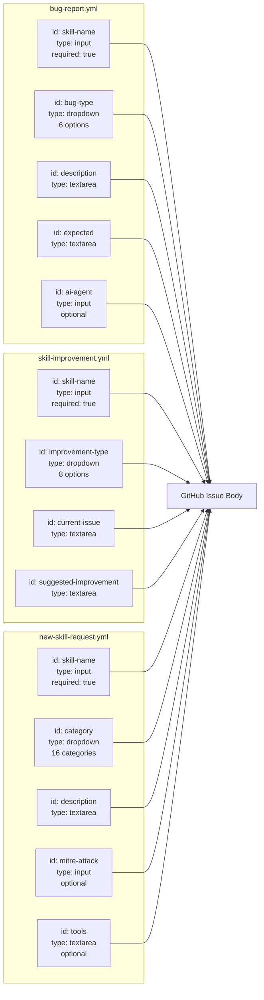
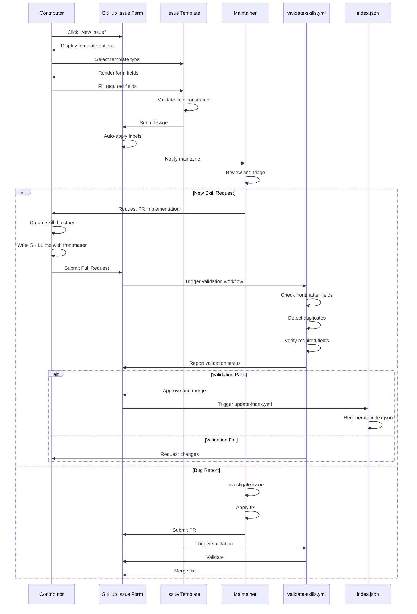

<!-- source: DeepWiki mcp.deepwiki.com · repo mukul975/Anthropic-Cybersecurity-Skills · page 7.2 Issue Templates · fetched 2026-10-26 -->

# Issue Templates

Relevant source files

The following files were used as context for generating this wiki page:

- [.github/ISSUE_TEMPLATE/bug-report.yml](.github/ISSUE_TEMPLATE/bug-report.yml)
- [.github/ISSUE_TEMPLATE/config.yml](.github/ISSUE_TEMPLATE/config.yml)
- [.github/ISSUE_TEMPLATE/new-skill-request.yml](.github/ISSUE_TEMPLATE/new-skill-request.yml)
- [.github/ISSUE_TEMPLATE/skill-improvement.yml](.github/ISSUE_TEMPLATE/skill-improvement.yml)

This page provides a high-level overview of the structured issue templates used in the Anthropic Cybersecurity Skills repository. These templates guide community contributions by standardizing bug reports, skill improvement suggestions, and new skill requests. They help ensure consistent metadata capture, automated labeling, and streamlined triage and processing in the contribution workflow.

For in-depth details on each template type—including fields, category options, and their submission flow—please consult the respective child pages:  
- [Bug Report Template](#7.2.1)  
- [Skill Improvement Templates](#7.2.2)  
- [New Skill Request Templates](#7.2.3)  
- [Issue Template Configuration](#7.2.4)

---

## Template System Overview

The repository employs GitHub issue forms defined in YAML format to enforce validated inputs such as required fields, dropdown selections, and automatic label application. Contributors can choose the appropriate template when opening a new issue, simplifying the capture of all necessary information upfront.

Supported contribution issue types and formats include:

*Diagram: Issue Template Routing System*

This multi-format approach supports contributors preferring either structured YAML forms or more flexible Markdown templates, both integrating seamlessly into the maintainers' workflow.

Sources:  
[.github/ISSUE_TEMPLATE/bug-report.yml](), [.github/ISSUE_TEMPLATE/skill-improvement.yml](), [.github/ISSUE_TEMPLATE/new-skill-request.yml](), [.github/ISSUE_TEMPLATE/improve-skill.md](), [.github/ISSUE_TEMPLATE/new-skill.md]()

---

## Template Types and Auto-Labeling

Each template type auto-applies labels to assist maintainers in triage and prioritization. The main template categories are summarized below:

| Template File           | Contribution Type                             | Auto-Applied Labels                 | Required Fields                          |
|------------------------|----------------------------------------------|-----------------------------------|------------------------------------------|
| `bug-report.yml`       | Report validation errors, broken scripts, or incorrect content | `bug`, `needs-triage`             | `skill-name`, `bug-type`, `description`, `expected` |
| `skill-improvement.yml`| Suggest improvements to existing skills      | `enhancement`, `skill-improvement`| `skill-name`, `improvement-type`, `current-issue`, `suggested-improvement` |
| `improve-skill.md`     | Alternative skill improvement template (Markdown) | `enhancement`                    | Freeform                                 |
| `new-skill-request.yml`| Request new skill with structured metadata   | `enhancement`, `new-skill`, `help wanted` | `skill-name`, `category`, `description` |
| `new-skill.md`         | Alternative new skill request (Markdown)     | `new-skill`, `good first issue`   | Freeform                                 |

Sources:  
[.github/ISSUE_TEMPLATE/bug-report.yml:4](), [.github/ISSUE_TEMPLATE/skill-improvement.yml:4](), [.github/ISSUE_TEMPLATE/new-skill-request.yml:4](), [.github/ISSUE_TEMPLATE/improve-skill.md:5](), [.github/ISSUE_TEMPLATE/new-skill.md:5]()

---

## YAML Form Structures and Fields

The YAML forms leverage GitHub's issue forms feature to enforce data consistency. Below is a mapping of form fields to their respective templates and purpose:

*Diagram: YAML Form Field Mapping*

Common field types:

- **Input Fields**  
  - `skill-name` (required skill directory name, kebab-case)  
  - `mitre-attack` (optional, technique IDs like T1059)  
  - `ai-agent` (optional, AI platform used)  

- **Dropdown Fields**  
  - `bug-type` (six predefined bug categories)  
  - `improvement-type` (eight types of improvements)  
  - `category` (sixteen cybersecurity domains)  

- **Textarea Fields**  
  - Multi-line freeform descriptions for issues, improvements, and requests  

Sources:  
[.github/ISSUE_TEMPLATE/bug-report.yml:10-50](), [.github/ISSUE_TEMPLATE/skill-improvement.yml:6-41](), [.github/ISSUE_TEMPLATE/new-skill-request.yml:10-58]()

---

## Overview of Bug Report Template

The bug report template captures issues such as validation errors, broken or incorrect scripts, missing files, and metadata errors, categorized as:

| Bug Type                     | Description                                        | Example                                                    |
|------------------------------|--------------------------------------------------|------------------------------------------------------------|
| SKILL.md validation error    | Frontmatter fails automated validation checks    | Missing required fields, invalid YAML                       |
| Broken/incorrect script      | Scripts in `scripts/` directory fail to execute   | Python import errors, shell syntax problems                 |
| Wrong instructions/commands  | Workflow steps produce incorrect or outdated results | Deprecated flags, wrong commands                            |
| Missing required files       | Expected files or assets are absent                | Missing `SKILL.md`, absent script files                      |
| Incorrect metadata/frontmatter| Metadata fields inaccurate or inconsistent        | Wrong category, invalid MITRE technique IDs                  |
| Other                       | Miscellaneous issues not covered above             | Typos, corrupted asset files                                 |

The template automatically prefixes issue titles with `[Bug]: ` and applies the `bug` and `needs-triage` labels to route bug reports efficiently within the triage workflow.

Sources:  
[.github/ISSUE_TEMPLATE/bug-report.yml:1-51]()

---

## Skill Improvement Templates

Two templates enable contributors to suggest enhancements:

### YAML Form Template (`skill-improvement.yml`)

This form enforces structured input with predefined improvement categories such as:

- More accurate or updated instructions  
- Better workflow steps  
- Adding missing tools or commands  
- Enhancing agent discovery descriptions  
- Adding MITRE ATT&CK or NIST CSF mappings  
- Improving supporting scripts or assets  
- Fixing outdated content  

Required fields include the skill name, improvement type category, current issue description, and suggested improvement details. The title is prefixed with `[Improvement]: ` and issues are labeled `enhancement` and `skill-improvement`.

Sources:  
[.github/ISSUE_TEMPLATE/skill-improvement.yml:1-42]()

### Markdown Template (`improve-skill.md`)

Alternately, a checklist-style markdown template provides a flexible format with common improvement checkboxes, including placeholders for agent.py issues, incomplete API references, missing frontmatter fields, and ATT&CK mapping errors.

It is labeled `enhancement` and uses the title prefix `[IMPROVE]`.

Sources:  
[.github/ISSUE_TEMPLATE/improve-skill.md:1-20]()

---

## New Skill Request Templates

Contributors can request new cybersecurity skills through two formats:

### YAML Form Template (`new-skill-request.yml`)

Defines required metadata for skill proposals with fields:

- `skill-name`: Proposed skill directory name in kebab-case gerund form
- `category`: Dropdown covering 16 cybersecurity domains (e.g., Threat Detection, Cloud Security)
- `description`: Summary of skill capability for AI agents

Optional metadata includes MITRE ATT&CK technique IDs and key tools or commands to cover. The title is prefixed `[Skill Request]: ` and labels `enhancement`, `new-skill`, `help wanted` are applied.

Sources:  
[.github/ISSUE_TEMPLATE/new-skill-request.yml:1-59]()

### Markdown Template (`new-skill.md`)

This template offers predefined sections to describe the skill name, domain, description, relevant MITRE ATT&CK techniques, NIST CSF functions, and rationale. It is labeled `new-skill` and `good first issue` with a `[NEW SKILL]` title prefix.

Sources:  
[.github/ISSUE_TEMPLATE/new-skill.md:1-26]()

---

## Contribution Workflow Integration

The issue template system ties into the repository’s automated workflows, from initial submission to final merge:

*Diagram: Issue Template to Merge Workflow*

This ensures issues are captured with rich metadata that flow into `index.json` and `SKILL.md` frontmatter, supporting validation workflows and maintainers’ triage efficiency.

Sources:  
[.github/ISSUE_TEMPLATE/bug-report.yml](), [.github/ISSUE_TEMPLATE/new-skill-request.yml](), [.github/ISSUE_TEMPLATE/skill-improvement.yml]()

---

## Category and Domain Taxonomies in Templates

Taxonomic consistency is enforced through dropdown fields:

### Bug Report Categories

Map directly to validation failure modes and repository structure:

- SKILL.md validation errors correspond to frontmatter schema checks
- Script issues relate to the `scripts/` directory
- Missing files check for required skill components
- Metadata errors validate YAML frontmatter correctness

Sources:  
[.github/ISSUE_TEMPLATE/bug-report.yml:19-28]()

### Skill Improvement Categories

Cover key skill elements aligned with codebase structure:

- Enhancements related to MITRE ATT&CK or NIST CSF
- Workflow step corrections in `SKILL.md`
- Script or asset fixes in `scripts/` and `assets/`

Sources:  
[.github/ISSUE_TEMPLATE/skill-improvement.yml:16-25]()

### New Skill Categories

Dropdown options correspond to cybersecurity domains consistent with the 29 subdomains taxonomy used in skill organization, examples include:

| Template Category         | Corresponding Subdomain(s)                      |
|--------------------------|------------------------------------------------|
| Threat Detection         | threat-hunting, threat-intelligence             |
| Incident Response       | incident-response                                |
| Digital Forensics       | digital-forensics                                |
| Network Security        | network-security                                 |
| Cloud Security          | cloud-security                                   |
| Application Security    | web-application-security, secure-sdlc           |
| Malware Analysis        | malware-analysis                                 |
| OSINT                   | osint                                            |
| Zero Trust Architecture | zero-trust-architecture                          |
| OT/ICS Security         | ot-ics-security                                  |
| DevSecOps               | devsecops, ci-cd-security                        |
| Ransomware Defense      | ransomware-defense                               |
| Threat Intelligence     | threat-intelligence                              |

Sources:  
[.github/ISSUE_TEMPLATE/new-skill-request.yml:22-38]()

---

## Issue Template Configuration

The repository’s `.github/ISSUE_TEMPLATE/config.yml` disables blank issue creation to encourage structured reporting. It also sets up contact links for security vulnerability reporting and general discussions, guiding contributors on appropriate channels from the outset.

For full details, see [Issue Template Configuration](#7.2.4).

Sources:  
[.github/ISSUE_TEMPLATE/config.yml]()

---

For comprehensive details on each issue template, please visit their dedicated child pages:  
- [Bug Report Template](#7.2.1)  
- [Skill Improvement Templates](#7.2.2)  
- [New Skill Request Templates](#7.2.3)  
- [Issue Template Configuration](#7.2.4)

---

Sources:  
.github/ISSUE_TEMPLATE/bug-report.yml  
.github/ISSUE_TEMPLATE/skill-improvement.yml  
.github/ISSUE_TEMPLATE/new-skill-request.yml  
.github/ISSUE_TEMPLATE/improve-skill.md  
.github/ISSUE_TEMPLATE/new-skill.md  
.github/ISSUE_TEMPLATE/config.yml

---

