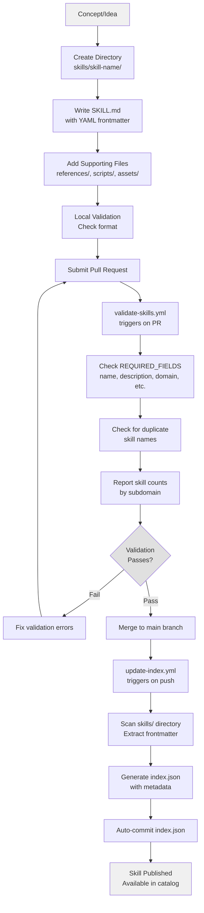
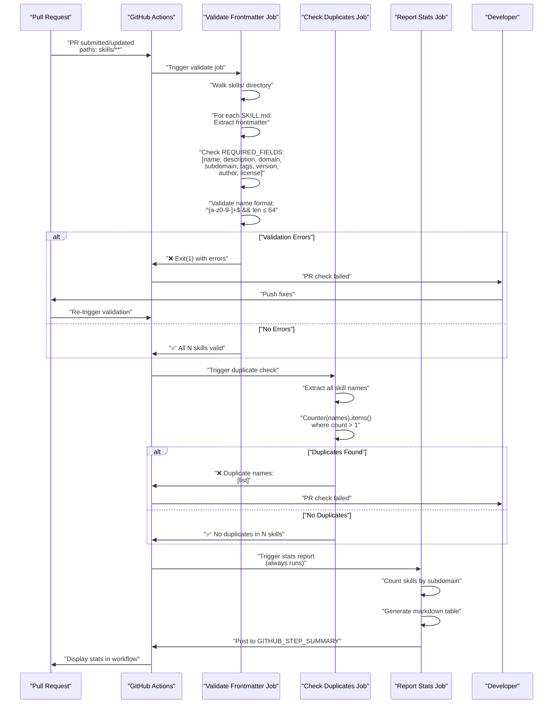
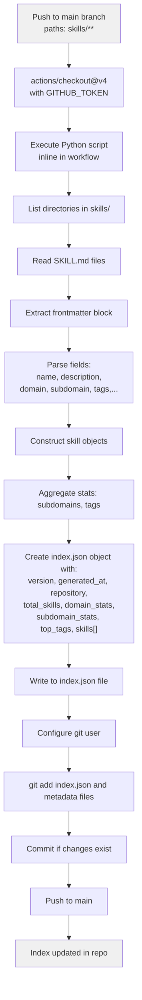

<!-- source: DeepWiki mcp.deepwiki.com · repo mukul975/Anthropic-Cybersecurity-Skills · page 7.3 Skill Development Workflow · fetched 2026-10-26 -->

# Skill Development Workflow

<details>
<summary>Relevant source files</summary>

The following files were used as context for generating this wiki page:

- [.claude-plugin/marketplace.json](.claude-plugin/marketplace.json)
- [.claude-plugin/plugin.json](.claude-plugin/plugin.json)
- [.github/workflows/sync-marketplace-version.yml](.github/workflows/sync-marketplace-version.yml)
- [.github/workflows/update-index.yml](.github/workflows/update-index.yml)
- [.github/workflows/validate-skills.yml](.github/workflows/validate-skills.yml)
- [CODE_OF_CONDUCT.md](CODE_OF_CONDUCT.md)
- [CONTRIBUTING.md](CONTRIBUTING.md)
- [LICENSE](LICENSE)
- [README.md](README.md)
- [tools/README.md](tools/README.md)
- [tools/validate-skill.py](tools/validate-skill.py)

</details>


This document provides a comprehensive, step-by-step guide for developing a new cybersecurity skill within the Anthropic Cybersecurity Skills repository. It covers the entire process from ideation and directory setup, through authoring and local validation, to automated CI/CD pipeline checks, pull request submission, and final index updates for publication.

For high-level contribution guidelines and structured issue templates, please see [Contribution Guidelines](#7.1) and [New Skill Request Templates](#7.2.3).

---

## Development Lifecycle Overview

The skill development workflow consists of a sequence of steps from the initial skill concept to final publication in the centralized skill index. It leverages GitHub Actions workflows for automated validation and index regeneration.



**Sources:** [CONTRIBUTING.md:1-75](), [.github/workflows/validate-skills.yml:1-129](), [.github/workflows/update-index.yml:1-93]()

---

## Step 1: Create Directory Structure

Each skill must have its own directory inside the top-level `skills/` folder. The directory name must be a unique kebab-case string matching the `name` field in the skill’s frontmatter.

**Directory Layout:**

```
skills/
└── your-skill-name/
    ├── SKILL.md              # Required: Markdown file defining the skill
    ├── references/           # Optional: Supporting docs (e.g. standards.md, workflows.md)
    ├── scripts/              # Optional: Helper scripts (e.g. process.py)
    └── assets/               # Optional: Templates, images, checklists
```

**Naming Constraints:**
- Lowercase ASCII letters, digits, and hyphens only
- Maximum length: 64 characters
- Must be unique (no duplicates)

This naming style and structure ensure consistency and ease of discovery across hundreds of skills.

**Sources:** [CONTRIBUTING.md:5-34]()

---

## Step 2: Write SKILL.md Frontmatter

The `SKILL.md` file starts with a YAML frontmatter block delimited by `---` lines, containing structured metadata necessary for validation and cataloging.

### Required Frontmatter Fields

| Field        | Type    | Validation                                     | Example                                 |
|--------------|---------|------------------------------------------------|-----------------------------------------|
| `name`       | string  | kebab-case, max 64 chars, unique across repo | `buffer-overflow-detection`            |
| `description`| string  | multi-line, ≥50 chars, includes keywords       | `Detect and analyze buffer overflow...`|
| `domain`     | string  | must be `"cybersecurity"`                      | `cybersecurity`                        |
| `subdomain`  | string  | one of the 29 accepted subdomains               | `web-application-security`             |
| `tags`       | array   | list of strings (tools, CVEs, technique IDs)    | `[burp-suite, fuzzing, T1203]`         |
| `version`    | string  | semantic version string                         | `"1.0"`                                |
| `author`     | string  | GitHub user handle of contributor              | `your-github-username`                  |
| `license`    | string  | must be `"Apache-2.0"`                          | `Apache-2.0`                           |

### Example Frontmatter

```yaml
---
name: buffer-overflow-detection
description: >-
  Detect and analyze buffer overflow vulnerabilities in compiled
  binaries using dynamic analysis and fuzzing techniques. Keywords:
  buffer overflow, memory corruption, fuzzing, exploitation.
domain: cybersecurity
subdomain: web-application-security
tags: [burp-suite, fuzzing, gdb, T1203, CWE-120]
version: "1.0"
author: your-github-username
license: Apache-2.0
---
```

### Validation Logic Summary

The `validate-skills.yml` GitHub Actions workflow runs on pull requests and pushes affecting skill files. It uses regex-based frontmatter extraction and validation logic to ensure:

- Frontmatter block exists
- All eight required fields are present
- `name` field matches `^[a-z0-9-]+$` and ≤ 64 characters
- No duplicate skill names exist in the entire repository

**Sources:** [CONTRIBUTING.md:6-19](), [.github/workflows/validate-skills.yml:16-68]()

---

## Step 3: Write Markdown Body

Following the frontmatter, author the skill’s instructional content using Markdown. The documentation must be clear, actionable, and structured to enable AI agents to understand and invoke the skill effectively.

### Recommended Sections

| Section          | Purpose                                     | Content notes                           |
|------------------|---------------------------------------------|-----------------------------------------|
| **When to Use**  | Conditions and scenarios for skill activation| Applicable use cases, triggers          |
| **Prerequisites**| Required tools, permissions, and knowledge  | Bullet points of requirements           |
| **Workflow**     | Step-by-step procedure to execute the skill | Numbered commands, shell snippets       |
| **Key Concepts** | Definitions of technical terms and concepts  | Markdown tables for clarity             |
| **Tools & Systems**| Software/platforms that the skill depends on| Versions, system requirements          |
| **Common Scenarios**| Real-world examples or contextual use     | Descriptions of applying the skill      |
| **Output Format**| Expected outcomes and how to interpret results| Sample output or evidence of success    |

### Example Workflow Content Snippet

```markdown
## Workflow

1. **Initialize fuzzing environment:**
   ```bash
   afl-fuzz -i testcases/ -o findings/ -- ./target-binary @@
   ```

2. **Monitor crash detection:**
   ```bash
   watch -n 1 'ls -lh findings/crashes/'
   ```

3. **Analyze crash with GDB:**
   ```bash
   gdb ./target-binary findings/crashes/id:000000
   ```
```

**Sources:** [CONTRIBUTING.md:21-28]()

---

## Step 4: Add Supporting Files

Supporting files enhance skill usability by providing context, references, or automation.

### references/

Contains detailed documentation references:

- `standards.md`: CVE IDs, NIST controls, MITRE ATT&CK technique links
- `workflows.md`: Expanded procedural documentation complementing SKILL.md

### scripts/

Executable helper scripts automating tasks described in the skill workflow. Scripts must be:

- Tested and working
- Include shebang and usage comments
- Python or shell scripts preferred for portability

Example snippet from `scripts/process.py`:
```python
#!/usr/bin/env python3
"""
Helper script for [skill-name]
Usage: python3 process.py <input-file>
"""

def main():
    # Implementation here
    pass

if __name__ == "__main__":
    main()
```

### assets/

Contains templates, checklists, configuration files, and media assets that support the skill.

**Sources:** [CONTRIBUTING.md:29-33]()

---

## Step 5: Local Validation

Before submitting a pull request, validate your skill locally to reduce CI errors and speed review.

### Validation Checklist

- `name`: kebab-case, unique, max 64 chars
- `description`: clear, ≥50 characters, contains keywords
- `domain`: must be `cybersecurity`
- `subdomain`: from allowed list of 29 subdomains
- `tags`: list with relevant tools and techniques
- Skill instructions contain executable commands
- Frontmatter YAML is syntactically correct

### Frontmatter Extraction Test

Test regular expression extraction with Python:

```python
import re

with open('skills/your-skill-name/SKILL.md', 'r') as f:
    content = f.read()

fm_match = re.match(r'^---\n(.*?)\n---', content, re.DOTALL)
if fm_match:
    print("✅ Frontmatter detected")
    print(fm_match.group(1))
else:
    print("❌ No frontmatter found")
```

This matches the automated frontmatter extraction used in the CI workflow.

**Sources:** [CONTRIBUTING.md:36-41](), [.github/workflows/validate-skills.yml:38-48]()

---

## Step 6: Submit Pull Request

Submit your skill addition or improvement as a GitHub PR against the `main` branch.

### PR Title Formats

| Change Type     | Format                     | Example                                  |
|-----------------|----------------------------|------------------------------------------|
| New Skill       | `Add skill: skill-name`    | `Add skill: buffer-overflow-detection`  |
| Skill Improvement| `Improve skill: skill-name` | `Improve skill: sql-injection-testing`  |
| Bug Fix         | `Fix: description`         | `Fix: missing tags in xss skill`         |

### PR Description Recommendations

- Short overview of the skill
- Subdomain category chosen
- Key tools and techniques covered
- Notes for reviewers (e.g., related frameworks, complexity)

**Sources:** [CONTRIBUTING.md:34]()

---

## Automated Validation Pipeline

Upon PR submission or update affecting skill files, the `validate-skills.yml` GitHub Actions workflow is triggered. It runs three main sequential jobs:



### Validation Job Details

- **Job 1: Validate Frontmatter**

  Walks the `skills/` directory, parses each `SKILL.md` frontmatter block, and verifies presence and format of required fields.

- **Job 2: Check Duplicate Names**

  Ensures no two skill directories share the same `name` field, preventing conflicts at runtime.

- **Job 3: Report Skill Statistics**

  Counts skills per subdomain and outputs a markdown table in the GitHub Actions UI summary to provide insight into the repo composition.

**Sources:** [.github/workflows/validate-skills.yml:1-129]()

---

## Automated Index Generation

On every push to `main` affecting skills, the `update-index.yml` GitHub Actions workflow regenerates the `index.json` catalog reflecting all published skills.



### Index Generation Script Highlights

- Reads all skill folders, skipping those without a valid `SKILL.md`
- Extracts frontmatter fields using regex and custom functions for fields and tags
- Collects statistics on subdomains and tags (top 20 tags)
- Produces a JSON object with metadata and full skill list
- Commits and pushes `index.json` only on changes to avoid unnecessary commits

**Relevant Snippets:**

```python
for skill_name in sorted(os.listdir(skills_dir)):
    skill_md = os.path.join(skills_dir, skill_name, "SKILL.md")
    if not os.path.isfile(skill_md):
        continue
    # Read and extract frontmatter here...

subdomain_counts[subdomain] += 1
tag_counter[tag] += 1

skills.append({
    "name": get_field("name", fm),
    "description": get_field("description", fm),
    "domain": "cybersecurity",
    # ...
    "path": f"skills/{skill_name}"
})

index = {
    "version": "1.1.0",
    "generated_at": datetime.now(timezone.utc).strftime("%Y-%m-%dT%H:%M:%SZ"),
    "repository": "https://github.com/mukul975/Anthropic-Cybersecurity-Skills",
    "total_skills": len(skills),
    "subdomain_stats": subdomain_counts,
    "top_tags": sorted_top_tags,
    "skills": skills
}
```

Git commit commands ensure proper user attribution and skip commit if no change is detected.

**Sources:** [.github/workflows/update-index.yml:1-93]()

---

## Merge and Publication

Once validation passes and maintainers approve, merge the PR to `main`. This triggers the index regeneration workflow, publishing the skill.

### Publication Flow and Timing

| Event                    | Timing           | Result                                     |
|--------------------------|------------------|--------------------------------------------|
| PR merge to `main`       | Immediate        | `update-index.yml` workflow starts          |
| Index regeneration script| Seconds after    | `index.json` rebuilt and committed          |
| Marketplace sync         | Minutes          | Skill count badges and metadata updated     |
| AI agent discovery       | Within minutes   | Skill becomes available for automated use   |

### Verifications Post-Merge

- Check Actions tab for successful `Update marketplace index` run
- Confirm your skill is listed in `index.json` under `skills`
- Review updated subdomain statistics
- Test AI agent progressive disclosure discovery on your skill

**Sources:** [.github/workflows/update-index.yml:3-8](), [.github/workflows/update-index.yml:86-92]()

---

## Common Development Errors

| Error Message                 | Cause                            | Solution                                       |
|------------------------------|---------------------------------|------------------------------------------------|
| `Missing YAML frontmatter`    | Absent or malformed frontmatter  | Add well-formed `---` frontmatter block        |
| `Missing required field 'tags'` | Required metadata missing      | Populate all required fields in frontmatter    |
| `Name must be kebab-case`     | Invalid characters in the name   | Use only lowercase letters, digits, hyphens    |
| `Name exceeds 64 characters`  | `name` is too long              | Shorten to 64 characters or fewer               |
| `Duplicate skill names found` | Another skill uses the same name | Choose a unique skill name                       |

| Issue                         | Symptom                         | Investigation                                 |
|-------------------------------|--------------------------------|-----------------------------------------------|
| Skill missing from index       | Skill not in `index.json`       | Verify if `SKILL.md` exists and is valid      |
| Incorrect subdomain count      | Stats mismatch in summary       | Check subdomain field matches allowed values  |
| Tags missing from top_tags     | Tag frequency lower than expected| Confirm correct tag spelling and repetition   |

**Sources:** [.github/workflows/validate-skills.yml:40-65](), [.github/workflows/update-index.yml:31-64]()

---

## Complete Development Example

### Creating a New Skill: `sql-injection-detection`

1. **Create directory and subdirs:**
   ```bash
   mkdir -p skills/sql-injection-detection/{references,scripts,assets}
   ```

2. **Create `SKILL.md`:**
   ```yaml
   ---
   name: sql-injection-detection
   description: >-
     Detect SQL injection vulnerabilities in web applications using
     automated scanners and manual testing techniques. Keywords: SQLi,
     database, injection, OWASP A03.
   domain: cybersecurity
   subdomain: web-application-security
   tags: [sqlmap, burp-suite, T1190, CWE-89, OWASP-A03]
   version: "1.0"
   author: your-username
   license: Apache-2.0
   ---

   ## When to Use
   When testing web applications for SQL injection vulnerabilities...

   ## Workflow

   1. Run automated scanner:
      ```bash
      sqlmap -u "$URL" --batch --level=3 --risk=2
      ```

   2. Validate findings manually with Burp Suite...

   ```
3. **Add helper script:**
   ```bash
   cat > skills/sql-injection-detection/scripts/scan.sh << 'EOF'
   #!/bin/bash
   sqlmap -u "$1" --batch --level=3 --risk=2
   EOF
   chmod +x skills/sql-injection-detection/scripts/scan.sh
   ```

4. **Create a Git branch, commit, and push:**
   ```bash
   git checkout -b add-sql-injection-detection
   git add skills/sql-injection-detection/
   git commit -m "Add skill: sql-injection-detection"
   git push origin add-sql-injection-detection
   ```

5. **Automated validation runs** on the PR, verifying frontmatter and name uniqueness.

6. **Post-merge**, `update-index.yml` updates the skill index and metadata catalog, making your skill available.

**Partial resulting `index.json` entry:**

```json
{
  "name": "sql-injection-detection",
  "description": "Detect SQL injection vulnerabilities...",
  "domain": "cybersecurity",
  "subdomain": "web-application-security",
  "tags": ["sqlmap", "burp-suite", "T1190", "CWE-89", "OWASP-A03"],
  "version": "1.0",
  "author": "your-username",
  "license": "Apache-2.0",
  "path": "skills/sql-injection-detection"
}
```

**Sources:** [CONTRIBUTING.md:1-42](), [.github/workflows/validate-skills.yml:1-129](), [.github/workflows/update-index.yml:1-93]()

---

This workflow ensures consistency, quality, and automation throughout the skill development lifecycle within the Anthropic Cybersecurity Skills repository. Following it carefully maximizes your contribution’s acceptance speed and the utility of the skill for AI-powered security agents.

---

