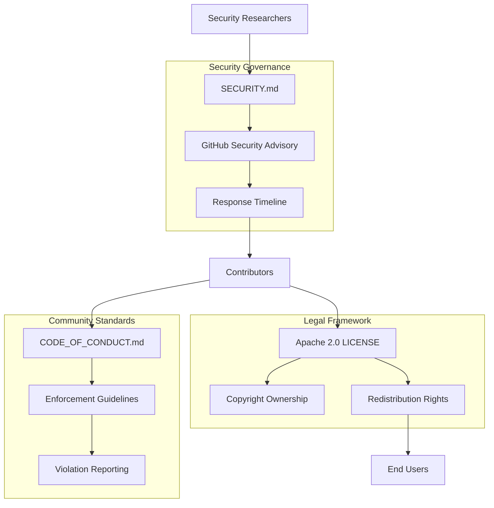
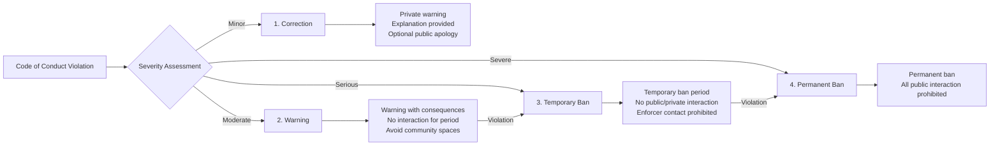
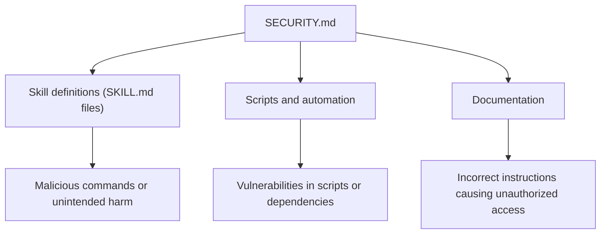
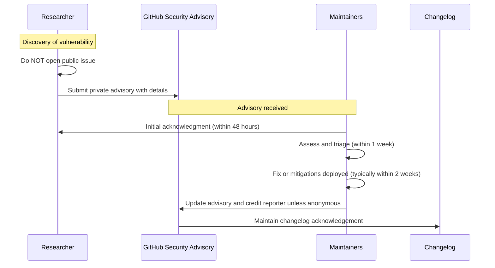
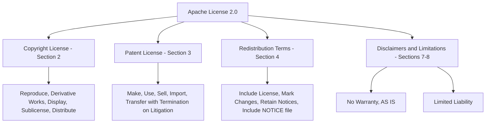
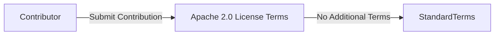

<!-- source: DeepWiki mcp.deepwiki.com · repo mukul975/Anthropic-Cybersecurity-Skills · page 8 Project Governance · fetched 2026-10-26 -->

# Project Governance

<details>
<summary>Relevant source files</summary>

The following files were used as context for generating this wiki page:

- [.claude-plugin/marketplace.json](.claude-plugin/marketplace.json)
- [.claude-plugin/plugin.json](.claude-plugin/plugin.json)
- [.github/workflows/sync-marketplace-version.yml](.github/workflows/sync-marketplace-version.yml)
- [.github/workflows/update-index.yml](.github/workflows/update-index.yml)
- [.github/workflows/validate-skills.yml](.github/workflows/validate-skills.yml)
- [CODE_OF_CONDUCT.md](CODE_OF_CONDUCT.md)
- [CONTRIBUTING.md](CONTRIBUTING.md)
- [LICENSE](LICENSE)
- [README.md](README.md)
- [SECURITY.md](SECURITY.md)

</details>


This document describes the governance framework for the Anthropic Cybersecurity Skills repository, including community standards, security vulnerability handling, and legal licensing terms. The governance model ensures ethical collaboration, responsible security disclosure, and clear legal rights for contributors and users.

For contribution workflows and quality standards, see [Contributing](#7). For technical automation of validation, see [Automation & CI/CD](#6).

## Governance Framework Overview

The project operates under three complementary governance mechanisms that establish standards for community interaction, security handling, and intellectual property rights:



**Governance Document Locations**

| Document         | File Path                   | Purpose                         |
|------------------|-----------------------------|--------------------------------|
| Code of Conduct  | [CODE_OF_CONDUCT.md:1-84]() | Community interaction standards |
| Security Policy  | [SECURITY.md:1-48]()        | Vulnerability reporting process |
| License          | [LICENSE:1-202]()           | Legal terms and copyright       |

Sources: [CODE_OF_CONDUCT.md:1-84](), [SECURITY.md:1-48](), [LICENSE:1-202]()

## Community Standards Enforcement

The project adopts the Contributor Covenant v2.1 to establish behavioral expectations for all community participants. The code of conduct applies to all community spaces including GitHub issues, pull requests, discussions, and official representation of the project.

### Contributor Covenant Implementation

The repository implements the standard Contributor Covenant framework at [CODE_OF_CONDUCT.md:1-84](). Key components include:

- **Pledge and Standards** ([CODE_OF_CONDUCT.md:3-25]())
  - Harassment-free participation regardless of identity characteristics
  - Positive behaviors: empathy, respect, constructive feedback, community focus
  - Prohibited behaviors: sexualized content, trolling, harassment, doxxing

- **Enforcement Contact**
  - Primary contact: `mukuljangra5@gmail.com` ([CODE_OF_CONDUCT.md:39]())
  - Complaints reviewed promptly and fairly
  - Reporter privacy and security protected ([CODE_OF_CONDUCT.md:41]())

### Four-Tier Enforcement Model

Community leaders follow graduated enforcement guidelines defined at [CODE_OF_CONDUCT.md:43-69]():



| Enforcement Level | Impact Type                                         | Consequence                                                      | Reference               |
|-------------------|---------------------------------------------------|-----------------------------------------------------------------|-------------------------|
| 1. Correction     | Inappropriate language or unprofessional behavior | Private written warning, explanation, possible public apology    | [CODE_OF_CONDUCT.md:47-52]()  |
| 2. Warning        | Single incident or series of violations            | Warning with interaction ban, avoid community and enforcers     | [CODE_OF_CONDUCT.md:54-58]()  |
| 3. Temporary Ban  | Sustained inappropriate behavior                    | Temporary ban with no interactions allowed                      | [CODE_OF_CONDUCT.md:60-64]()  |
| 4. Permanent Ban  | Pattern of violations, harassment, aggression      | Permanent ban from all public interaction                        | [CODE_OF_CONDUCT.md:66-69]()  |

Sources: [CODE_OF_CONDUCT.md:43-69]()

### Scope of Application

The code applies in two contexts as defined at [CODE_OF_CONDUCT.md:33-35]():

1. **All Community Spaces** — GitHub repository, issues, pull requests, discussions  
2. **Official Representation** — Official email addresses, social media accounts, event representation

## Security Vulnerability Governance

The security policy located in [SECURITY.md:1-48]() defines procedures for responsibly reporting, triaging, and mitigating security vulnerabilities found in skill content, scripts, automation, and documentation.

### Security Coverage Scope

All repository content is covered by this security policy ([SECURITY.md:5-11]()):



**In-Scope Vulnerabilities** ([SECURITY.md:34-39]()):

- Skill commands or scripts causing unintended harm or privilege escalation  
- Instructions that may lead to unauthorized access if misused  
- Sensitive data accidentally included in skill content  
- Dependencies or external references that are compromised

Sources: [SECURITY.md:5-11](), [SECURITY.md:34-39]()

### Responsible Disclosure Process

Security researchers must follow the private reporting workflow ([SECURITY.md:13-24]()):



**Disclosure Requirements** ([SECURITY.md:18-24]()):

- Use GitHub's private security advisory system: `/security/advisories/new`  
- Include affected skill name and path, vulnerability nature, impact, reproduction steps, and suggested fix

**Response Timelines** ([SECURITY.md:26-30]()):

| Stage                  | Timeframe          |
|------------------------|--------------------|
| Initial acknowledgment | Within 48 hours    |
| Assessment and triage  | Within 1 week       |
| Fix or mitigation      | Typically within 2 weeks (severity-based) |

**Acknowledgement:** Valid reporters receive credit in the changelog unless anonymity is requested.

Sources: [SECURITY.md:13-30](), [SECURITY.md:41-43]()

## Licensing and Copyright

The repository is distributed under the Apache License 2.0, a permissive open-source license that provides freedom to use, modify, and redistribute while including patent grants and attribution requirements.

### Apache 2.0 License Structure

The license text ([LICENSE:1-202]()) covers broad rights and obligations:



**Copyright Ownership** ([LICENSE:189]()):

```
Copyright 2026 mukul975
```

Sources: [LICENSE:1-202]()

### Grant of Rights

The license provides two primary grant types:

- **Copyright License** ([LICENSE:67-72]())
  - Perpetual, worldwide, non-exclusive, royalty-free permissions  
  - Rights to reproduce, prepare derivatives, display, sublicense, and distribute  
  - Applies to source and object forms

- **Patent License** ([LICENSE:74-88]())
  - Same scope as copyright license for patent claims necessarily infringed  
  - Terminates if the licensee initiates patent litigation against the licensor regarding this work

Sources: [LICENSE:67-88]()

### Redistribution Requirements

Section 4 of the license ([LICENSE:90-129]()) mandates these conditions when redistributing:

| Requirement               | Details                                                        | Reference             |
|---------------------------|----------------------------------------------------------------|-----------------------|
| (a) Provide License Copy   | Must include Apache 2.0 license with redistributions           | [LICENSE:95-96]()     |
| (b) Mark Modified Files    | Modified files must carry prominent notices of the changes     | [LICENSE:98-99]()     |
| (c) Retain Notices         | Keep all copyright, patent, trademark, and attribution notices | [LICENSE:101-105]()   |
| (d) Include NOTICE File    | If the original work includes a NOTICE file, include it too    | [LICENSE:107-115]()   |

Redistributors may add their own copyright and license terms on modifications only.

Sources: [LICENSE:90-129]()

### Contribution Submission Terms

By submitting contributions, contributors agree to license their work under Apache 2.0 unless otherwise specified ([LICENSE:131-137]()):



- Contributions become part of the work under the project's Apache 2.0 license  
- Separate agreements may apply only if explicitly stated

Sources: [LICENSE:131-137]()

### Disclaimer and Liability Limitations

The license includes standard disclaimers ([LICENSE:144-164]()):

- No warranties provided; work is "AS IS"  
- No liability for damages of any kind, including indirect or consequential

Paid support or warranty terms may be offered by redistributors but do not affect other contributors ([LICENSE:166-175]()).

Sources: [LICENSE:144-175]()

### Trademark Use Restrictions

Trademark rights are explicitly excluded ([LICENSE:139-142]()):

- License does not grant permission to use licensor's trademarks or trade names  
- Reasonable and customary use for describing origin or reproducing NOTICE file is allowed

Sources: [LICENSE:139-142]()

## Governance Document Maintenance

The project's governance documents are maintained with stable versioning and external attribution:

- **Code of Conduct**
  - Based on Contributor Covenant v2.1 ([CODE_OF_CONDUCT.md:73]())
  - Enforcement guidelines inspired by Mozilla's model ([CODE_OF_CONDUCT.md:75]())
  
- **Security Policy**
  - Managed in [SECURITY.md]() and aligned with GitHub security advisories

- **License**
  - Standard Apache License 2.0 text ([LICENSE:1-177]())
  - Copyright applied in 2026

Sources: [CODE_OF_CONDUCT.md:71-83](), [LICENSE:1-201](), [SECURITY.md:1-48]()

---

For more detailed information, see the child pages:

- [Code of Conduct](#8.1) – Community standards and enforcement  
- [Security Policy](#8.2) – Security vulnerability reporting and response  
- [Licensing](#8.3) – Apache 2.0 license details and contributor rights

---

