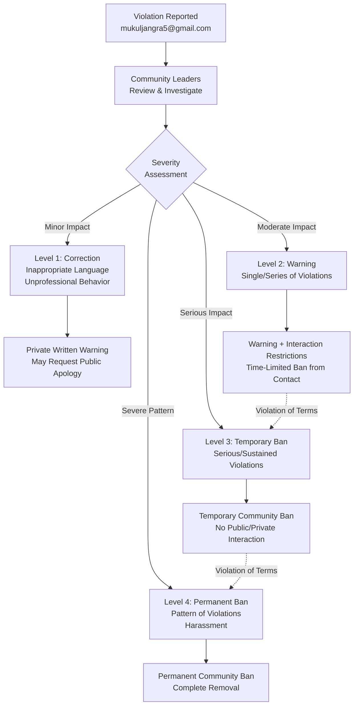
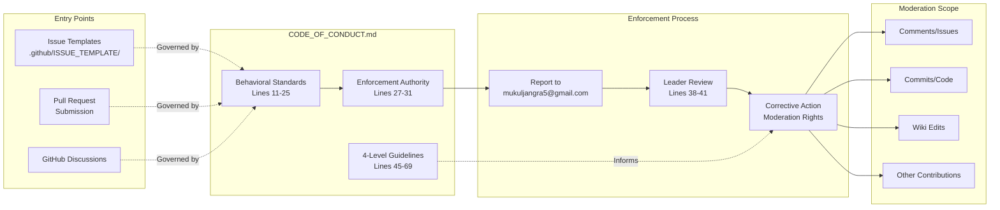

<!-- source: DeepWiki mcp.deepwiki.com · repo mukul975/Anthropic-Cybersecurity-Skills · page 8.1 Code of Conduct · fetched 2026-10-26 -->

# Code of Conduct

Relevant source files

The following files were used as context for generating this wiki page:

- [.claude-plugin/marketplace.json](.claude-plugin/marketplace.json)
- [.claude-plugin/plugin.json](.claude-plugin/plugin.json)
- [.github/workflows/sync-marketplace-version.yml](.github/workflows/sync-marketplace-version.yml)
- [.github/workflows/update-index.yml](.github/workflows/update-index.yml)
- [.github/workflows/validate-skills.yml](.github/workflows/validate-skills.yml)
- [CODE_OF_CONDUCT.md](CODE_OF_CONDUCT.md)
- [README.md](README.md)

This document details the community standards and behavioral expectations defined in [CODE_OF_CONDUCT.md](), which governs all interactions within the Anthropic Cybersecurity Skills repository. The Code of Conduct establishes inclusive community principles, defines acceptable and unacceptable behaviors, and outlines a four-level enforcement framework for violations.

For information about security vulnerability reporting, see [Security Policy](#8.2). For general contribution processes, see [Contributing](#7).

## Overview

The repository adopts the **Contributor Covenant Code of Conduct version 2.1**, a widely-used open source community standard. This establishes behavioral expectations for all participants in the project, including contributors, maintainers, and issue reporters across all community spaces (GitHub issues, pull requests, discussions, and external representation).

The Code of Conduct serves three primary functions:
1. **Community Standards**: Defines positive and negative behavioral patterns
2. **Enforcement Authority**: Grants community leaders moderation rights
3. **Violation Response**: Provides graduated enforcement guidelines

Sources: [CODE_OF_CONDUCT.md:1-84]()

## Pledge and Standards

### Community Pledge

The pledge commits all participants to creating a harassment-free environment regardless of personal characteristics including age, disability, ethnicity, gender identity, experience level, nationality, race, religion, or sexual orientation. This applies to all community interactions and official representation of the project.

**Positive Behavior Standards** include:
- Demonstrating empathy and kindness
- Respecting differing opinions and experiences
- Giving and accepting constructive feedback gracefully
- Accepting responsibility for mistakes
- Focusing on community benefit over individual interest

**Prohibited Behaviors** include:
- Sexualized language, imagery, or unwanted advances
- Trolling, insulting comments, or personal attacks
- Public or private harassment
- Publishing private information without permission
- Unprofessional conduct inappropriate for a technical setting

Sources: [CODE_OF_CONDUCT.md:3-25]()

## Enforcement Framework

### Scope and Authority

The Code of Conduct applies in two contexts:

| Context               | Examples                                                              |
|-----------------------|---------------------------------------------------------------------|
| **All Community Spaces**      | GitHub issues, pull requests, code reviews, discussions, commit messages |
| **Official Representation** | Official email addresses, social media accounts, event representation      |

Community leaders hold the authority to remove, edit, or reject any contributions not aligned with the Code of Conduct, including comments, commits, code, wiki edits, and issues.

Sources: [CODE_OF_CONDUCT.md:27-35]()

### Violation Reporting

Violations are reported to the enforcement contact at `mukuljangra5@gmail.com`. All reports are:
- Reviewed promptly and fairly
- Investigated with reporter privacy protection
- Handled confidentially by community leaders

Sources: [CODE_OF_CONDUCT.md:38-41]()

## Enforcement Guidelines Structure

**Diagram: Four-Level Enforcement Process**

Sources: [CODE_OF_CONDUCT.md:43-69]()

### Level 1: Correction

**Trigger**: Inappropriate language or unprofessional behavior

**Response Process**:
1. Community leaders issue private written warning
2. Explanation provided on violation nature and inappropriateness
3. Public apology may be requested (optional)

**Outcome**: Educational intervention without restrictions

Sources: [CODE_OF_CONDUCT.md:47-51]()

### Level 2: Warning

**Trigger**: Single incident or series of minor violations

**Response Process**:
1. Formal warning issued with consequences for continued behavior
2. No interaction permitted with involved parties (specified duration)
3. Restriction applies to community spaces and external channels
4. Unsolicited contact with enforcers prohibited

**Escalation Path**: Violating warning terms may trigger temporary or permanent ban

Sources: [CODE_OF_CONDUCT.md:53-57]()

### Level 3: Temporary Ban

**Trigger**: Serious violations including sustained inappropriate behavior

**Response Process**:
1. Temporary ban from all community interaction (specified duration)
2. Complete prohibition on public and private contact with involved parties
3. No interaction with enforcers during ban period

**Escalation Path**: Violating ban terms triggers permanent ban

Sources: [CODE_OF_CONDUCT.md:59-63]()

### Level 4: Permanent Ban

**Trigger**: Pattern of violations, sustained harassment, or disparagement of groups

**Response Process**:
1. Permanent ban from all public community interaction
2. Complete removal from project participation
3. No appeal process specified

This is the terminal enforcement action for the most severe or repeated violations.

Sources: [CODE_OF_CONDUCT.md:65-69]()

## Enforcement Decision Matrix

| Level           | Community Impact                     | Consequence Type                  | Duration      | Escalation Risk      |
|-----------------|------------------------------------|---------------------------------|---------------|---------------------|
| **1. Correction**   | Inappropriate language/behavior    | Private warning                  | N/A           | Low                 |
| **2. Warning**      | Single incident or series          | Interaction restrictions        | Time-limited  | Medium (→ L3/L4)     |
| **3. Temporary Ban**| Serious/sustained violations       | Community ban                   | Time-limited  | High (→ L4)          |
| **4. Permanent Ban**| Pattern/harassment                 | Community removal               | Permanent     | Terminal            |

Sources: [CODE_OF_CONDUCT.md:45-69]()

## Integration with Contribution System

**Diagram: Code of Conduct Integration with Repository Workflow**

The Code of Conduct operates alongside the contribution system documented in [Contributing](#7) and [Issue Templates](#7.2). When contributors interact through issue templates ([new-skill-request.yml](), [skill-improvement.yml](), [bug-report.yml]()), pull requests, or discussions, their behavior is governed by `CODE_OF_CONDUCT.md` standards.

Community leaders can exercise enforcement authority by:
- Removing or editing comments in issues/PRs
- Rejecting commits or code submissions
- Editing or removing wiki contributions
- Moderating other participation forms

Sources: [CODE_OF_CONDUCT.md:27-31]()

## Attribution and Version

The document implements **Contributor Covenant version 2.1**, sourced from:
- Primary source: `https://www.contributor-covenant.org/version/2/1/code_of_conduct.html`
- Community Impact Guidelines inspired by Mozilla's enforcement ladder
- FAQ available at `https://www.contributor-covenant.org/faq`

The Contributor Covenant is a widely-adopted standard across open source projects, providing consistency in community expectations and enforcement approaches.

Sources: [CODE_OF_CONDUCT.md:71-83]()

## Relationship to Other Governance Documents

| Document              | Purpose                            | Reference                      |
|-----------------------|----------------------------------|-------------------------------|
| **CODE_OF_CONDUCT.md** | Community behavioral standards   | Current page (#8.1)            |
| **SECURITY.md**        | Vulnerability reporting process  | [Security Policy](#8.2)        |
| **LICENSE**            | Apache 2.0 software licensing    | [Licensing](#8.3)              |
| **CONTRIBUTING.md**    | Technical contribution guidelines| [Contributing](#7)             |

The Code of Conduct defines **behavioral** expectations, while [CONTRIBUTING.md]() defines **technical** contribution requirements. Both ensure a safe and productive contributor environment.

For security-specific violations, such as malicious code submissions, the [Security Policy](#8.2) provides specialized reporting channels and handling beyond the general Code of Conduct framework.

Sources: [CODE_OF_CONDUCT.md:1-84]()

---

