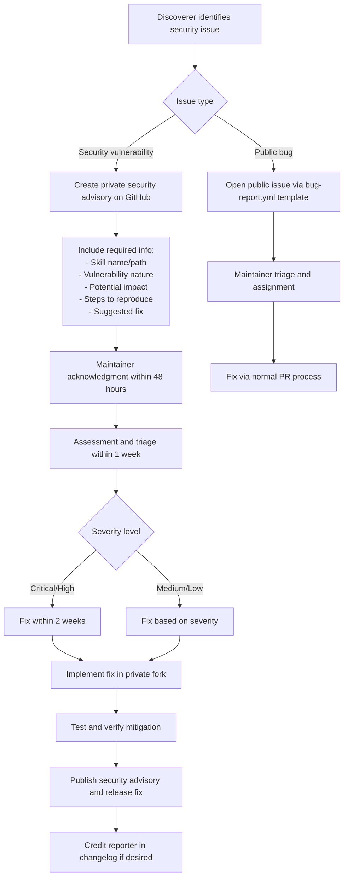
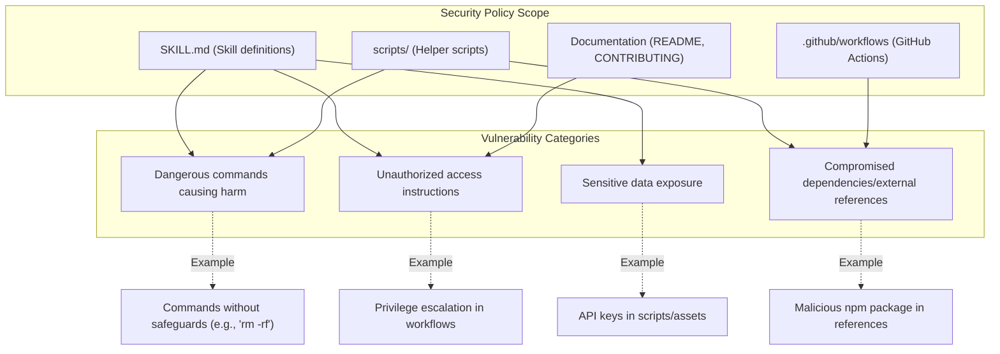
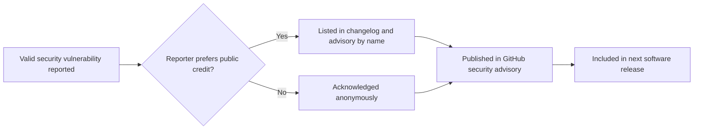
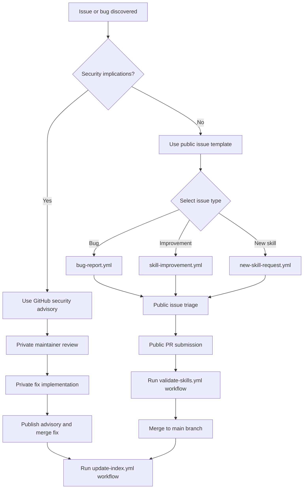
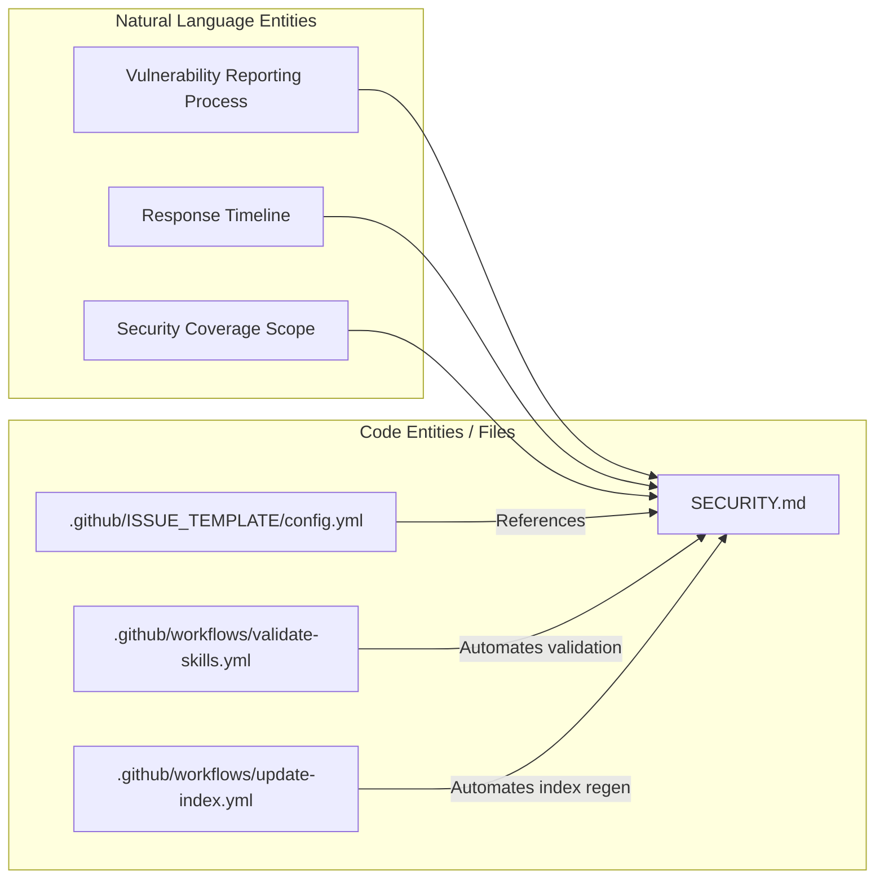

<!-- source: DeepWiki mcp.deepwiki.com · repo mukul975/Anthropic-Cybersecurity-Skills · page 8.2 Security Policy · fetched 2026-10-26 -->

# Security Policy

<details>
<summary>Relevant source files</summary>

The following files were used as context for generating this wiki page:

- [SECURITY.md](SECURITY.md)

</details>


This document defines the security vulnerability reporting process, response procedures, and coverage scope for the Anthropic Cybersecurity Skills repository. It establishes responsible disclosure guidelines for reporting security issues in skill definitions, scripts, documentation, and supporting materials.

For general contribution guidelines, see [Contributing](#7). For project licensing terms, see [Licensing](#8.3).

---

## Purpose and Coverage

The security policy applies to all content in the repository that could present security risks when followed or executed. This includes skill workflow instructions, helper scripts, external references, and documentation that could lead to unintended system compromise or data exposure.

### Supported Components

| Component                              | Supported | Description                                           |
|--------------------------------------|-----------|-------------------------------------------------------|
| Skill definitions (`SKILL.md` files) | Yes       | Workflow instructions and frontmatter metadata       |
| Scripts and automation                | Yes       | Helper scripts in `scripts/` directories and GitHub Actions workflows |
| Documentation                        | Yes       | README, CONTRIBUTING, and supporting documentation    |

*Sources: [SECURITY.md:1-11]()*


---

## Vulnerability Reporting Process

The repository uses GitHub's private security advisory system for vulnerability disclosure, ensuring sensitive security issues are not publicly exposed before fixes are implemented.

### Reporting Workflow Diagram



### Required Information

When reporting a security vulnerability through GitHub's security advisory system, include the following details in your report:

| Field              | Description                                                        | Required        |
|--------------------|--------------------------------------------------------------------|-----------------|
| Affected skill     | Skill name and file path (e.g., `skills/forensics/acquiring-disk-image-with-dd-and-dcfldd/SKILL.md`) | Yes             |
| Vulnerability nature | Type of security issue (command injection, privilege escalation, data exposure, etc.)             | Yes             |
| Potential impact   | What could happen if the vulnerability is exploited               | Yes             |
| Reproduction steps | Step-by-step instructions to reproduce the issue                  | If applicable   |
| Suggested fix     | Proposed mitigation or code changes                                 | Optional        |

**Important:** Do **not** open a public GitHub issue for security vulnerabilities. Use the private advisory system at `https://github.com/mukul975/Anthropic-Cybersecurity-Skills/security/advisories/new`.

*Sources: [SECURITY.md:13-24]()*


---

## Response Timeline

The security policy establishes three response milestones with defined timeframes:

```mermaid
gantt
    title Security Vulnerability Response Timeline
    dateFormat X
    axisFormat %s

    section Acknowledgment
    Initial acknowledgment :0, 48h

    section Assessment
    Assessment and triage      :48h, 168h

    section Resolution
    Fix or mitigation (typical):168h, 336h
```

| Milestone             | Timeline         | Actions                                                    |
|-----------------------|------------------|------------------------------------------------------------|
| Initial acknowledgment | Within 48 hours  | Maintainer confirms receipt of security advisory           |
| Assessment and triage   | Within 1 week    | Severity classification, impact analysis, fix planning     |
| Fix or mitigation       | Typically within 2 weeks | Implementation, testing, and deployment of fix             |

Timeline variations occur depending on vulnerability severity, fix complexity, and maintainer availability. Critical vulnerabilities enabling remote code execution or affecting multiple skills are prioritized.

*Sources: [SECURITY.md:26-30]()*


---

## Scope of Security Coverage

### In-Scope Security Issues



**Detailed Scope Items:**

1. **Skills with harmful commands:** Skill workflows in `SKILL.md` files that execute potentially dangerous commands which might cause system damage, data loss, or resource exhaustion if run incorrectly or without safeguards.

2. **Unauthorized access instructions:** Skill instructions that, if improperly followed or without authorization checks, may lead to privilege escalation, lateral movement, or unauthorized access.

3. **Sensitive data exposure:** Inclusion of confidential information such as API keys, credentials, private keys inside skill content, scripts, assets, or documentation.

4. **Compromised dependencies:** External software, libraries, repositories, or references that have become vulnerable, deprecated or compromised.

### Out-of-Scope Items

- Vulnerabilities in third-party tools referenced by skills (report to respective vendors).
- Intentional attack technique demonstrations in skills (educational purpose).
- Vulnerabilities requiring unauthorized access to trigger.
- Theoretical vulnerabilities without practical exploitation paths.

*Sources: [SECURITY.md:32-40]()*


---

## Recognition and Attribution

### Credit System Flow



Valid security vulnerability reports receive attribution in the repository changelog and security advisories unless the reporter elects to remain anonymous. The acknowledgment includes the reporter's name or handle (if permitted), a brief description of the vulnerability, affected components, and the fix summary.

*Sources: [SECURITY.md:41-43]()*


---

## Contact and Escalation

### Primary Contact Method

Report security vulnerabilities using GitHub's private security advisory system at:

```
https://github.com/mukul975/Anthropic-Cybersecurity-Skills/security/advisories/new
```

This method enables:

- Private communication with maintainers
- Structured vulnerability disclosure workflow
- CVE assignment if applicable
- Coordinated disclosure timeline management

### Alternative Contact

For security matters unsuitable for GitHub advisories (for example, account or repository access issues), use the repository's discussion forum. Mark discussions as private and select the "Security" category if available.

*Sources: [SECURITY.md:45-47]()*


---

## Integration with Contribution Workflow

### Security vs. Non-Security Issue Routing



The security vulnerability reporting process runs in parallel with the public contribution workflow but uses a private disclosure channel to avoid premature exposure. Once a fix is implemented, it undergoes the same validation, testing, and index update automation as normal contributions.

*Sources: [SECURITY.md:1-47]()*


---

# Summary of Key Code Entities Related to Security Policy



*Sources: [SECURITY.md:1-48]()*

---

This completes the Security Policy documentation for the Anthropic Cybersecurity Skills repository. The policy ensures security vulnerabilities are responsibly reported, promptly addressed, and that contributors are credited for valid disclosures while maintaining strict confidentiality during the process.

---

