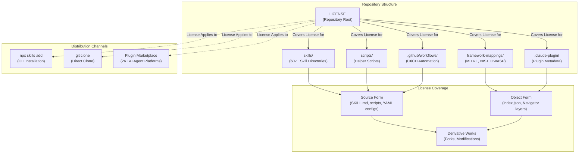
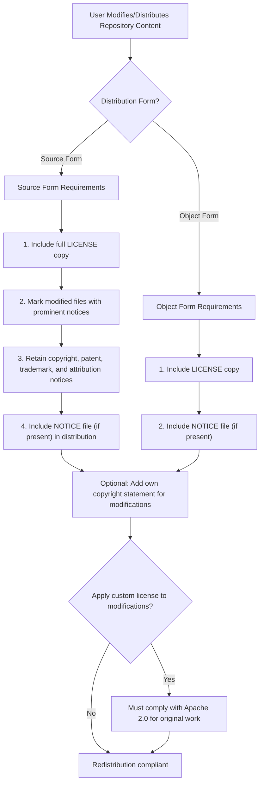
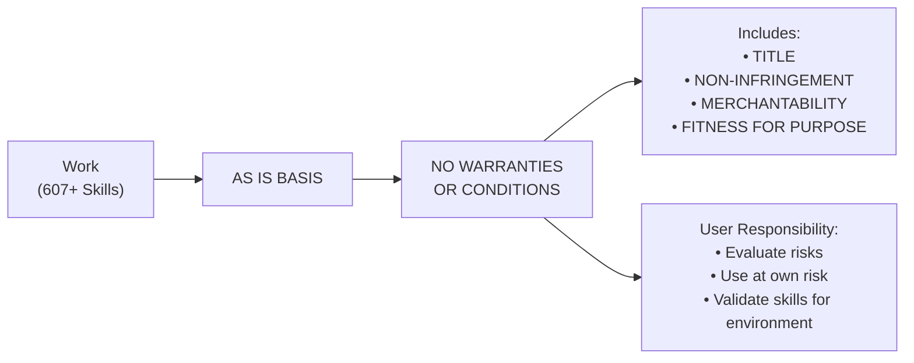
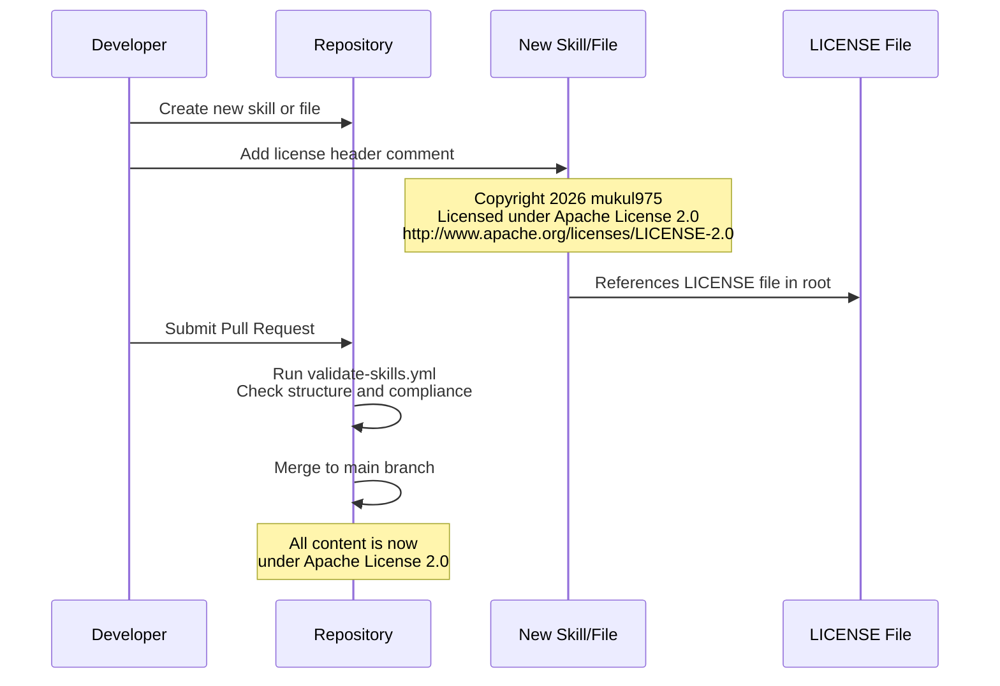
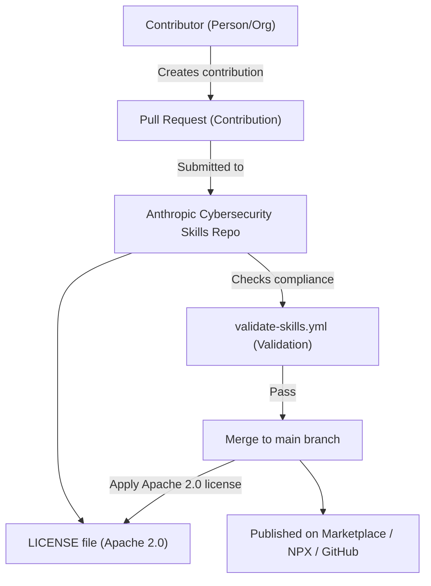

<!-- source: DeepWiki mcp.deepwiki.com · repo mukul975/Anthropic-Cybersecurity-Skills · page 8.3 Licensing · fetched 2026-10-26 -->

# Licensing

<details>
<summary>Relevant source files</summary>

The following files were used as context for generating this wiki page:

- [CONTRIBUTING.md](CONTRIBUTING.md)
- [LICENSE](LICENSE)

</details>


This page documents the Apache License 2.0 that governs the Anthropic Cybersecurity Skills repository, including copyright ownership, granted permissions, redistribution requirements, and license application across the repository structure. For information about contribution agreements, see [Contributing](#7). For security vulnerability disclosure requirements, see [Security Policy](#8.2).

## License Overview

The repository is licensed under the **Apache License, Version 2.0, January 2004**. This permissive open-source license enables commercial use, modification, distribution, and patent grant while requiring license and copyright notice preservation.

### Copyright Ownership

```
Copyright 2026 mukul975
```

All original works in the repository, including skills, documentation, scripts, and automation workflows, are owned by mukul975 as specified in [LICENSE:13-14, 189]().

### License Location

| Component         | License File Path                  | Scope                                                                                  |
|-------------------|----------------------------------|----------------------------------------------------------------------------------------|
| Repository Root   | `LICENSE`                        | Entire repository including all 607+ skills, framework mappings, scripts, and workflows |
| Individual Skills | `skills/{skill-name}/LICENSE`    | Each skill directory may contain a copy for standalone distribution                      |

Sources: [LICENSE:1-202](), [skills/acquiring-disk-image-with-dd-and-dcfldd/LICENSE:1-202]()

## License Architecture



Sources: [LICENSE:1-202]()

## Granted Permissions

The Apache License 2.0 grants the following rights to all users:

### Copyright License

As defined in [LICENSE:67-72](), contributors grant a **perpetual, worldwide, non-exclusive, no-charge, royalty-free, irrevocable** copyright license to:

| Permission                | Description                           | Application in Repository                                |
|---------------------------|-------------------------------------|---------------------------------------------------------|
| **Reproduce**             | Make copies of the work              | Clone repository, duplicate or fork skills               |
| **Prepare Derivative Works** | Modify and create derived works    | Fork repository, adapt skills for different platforms    |
| **Publicly Display**      | Show the work publicly               | Host documentation or demos                              |
| **Publicly Perform**      | Execute the work publicly            | Run skills in AI training or demonstrations              |
| **Sublicense**            | Grant license to others              | Redistribute skills via plugin marketplaces               |
| **Distribute**            | Share copies of the work             | Share via NPX CLI, git clone, or plugin marketplace       |

### Patent License

As defined in [LICENSE:74-88](), contributors grant a **perpetual, worldwide, non-exclusive, no-charge, royalty-free, irrevocable** patent license covering:

- Patent claims necessarily infringed by their contributions alone or in combination with the work
- **Termination Clause:** License terminates if a licensee initiates patent litigation alleging infringement

This patent grant is critical to enable open and safe distribution to multiple AI agent platforms.

Sources: [LICENSE:67-88]()

## Redistribution Requirements



Sources: [LICENSE:90-129]()

### Source Form Distribution

When redistributing or modifying the repository in **source form** (e.g. `SKILL.md` files, Python helper scripts, YAML workflows), you must:

1. **Include License Copy:** Provide recipients the full Apache License 2.0 text [LICENSE:90-92]()
2. **Mark Modified Files:** Clearly state in each changed file that it was modified [LICENSE:98-99]()
3. **Retain Attribution Notices:** Preserve all copyright, patent, trademark, and attribution notices [LICENSE:100-105]()
4. **Include NOTICE File:** If the original distribution includes a NOTICE file, include it (or its notices) in derived works [LICENSE:107-116]()

### Object Form Distribution

When redistributing **compiled or generated artifacts** (e.g. `index.json`, `attack-navigator-layer.json`), you must:

1. **Include License Copy:** Provide Apache 2.0 license with the distribution [LICENSE:90-92]()
2. **Preserve Attributions:** Include the NOTICE file or attribution notices if present [LICENSE:107-116]()

### Example: Forking Skills for Custom Platform

```markdown
# Scenario: Fork repository to adapt skills for proprietary AI platform

Required Actions:
1. Include root `LICENSE` file in fork.
2. For any modified `SKILL.md` or scripts, add prominent comments such as:
// Modified by [Your Name] on [Date]: [Brief Description]
3. Retain original copyright statement:
// Copyright 2026 mukul975
4. Optionally add your own copyright:
// Copyright 2026 [Your Organization] (modifications only)
5. Ensure LICENSE accompanies any distribution channel (NPX, marketplace, git clone).
```

Sources: [LICENSE:90-129]()

## Contribution Licensing

### Inbound License Agreement

All contributions submitted to the repository are governed by the Apache 2.0 license as per [LICENSE:131-137]():

```
Unless You explicitly state otherwise, any Contribution intentionally 
submitted for inclusion in the Work by You to the Licensor shall be 
under the terms and conditions of this License, without any additional 
terms or conditions.
```

Implications:

- Contributors automatically grant Apache 2.0 license terms on submission
- No separate Contributor License Agreement (CLA) is required
- Contributors cannot impose additional licensing terms unilaterally

### Contribution Definition

As defined in [LICENSE:49-61](), a **Contribution** is:

| Aspect            | Definition                                                                            |
|-------------------|--------------------------------------------------------------------------------------|
| **Scope**         | Original work + any modifications or additions submitted                             |
| **Intent**        | Intentionally submitted for inclusion by copyright owner or authorized entity        |
| **Submission Methods** | Electronic, verbal, or written communication to licensor or representatives      |
| **Channels**      | Mailing lists, source control (Git), issue tracking systems (GitHub Issues etc.)     |
| **Exclusions**    | Communications marked clearly as "Not a Contribution"                               |

For practical contribution workflows, see [Contribution Guidelines](#7.1).

Sources: [LICENSE:49-61](), [LICENSE:131-137](), [CONTRIBUTING.md:73-74]()

## License Terms and Definitions

### Key License Terms from LICENSE

| Term                | Definition                                                                                   | Application in Codebase Examples                         |
|---------------------|----------------------------------------------------------------------------------------------|----------------------------------------------------------|
| **License**         | Terms and conditions for use, reproduction, and distribution [LICENSE:10-11]()               | Apache License 2.0, January 2004                          |
| **Licensor**        | Copyright owner or authorized entity granting license [LICENSE:13-14]()                      | mukul975 (repository owner)                              |
| **You / Your**      | Individual or Legal Entity exercising permissions [LICENSE:24-25]()                          | Developers, organizations, end users                      |
| **Source**          | Preferred form for modifications (source code, config) [LICENSE:27-29]()                    | `SKILL.md`, Python scripts, YAML files                    |
| **Object**          | Transformed or compiled form (binary, JSON) [LICENSE:31-34]()                               | `index.json`, `attack-navigator-layer.json`               |
| **Work**            | Authored work under license [LICENSE:36-39]()                                              | Entire repo: skills, docs, scripts, workflows             |
| **Derivative Works** | Works based on or derived from original work [LICENSE:41-47]()                             | Modified skills, forks, adaptations                        |
| **Contribution**    | Intentionally submitted works included in the project [LICENSE:49-61]()                     | Pull requests, patches                                    |
| **Contributor**     | Licensor and any individual/entity whose contributions are included [LICENSE:63-65]()       | mukul975 + community contributors                         |

Sources: [LICENSE:8-65]()

## Warranties and Liability

### Disclaimer of Warranty



Per [LICENSE:144-152](), the entire work is provided **"AS IS"** with no express or implied warranties including but not limited to:

- **Title:** No guarantee of ownership or licensing rights
- **Non-Infringement:** No assurance the repository does not infringe others’ rights
- **Merchantability:** No warranty that the content is fit for sale
- **Fitness for Particular Purpose:** No guarantee skills will suit all security use cases

Users must evaluate and validate skills in their environment before production use.

### Limitation of Liability

Per [LICENSE:154-164](), contributors disclaim liability for damages including:

| Damage Type           | Examples in Repository Context                                      |
|-----------------------|--------------------------------------------------------------------|
| **Direct**            | Failed skill execution causing immediate harm                      |
| **Indirect**          | Security breach flowing from misuse of repository content          |
| **Special**            | Environmental or setup-specific damage                             |
| **Incidental**        | Secondary damages from deployment mishaps                          |
| **Consequential**      | Business losses, data loss or downtime caused by usage             |

Applies even if contributor has been notified of potential damage.

Sources: [LICENSE:144-164]()

## Trademark Restrictions

The license **does not grant permission** to use [LICENSE:139-142]():

- Licensor’s trade names
- Trademarks
- Service marks
- Product names

Exception: Reasonable descriptive use and reproduction of NOTICE file content.

Implications:

- You *may* state “Based on Anthropic Cybersecurity Skills by mukul975”
- You *may not* imply endorsement or confuse origin
- You *may not* use trademarks to brand derivative works

Sources: [LICENSE:139-142]()

## License Application Workflow



### Applying License to New Content

As outlined in [LICENSE:179-187](), apply Apache License 2.0 by adding this boilerplate notice to new files (adapt comment symbols appropriately):

```
Copyright 2026 mukul975

Licensed under the Apache License, Version 2.0 (the "License");
you may not use this file except in compliance with the License.
You may obtain a copy of the License at

    http://www.apache.org/licenses/LICENSE-2.0

Unless required by applicable law or agreed to in writing, software
distributed under the License is distributed on an "AS IS" BASIS,
WITHOUT WARRANTIES OR CONDITIONS OF ANY KIND, either express or implied.
See the License for the specific language governing permissions and
limitations under the License.
```

Sources: [LICENSE:179-201]()

## Accepting Additional Liability

Redistributors may provide additional warranties or accept liability obligations as per [LICENSE:166-175]():

- Offer paid support, warranty, or indemnity
- Accept liability consistent with Apache 2.0 terms

Conditions:

1. Acting on own behalf solely
2. Not binding original contributors
3. Indemnify and defend contributors against any liabilities

This provision enables commercial service models around the skills while shielding original authors.

Sources: [LICENSE:166-175]()

## License Compatibility

The Apache License 2.0 is compatible with these licenses:

| License       | Compatibility     | Typical Use Case                                                |
|---------------|-------------------|----------------------------------------------------------------|
| **MIT License** | ✅ Compatible     | Combining with MIT-licensed tools/libraries                    |
| **BSD License** | ✅ Compatible     | Including BSD-licensed utilities                              |
| **GPL v3**     | ⚠️ One-way compatible | Apache 2.0 code can be included in GPL v3 projects but not vice versa |
| **Proprietary**| ✅ Compatible     | Integration into proprietary security products with attribution  |

This compatibility facilitates:

- Distribution via 26+ AI agent platforms (Claude, Copilot, Gemini, etc.)
- Use alongside other open-source cybersecurity tooling
- Commercial product development with proper license compliance

Sources: [LICENSE:1-202]()

## License Full Text Location

The complete Apache License 2.0 text is available at:

- **Repository Root:** [LICENSE:1-202]()
- **Individual Skills:** e.g. [skills/acquiring-disk-image-with-dd-and-dcfldd/LICENSE:1-202]()
- **Online Reference:** http://www.apache.org/licenses/LICENSE-2.0

For detailed legal interpretation, consult the Apache Software Foundation documentation or qualified legal counsel.

Sources: [LICENSE:1-202](), [skills/acquiring-disk-image-with-dd-and-dcfldd/LICENSE:1-202]()


# Bridging Natural Language Terms to Code Entities

```mermaid
flowchart LR
    NL_AgentSkills["Natural Language: AgentSkills.io Cybersecurity Skills"]
    NL_ApacheLicense["Natural Language: Apache 2.0 License"]
    CODE_SKILL_MD["Code Entity: `SKILL.md` (Skills Metadata and Instructions)"]
    CODE_LICENSE_ROOT["`LICENSE` (Repository Root License File)"]
    CODE_LICENSE_SKILL["`LICENSE` (Per Skill Directory License)"]
    CODE_VALIDATE_YML["`.github/workflows/validate-skills.yml` (Skill Validation Workflow)"]
    CODE_INDEX_JSON["`index.json` (Skill Index for Object Form)"]
    CODE_PLUGIN_JSON["`.claude-plugin/plugin.json` (Plugin Metadata)"]
    
    NL_AgentSkills --> CODE_SKILL_MD
    NL_ApacheLicense --> CODE_LICENSE_ROOT
    NL_ApacheLicense --> CODE_LICENSE_SKILL
    NL_ApacheLicense --> CODE_VALIDATE_YML
    NL_AgentSkills --> CODE_PLUGIN_JSON
    CODE_SKILL_MD --> CODE_INDEX_JSON
    CODE_PLUGIN_JSON --> CODE_INDEX_JSON
```

Sources: [LICENSE:1-202](), [CONTRIBUTING.md:6-20](), [.github/workflows/validate-skills.yml]()

---



Sources: [LICENSE:131-137](), [CONTRIBUTING.md:3-20]()

---

This completes the detailed technical reference for the licensing of the Anthropic Cybersecurity Skills repository.

---

