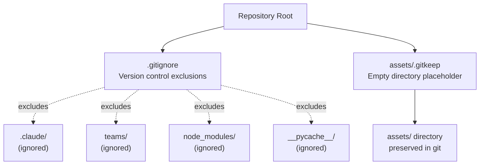
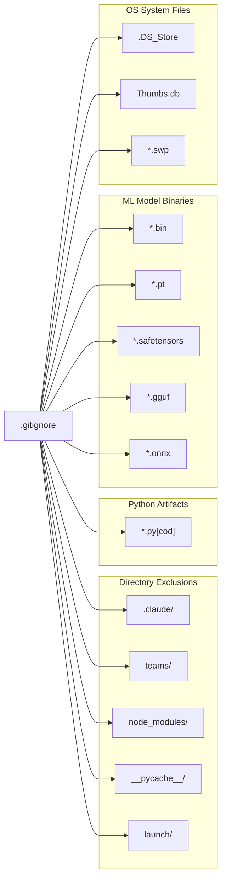
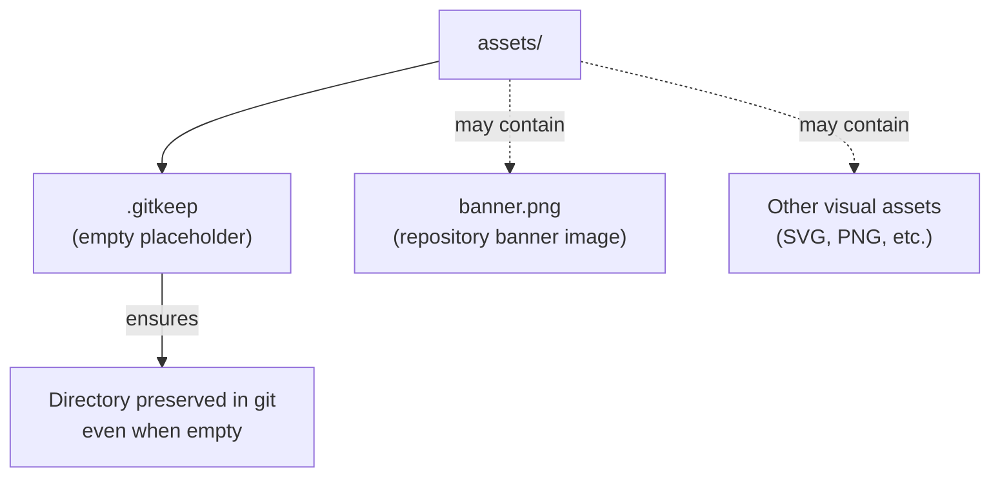
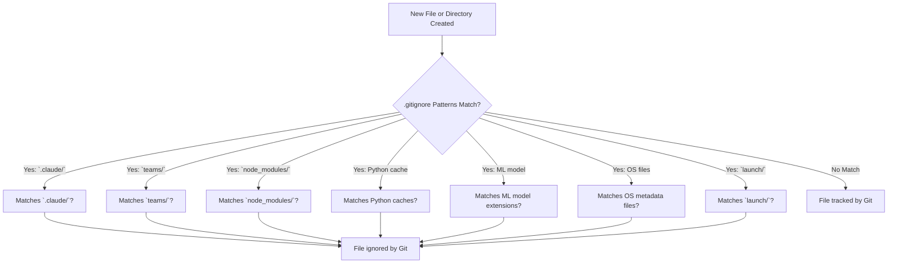

<!-- source: DeepWiki mcp.deepwiki.com · repo mukul975/Anthropic-Cybersecurity-Skills · page 9 Reference · fetched 2026-10-26 -->

# Reference

<details>
<summary>Relevant source files</summary>

The following files were used as context for generating this wiki page:

- [CITATION.cff](CITATION.cff)
- [assets/banner.png](assets/banner.png)

</details>


This page provides a high-level technical reference overview of critical repository configuration files and asset management for the **Anthropic Cybersecurity Skills** repository. It focuses on how the version control system handles various files via `.gitignore` patterns and how assets like images are organized and preserved in the repository. 

The information here ensures contributors and integrators understand repository hygiene, how bulky and unnecessary files are excluded, and how media content is structured for documentation and presentation purposes.

For detailed explanations on the `.gitignore` contents and asset directory structures, please see the child pages:
- [Repository Configuration](#9.1)
- [Assets and Media](#9.2)

---

## Repository Configuration Overview

The repository includes several configuration files that govern:

- What files and directories Git tracks or excludes from version control (via `.gitignore`)
- Placeholder files (`.gitkeep`) to maintain empty directory hierarchies like `assets/`
- Ignoring temporary, platform-specific, or bulky binary files such as:
  - Claude AI agent configuration caches
  - Node.js dependencies in `node_modules/`
  - Python bytecode caches
  - Machine learning model binaries
  - OS system metadata files (e.g. `.DS_Store`)

This setup enforces a clean development environment and prevents unnecessary or large files from bloating the repository.

### Configuration Files and Directory Structure



**Sources:** [.gitignore:1-15](), [assets/.gitkeep:1]()

---

## .gitignore Patterns Summary

The `.gitignore` file is crucial for controlling version control behavior by excluding files and directories that are:

- Generated automatically during builds or execution (`__pycache__/`, `.pyc` files)
- Environment or system-specific temporary files (`.DS_Store`, `Thumbs.db`)
- Large ML model binaries (`*.pt`, `*.bin`, `*.onnx`)
- Dependency directories (`node_modules/`)
- User or platform-specific caches (`.claude/`, `teams/`)

### Pattern Categories and Purpose

| Category                    | Patterns                       | Purpose                                      |
|-----------------------------|-------------------------------|----------------------------------------------|
| **Claude AI Cache & Config** | `.claude/`                    | Hide Claude agent config and cache files     |
| **Team Collaboration**       | `teams/`                      | Ignore team-specific workspace files         |
| **JavaScript Dependencies**  | `node_modules/`               | Ignore npm package installations              |
| **Python Cache and Build**   | `__pycache__/`, `*.py[cod]`  | Ignore Python bytecode and cache files       |
| **ML Model Binaries**        | `*.bin`, `*.pt`, `*.safetensors`, `*.gguf`, `*.onnx` | Ignore bulky ML model files       |
| **OS Metadata Files**        | `.DS_Store`, `Thumbs.db`, `*.swp` | Hide OS-specific metadata files         |
| **IDE Launch Configs**       | `launch/`                     | Hide IDE or debug launch settings            |



**Sources:** [.gitignore:1-15]()

---

## Assets and Media Overview

The repository’s `assets/` directory stores static media files utilized mostly in documentation, marketing, and UI materials. Keeping this directory versioned ensures consistency and ease of updates to visual contents related to the project.

### Directory and File Management

- The `assets/` directory contains files like `banner.png` used as the repository banner image.
- A `.gitkeep` file is placed in `assets/` as an empty placeholder to ensure Git tracks the directory itself, even if no current assets exist or after asset removal.
- Actual asset files (images, icons) are tracked normally and **not** ignored.



**Sources:** [assets/.gitkeep:1]()

### Why `.gitkeep`?

- Git does not track empty folders because it tracks files.
- `.gitkeep` acts as a no-content file to maintain directory presence.
- Ensures that users cloning the repository have the full expected folder structure.
- Common practice in repositories needing to preserve asset directories.

---

## Integration with Other Repository Aspects

This reference page complements broader architectural and workflow documents by providing essential low-level details about how the repository sustains environment cleanliness and asset consistency. 

- The `.gitignore` patterns help maintain clean working copies, especially when dependencies and ML models can be heavy or environment-specific.
- Asset management underpins the repository’s user-facing presentations and documentation consistency.
- Together these enable efficient collaboration, reproducibility, and easy onboarding.

For advanced configuration details and deeper file management strategies, see the child pages:
- [Repository Configuration](#9.1)
- [Assets and Media](#9.2)

---

## Citation Information

If you use this repository in your research, publications, or tooling, please cite it as follows:

```yaml
cff-version: 1.2.0
message: "If you use this repository in your research, tools, or publications, please cite it as below."
type: software
title: "Anthropic-Cybersecurity-Skills"
abstract: |
  A structured collection of 753 cybersecurity skills for AI agents, covering
  penetration testing, digital forensics, threat intelligence, incident response,
  cloud security, OT/SCADA security, AI security, and more. Each skill follows
  a standardized format with YAML frontmatter metadata, step-by-step procedures,
  tool commands, expected outputs, and MITRE ATT&CK mappings. Compatible with
  Claude Code, GitHub Copilot, Cursor, Windsurf, Gemini CLI, and 20+ AI agent
  platforms.
authors:
  - name: "Mahipal"
    email: mukuljangra5@gmail.com
    alias: mukul975
repository-code: "https://github.com/mukul975/Anthropic-Cybersecurity-Skills"
url: "https://github.com/mukul975/Anthropic-Cybersecurity-Skills"
license: Apache-2.0
version: "1.1.0"
date-released: "2026-03-21"
keywords:
  - cybersecurity
  - AI agents
  - skills
  - penetration testing
  - digital forensics
  - threat intelligence
  - incident response
  - MITRE ATT&CK
  - Claude Code
  - open source
```

This citation metadata is available at the repository root in the `CITATION.cff` file.

**Sources:** [CITATION.cff:1-33]()

---

# Additional Diagrams Bridging Natural Language and Code Entity Space

### Diagram 1: Association of System Names to Key Configuration Entities

```mermaid
graph LR
    NL_Concepts["Natural Language Concepts"]
    Code_Entities["Code Entities"]
    
    NL_Concepts -->|".gitignore controls versioning"| GitIgnoreFile["`.gitignore`"]
    NL_Concepts -->|"Assets directory holds media"| AssetsDir["`assets/` directory"]
    NL_Concepts -->|"ML model files excluded"| MLPatterns["Patterns: `*.pt, *.bin, ...`"]
    NL_Concepts -->|"Node.js dependencies ignored"| NodeModulesDir["`node_modules/` directory"]
    NL_Concepts -->|"Python bytecode excluded"| PyCacheDir["`__pycache__/` and `*.pyc` files"]

    GitIgnoreFile --> MLPatterns
    GitIgnoreFile --> NodeModulesDir
    GitIgnoreFile --> PyCacheDir
    AssetsDir -.->|"Contains"| BannerPNg["`banner.png`"]
    AssetsDir -.->|"Contains"| GitKeepFile["`.gitkeep`"]

    style NL_Concepts fill:#fff,stroke:#000,stroke-width:1px
    style Code_Entities fill:#fff,stroke:#000,stroke-width:1px
```

### Diagram 2: Flow of File Inclusion/Exclusion in Git Based on Patterns



---

This concludes the high-level reference overview of repository configuration and asset management for the Anthropic Cybersecurity Skills repository.

**Sources:**  
- [.gitignore:1-15]()  
- [assets/.gitkeep:1]()  
- [CITATION.cff:1-33]()

---

