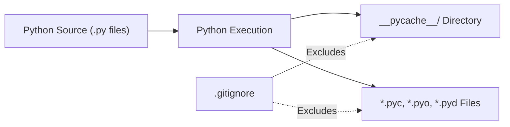
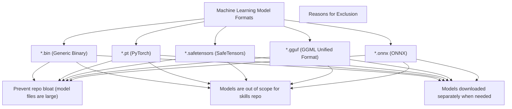
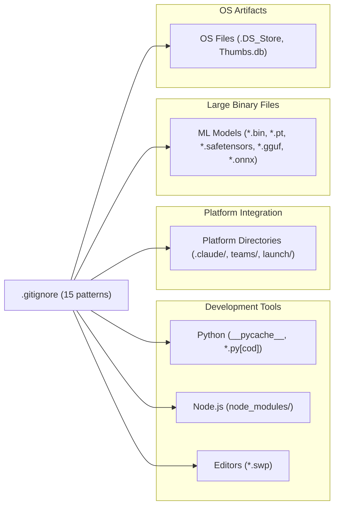

<!-- source: DeepWiki mcp.deepwiki.com · repo mukul975/Anthropic-Cybersecurity-Skills · page 9.1 Repository Configuration · fetched 2026-10-26 -->

# Repository Configuration

Relevant source files

The following files were used as context for generating this wiki page:

- [.gitignore](.gitignore)
- [ATTACK_COVERAGE.md](ATTACK_COVERAGE.md)

This page documents the repository-level configuration files that control Git version control behavior. Specifically, this covers the `.gitignore` patterns that exclude build artifacts, platform-specific files, and large binary assets from the repository.

For information about plugin distribution configuration, see [Marketplace Configuration](#5.1). For CI/CD workflow configuration, see [Automation & CI/CD](#6).

## Overview

The repository uses a `.gitignore` file to exclude files and directories that are:

- Unnecessary or harmful to commit (such as build artifacts or dependencies)
- Large binary files like machine learning models that would bloat the repository size
- OS-specific or editor-specific files that vary per developer environment

This helps keep the repository clean, lightweight, and easy to work with in diverse environments.

## Gitignore Pattern Architecture

The `.gitignore` organizes exclusion patterns by categories targeting:

- Platform-specific directories (e.g. `.claude/`, `teams/`)
- Language-specific artifacts (Python and Node.js)
- Machine learning model file formats commonly used in AI tooling
- Operating system-specific files (macOS, Windows)
- Editor temporary or swap files (Vim)

Below is a diagram depicting these pattern categories and their relationship to the `.gitignore` file:

**Diagram: Gitignore Pattern Categories**

```mermaid
graph TB
    GitIgnore[".gitignore (15 patterns)"]
    
    subgraph "Platform Directories"
        ClaudeDir[".claude/"]
        TeamsDir["teams/"]
        LaunchDir["launch/"]
        NodeModules["node_modules/"]
    end
    
    subgraph "Python Artifacts"
        PyCache["__pycache__/"]
        PyCompiled["*.py[cod]"]
    end
    
    subgraph "ML Model Files"
        BinFiles["*.bin"]
        PTFiles["*.pt"]
        SafeTensors["*.safetensors"]
        GGUF["*.gguf"]
        ONNX["*.onnx"]
    end
    
    subgraph "OS-Specific Files"
        DSStore[".DS_Store"]
        Thumbs["Thumbs.db"]
    end
    
    subgraph "Editor Files"
        VimSwap["*.swp"]
    end
    
    GitIgnore --> ClaudeDir
    GitIgnore --> TeamsDir
    GitIgnore --> LaunchDir
    GitIgnore --> NodeModules
    GitIgnore --> PyCache
    GitIgnore --> PyCompiled
    GitIgnore --> BinFiles
    GitIgnore --> PTFiles
    GitIgnore --> SafeTensors
    GitIgnore --> GGUF
    GitIgnore --> ONNX
    GitIgnore --> DSStore
    GitIgnore --> Thumbs
    GitIgnore --> VimSwap
```

Sources: [.gitignore:1-15]()

## Pattern Categories

### Platform-Specific Directories

These directories contain local or platform-specific configurations, caches, or dependencies that should not be committed to source control:

| Pattern          | Purpose                            | Typical Contents                  |
|------------------|----------------------------------|---------------------------------|
| `.claude/`       | Claude Code platform settings     | Local IDE settings, caches       |
| `teams/`         | Team or workspace-specific files  | Local team configurations        |
| `launch/`        | Launch configuration directory    | Runtime scripts and setups       |
| `node_modules/`  | Node.js dependency packages       | Installed third-party modules    |

- The `.claude/` directory exclusion prevents sharing local project environment data used by Claude Code IDE tooling.
- The `teams/` directory isolates team-specific configurations that vary among users.
- The `launch/` directory contains runtime launch files/scripts which are often generated or volatile.
- The `node_modules/` directory is standard for Node.js projects and can be regenerated from `package.json` state; committing it leads to bloated repos.

Sources: [.gitignore:1-3,14]()

### Language Dependencies and Build Artifacts

Python-related patterns exclude compiled bytecode, cache directories, and interpreter artifacts:

| Pattern        | Description                  | Matches                             |
|----------------|------------------------------|-----------------------------------|
| `__pycache__/` | Python bytecode cache dirs   | All files inside `__pycache__/`   |
| `*.py[cod]`    | Compiled/intermediate files  | `.pyc`, `.pyo`, `.pyd` files      |

- The pattern `*.py[cod]` uses bracket expression to match the extensions `.pyc` (compiled), `.pyo` (optimized), and `.pyd` (Windows DLLs).
- These files result from Python module execution and are ephemeral caches.

**Diagram: Python Artifact Exclusion**

Sources: [.gitignore:4-5]()

Node.js dependencies are handled by excluding the `node_modules/` directory as noted earlier.

### Machine Learning Model Files

Several large binary file extensions used for machine learning model storage are excluded to avoid repository size explosion:

| File Pattern     | Description              | Typical Use Case                          |
|------------------|--------------------------|-----------------------------------------|
| `*.bin`          | Generic binary format     | Various ML models & weights              |
| `*.pt`           | PyTorch model checkpoint  | PyTorch deep learning models             |
| `*.safetensors`  | SafeTensors format        | Safer, faster Hugging Face model storage |
| `*.gguf`         | GGML Unified Format       | Quantized models for llama.cpp           |
| `*.onnx`         | Open Neural Network Exchange | Inter-framework model interoperability |

These patterns indicate the repository contains skills or scripts that may work with AI models, but the actual model files are not committed, instead expected to be downloaded or built externally.

**Diagram: ML Model File Exclusion**

Sources: [.gitignore:6-10]()

### Operating System Files

Common OS-specific metadata files are excluded to maintain a cross-platform clean repo:

| Pattern       | OS      | Description                          |
|---------------|---------|------------------------------------|
| `.DS_Store`   | macOS   | Folder metadata (icon positions, etc.) |
| `Thumbs.db`   | Windows | Image thumbnail cache file          |

These files are automatically created by OSs and hold no meaningful versioned data.

Sources: [.gitignore:11-12]()

### Editor Files

Editor temporary or swap files are excluded:

| Pattern    | Editor  | Purpose                             |
|------------|---------|-----------------------------------|
| `*.swp`    | Vim/Vi  | Swap files storing editing state  |

These files prevent lock conflicts and accidental commits of volatile editor state.

Sources: [.gitignore:13]()

## Configuration Summary

The `.gitignore` reflects multiple cross-cutting concerns:

- Platform integration (`.claude/`, `teams/`, `launch/`, `node_modules/`)
- Python language artifacts (`__pycache__`, `*.py[cod]`)
- Large ML model files excluded (`*.bin`, `*.pt`, `*.safetensors`, etc.)
- OS- and editor-specific temp files (`.DS_Store`, `Thumbs.db`, `*.swp`)

This combination makes sure that transient, bulky, or local environment data do not clutter the repository.

**Pattern Organization Diagram**

Sources: [.gitignore:1-15]()

## Implementation Details

The `.gitignore` file uses standard Git pattern and wildcard syntax:

- Directory patterns end with `/` to exclude entire directories recursively, e.g., `.claude/`
- Wildcards `*` match any characters within a filename, e.g. `*.bin`
- Bracket expressions like `*.py[cod]` match any one character within the brackets, enabling concise multiple extension matching
- Patterns are applied from the repository root; no per-subdirectory `.gitignore` files are present indicating central management

This precise configuration supports diverse developer environments and tooling while keeping the repo size minimal and stable.

Sources: [.gitignore:1-15]()

---

