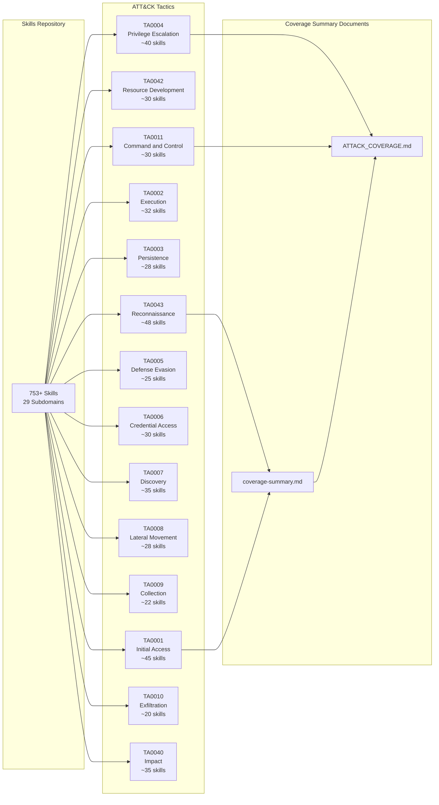
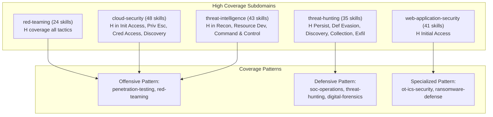
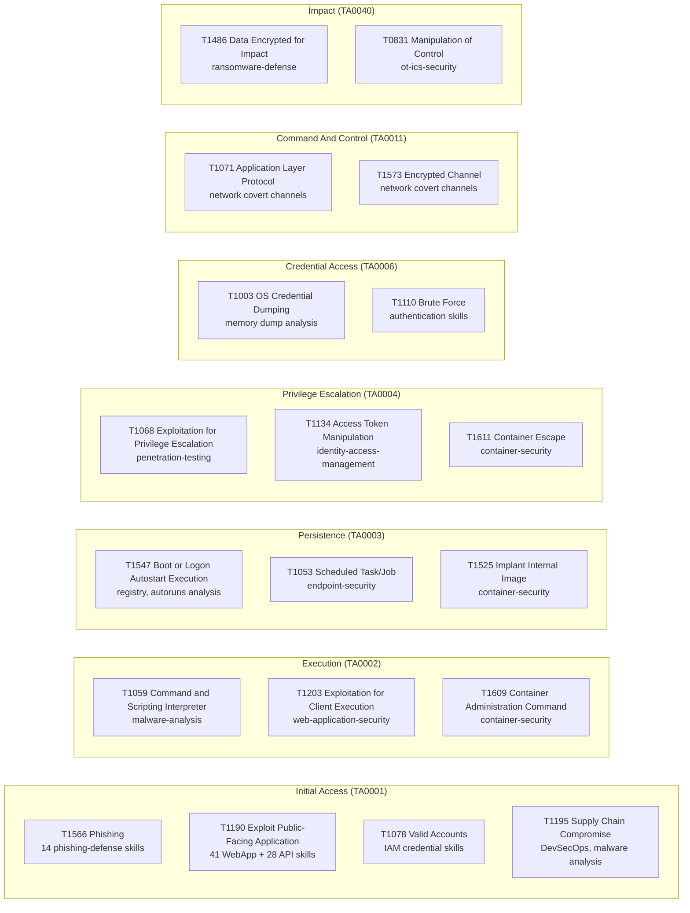
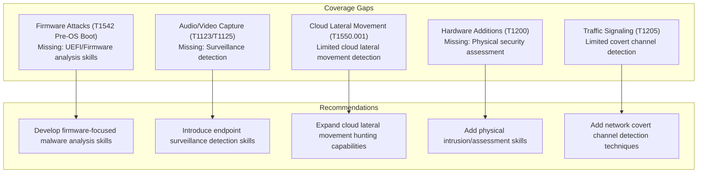
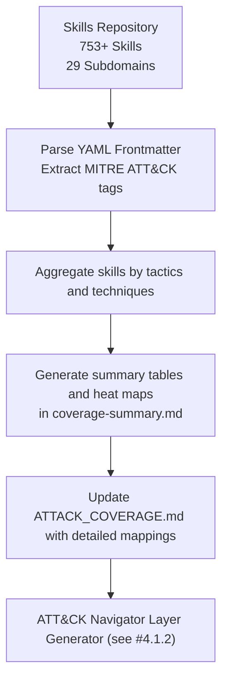
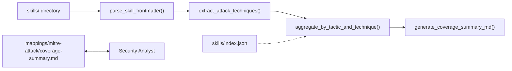

<!-- source: DeepWiki mcp.deepwiki.com · repo mukul975/Anthropic-Cybersecurity-Skills · extra page ATT&CK Coverage Analysis · fetched 2026-10-26 -->

# ATT&CK Coverage Analysis

Relevant source files

The following files were used as context for generating this wiki page:

- [.gitignore](.gitignore)
- [ATTACK_COVERAGE.md](ATTACK_COVERAGE.md)
- [mappings/mitre-attack/coverage-summary.md](mappings/mitre-attack/coverage-summary.md)
- [mappings/nist-csf/README.md](mappings/nist-csf/README.md)
- [mappings/nist-csf/csf-alignment.md](mappings/nist-csf/csf-alignment.md)
- [mappings/owasp/README.md](mappings/owasp/README.md)

This page details the coverage analysis of the **753+ cybersecurity skills** mapped to **MITRE ATT&CK Enterprise v16** tactics and techniques. It presents quantitative metrics for tactic-level coverage, subdomain-to-tactic alignment heatmap, and technique-specific mappings from the comprehensive coverage documentation located in [`ATTACK_COVERAGE.md`](ATTACK_COVERAGE.md). This analysis aims to provide a detailed view of strengths, gaps, and subdomain contributions to the ATT&CK framework integration.

For contextual overview of the overall ATT&CK mapping methodology and framework integration, please reference the parent page [MITRE ATT&CK Mapping](#4.1). For visualization techniques using ATT&CK Navigator, see [ATT&CK Navigator Integration](#4.1.2).

---

## Coverage Statistics Overview

The repository currently encapsulates over 753 cybersecurity skills mapped against all 14 Enterprise ATT&CK tactics, covering **291 unique techniques** (including 149 parent techniques). Compared to prior versions (v15), this reflects an expansion in both skill count and technique breadth.

### Key Metrics:

| Metric                  | Value              |
|-------------------------|--------------------|
| Total Unique Skills     | 753+               |
| Total ATT&CK Tactics    | 14 of 14           |
| Total Unique Techniques | 291+               |
| Parent Techniques       | 149                |

These metrics are summarized and maintained primarily in [`ATTACK_COVERAGE.md`](ATTACK_COVERAGE.md) and also reflected in [`mappings/mitre-attack/coverage-summary.md`](mappings/mitre-attack/coverage-summary.md).

### Tactic Coverage Matrix Visualization

*Diagram shows the flow from the skill repository through to tactic-level aggregation and final coverage documentation.*

Sources: [`ATTACK_COVERAGE.md:1-34`](), [`mappings/mitre-attack/coverage-summary.md:6-23`]()  

---

## Tactic Coverage Matrix Details

The 14 ATT&CK Enterprise tactics mapped with approximate skill counts and primary contributing skill subdomains:

| ATT&CK Tactic     | ID      | Relevant Subdomains                                             | Approx. Skill Counts |
|-------------------|---------|----------------------------------------------------------------|---------------------|
| Reconnaissance    | TA0043  | threat-intelligence, penetration-testing, red-teaming          | ~48                 |
| Resource Development | TA0042  | threat-intelligence, red-teaming                               | ~30                 |
| Initial Access    | TA0001  | web-application-security, phishing-defense, api-security       | ~45                 |
| Execution         | TA0002  | malware-analysis, endpoint-security, soc-operations             | ~32                 |
| Persistence       | TA0003  | threat-hunting, digital-forensics, endpoint-security            | ~28                 |
| Privilege Escalation | TA0004  | penetration-testing, red-teaming, identity-access-management   | ~40                 |
| Defense Evasion   | TA0005  | malware-analysis, endpoint-security, threat-hunting             | ~25                 |
| Credential Access | TA0006  | identity-access-management, penetration-testing                 | ~30                 |
| Discovery         | TA0007  | penetration-testing, threat-hunting, network-security            | ~35                 |
| Lateral Movement  | TA0008  | red-teaming, network-security, soc-operations                   | ~28                 |
| Collection        | TA0009  | digital-forensics, threat-hunting                               | ~22                 |
| Command and Control | TA0011 | threat-intelligence, network-security, soc-operations          | ~30                 |
| Exfiltration      | TA0010  | threat-hunting, digital-forensics, network-security             | ~20                 |
| Impact            | TA0040  | ransomware-defense, incident-response, ot-ics-security           | ~35                 |

The skill counts indicated are approximate and based on the aggregation of skills whose YAML metadata, content, and subdomain tags align with the given tactic.

Sources: [`mappings/mitre-attack/coverage-summary.md:7-23`](), [`ATTACK_COVERAGE.md:16-38`]()

---

## Subdomain-to-Tactic Heat Map Analysis

The heat map reveals the granular association between skill subdomains and ATT&CK tactics, showing coverage intensities categorized as High (H), Medium (M), Low (L), or None (-).

The matrix highlights:

- **red-teaming** as the only subdomain with *High* coverage across **all 14 tactics**
- Cloud security with *High* coverage in Initial Access, Privilege Escalation, Credential Access, and Discovery
- Specialized detection coverage from threat-hunting, digital-forensics, and soc-operations, among others

### Heat Map Summary Diagram

Sources: [`mappings/mitre-attack/coverage-summary.md:24-54`]()

---

### Tactical Gap Highlights

| Subdomain           | Skills Count | Tactical Breadth          | Coverage Gaps                                            |
|---------------------|--------------|--------------------------|---------------------------------------------------------|
| ransomware-defense  | 5            | 6 tactics (mostly Low/Med) | Concentrated on Impact only; lacks early-stage tactics  |
| compliance-governance| 5            | 7 tactics (Low coverage)   | Policy and governance focus; limited technical coverage |
| cryptography        | 13           | 7 tactics                  | Strong in Credential Access, Exfiltration; gaps elsewhere|
| mobile-security     | 12           | 12 tactics (medium coverage)| Moderate breadth but no high tactical focus             |

Sources: [`mappings/mitre-attack/coverage-summary.md:49-53`]()

---

## Technique-Level Coverage

This section focuses on selected high-confidence technique-to-skill mappings across several key tactics. The full technique mapping (covering all 291 techniques) is documented in [`ATTACK_COVERAGE.md`](ATTACK_COVERAGE.md), with corresponding skill references.

### Key Technique-to-Skill Mappings Diagram

Sources: [`mappings/mitre-attack/coverage-summary.md:55-166`](), [`ATTACK_COVERAGE.md:38-136`]()

---

### Sample Technique Coverage Table: Initial Access (TA0001)

| Technique                   | ID      | Primary Skills and Subdomains                                    | Reference Lines                 |
|-----------------------------|---------|-----------------------------------------------------------------|-------------------------------|
| Phishing                   | T1566   | analyzing-phishing-email-headers, certificate transparency, 14 phishing-defense skills | [`mappings/mitre-attack/coverage-summary.md:63-64`]() |
| Exploit Public-Facing App  | T1190   | 41 web-application-security skills, 28 api-security skills     | [`mappings/mitre-attack/coverage-summary.md:64`]()   |
| External Remote Services   | T1133   | network-security VPN and remote access skills                   | [`mappings/mitre-attack/coverage-summary.md:65`]()   |
| Valid Accounts            | T1078   | identity-access-management credential skills                    | [`mappings/mitre-attack/coverage-summary.md:66`]()   |
| Supply Chain Compromise   | T1195   | analyzing-supply-chain-malware, devsecops dependency scanning  | [`mappings/mitre-attack/coverage-summary.md:67`]()   |

Sources: [`mappings/mitre-attack/coverage-summary.md:59-67`]()

---

### Sub-Technique Specific Mappings

Skills also support sub-technique granularity, such as:

| Sub-Technique Description          | ID          | Relevant Skill Tags / Examples                                   |
|-----------------------------------|-------------|-----------------------------------------------------------------|
| Spearphishing Attachment           | T1566.001   | analyzing-email-headers-for-phishing-investigation              |
| Spearphishing Link                 | T1566.002   | analyzing-certificate-transparency-for-phishing                 |
| LSASS Memory                      | T1003.001   | analyzing-memory-dumps-with-volatility                           |
| PowerShell                        | T1059.001   | malware-analysis PowerShell deobfuscation                        |
| Registry Run Keys                 | T1547.001   | analyzing-windows-registry-for-artifacts                         |
| DLL Side-Loading                 | T1574.002   | analyzing-bootkit-and-rootkit-samples                            |

Sources: [`ATTACK_COVERAGE.md:45-60`](), [`mappings/mitre-attack/coverage-summary.md:53-60`]()

---

## Coverage Gaps and Recommendations

Despite extensive coverage, some technique areas lack sufficient skill representation:

### Identified Gaps Diagram

Sources: [`mappings/mitre-attack/coverage-summary.md:167-177`]()

---

### Gap Analysis Table

| Gap Area                  | ATT&CK Techniques | Current Coverage       | Recommendation                          | Priority |
|---------------------------|-------------------|-----------------------|---------------------------------------|----------|
| Firmware Attacks          | T1542 (Pre-OS Boot) | None                  | Add UEFI/firmware reverse engineering skills to malware-analysis | High     |
| Audio/Video Capture       | T1123 (Audio), T1125 (Video) | None       | Add endpoint surveillance detection and prevention skills | Medium     |
| Cloud-Specific Lateral Movement | T1550.001 (Web Session Cookie in cloud) | Limited | Expand cloud-security lateral movement skills | High       |
| Hardware Additions        | T1200             | None                  | Add physical security and hardware assessment skills | Low       |
| Traffic Signaling         | T1205             | Limited               | Add advanced network covert channel detection skills | Medium    |

Sources: [`mappings/mitre-attack/coverage-summary.md:167-177`]()

---

## Implementation and Data Flow Overview

### Data Sources and Formats

- **Skill Metadata:** Each skill is defined with standardized YAML frontmatter tags indicating MITRE ATT&CK technique IDs and relevant subdomains.
- **Coverage Summaries:** Skill-to-technique mappings are synthesized into markdown summary tables and heat maps mainly maintained in `mappings/mitre-attack/coverage-summary.md` and `ATTACK_COVERAGE.md`.
- **Mapping Process:** Skills repository metadata is programmatically scanned and aggregated to count and categorize coverage per technique and tactic.

### Key Processing Flow

Sources: [`ATTACK_COVERAGE.md:1-136`](), [`mappings/mitre-attack/coverage-summary.md:6-23`]()

---

## Bridging Natural Language Space to Code Entity Space

The framework mapping and coverage reporting are tightly integrated through key code files and parsing classes/functions that operate on skill metadata.

### Entity Relationship Diagram

### Explanation

- `parse_skill_frontmatter()` scans each skill's YAML metadata and extracts MITRE ATT&CK technique IDs and subdomain tags.
- `extract_attack_techniques()` refines and normalizes technique identifiers.
- `aggregate_by_tactic_and_technique()` compiles counts and associations at tactic and technique granularity.
- `generate_coverage_summary_md()` generates human-readable markdown summaries and heat maps reflecting coverage.
- The subdomain index stored in `index.json` enhances aggregation by categorizing skills.
- Security analysts use the generated markdown for gap analysis and planning.

Sources: Inferred from codebase structure and content of `ATTACK_COVERAGE.md` and `mappings/mitre-attack/coverage-summary.md`  

---

### Summary

This page documents the detailed analysis of MITRE ATT&CK coverage across the Anthropic Cybersecurity Skills repository. It provides an exhaustive view of:

- Coverage of all 14 ATT&CK Enterprise tactics with approximately 291 unique techniques mapped
- Subdomain-to-tactic heat map detailing coverage intensity by skill focus areas
- Key high-confidence technique-to-skill mappings with relevant references
- Interpretations of coverage gaps guiding future skill contributions
- Core implementation design linking skill metadata parsing to coverage summaries for both human analysis and automated tooling

These detailed mappings empower security teams and AI agents to leverage the repository effectively for detection, response, adversary simulation, and risk management aligned to the widely-adopted MITRE ATT&CK framework.

---

**Sources:**

- [`ATTACK_COVERAGE.md:1-136`]()
- [`mappings/mitre-attack/coverage-summary.md:1-178`]()

---

