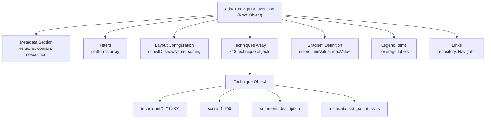
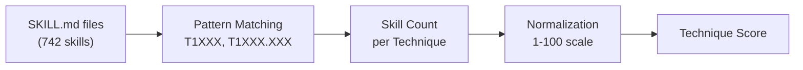
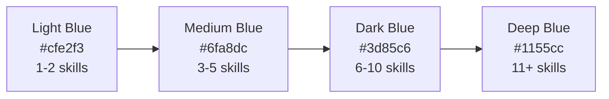
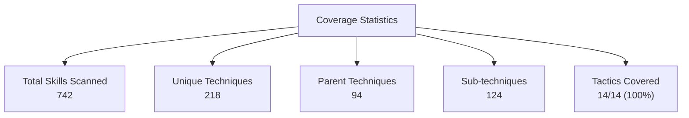
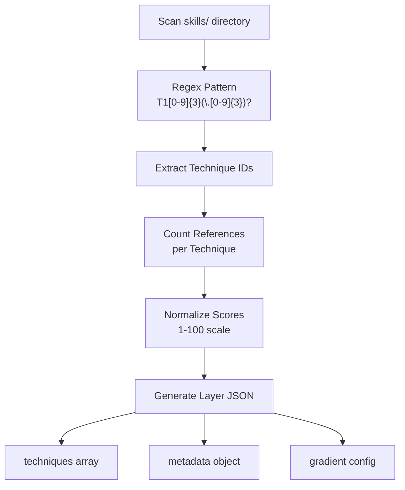

<!-- source: DeepWiki mcp.deepwiki.com · repo mukul975/Anthropic-Cybersecurity-Skills · extra page ATT&CK Navigator Integration · fetched 2026-10-26 -->

# ATT&CK Navigator Integration

<details>
<summary>Relevant source files</summary>

The following files were used as context for generating this wiki page:

- [mappings/README.md](mappings/README.md)
- [mappings/attack-navigator-layer.json](mappings/attack-navigator-layer.json)
- [mappings/mitre-attack/README.md](mappings/mitre-attack/README.md)

</details>


This document describes the ATT&CK Navigator layer integration system, which visualizes the repository's MITRE ATT&CK technique coverage through a standardized JSON layer file. The Navigator layer enables interactive exploration of which techniques are covered by the skills collection and the depth of that coverage.

For information about the underlying technique extraction and coverage analysis, see [ATT&CK Coverage Analysis](#4.1.1). For details on NIST CSF mapping, see [NIST CSF 2.0 Mapping](#4.2).

## Overview

The repository generates a MITRE ATT&CK Navigator layer file at [mappings/attack-navigator-layer.json:1-3594]() that maps 218 unique techniques across 742 skills. This layer uses the Navigator v4.5 format specification and targets ATT&CK Enterprise v14, providing a visual heat map where technique coverage depth is represented through a blue gradient scoring system.

Sources: [mappings/README.md:1-89](), [mappings/attack-navigator-layer.json:1-10]()

## Layer File Structure

The Navigator layer follows a standardized JSON schema with several key components:



**Figure 1: Navigator Layer JSON Structure**

Sources: [mappings/attack-navigator-layer.json:1-35](), [mappings/attack-navigator-layer.json:36-52]()

### Core Metadata Fields

The layer metadata section defines compatibility and identification:

| Field | Value | Purpose |
|-------|-------|---------|
| `versions.attack` | `"14"` | ATT&CK Enterprise version |
| `versions.navigator` | `"4.9.1"` | Navigator tool version |
| `versions.layer` | `"4.5"` | Layer format specification |
| `domain` | `"enterprise-attack"` | ATT&CK domain scope |
| `name` | `"Anthropic Cybersecurity Skills - ATT&CK Coverage"` | Display name |

Sources: [mappings/attack-navigator-layer.json:2-7]()

### Platform Filters

The layer includes all ATT&CK platforms to ensure complete coverage visibility:

```json
"platforms": [
  "Linux", "macOS", "Windows", "Network", "PRE",
  "Containers", "Office 365", "SaaS", 
  "Google Workspace", "IaaS", "Azure AD"
]
```

Sources: [mappings/attack-navigator-layer.json:11-23]()

## Technique Scoring Methodology

Each technique in the `techniques` array receives a score proportional to the number of skills that reference it, normalized to a 1-100 scale.



**Figure 2: Scoring Pipeline**

### Scoring Formula

The scoring algorithm maps skill counts to the 1-100 range. For example, based on the provided `attack-navigator-layer.json`:

- **T1059.001 (PowerShell)**: 26 skills → score 100 (maximum coverage) [mappings/attack-navigator-layer.json:822-835]()
- **T1055 (Process Injection)**: 17 skills → score 65 [mappings/attack-navigator-layer.json:598-611]()
- **T1053.005 (Scheduled Task)**: 16 skills → score 62 [mappings/attack-navigator-layer.json:570-583]()
- **T1003.006 (DCSync)**: 13 skills → score 50 [mappings/attack-navigator-layer.json:134-147]()
- **T1005 (Data from Local System)**: 2 skills → score 8 [mappings/attack-navigator-layer.json:150-163]()
- **T1020 (Automated Exfiltration)**: 1 skill → score 4 [mappings/attack-navigator-layer.json:198-211]()

The top 10 most-covered techniques are documented at [mappings/README.md:59-72]().

Sources: [mappings/README.md:74-76](), [mappings/attack-navigator-layer.json:822-835]()

### Technique Object Structure

Each technique entry contains comprehensive metadata:

```json
{
  "techniqueID": "T1003.006",
  "score": 50,
  "comment": "DCSync - Referenced in 13 skill(s)",
  "enabled": true,
  "metadata": [
    {
      "name": "skill_count",
      "value": "13"
    },
    {
      "name": "skills",
      "value": "analyzing-windows-event-logs-in-splunk, conducting-domain-persistence-with-dcsync, ..."
    }
  ]
}
```

Sources: [mappings/attack-navigator-layer.json:134-147]()

## Color Gradient Mapping

The layer uses a blue gradient to visualize coverage depth:



**Figure 3: Color Gradient Scale**

The gradient configuration is defined at [mappings/attack-navigator-layer.json:3526-3534]():

```json
"gradient": {
  "colors": [
    "#cfe2f3",
    "#6fa8dc",
    "#1155cc"
  ],
  "minValue": 1,
  "maxValue": 100
}
```

### Legend Items

The layer includes four legend items for user reference:

| Label | Color | Meaning |
|-------|-------|---------|
| "1-2 skills (Low coverage)" | `#cfe2f3` | Light blue |
| "3-5 skills (Moderate coverage)" | `#6fa8dc` | Medium blue |
| "6-10 skills (Good coverage)" | `#3d85c6` | Medium-dark blue |
| "11+ skills (Strong coverage)" | `#1155cc` | Dark blue |

Sources: [mappings/README.md:49-57](), [mappings/attack-navigator-layer.json:3535-3552]()

## Layout Configuration

The layer specifies display preferences for the Navigator interface:

| Setting | Value | Purpose |
|---------|-------|-------------|
| `layout` | `"side"` | Tactic organization |
| `showID` | `true` | Display technique IDs |
| `showName` | `true` | Display technique names |
| `showAggregateScores` | `false` | Hide aggregate scores |
| `expandedSubtechniques` | `"annotated"` | Expand annotated sub-techniques |
| `sorting` | `3` | Sort order |

Sources: [mappings/attack-navigator-layer.json:25-34]()

## Coverage Statistics

The layer metadata includes comprehensive statistics:



**Figure 4: Coverage Metrics**

Sources: [mappings/README.md:20-29]()

### Tactic-Level Coverage

All 14 ATT&CK tactics have coverage, with varying technique counts:

| Tactic | Techniques Covered |
|--------|-------------------|
| Defense Evasion | 36 |
| Credential Access | 33 |
| Persistence | 29 |
| Initial Access | 17 |
| Command and Control | 17 |
| Privilege Escalation | 13 |
| Discovery | 12 |
| Exfiltration | 12 |
| Reconnaissance | 11 |
| Collection | 10 |
| Lateral Movement | 9 |
| Execution | 8 |
| Resource Development | 6 |
| Impact | 5 |

Sources: [mappings/README.md:31-48]()

## Loading the Navigator Layer

There are three methods to load the layer file into the ATT&CK Navigator:

```mermaid
sequenceDiagram
    participant User
    participant Browser
    participant Navigator["ATT&CK Navigator<br/>mitre-attack.github.io"]
    participant Local["Local File<br/>attack-navigator-layer.json"]
    participant Remote["GitHub Raw URL"]
    
    Note over User,Remote: Method 1: Upload Local File
    User->>Browser: Navigate to Navigator
    Browser->>Navigator: Load application
    User->>Navigator: Click "Open Existing Layer"
    User->>Navigator: Select "Upload from local"
    User->>Local: Choose file
    Local->>Navigator: Upload JSON
    Navigator->>Browser: Render matrix
    
    Note over User,Remote: Method 2: Load from URL
    User->>Navigator: Click "Open Existing Layer"
    User->>Navigator: Select "Load from URL"
    User->>Navigator: Paste raw GitHub URL
    Navigator->>Remote: Fetch JSON
    Remote->>Navigator: Return layer
    Navigator->>Browser: Render matrix
```

**Figure 5: Layer Loading Workflow**

### Loading Instructions

**Method 1: Local Upload**
1. Open [https://mitre-attack.github.io/attack-navigator/](https://mitre-attack.github.io/attack-navigator/)
2. Click **Open Existing Layer**
3. Select **Upload from local**
4. Choose `attack-navigator-layer.json`
5. View the rendered matrix with blue-shaded techniques

**Method 2: Direct URL Load**
1. Open the Navigator
2. Click **Open Existing Layer**
3. Select **Load from URL**
4. Paste the raw GitHub URL for the layer file
5. The matrix loads automatically

**Method 3: GitHub Integration**
1. Navigate to the `mappings/` directory on GitHub
2. Click the layer file
3. Use the "Download raw file" option
4. Follow Method 1 steps

Sources: [mappings/README.md:11-19]()

## Layer Metadata Object

The layer includes a structured metadata array for documentation:

```json
"metadata": [
  {
    "name": "repository",
    "value": "Anthropic-Cybersecurity-Skills"
  },
  {
    "name": "total_techniques",
    "value": "218"
  },
  {
    "name": "total_skills_scanned",
    "value": "742"
  },
  {
    "name": "generated_date",
    "value": "2026-03-11"
  },
  {
    "name": "attack_version",
    "value": "14"
  },
  {
    "name": "description",
    "value": "Auto-generated from skill SKILL.md files referencing ATT&CK technique IDs"
  }
]
```

Sources: [mappings/attack-navigator-layer.json:3558-3583]()

## Technique Examples

### High-Coverage Technique

PowerShell (T1059.001) has the highest coverage with 26 skills:

```json
{
  "techniqueID": "T1059.001",
  "score": 100,
  "comment": "PowerShell - Referenced in 26 skill(s)",
  "enabled": true,
  "metadata": [
    {
      "name": "skill_count",
      "value": "26"
    },
    {
      "name": "skills",
      "value": "analyzing-apt-group-with-mitre-navigator, analyzing-macro-malware-in-office-documents, analyzing-powershell-empire-artifacts, ..."
    }
  ]
}
```

Sources: [mappings/attack-navigator-layer.json:822-835]()

### Parent-Subtechnique Relationship

Process Injection (T1055) and its sub-techniques demonstrate the hierarchy:

- **T1055** (Parent): 17 skills → score 65 [mappings/attack-navigator-layer.json:598-611]()
- **T1055.001** (DLL Injection): 4 skills → score 15 [mappings/attack-navigator-layer.json:612-625]()
- **T1055.012** (Process Hollowing): 6 skills → score 23 [mappings/attack-navigator-layer.json:640-653]()
- **T1055.003** (Thread Execution Hijacking): 3 skills → score 12 [mappings/attack-navigator-layer.json:626-639]()

Sources: [mappings/attack-navigator-layer.json:598-660]()

## Interactive Features

The Navigator supports several interaction modes enabled by the layer configuration:

| Feature | Setting | Description |
|---------|---------|-------------|
| Tactic Row Background | `#205080` | Dark blue background for tactic rows |
| Select Across Tactics | `true` | Select techniques across multiple tactics |
| Select Subtechniques with Parent | `true` | Auto-select children when parent selected |
| Visible Technique Selection | `false` | Disable bulk visible selection |

Sources: [mappings/attack-navigator-layer.json:3553-3557]()

## External Links

The layer embeds navigational links for reference:

```json
"links": [
  {
    "label": "Repository",
    "url": "https://github.com/anthropics/cybersecurity-skills"
  },
  {
    "label": "ATT&CK Navigator",
    "url": "https://mitre-attack.github.io/attack-navigator/"
  }
]
```

Sources: [mappings/attack-navigator-layer.json:3584-3593]()

## Related Documentation

Additional MITRE ATT&CK resources:

- **MITRE ATT&CK Framework**: [https://attack.mitre.org/](https://attack.mitre.org/)
- **ATT&CK Navigator Repository**: [https://github.com/mitre-attack/attack-navigator](https://github.com/mitre-attack/attack-navigator)
- **Layer Format Specification**: Navigator v4.5 format documentation

Sources: [mappings/README.md:84-89]()

## Technique Extraction Process

The layer is auto-generated by scanning all `SKILL.md` files for ATT&CK technique ID patterns:



**Figure 6: Layer Generation Pipeline**

The methodology scans for both parent techniques (e.g., `T1003`) and sub-techniques (e.g., `T1003.006`), extracting them from skill frontmatter tags and markdown content.

Sources: [mappings/README.md:74-76]()

## Use Cases

The Navigator layer supports several security workflows:

**1. Gap Analysis**: Identify techniques with low or no coverage to prioritize new skill development

**2. Training Planning**: Visualize which tactics have strong coverage for curriculum development

**3. Detection Strategy**: Map detection engineering efforts to technique coverage

**4. Threat Modeling**: Compare threat actor TTPs against repository coverage

**5. Compliance Mapping**: Demonstrate ATT&CK alignment for security frameworks

Sources: [mappings/README.md:1-4]()

---

