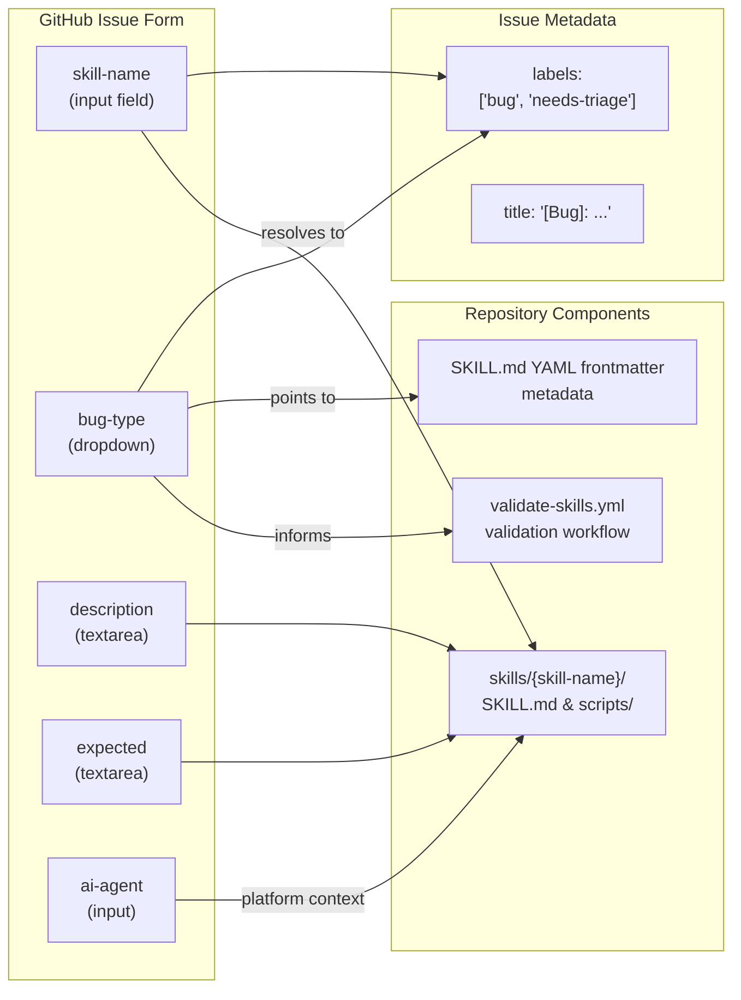
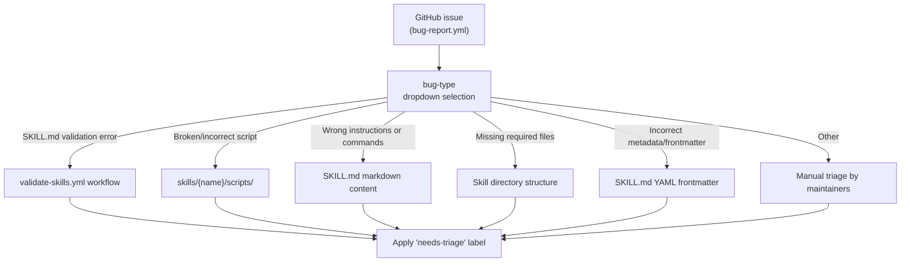
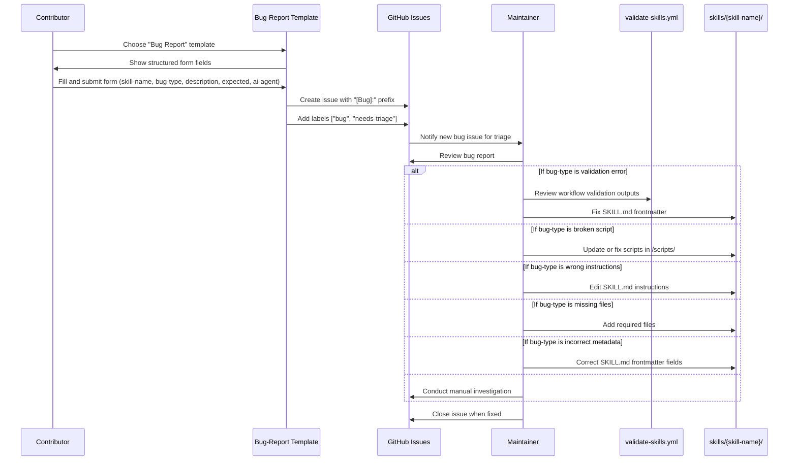
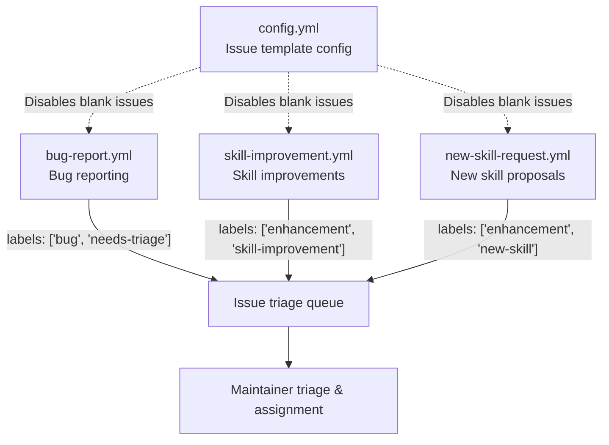

<!-- source: DeepWiki mcp.deepwiki.com · repo mukul975/Anthropic-Cybersecurity-Skills · extra page Bug Report Template · fetched 2026-10-26 -->

# Bug Report Template

<details>
<summary>Relevant source files</summary>

The following files were used as context for generating this wiki page:

- [.github/ISSUE_TEMPLATE/bug-report.yml](.github/ISSUE_TEMPLATE/bug-report.yml)
- [.github/ISSUE_TEMPLATE/config.yml](.github/ISSUE_TEMPLATE/config.yml)
- [.github/ISSUE_TEMPLATE/new-skill-request.yml](.github/ISSUE_TEMPLATE/new-skill-request.yml)
- [.github/ISSUE_TEMPLATE/skill-improvement.yml](.github/ISSUE_TEMPLATE/skill-improvement.yml)

</details>


This document details the bug report issue template used in the Anthropic Cybersecurity Skills repository to capture structured information about skill defects, validation errors, and incorrect content.

The bug report template enables contributors to report issues with existing skills in a standardized format, ensuring all necessary diagnostic information is collected. For reporting improvements to existing skills, see [Skill Improvement Templates](#7.2.2). For proposing new skills, see [New Skill Request Templates](#7.2.3).

**Sources:** [.github/ISSUE_TEMPLATE/bug-report.yml:1-51]()

## Template Configuration

The bug report template is defined as a GitHub issue form in `.github/ISSUE_TEMPLATE/bug-report.yml`. It leverages GitHub’s issue form schema to provide structured fields, automatic labeling, and validation rules, ensuring consistent data collection for skill bugs.

### Basic Metadata

| Property  | Value                                                              | Purpose                                        |
|-----------|--------------------------------------------------------------------|------------------------------------------------|
| `name`    | `Bug Report`                                                       | Display name in the issue template selector   |
| `description` | `Report a SKILL.md validation error, broken script, or incorrect content` | Explains template purpose                      |
| `title`   | `[Bug]: `                                                         | Auto-prefixes issue titles with bug indicator |
| `labels`  | `["bug", "needs-triage"]`                                         | Automatically tags issues for triage workflow |

The `needs-triage` label routes the bug reports into a review queue for maintainers to categorize and assign priority.

**Sources:** [.github/ISSUE_TEMPLATE/bug-report.yml:1-4]()

## Form Field Structure

The form collects detailed information via five fields using GitHub issue form types. These fields ensure key diagnostic data is always provided.

| Field ID   | Type      | Label            | Required | Purpose                                             |
|------------|-----------|------------------|----------|-----------------------------------------------------|
| `skill-name` | `input`   | Skill Name       | Yes      | Identifies the bug-affected skill by its directory  |
| `bug-type`   | `dropdown`| Bug Type         | Yes      | Categorizes the bug from predefined types           |
| `description`| `textarea`| Description      | Yes      | Detailed explanation of the bug                      |
| `expected`   | `textarea`| Expected Behavior| Yes      | What the correct behavior should be                  |
| `ai-agent`   | `input`   | AI Agent Used    | No       | (Optional) AI agent used when encountering the bug  |

**Sources:** [.github/ISSUE_TEMPLATE/bug-report.yml:10-51]()

### Field Descriptions and Validations

- `skill-name`: Required field, expects the exact kebab-case skill directory name (e.g., `analyzing-disk-image-with-autopsy`) to resolve the location in `/skills/` on the repository.
- `bug-type`: Required dropdown field with six options to assist triage and routing (see next section).
- `description`: Required multi-line markdown textarea detailing what the reporter observed.
- `expected`: Required multi-line markdown textarea describing intended correct behavior.
- `ai-agent`: Optional single-line text input to capture environment or AI agent details.

Placeholders provide guidance, e.g., for `skill-name`: “e.g., analyzing-disk-image-with-autopsy” and for `ai-agent:` “e.g., Claude Code, GitHub Copilot, Codex CLI”.

**Sources:** [.github/ISSUE_TEMPLATE/bug-report.yml:15-51]()

### Mapping of Fields to Repository Entities



**Sources:** [.github/ISSUE_TEMPLATE/bug-report.yml:10-51]()

## Bug Type Categorization

The `bug-type` field guides issue triage by categorizing bugs into one of six distinct classes. This classification helps maintainers prioritize fixes and assign issues effectively.

| Bug Type                     | Focus Area                 | Relevant Repository Files/Locations               |
|------------------------------|----------------------------|----------------------------------------------------|
| SKILL.md validation error     | YAML frontmatter correctness | Validation logs from `.github/workflows/validate-skills.yml` |
| Broken/incorrect script       | Executable scripts          | `skills/{skill-name}/scripts/` directory           |
| Wrong instructions or commands| Markdown instructions       | `skills/{skill-name}/SKILL.md` content              |
| Missing required files        | Skill directory structure   | `skills/{skill-name}/` including subdirectories     |
| Incorrect metadata/frontmatter| SKILL.md header fields      | Lines 1-20 of `skills/{skill-name}/SKILL.md`        |
| Other                        | General or unclassified      | Varies                                              |

**Sources:** [.github/ISSUE_TEMPLATE/bug-report.yml:18-29]()

### Bug Type Routing and Triage Flow



This routing ensures bugs with specific categories can either be programmatically checked (e.g., validation errors) or manually triaged by maintainers with appropriate labels.

**Sources:** [.github/ISSUE_TEMPLATE/bug-report.yml:18-29]()

## Submission Workflow: Bug Report Lifecycle

The bug report process integrates tightly with GitHub workflows and issue management to streamline bug detection and resolution:



This workflow enforces the repository’s high-quality standards via triaged maintenance, validation checks, and clear issue reporting.

**Sources:** [.github/ISSUE_TEMPLATE/bug-report.yml:1-51]()

## Form Rendering and User Experience

GitHub renders the `.yml` template file as an interactive web form when contributors start a new issue with the bug report template. Field types and validations are automatically enforced by GitHub’s UI:

| YAML Field Type | Rendered Input Type    | Validation Behavior                  |
|-----------------|-----------------------|------------------------------------|
| `input`         | Single-line text box  | Required fields block submission    |
| `dropdown`      | Select dropdown menu  | User must select one option         |
| `textarea`      | Multi-line text area  | Supports markdown and multiline text|
| `markdown`      | Read-only text block  | Displays informative static content |

The first form field is a markdown block greeting the user with a thanks message and instructions.

**Sources:** [.github/ISSUE_TEMPLATE/bug-report.yml:6-9]()

## Relationship Within the Repository's Issue Templates

The bug report template is part of a family of structured issue templates configured in `.github/ISSUE_TEMPLATE/` with a global config `.github/ISSUE_TEMPLATE/config.yml` disabling blank issues and providing security and discussion contact links. The main templates are:



This ecosystem enables clear division between bugs, improvements, and new skill requests, improving repository management and contributor experience.

**Sources:** [.github/ISSUE_TEMPLATE/config.yml:1-9](.github/ISSUE_TEMPLATE/bug-report.yml:1-51)(.github/ISSUE_TEMPLATE/skill-improvement.yml:1-42)(.github/ISSUE_TEMPLATE/new-skill-request.yml:1-59)()

## Example Bug Report Payload

A typical submitted bug report rendered as markdown in GitHub Issues looks like:

```markdown
## Skill Name
analyzing-disk-image-with-autopsy

## Bug Type
Broken/incorrect script

## Description
The `mount_image.sh` script fails with permission denied error when run as non-root user.

## Expected Behavior
Script should either detect insufficient permissions and prompt for sudo, or include instructions to run with elevated privileges.

## AI Agent Used
Claude Code
```

The `skill-name` directly maps to the directory path `skills/analyzing-disk-image-with-autopsy/`, allowing maintainers to promptly locate and resolve the bug.

**Sources:** [.github/ISSUE_TEMPLATE/bug-report.yml:10-51]()

---

This detailed bug report template and associated workflow provide a structured mechanism for identifying, categorizing, and resolving issues in the Anthropic Cybersecurity Skills repository, maintaining the high quality and usability of the skill set.

---

