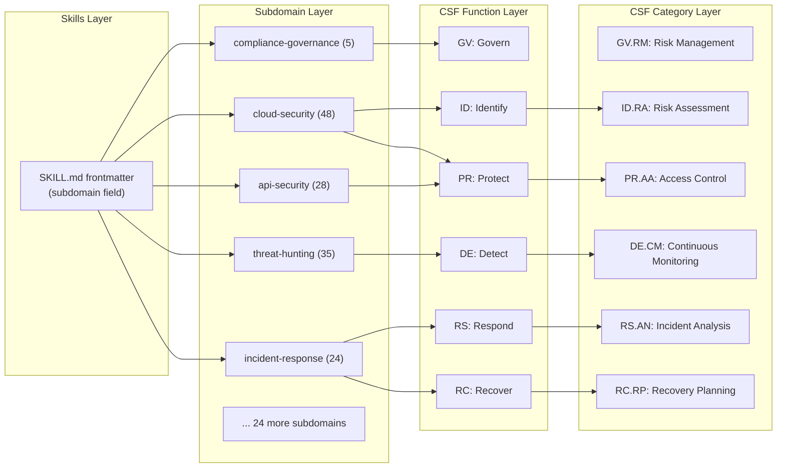
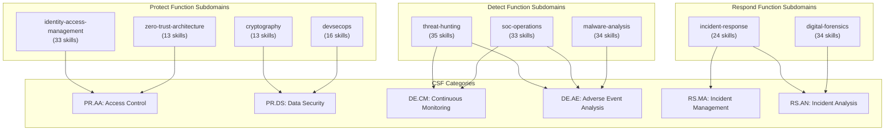
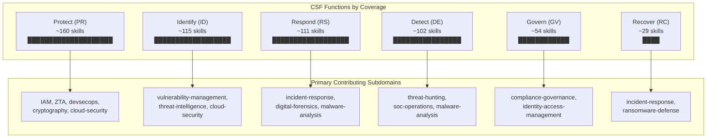
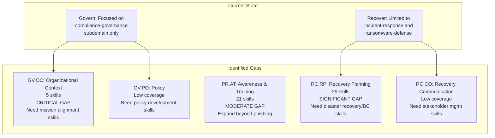

<!-- source: DeepWiki mcp.deepwiki.com · repo mukul975/Anthropic-Cybersecurity-Skills · extra page CSF Alignment Details · fetched 2026-10-26 -->

# CSF Alignment Details

Relevant source files

The following files were used as context for generating this wiki page:

- [mappings/mitre-attack/coverage-summary.md](mappings/mitre-attack/coverage-summary.md)
- [mappings/nist-csf/README.md](mappings/nist-csf/README.md)
- [mappings/nist-csf/csf-alignment.md](mappings/nist-csf/csf-alignment.md)
- [mappings/owasp/README.md](mappings/owasp/README.md)
- [skills/implementing-gdpr-data-protection-controls/SKILL.md](skills/implementing-gdpr-data-protection-controls/SKILL.md)
- [skills/implementing-iso-27001-information-security-management/SKILL.md](skills/implementing-iso-27001-information-security-management/SKILL.md)
- [skills/implementing-pci-dss-compliance-controls/SKILL.md](skills/implementing-pci-dss-compliance-controls/SKILL.md)
- [skills/performing-nist-csf-maturity-assessment/SKILL.md](skills/performing-nist-csf-maturity-assessment/SKILL.md)
- [skills/performing-soc2-type2-audit-preparation/SKILL.md](skills/performing-soc2-type2-audit-preparation/SKILL.md)

This document details the subdomain-to-category alignment that maps the 817 cybersecurity skills to NIST Cybersecurity Framework (CSF) 2.0 functions and categories. It provides the complete mapping table, coverage analysis across the six CSF core functions, and gap identification for underrepresented categories.

For general information about the NIST CSF 2.0 mapping approach and function descriptions, see [NIST CSF 2.0 Mapping](#4.2). For MITRE ATT&CK framework mappings, see [MITRE ATT&CK Mapping](#4.1).

## Alignment Methodology

The CSF alignment operates through a two-level mapping strategy: skills are first organized into **29 subdomains** (defined in `index.json`), and each subdomain is then mapped to one or more **CSF categories** within the six core functions (Govern, Identify, Protect, Detect, Respond, Recover). This approach enables efficient categorization of skills without requiring manual CSF tagging on every individual skill.

### Data Flow: Skill to CSF Category
The following diagram illustrates how a skill's metadata (subdomain) determines its alignment with the NIST CSF 2.0 categories.

**Sources:** [mappings/nist-csf/csf-alignment.md:1-39](), [mappings/nist-csf/README.md:14-90]()

## Complete Subdomain-to-CSF Alignment

The complete alignment is defined in `mappings/nist-csf/csf-alignment.md` as a reference table mapping each skill subdomain to their primary CSF function(s), specific CSF category IDs, and alignment rationale.

### Alignment Table Structure

| Field | Description | Example |
|-------|-------------|---------|
| **Subdomain (Skills)** | Subdomain name with skill count | `api-security (28)` |
| **Primary CSF Function** | Main CSF function(s) | `Protect (PR)` |
| **CSF Categories** | Specific category IDs | `PR.DS, PR.PS` |
| **Alignment Rationale** | Explanation of mapping | `API hardening, authentication, input validation` |

**Sources:** [mappings/nist-csf/csf-alignment.md:13-38]()

### Key Subdomain Mappings

#### High-Coverage Subdomains
The repository shows significant concentration in technical subdomains like `cloud-security` (48 skills) and `web-application-security` (41 skills), which drive the majority of coverage in the **Protect** and **Identify** functions.

**Sources:** [mappings/nist-csf/csf-alignment.md:13-38](), [mappings/nist-csf/README.md:14-90]()

#### Multi-Function Subdomains
Several subdomains reflect the cross-functional nature of modern security operations:

| Subdomain | Functions | Categories | Rationale |
|-----------|-----------|------------|-----------|
| `cloud-security` (48) | Identify, Protect | `ID.AM`, `PR.DS`, `PR.PS`, `PR.IR` | Asset management + data protection + infrastructure |
| `incident-response` (24) | Respond, Recover | `RS.MA`, `RS.AN`, `RS.MI`, `RS.CO`, `RC.RP`, `RC.CO` | Full incident lifecycle |
| `soc-operations` (33) | Detect, Respond, Govern | `DE.CM`, `DE.AE`, `RS.MA`, `GV.OV` | Monitoring + triage + oversight |
| `threat-intelligence` (43) | Identify, Detect | `ID.RA`, `DE.AE` | Risk assessment + threat detection |
| `devsecops` (16) | Protect, Govern | `PR.PS`, `GV.SC` | Platform security + supply chain |

**Sources:** [mappings/nist-csf/csf-alignment.md:16-38]()

## Coverage Analysis by CSF Function

The alignment produces a distribution across the six CSF core functions. While the collection is robust in **Protect** (~160 skills) and **Identify** (~115 skills), the **Recover** function remains an area for expansion.

### Function Coverage Distribution

**Sources:** [mappings/nist-csf/README.md:92-101]()

### Coverage Metrics by Function

| Function | Approx. Skills | Primary Subdomains | Coverage Assessment |
|----------|--------|------------------|---------------------|
| Protect (PR) | ~160 | IAM, cloud-security, cryptography | Strong coverage across access control and data security. |
| Identify (ID) | ~115 | vulnerability-management, threat-intelligence | Strong coverage in risk assessment and asset discovery. |
| Respond (RS) | ~111 | incident-response, digital-forensics | Strong coverage across the investigation lifecycle. |
| Detect (DE) | ~102 | threat-hunting, soc-operations | Good coverage in proactive monitoring and analysis. |
| Govern (GV) | ~54 | compliance-governance, IAM | Focused primarily on compliance frameworks (PCI, SOC2, GDPR). |
| Recover (RC) | ~29 | incident-response, ransomware-defense | Limited to specific recovery planning and communication skills. |

**Sources:** [mappings/nist-csf/README.md:16-101]()

## Coverage Analysis by CSF Category

The alignment maps skills to **22 CSF categories** across the six functions. Category-level analysis reveals specific strengths and gaps.

### Govern (GV) Categories
The Govern function was introduced in CSF 2.0 and is primarily populated by the `compliance-governance` subdomain.

| Category | ID | Subdomain Coverage |
|----------|-----|-------------------|
| Organizational Context | GV.OC | compliance-governance |
| Risk Management Strategy | GV.RM | compliance-governance, vulnerability-management |
| Roles, Responsibilities | GV.RR | compliance-governance, identity-access-management |
| Policy | GV.PO | compliance-governance, zero-trust-architecture |
| Oversight | GV.OV | compliance-governance, soc-operations |
| Supply Chain Risk Mgmt | GV.SC | devsecops, container-security |

**Sources:** [mappings/nist-csf/README.md:20-27](), [mappings/nist-csf/csf-alignment.md:44-51]()

### Identify (ID) Categories

| Category | ID | Subdomain Coverage | Skill Count |
|----------|-----|-------------------|-------------|
| Asset Management | ID.AM | cloud-security, container-security, network-security | 107 |
| Risk Assessment | ID.RA | vulnerability-mgmt, threat-intel, pen-testing, red-teaming | 67 |
| Improvement | ID.IM | soc-operations, red-teaming, compliance-governance | 38 |

**Sources:** [mappings/nist-csf/README.md:35-39](), [mappings/nist-csf/csf-alignment.md:55-59]()

### Protect (PR) Categories

| Category | ID | Subdomain Coverage | Skill Count |
|----------|-----|-------------------|-------------|
| Access Control | PR.AA | identity-access-management, zero-trust-architecture | 46 |
| Awareness & Training | PR.AT | phishing-defense, compliance-governance | 21 |
| Data Security | PR.DS | cryptography, cloud-security, api-security | 89 |
| Platform Security | PR.PS | endpoint-security, container-security, devsecops | 58 |
| Infra Resilience | PR.IR | network-security, zero-trust-architecture | 46 |

**Sources:** [mappings/nist-csf/README.md:47-53](), [mappings/nist-csf/csf-alignment.md:63-69]()

## Gap Identification

The alignment table identifies **five CSF categories** with low coverage, indicating areas for future skill development.

**Sources:** [mappings/nist-csf/csf-alignment.md:94-102]()

## Case Study: Compliance-Governance Alignment
Skills within the `compliance-governance` subdomain provide direct mapping to specific NIST CSF 2.0 categories through their YAML frontmatter.

| Skill Name | NIST CSF Mapping | Subdomain |
|------------|------------------|-----------|
| `performing-nist-csf-maturity-assessment` | GV.OC-01, GV.RM-01, GV.PO-01, ID.RA-01, GV.OV-01 | compliance-governance |
| `implementing-pci-dss-compliance-controls` | GV.PO-01, PR.DS-01, PR.AA-01, DE.CM-01, ID.RA-01 | compliance-governance |
| `performing-soc2-type2-audit-preparation` | GV.OC-01, GV.RM-01, GV.PO-01, GV.OV-01 | governance-risk-compliance |

**Sources:** [skills/performing-nist-csf-maturity-assessment/SKILL.md:17-22](), [skills/implementing-pci-dss-compliance-controls/SKILL.md:14-19](), [skills/performing-soc2-type2-audit-preparation/SKILL.md:24-28]()

## Implementation Files

### File: csf-alignment.md
Contains the complete subdomain-to-category mapping table and the detailed gap analysis identifying underrepresented categories.
**File path:** [mappings/nist-csf/csf-alignment.md:1-102]()

### File: README.md
Contains the high-level function descriptions, visual coverage distribution, and instructions for AI agents to query skills by CSF function using subdomain filters.
**File path:** [mappings/nist-csf/README.md:1-134]()

**Sources:** [mappings/nist-csf/csf-alignment.md:1-102](), [mappings/nist-csf/README.md:1-134]()

---

