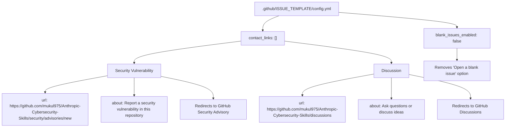
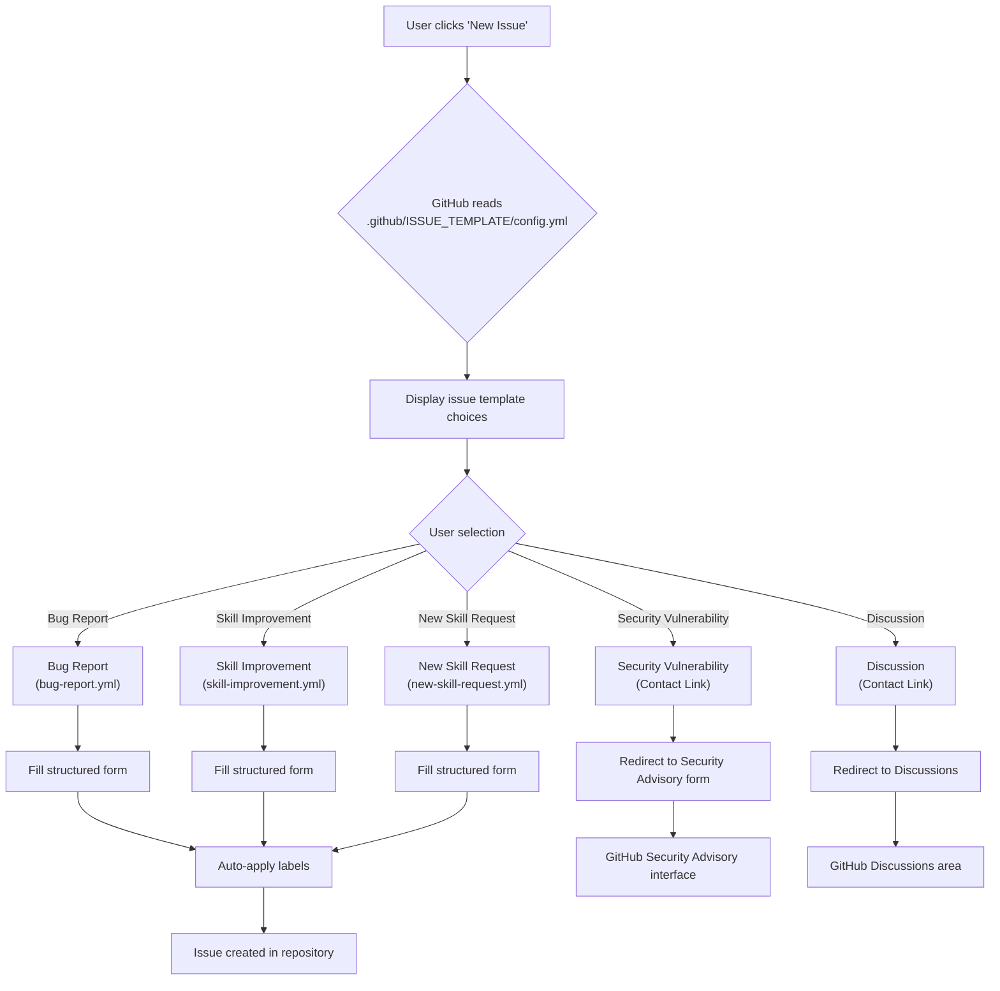
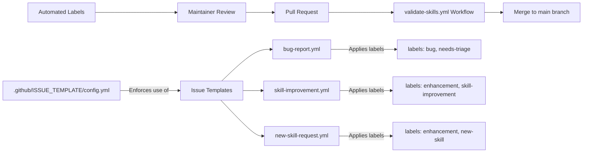

<!-- source: DeepWiki mcp.deepwiki.com · repo mukul975/Anthropic-Cybersecurity-Skills · extra page Issue Template Configuration · fetched 2026-10-26 -->

# Issue Template Configuration

<details>
<summary>Relevant source files</summary>

The following files were used as context for generating this wiki page:

- [.github/ISSUE_TEMPLATE/bug-report.yml](.github/ISSUE_TEMPLATE/bug-report.yml)
- [.github/ISSUE_TEMPLATE/config.yml](.github/ISSUE_TEMPLATE/config.yml)
- [.github/ISSUE_TEMPLATE/new-skill-request.yml](.github/ISSUE_TEMPLATE/new-skill-request.yml)
- [.github/ISSUE_TEMPLATE/skill-improvement.yml](.github/ISSUE_TEMPLATE/skill-improvement.yml)

</details>


The issue template configuration system controls the GitHub issue creation experience by disabling blank issues and providing structured contact links for security reports and community discussions. This configuration file works in conjunction with the issue templates to ensure all contributions follow standardized pathways.

For details about the specific issue templates themselves, see [Bug Report Template](#7.2.1), [Skill Improvement Templates](#7.2.2), and [New Skill Request Templates](#7.2.3).

## Overview

The `.github/ISSUE_TEMPLATE/config.yml` file serves as the central configuration for GitHub's issue creation interface. This configuration enforces structured contributions by preventing freeform issue creation and redirecting specialized requests to appropriate channels.

**Sources:** [.github/ISSUE_TEMPLATE/config.yml:1-9]()

## Configuration Structure

The configuration consists of two primary directives: blank issue control and contact link definitions.

### Configuration File Anatomy



**Sources:** [.github/ISSUE_TEMPLATE/config.yml:1-9]()

### Field Specification

| Field                  | Value  | Purpose                                           |
|------------------------|--------|-------------------------------------------------|
| `blank_issues_enabled` | `false` | Disables the default blank issue option         |
| `contact_links`        | Array  | Defines alternative contact pathways             |
| `contact_links[].name` | String | Display name for the link                         |
| `contact_links[].url`  | String | Target URL for redirection                        |
| `contact_links[].about`| String | Description text for the option                   |

**Sources:** [.github/ISSUE_TEMPLATE/config.yml:1-9]()

## Blank Issue Prevention

The directive `blank_issues_enabled: false` at line 1 removes the default "Open a blank issue" option from the GitHub issue creation interface. This enforcement ensures all contributions use one of the structured templates:

- **bug-report.yml** — For reporting validation errors, broken scripts, or incorrect content in skills.
- **skill-improvement.yml** — For suggesting enhancements or corrections to existing skills.
- **new-skill-request.yml** — For proposing new cybersecurity skills to add.

Preventing blank issues enforces data consistency and improves triaging efficiency by funneling all contributors through predefined templates that require essential information.

**Sources:** [.github/ISSUE_TEMPLATE/config.yml:1]()

## Contact Links Configuration

The configuration defines two specialized contact pathways at lines 2-8. These links supplement issue templates by redirecting specific categories of communication to designated GitHub areas:

### Security Vulnerability Link

```yaml
- name: Security Vulnerability
  url: https://github.com/mukul975/Anthropic-Cybersecurity-Skills/security/advisories/new
  about: Report a security vulnerability in this repository
```

This contact link directs users reporting security vulnerabilities to GitHub's Security Advisory interface, which ensures:

- **Private disclosure** of security issues until patches are released
- **Structured reporting** with guided fields for impact and remediation
- **Coordinated vulnerability handling** with potential CVE assignments

This link promotes responsible security reporting outside the public issue tracker.

**Sources:** [.github/ISSUE_TEMPLATE/config.yml:3-5]()

### Discussion Link

```yaml
- name: Discussion
  url: https://github.com/mukul975/Anthropic-Cybersecurity-Skills/discussions
  about: Ask questions or discuss ideas
```

The Discussion contact link forwards inquiries, ideas, and general conversations to GitHub Discussions. This separation prevents the issue tracker from being cluttered with non-actionable or exploratory threads, improving maintainers' focus on concrete issues and contributions.

**Sources:** [.github/ISSUE_TEMPLATE/config.yml:6-8]()

## Issue Creation Workflow

This diagram shows the user experience during issue creation under this configuration:



This flow ensures that users must select a relevant issue type or contact path, providing better-structured inputs for maintainers and contributors.

**Sources:** [.github/ISSUE_TEMPLATE/config.yml:1-9]()

## Configuration Impact Comparison

The table below highlights differences in issue creation behavior with and without this configuration:

| Scenario              | Without config.yml                    | With config.yml                                  |
|----------------------|-------------------------------------|-------------------------------------------------|
| **Blank issues**      | Available as a default option        | Disabled; users must choose a structured template |
| **Security reports**  | Mixed as public issues               | Redirected privately to Security Advisory       |
| **Questions/Ideas**   | Mixed with issues                   | Redirected to Discussions                         |
| **Template enforcement**| Optional; users can skip           | Mandatory; no blank issue creation allowed       |
| **Issue quality**     | Inconsistent, unstructured          | Consistent, captured detailed information        |

**Sources:** [.github/ISSUE_TEMPLATE/config.yml:1-9]()

## Integration with Contribution Workflow

This configuration works alongside defined issue templates (`bug-report.yml`, `skill-improvement.yml`, `new-skill-request.yml`), automatic labeling, and GitHub Actions workflows like `validate-skills.yml` for validation.



This multi-layered pipeline ensures high-quality contributions from issue creation through final merge.

**Sources:** [.github/ISSUE_TEMPLATE/config.yml:1-9]()

## Configuration Best Practices

The issue template configuration exemplifies these best practices:

- **Centralized control:** Single file controls issue creation behavior.
- **Explicit alternatives:** Clear, descriptive contact links for specialized needs.
- **Data quality enforcement:** Disallows empty issues to enforce structured input.
- **Security-first approach:** Redirects sensitive issues to private Security Advisories.
- **Community management:** Segregates conversational discussions from issues.

This approach reduces maintainer overhead and improves contributor guidance.

**Sources:** [.github/ISSUE_TEMPLATE/config.yml:1-9]()

## Relationship to Validation Workflows

While the `config.yml` controls the front-end user experience in the issue tracker, backend workflows like `validate-skills.yml` verify pull request contents against schemas and skill quality rules, maintaining repository integrity.

| Stage            | Mechanism                          | Purpose                          |
|------------------|----------------------------------|---------------------------------|
| **Issue Creation**| `config.yml` + issue templates   | Enforce structured data capture |
| **Issue Triage**  | Auto-applied labels from templates| Route issues to maintainers     |
| **PR Validation** | `validate-skills.yml` GitHub Action | Automated skill validation      |
| **Index Update**  | `update-index.yml` GitHub Action | Regenerate skill index.json     |

Together, they ensure consistent, high-quality contributions and repository hygiene.

**Sources:** [.github/ISSUE_TEMPLATE/config.yml:1-9]()

---

This completes the technical documentation for the Issue Template Configuration in the Anthropic Cybersecurity Skills repository.

---

