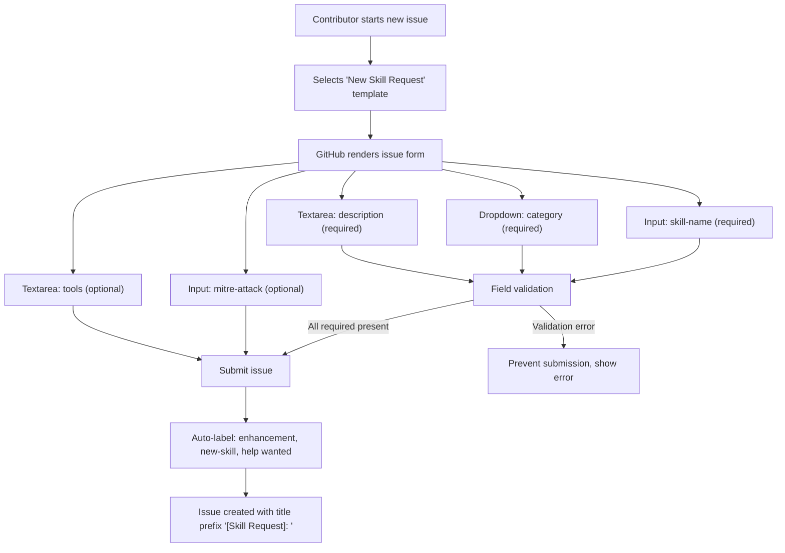
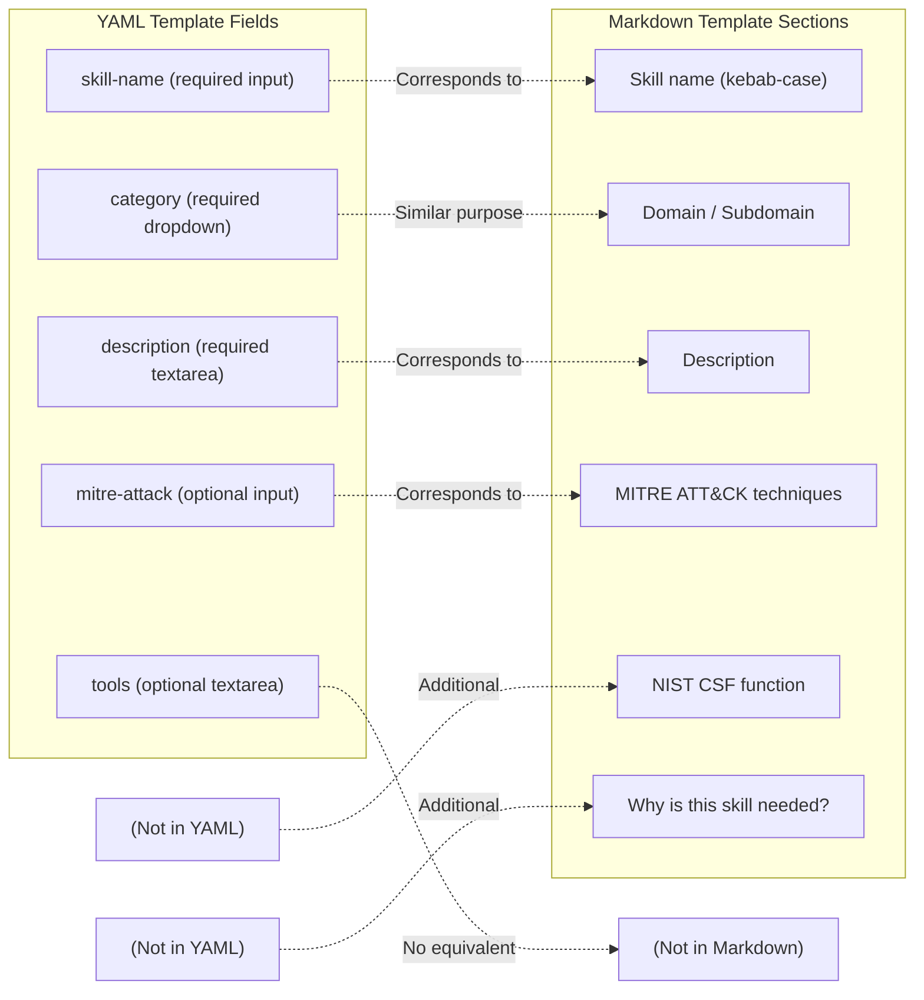
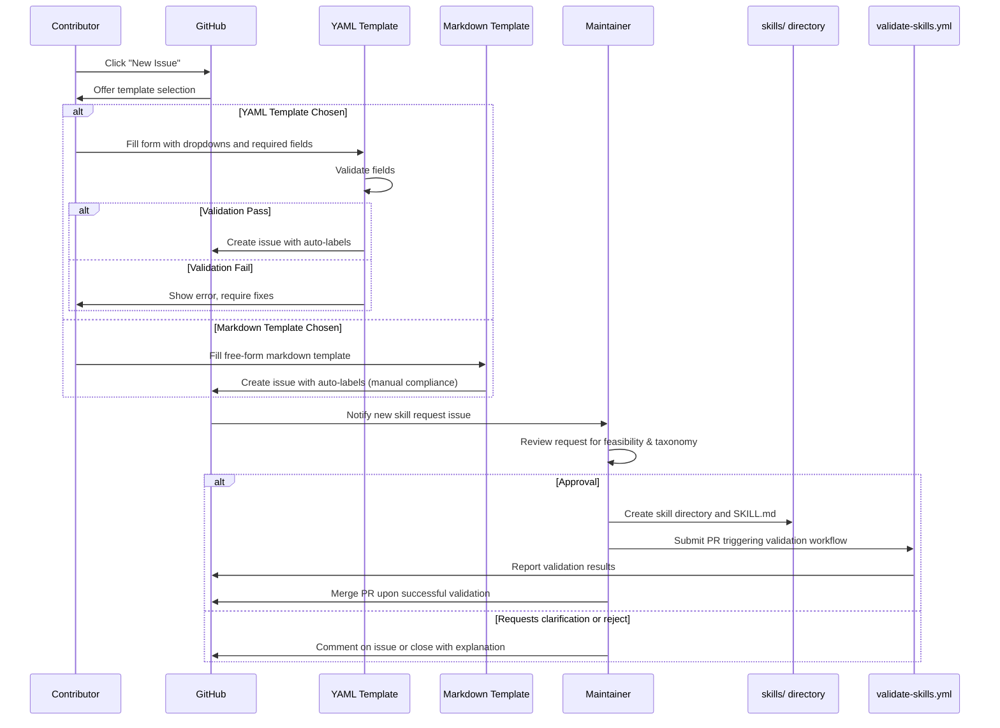
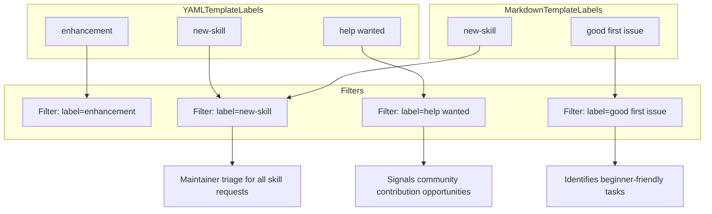
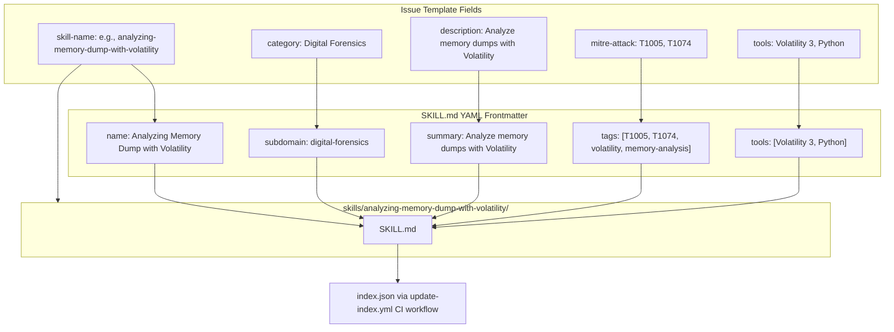

<!-- source: DeepWiki mcp.deepwiki.com · repo mukul975/Anthropic-Cybersecurity-Skills · extra page New Skill Request Templates · fetched 2026-10-26 -->

# New Skill Request Templates

<details>
<summary>Relevant source files</summary>

The following files were used as context for generating this wiki page:

- [.github/ISSUE_TEMPLATE/bug-report.yml](.github/ISSUE_TEMPLATE/bug-report.yml)
- [.github/ISSUE_TEMPLATE/config.yml](.github/ISSUE_TEMPLATE/config.yml)
- [.github/ISSUE_TEMPLATE/new-skill-request.yml](.github/ISSUE_TEMPLATE/new-skill-request.yml)
- [.github/ISSUE_TEMPLATE/skill-improvement.yml](.github/ISSUE_TEMPLATE/skill-improvement.yml)

</details>


This document details the two new skill request templates provided by the **Anthropic Cybersecurity Skills** repository to standardize how contributors propose new cybersecurity skills. These templates ensure consistent capture of skill metadata, categorical assignment, and optional framework mappings for rapid triage and implementation by maintainers.

The two templates are offered as:

- A **YAML GitHub Issue Form** (`new-skill-request.yml`) that provides structured dropdowns, validations, and automatic labeling.
- A **Markdown Issue Template** (`new-skill.md`) that offers a textual, free-form format with inline instructions and expanded metadata fields.

These templates support contributors with different submission preferences while maintaining consistent data capture and streamlined processing.

For related contribution processes, see the [Contribution Guidelines](#7.1), [Skill Improvement Templates](#7.2.2), and [Bug Report Template](#7.2.1).

---

## Template Variants

| Template Filename           | Format           | Auto-Labels                        | Validation                  | Main Use Case                                |
|----------------------------|------------------|----------------------------------|-----------------------------|----------------------------------------------|
| `.github/ISSUE_TEMPLATE/new-skill-request.yml` | YAML GitHub Issue Form | `enhancement`, `new-skill`, `help wanted` | Built-in required field validation | Structured, interactive form submissions    |
| `.github/ISSUE_TEMPLATE/new-skill.md`          | Markdown Issue Template          | `new-skill`, `good first issue`           | Manual compliance, no enforced validation   | Quick text-based submissions with richer metadata |

The YAML template emphasizes guided input via dropdowns and required fields, facilitating accurate skill categorization. The Markdown template allows contributors to provide additional context such as NIST CSF mapping and justification, useful for maintainers evaluating skill necessity and framework alignment.

Sources: [.github/ISSUE_TEMPLATE/new-skill-request.yml:1-59](), [.github/ISSUE_TEMPLATE/new-skill.md:1-26]()

---

## YAML Template Structure (`new-skill-request.yml`)

The YAML template uses GitHub issue forms to provide a guided submission workflow with validation, dropdown category selection, and automatic label assignment for streamlined triage.

```yaml
name: New Skill Request
description: Request a new cybersecurity skill to be added to the database
title: "[Skill Request]: "
labels: ["enhancement", "new-skill", "help wanted"]
```

### Key Fields

| Field ID       | Type     | Description                                   | Validation          |
|----------------|----------|-----------------------------------------------|---------------------|
| `skill-name`   | Input    | Proposed skill directory name in kebab-case (e.g., `analyzing-memory-dump-with-volatility`) | Required            |
| `category`     | Dropdown | Skill category selected from 16 predefined options matching the taxonomy (e.g., `Digital Forensics`) | Required            |
| `description`  | Textarea | Summary of what the skill teaches AI agents to do | Required            |
| `mitre-attack` | Input    | Optional comma-separated MITRE ATT&CK technique IDs (e.g., `T1059, T1078`) | Optional            |
| `tools`        | Textarea | Optional list of key tools or commands covered by the skill | Optional            |

### Category Dropdown Options

- Threat Detection
- Incident Response
- Penetration Testing
- Digital Forensics
- Compliance & Governance
- Network Security
- Cloud Security
- Application Security
- Malware Analysis
- OSINT
- Zero Trust Architecture
- OT/ICS Security
- DevSecOps
- Ransomware Defense
- Threat Intelligence
- Other

### Data Flow in YAML Template Submission



Sources: [.github/ISSUE_TEMPLATE/new-skill-request.yml:1-59]()

---

## Markdown Template Structure (`new-skill.md`)

The Markdown template provides a legacy-style issue format with user-editable sections and comment instructions, enabling rich contextual metadata and free-text input.

### Template Frontmatter

```yaml
---
name: Add new skill
about: Propose a new cybersecurity skill for the database
title: '[NEW SKILL] skill-name-here'
labels: 'new-skill, good first issue'
assignees: ''
---
```

- Labels `new-skill` and `good first issue` are automatically applied.
- The title prefix is `[NEW SKILL]`.

### Section Headings and Purpose

| Section Header             | Description                                      | Example                         | Alignment to YAML Template |
|----------------------------|------------------------------------------------|---------------------------------|----------------------------|
| `## Skill name (kebab-case)` | Skill directory name in kebab-case format       | `detecting-lateral-movement-in-azure` | Maps to `skill-name` input |
| `## Domain / Subdomain`     | Categorization in free-text (broader taxonomy) | `cybersecurity / threat-hunting` | Relates to `category` dropdown |
| `## Description`            | What the skill teaches an AI agent to do        | One sentence skill summary       | Maps to `description` textarea |
| `## MITRE ATT&CK techniques`| Relevant technique IDs                           | `T1021.001, T1078.004`          | Maps to `mitre-attack` input |
| `## NIST CSF function`      | Aligns skill to NIST CSF 2.0 categories         | `Identify, Protect, Detect`      | Additional metadata not in YAML |
| `## Why is this skill needed?` | Justification of skill utility                    | Explains problem solved          | Additional metadata not in YAML |

### Markdown Template Section Layout

```mermaid
graph TD
    subgraph Template Sections
        S1["## Skill name (kebab-case)"]
        S2["## Domain / Subdomain"]
        S3["## Description"]
        S4["## MITRE ATT&CK techniques"]
        S5["## NIST CSF function"]
        S6["## Why is this skill needed?"]
    end
    
    subgraph Comments (Instructions)
        C1["<!-- e.g., detecting-lateral-movement-in-azure -->"]
        C2["<!-- e.g., cybersecurity / threat-hunting -->"]
        C3["<!-- One sentence describing skill capability -->"]
        C4["<!-- e.g., T1021.001, T1078.004 -->"]
        C5["<!-- e.g., Identify, Protect, Detect -->"]
        C6["<!-- Explain why this skill is valuable -->"]
    end

    S1 -.-> C1
    S2 -.-> C2
    S3 -.-> C3
    S4 -.-> C4
    S5 -.-> C5
    S6 -.-> C6

    S1 --> Dir["skills/{skill-name}/"]
    S2 --> Taxonomy["Skill taxonomy categorization"]
    S3 --> Summary["SKILL.md summary field"]
    S4 --> Tags["YAML frontmatter tags"]
    S5 --> NIST["NIST CSF metadata"]
    S6 --> Justify["Skill inclusion justification"]
```

Sources: [.github/ISSUE_TEMPLATE/new-skill.md:1-26]()

---

## Template Comparison

Both templates collect similar core metadata but differ in structure, validation, and optional fields.

### Field-Level Comparison



### Key Differences

| Aspect                 | YAML Template                   | Markdown Template              |
|------------------------|--------------------------------|-------------------------------|
| Validation             | Enforced by GitHub form         | Manual, no validation          |
| Category Selection     | Authoritative dropdown list     | Free-form domain/subdomain     |
| Auto-Labels Applied    | `enhancement`, `new-skill`, `help wanted` | `new-skill`, `good first issue` |
| Title Prefix           | `[Skill Request]:`              | `[NEW SKILL] skill-name`       |
| Tools Field            | Included as a dedicated field   | Not present                   |
| NIST CSF Mapping       | Not included                   | Explicit section for mapping   |
| Justification Field    | Not included                   | Captured under "Why is this skill needed?" |
| User Experience        | Interactive, guided input       | Free-text, flexible format     |

Sources: [.github/ISSUE_TEMPLATE/new-skill-request.yml:1-59](), [.github/ISSUE_TEMPLATE/new-skill.md:1-26]()

---

## Issue Creation and Skill Development Workflow

This sequence diagram illustrates the interaction between contributor, GitHub issue templates, maintainers, and the CI validation workflow in processing new skill requests.



Sources: [.github/ISSUE_TEMPLATE/new-skill-request.yml:1-59](), [.github/ISSUE_TEMPLATE/new-skill.md:1-26]()

---

## Automatic Labeling Behavior

Upon issue creation via either template, a set of labels facilitates workflow automation and community triage:



Sources: [.github/ISSUE_TEMPLATE/new-skill-request.yml:4](), [.github/ISSUE_TEMPLATE/new-skill.md:5]()

---

## Template Data to Skill Metadata Flow

Data collected via the new skill request templates maps directly to structured YAML frontmatter in the final `SKILL.md` files within the skills directory.



This mapping ensures that skill requests translate into consistent, queryable skill metadata, enabling skill discovery, filtering, and integration with framework mappings such as MITRE ATT&CK and NIST CSF.

Sources: [.github/ISSUE_TEMPLATE/new-skill-request.yml:10-58](), [.github/ISSUE_TEMPLATE/new-skill.md:9-26]()

---

## Usage Recommendations

### When to Use YAML Template

- Preferable when contributors want guided input with validation to avoid errors.
- Useful if unsure about categories and prefer selecting from supported dropdown taxonomy.
- When the submission requires immediate precise metadata such as tools and MITRE ATT&CK IDs.
- Ideal for contributors not wanting to write markdown manually.

### When to Use Markdown Template

- Preferred for contributors comfortable describing skill details in free text.
- When including additional context: NIST CSF function alignment and justification of skill necessity.
- Suitable for proposing new skills needing nuanced explanations beyond form constraints.
- To flag issues for new contributors by marking them as `good first issue`.

Both templates are accepted and funneled into maintainers' workflow for review, triage, and skill creation.

Sources: [.github/ISSUE_TEMPLATE/new-skill-request.yml:1-59](), [.github/ISSUE_TEMPLATE/new-skill.md:1-26]()

---

# Summary

The **Anthropic Cybersecurity Skills** repository supports contributors in requesting new skills through two structured templates:

- A **YAML Issue Form** for guided, validated submissions with category dropdown and tool descriptions.
- A **Markdown Template** for rich, free-form proposals including NIST CSF mappings and justifications.

These templates integrate seamlessly into the GitHub issue and PR workflows, enabling efficient skill metadata capture, taxonomy alignment, and automated validation. This structured approach sustains the repository's quality and scalability as new cybersecurity capabilities are continuously added.

---

**End of wiki page 7.2.3**

---

