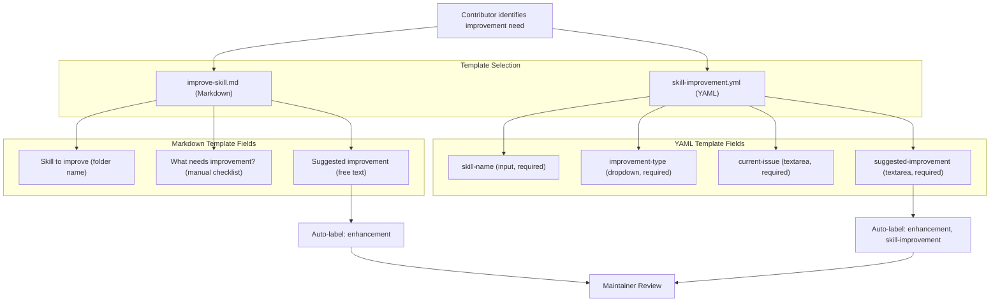
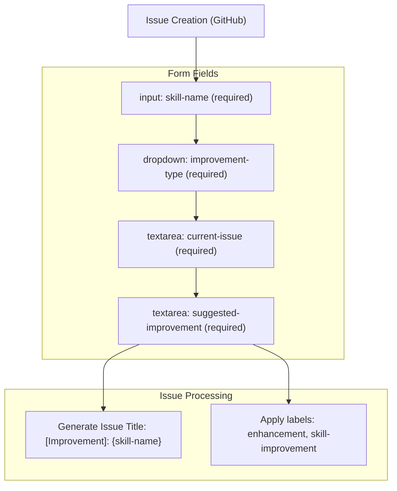
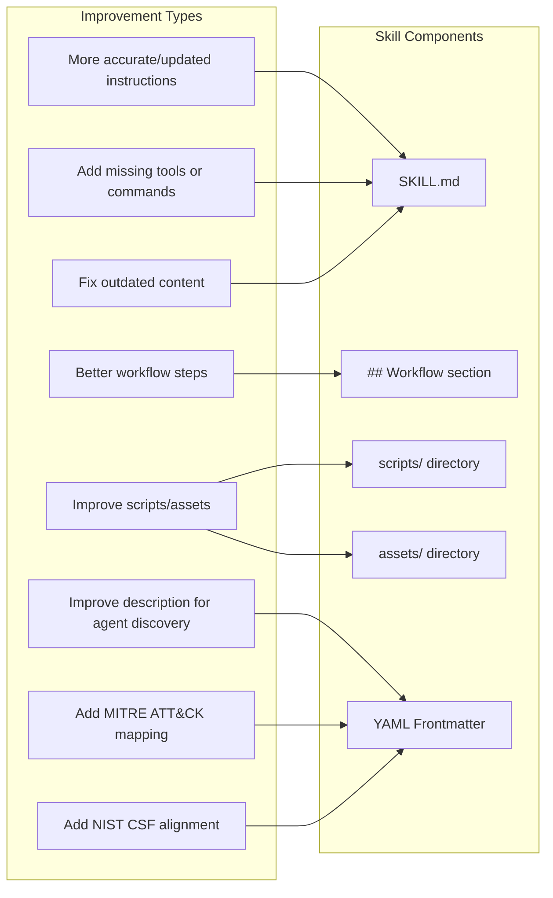
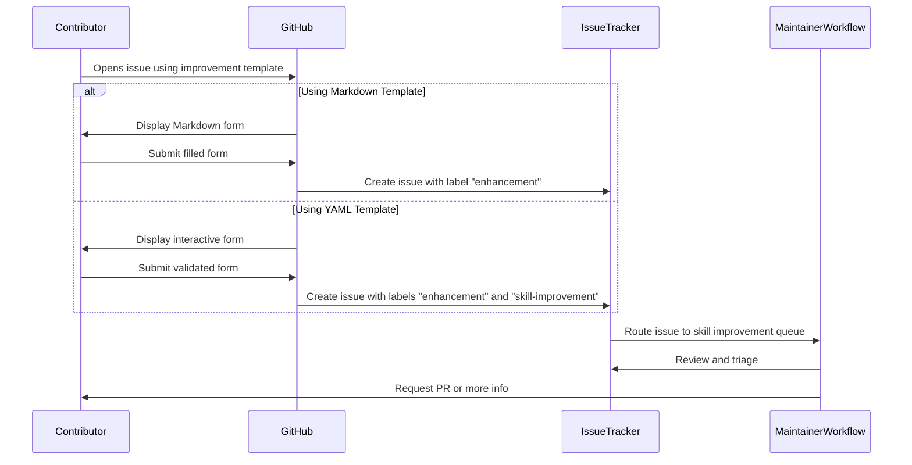
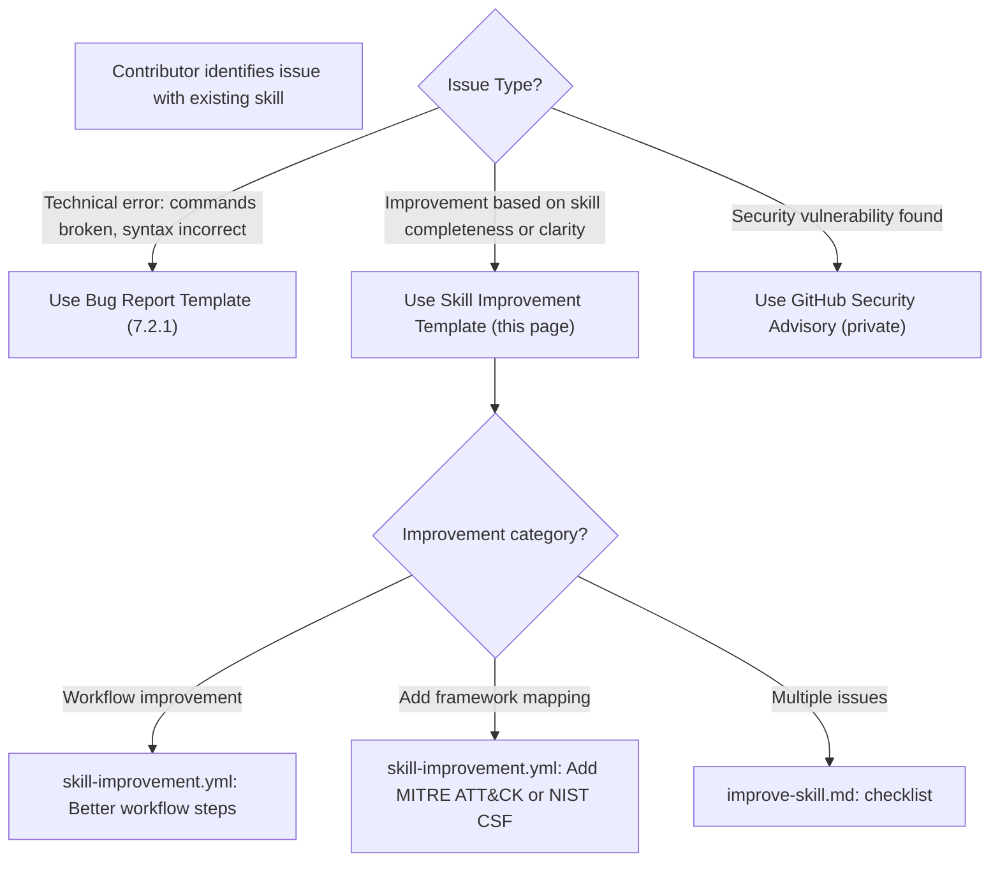

<!-- source: DeepWiki mcp.deepwiki.com · repo mukul975/Anthropic-Cybersecurity-Skills · extra page Skill Improvement Templates · fetched 2026-10-26 -->

# Skill Improvement Templates

<details>
<summary>Relevant source files</summary>

The following files were used as context for generating this wiki page:

- [.github/ISSUE_TEMPLATE/bug-report.yml](.github/ISSUE_TEMPLATE/bug-report.yml)
- [.github/ISSUE_TEMPLATE/config.yml](.github/ISSUE_TEMPLATE/config.yml)
- [.github/ISSUE_TEMPLATE/new-skill-request.yml](.github/ISSUE_TEMPLATE/new-skill-request.yml)
- [.github/ISSUE_TEMPLATE/skill-improvement.yml](.github/ISSUE_TEMPLATE/skill-improvement.yml)

</details>


This document provides a detailed explanation of the two official skill improvement issue templates available in the Anthropic Cybersecurity Skills repository. These templates enable contributors to submit structured suggestions for enhancing existing cybersecurity skills, covering updates in instructions, workflows, tool usage, framework mappings, and auxiliary files.

For related templates, see [New Skill Request Templates](#7.2.3) for adding new skills and [Bug Report Template](#7.2.1) for reporting functional errors. This page is a leaf page and covers the implementation, data flow, form fields, and auto-labeling in full technical detail.

---

## Template Overview

The repository offers two distinct skill improvement templates:

| Template File             | Format   | Form Type        | GitHub Labels Applied          |
|---------------------------|----------|------------------|-------------------------------|
| `.github/ISSUE_TEMPLATE/improve-skill.md`     | Markdown | Manual checklist  | `enhancement`                   |
| `.github/ISSUE_TEMPLATE/skill-improvement.yml`| YAML     | Interactive form  | `enhancement`, `skill-improvement` |

- **Markdown template**: Presents a free-text and checklist form suitable for multiple, varied improvement suggestions in one issue.
- **YAML template**: Supplies validated form fields with dropdowns and required inputs for more focused, categorical improvement proposals.

Both templates streamline maintainer triage by automatically labeling improvement requests for efficient filtering and prioritization.

**Sources:** [.github/ISSUE_TEMPLATE/improve-skill.md:1-42](), [.github/ISSUE_TEMPLATE/skill-improvement.yml:1-42]()

---

## Template Comparison Architecture



This architecture illustrates how contributors select between the two templates and fill out fields accordingly, leading to labeled issue creation for maintainer review.

**Sources:** [.github/ISSUE_TEMPLATE/improve-skill.md:1-20](), [.github/ISSUE_TEMPLATE/skill-improvement.yml:1-42]()

---

## Markdown Template Structure (`improve-skill.md`)

This legacy-style template is a Markdown-based issue form that provides a simple checklist and free-text area for improvement suggestions.

### Frontmatter Configuration

```yaml
name: Improve existing skill
about: Suggest improvements to an existing skill
title: '[IMPROVE] skill-name-here'
labels: 'enhancement'
assignees: ''
```

- Registers the template title and auto-applies the `enhancement` label.
- No automatic assignees are configured.

### Fields and Format

| Field                   | Description                    | Format            |
|-------------------------|-------------------------------|-------------------|
| Skill to improve        | Folder name of the skill       | Free text         |
| What needs improvement? | Checklist of common issues     | Manual checkboxes |
| Suggested improvement   | Free-text description          | Text area         |

### Sample Improvement Checklist

```markdown
- [ ] agent.py has errors or placeholders
- [ ] api-reference.md is incomplete
- [ ] SKILL.md frontmatter is missing fields
- [ ] ATT&CK mapping is incorrect
- [ ] Other:
```

This aligns with key skill components: helper scripts (`agent.py`), reference docs (`api-reference.md`), metadata (`SKILL.md` frontmatter), and MITRE ATT&CK tags.

**Sources:** [.github/ISSUE_TEMPLATE/improve-skill.md:1-20]()

---

## YAML Template Structure (`skill-improvement.yml`)

The modern template format uses GitHub’s YAML issue forms feature, enabling structured and validated inputs.

### Template Metadata

```yaml
name: Skill Improvement
description: Suggest improvements to an existing skill
title: "[Improvement]: "
labels: ["enhancement", "skill-improvement"]
```

- Applies dual labels `enhancement` and `skill-improvement`.
- Provides description to help contributors in the template picker.

### Form Field Definitions and Data Flow



- The form enforces completeness with required fields.
- Title and labels are automatically generated on submission.

**Sources:** [.github/ISSUE_TEMPLATE/skill-improvement.yml:1-42]()

### Field Detail Breakdown

| Field              | Type      | Description                                                                   | Required | Notes                                                                                 |
|--------------------|-----------|-------------------------------------------------------------------------------|----------|---------------------------------------------------------------------------------------|
| `skill-name`       | Input     | Exact skill folder name requiring improvement                                | Yes      | Must match directory under `skills/` for unambiguous identification                   |
| `improvement-type` | Dropdown  | Categorizes the nature of improvement                                        | Yes      | Eight predefined options for classification                                          |
| `current-issue`    | Textarea  | Description of problem or gap                                                | Yes      | Helps maintainers understand the existing deficiency                                |
| `suggested-improvement` | Textarea | Concrete recommendations for changes                                       | Yes      | Should be actionable and detailed for effective implementation                      |

**Sources:** [.github/ISSUE_TEMPLATE/skill-improvement.yml:6-42]()

---

## Improvement Type Categories

The dropdown for `improvement-type` encapsulates common improvement targets in skills:

| Improvement Type                  | Target Component                                  | Related Framework/Area                     |
|---------------------------------|-------------------------------------------------|-------------------------------------------|
| More accurate/updated instructions | SKILL.md instructions section                    | N/A                                       |
| Better workflow steps             | SKILL.md `## Workflow` section                    | N/A                                       |
| Add missing tools or commands     | SKILL.md tools enumeration                        | N/A                                       |
| Improve description for agent discovery | SKILL.md YAML frontmatter `description`          | Progressive Disclosure (Efficient skill discovery) |
| Add MITRE ATT&CK mapping          | SKILL.md frontmatter `tags` with ATT&CK IDs     | MITRE ATT&CK mapping                       |
| Add NIST CSF alignment            | Skill subdomain category                          | NIST CSF 2.0 alignment                     |
| Improve scripts/assets            | `scripts/` or `assets/` subdirectories           | Skill helper components                    |
| Fix outdated content              | Any skill component                               | General maintenance                        |



**Sources:** [.github/ISSUE_TEMPLATE/skill-improvement.yml:14-27]()

---

## Framework Mapping Improvements

Two improvement categories specifically address alignment of skills with cybersecurity frameworks:

- **Add MITRE ATT&CK mapping**: Contributors suggest adding ATT&CK technique IDs (e.g., `T1059`) in the skill’s YAML frontmatter `tags` array to enhance threat intelligence integration and attack-navigator layer coverage.

- **Add NIST CSF alignment**: Proposals to refine the skill’s subdomain categorization to better reflect NIST CSF 2.0 core functions (Govern, Identify, Protect, Detect, Respond, Recover) enabling effective mapping and coverage analysis.

---

## Progressive Disclosure Improvements

The "Improve description for agent discovery" choice focuses on refining the skill's YAML frontmatter `description` field. Improving this description enables efficient token-based skill discovery by AI agents during progressive disclosure, where brief summaries guide agent relevance heuristics.

Example enhancement:

```yaml
description: |
  Before: "Analyze network traffic"
  After: "Capture and analyze network packets using Wireshark to identify protocols, detect anomalies, and investigate security incidents in real-time or from PCAP files"
```

Well-crafted descriptions reduce token consumption and improve skill match precision.

**Sources:** [.github/ISSUE_TEMPLATE/skill-improvement.yml:21-22]()

---

## Auto-Labeling Behavior and Workflow Integration

| Template             | Labels Applied                 | Purpose                                        |
|----------------------|-------------------------------|------------------------------------------------|
| `improve-skill.md`       | `enhancement`                  | Marks issue as a feature/improvement request   |
| `skill-improvement.yml`  | `enhancement`, `skill-improvement` | Adds finer filterability by maintainer task queue |

### Auto-Labeling Flow



The dual-label approach allows maintainers to filter all enhancements or just skill improvements as needed.

**Sources:** [.github/ISSUE_TEMPLATE/improve-skill.md:5](), [.github/ISSUE_TEMPLATE/skill-improvement.yml:1-4]()

---

## Improvement vs. Bug Report Decision Tree



This graph guides contributors to the appropriate issue template based on problem type.

**Sources:** [.github/ISSUE_TEMPLATE/improve-skill.md:1-20](), [.github/ISSUE_TEMPLATE/skill-improvement.yml:1-42]()

---

## Template Selection Guidance

| Use Markdown Template (`improve-skill.md`) When                     | Use YAML Template (`skill-improvement.yml`) When                   |
|----------------------------------------------------------------------|--------------------------------------------------------------------|
| You have multiple types of improvements to suggest simultaneously    | Your improvement fits exactly one predefined category               |
| You prefer free-form text input without dropdown limitations         | You want interactive validation and required field enforcement      |
| You want to provide a mixed, exploratory feedback document           | You use the GitHub web interface and want guided issue submission   |
| You want a simple checklist approach                                 | You want structured input for maintainers to expedite triage       |

Both templates feed into the same contributor-maintainer workflow for resolution.

**Sources:** [.github/ISSUE_TEMPLATE/improve-skill.md:1-20](), [.github/ISSUE_TEMPLATE/skill-improvement.yml:1-42]()

---

## Common Improvement Scenarios and Template Usage

### Scenario 1: Adding MITRE ATT&CK Mapping

- **Template**: `skill-improvement.yml`
- **Fields**:
  - **skill-name**: `analyzing-network-traffic-with-wireshark`
  - **improvement-type**: "Add MITRE ATT&CK mapping"
  - **current-issue**: "Skill frontmatter lacks ATT&CK IDs"
  - **suggested-improvement**: "Add tags: [T1040, T1557] for network sniffing and credential theft"
- **Result**: Maintainer updates skill YAML frontmatter; triggers validation and index regeneration workflows.

### Scenario 2: Fixing Outdated Commands

- **Template**: `improve-skill.md`
- **Fields**:
  - **Skill to improve**: `configuring-firewall-rules-with-iptables`
  - **What needs improvement?**: Checked "Other" with description "iptables deprecated, update to nftables"
  - **Suggested improvement**: "Rewrite commands to nftables syntax or split into new skill"
- **Result**: Discussion on whether to update or split skill; then PR to implement changes.

### Scenario 3: Enhancing Agent Discovery

- **Template**: `skill-improvement.yml`
- **Fields**:
  - **skill-name**: `analyzing-malware-with-ghidra`
  - **improvement-type**: "Improve description for agent discovery"
  - **current-issue**: "Too brief description: 'Analyze malware with Ghidra'"
  - **suggested-improvement**: "Expand description with more context for packet analysis and reverse engineering"
- **Result**: Improved progressive disclosure metadata; better AI agent matching on skill relevance.

**Sources:** [.github/ISSUE_TEMPLATE/skill-improvement.yml:6-41](), [.github/ISSUE_TEMPLATE/improve-skill.md:1-20]()

---

## Summary

The skill improvement templates are critical tools to maintain and enhance the vast collection of AI cybersecurity skills in this repository, enabling:

- Dual-format submission: markdown checklist or YAML form.
- Structured metadata-driven improvement categorization.
- Focused enhancements on instructions, workflows, tools, frameworks, and ancillary files.
- Automated issue labeling for maintainer workload optimization.
- Integration with validation and index regeneration CI/CD workflows after improvements.

For complementary guidance, see the New Skill Request Templates (7.2.3) and Bug Report Template (7.2.1).

---

**Sources:**  
- `.github/ISSUE_TEMPLATE/improve-skill.md:1-42`  
- `.github/ISSUE_TEMPLATE/skill-improvement.yml:1-42`

---

