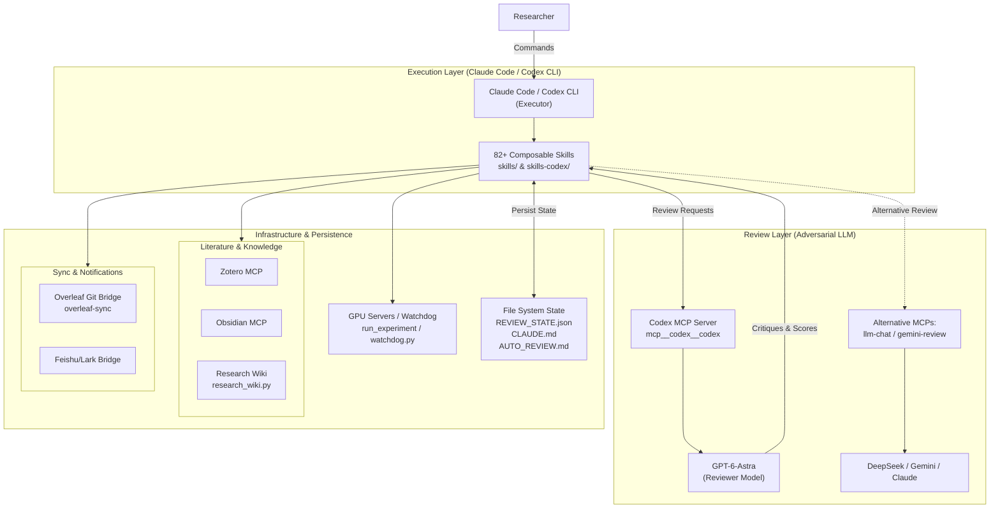
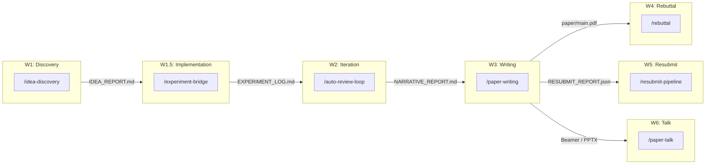

<!-- source: DeepWiki mcp.deepwiki.com · repo wanshuiyin/Auto-claude-code-research-in-sleep · page 1 Overview · fetched 2026-10-26 -->

# Overview

Relevant source files

The following files were used as context for generating this wiki page:

- [AGENT_GUIDE.md](AGENT_GUIDE.md)
- [README.md](README.md)
- [README_CN.md](README_CN.md)
- [docs/ARIS_INTRO.html](docs/ARIS_INTRO.html)
- [docs/ARIS_INTRO.md](docs/ARIS_INTRO.md)
- [docs/SKILLS_CATALOG.md](docs/SKILLS_CATALOG.md)
- [skills/auto-paper-improvement-loop/SKILL.md](skills/auto-paper-improvement-loop/SKILL.md)
- [skills/paper-write/SKILL.md](skills/paper-write/SKILL.md)
- [skills/paper-writing/SKILL.md](skills/paper-writing/SKILL.md)
- [skills/skills-codex/README.md](skills/skills-codex/README.md)
- [skills/skills-codex/README_CN.md](skills/skills-codex/README_CN.md)

ARIS (Auto-claude-code-research-in-sleep) is an autonomous machine learning research workflow automation system built on top of [Claude Code](https://docs.anthropic.com/en/docs/claude-code) and compatible agent environments [README.md:1-12](). It orchestrates complete research lifecycles—ranging from literature surveying and hypothesis generation to iterative experimentation, paper drafting, rebuttals, and presentation design—using a **cross-model collaboration** architecture where an executor model (such as Claude Code) and an adversarial reviewer model (such as GPT-6-Astra via Codex MCP) operate together to eliminate single-model blind spots [AGENT_GUIDE.md:5-11]().

## What Problem Does ARIS Solve?

Machine learning research is bottlenecked by repetitive, highly integrated tasks that interrupt deep reasoning: literature gathering across disparate databases, hypothesis validation, debugging code on remote GPUs, writing LaTeX manuscripts, and responding to reviews under tight deadlines [README.md:1-29](). ARIS automates these steps while maintaining strict human-in-the-loop checkpoints and deterministic audit gates [AGENT_GUIDE.md:57-64]().

Key friction points addressed by the framework include:
- **Literature Review & Sourcing**: Querying and synthesizing papers across Zotero, Obsidian, arXiv, Semantic Scholar, DeepXiv, and Exa search [docs/SKILLS_CATALOG.md:48-61]().
- **Idea Discovery & Novelty Filtering**: Automated screening of research directions against existing literature databases to prune unviable ideas early [skills/idea-discovery/SKILL.md:8-25]().
- **Iterative Experimentation & Review**: Autonomous review-fix-recompile loops that refine codebases and narrative reports [skills/auto-paper-improvement-loop/SKILL.md:1-28]().
- **Paper Generation**: Section-by-section LaTeX drafting tailored to venue-specific templates (ICLR, NeurIPS, ICML, CVPR, etc.) with integrated figure and bibliography management [skills/paper-write/SKILL.md:12-26]().
- **Assurance & Verification**: Multi-layer audit chains (`/experiment-audit`, `/result-to-claim`, `/paper-claim-audit`, `/citation-audit`, `/kill-argument`) that ensure empirical integrity and citation validity [AGENT_GUIDE.md:98-112]().

**Key design principle**: Homogeneous agent self-review typically leads to sycophantic acceptance and local minima [README.md:43-45](). ARIS enforces cross-family divergence: the executor writes code and text, while an independent reviewer challenges assumptions using fresh conversation threads [AGENT_GUIDE.md:5-11]().

Sources: [README.md:1-29](), [AGENT_GUIDE.md:5-11](), [docs/SKILLS_CATALOG.md:48-61]()

## High-Level Architecture

The ARIS architecture bridges high-level natural language intent with concrete code execution entities and persistence layers. 

**Diagram: ARIS Cross-Model Collaboration & Code Entity Architecture**

**Core architectural invariants:**
1. **Executor-Reviewer Separation**: The executor model (`Claude Code` / `Codex CLI`) never audits its own artifacts. Review tasks are delegated via `mcp__codex__codex` or equivalent bridge tools [AGENT_GUIDE.md:5-11]().
2. **Skill-Based Composability**: Over 82 atomic and orchestrator skills (`skills/<name>/SKILL.md`) provide modular building blocks [docs/SKILLS_CATALOG.md:1-17]().
3. **Assurance Chain**: Dedicated audit scripts and validators (`verify_paper_audits.sh`, `assurance-contract.md`) gate submission-ready states [AGENT_GUIDE.md:98-112]().
4. **Resilient State Persistence**: Run states are checkpointed in files like `REVIEW_STATE.json` and tracked via the `CLAUDE.md` pipeline status section, allowing seamless recovery across context compactions [AGENT_GUIDE.md:80-90]().

Sources: [README.md:31-50](), [AGENT_GUIDE.md:5-21](), [docs/SKILLS_CATALOG.md:1-17]()

## The Six Main Workflows

ARIS organizes complex automation into six core sequential workflows (W1 through W6) alongside overarching integration orchestrators like `/research-pipeline` [AGENT_GUIDE.md:79-97]().

**Diagram: End-to-End Research Pipeline (W1-W6 Code Entry Points)**

1. **Workflow 1: Idea Discovery** (`/idea-discovery`): Performs multi-source literature reviews, generates candidate ideas, checks novelty against arXiv/DBLP, and runs pilot experiments [docs/SKILLS_CATALOG.md:27-31]().
2. **Workflow 1.5: Experiment Bridge** (`/experiment-bridge`): Translates `EXPERIMENT_PLAN.md` into executable code, performs cross-model code review, and deploys tasks to local or remote GPU resources [docs/SKILLS_CATALOG.md:27-31]().
3. **Workflow 2: Auto Review Loop** (`/auto-review-loop`): Iteratively executes autonomous review-fix cycles until score thresholds or maximum rounds are met [docs/SKILLS_CATALOG.md:27-31]().
4. **Workflow 3: Paper Writing** (`/paper-writing`): Orchestrates outline generation, figure plotting, LaTeX section compilation, and multi-round polishing (`/auto-paper-improvement-loop`) [skills/paper-writing/SKILL.md:12-22]().
5. **Workflow 4: Rebuttal Pipeline** (`/rebuttal`): Parses external reviews, atomizes critique points, structures response strategies, and produces paste-ready responses [docs/SKILLS_CATALOG.md:31-38]().
6. **Workflow 5 & 6: Resubmission & Talks** (`/resubmit-pipeline`, `/paper-talk`): Ports polished papers to alternative venues under strict isolation rules or generates conference slides, Beamer files, and speaker notes [docs/SKILLS_CATALOG.md:31-38]().

Sources: [AGENT_GUIDE.md:79-97](), [docs/SKILLS_CATALOG.md:21-43](), [skills/paper-writing/SKILL.md:12-22]()

## Navigation to Child Pages

For detailed specifications and technical documentation, refer to the following child pages:

- **Quick Start** ([#1.1]()) — Installation instructions, Codex MCP and LaTeX toolchain setup, minimal working examples, and AGENT_GUIDE.md routing index.
- **Core Concepts** ([#1.2]()) — Composable skill structure, workflows vs. atomic skills, cross-model collaboration, human-in-the-loop checkpoints, and assurance/effort axes.
- **System Design Philosophy** ([#1.3]()) — Rationale for cross-family collaboration over self-play, executor/reviewer separation protocol, and the 5-layer assurance chain.

Sources: [README.md:11-15](), [AGENT_GUIDE.md:1-11]()

---

