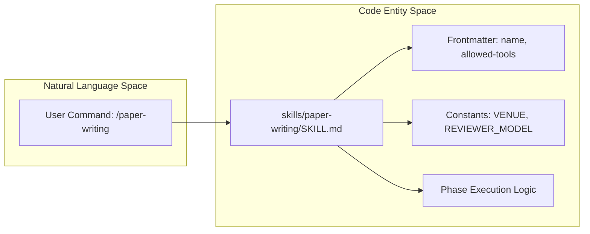
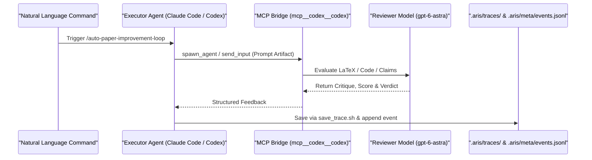

<!-- source: DeepWiki mcp.deepwiki.com · repo wanshuiyin/Auto-claude-code-research-in-sleep · page 1.2 Core Concepts · fetched 2026-10-26 -->

# Core Concepts

Relevant source files

The following files were used as context for generating this wiki page:

- [README.md](README.md)
- [README_CN.md](README_CN.md)
- [skills/auto-paper-improvement-loop/SKILL.md](skills/auto-paper-improvement-loop/SKILL.md)
- [skills/paper-write/SKILL.md](skills/paper-write/SKILL.md)
- [skills/paper-writing/SKILL.md](skills/paper-writing/SKILL.md)
- [skills/shared-references/assurance-contract.md](skills/shared-references/assurance-contract.md)
- [skills/shared-references/effort-contract.md](skills/shared-references/effort-contract.md)
- [skills/skills-codex/shared-references/acceptance-gate.md](skills/skills-codex/shared-references/acceptance-gate.md)
- [skills/skills-codex/shared-references/assurance-contract.md](skills/skills-codex/shared-references/assurance-contract.md)
- [skills/skills-codex/shared-references/effort-contract.md](skills/skills-codex/shared-references/effort-contract.md)
- [skills/skills-codex/shared-references/review-tracing.md](skills/skills-codex/shared-references/review-tracing.md)
- [tests/test_verify_paper_audits.py](tests/test_verify_paper_audits.py)
- [tools/verify_paper_audits.sh](tools/verify_paper_audits.sh)

This page details the fundamental architectural concepts underlying ARIS (Auto-claude-code-research-in-sleep): the composable skill system, the distinction between atomic skills and orchestrator workflows, the cross-model collaboration invariant, the dual control axes (`effort` and `assurance`), human-in-the-loop checkpoints, and acceptance gate semantics.

---

## Composable Skills & File Structure

ARIS implements research automation through **skills** — self-contained prompt templates stored as Markdown files (`SKILL.md`) within structured directories [README.md:72](). Each skill defines its frontmatter metadata, execution parameters, allowed tools, and prompt instructions [skills/paper-writing/SKILL.md:1-6]().

### Skill File Anatomy

**Sources:** [README.md:72](), [skills/paper-writing/SKILL.md:1-6](), [AGENT_GUIDE.md:21]()

When a user invokes a skill like `/paper-writing` [skills/paper-writing/SKILL.md:3]() or `/auto-paper-improvement-loop` [skills/auto-paper-improvement-loop/SKILL.md:3](), the host environment parses the frontmatter `allowed-tools` (e.g., `Bash(*)`, `Read`, `Write`, `mcp__codex__codex`) to authorize tool execution [skills/paper-writing/SKILL.md:5]().

---

## Workflows vs Atomic Skills

ARIS organizes capabilities into two distinct operational classes:

### Atomic Skills
*   **Definition:** Single-purpose operational units performing a specific function.
*   **Examples:** `novelty-check` (verifying idea uniqueness against literature) [skills/shared-references/effort-contract.md:83](), `paper-compile` (invoking LaTeX compilation and error recovery) [skills/shared-references/effort-contract.md:119](), `research-lit` (fetching bibliographic entries) [skills/shared-references/effort-contract.md:78]().
*   **Characteristics:** Direct tool invocation, minimal state management, deterministic or single-turn execution.

### Orchestrator Skills (Workflows)
*   **Definition:** Higher-level pipelines that chain multiple atomic skills and manage multi-phase state transitions.
*   **Examples:** `/paper-writing` (orchestrating `/paper-plan` → `/paper-figure` → `/paper-write` → `/paper-compile` → `/auto-paper-improvement-loop`) [skills/paper-writing/SKILL.md:16-19](), `/auto-review-loop` (iterating review phases A–E), and `/research-pipeline` [README.md:94]().
*   **Characteristics:** Use the `Skill` tool to delegate subtasks, enforce pilot and compute budgets, and maintain pipeline progress [skills/paper-writing/SKILL.md:5]().

**Sources:** [skills/paper-writing/SKILL.md:14-22](), [skills/auto-paper-improvement-loop/SKILL.md:25-27](), [skills/shared-references/effort-contract.md:78-124]()

---

## Cross-Model Collaboration & Reviewer Independence

ARIS avoids single-model "self-play" loops to prevent confirmation bias and blind spots. It enforces a strict separation between the **Executor** and the **Reviewer** [README.md:43-45]().

### Executor vs. Reviewer Separation
1.  **Executor (Claude Code / Codex):** Generates code, runs experiments, drafts LaTeX prose, and implements fixes [AGENT_GUIDE.md:5]().
2.  **Reviewer (GPT-6-Astra / Gemini / Codex via MCP):** Operates in isolated context threads (`mcp__codex__codex`) to critique artifacts without author-side contextual bias [skills/paper-write/SKILL.md:14]().

### Review Tracing
Every reviewer interaction is recorded via the review tracing protocol to ensure reproducibility and auditability [skills/skills-codex/shared-references/review-tracing.md:5-10]().

**Sources:** [skills/paper-write/SKILL.md:14](), [skills/skills-codex/shared-references/review-tracing.md:11-35](), [tools/verify_paper_audits.sh:1-40]()

---

## The Two Control Axes: Effort and Assurance

ARIS decouples operational workload scaling from audit strictness by establishing two independent axes [skills/shared-references/effort-contract.md:48-52]().

### Axis 1: Effort (Depth & Budget)
Controlled via `— effort: lite | balanced | max | beast` [skills/shared-references/effort-contract.md:10](). It scales token expenditure, search breadth, literature query counts, and pilot budgets [skills/shared-references/effort-contract.md:78-89](). It **never** lowers reviewer reasoning thresholds [skills/shared-references/effort-contract.md:15-19]().

### Axis 2: Assurance (Audit Strictness)
Controlled via `— assurance: draft | submission` [skills/shared-references/assurance-contract.md:52-55]().
*   **`draft`**: Audits run opportunistically; silent skips are permitted [skills/shared-references/assurance-contract.md:30-34]().
*   **`submission`**: Mandatory audits (`paper-claim-audit`, `citation-audit`, `proof-checker`, `kill-argument`) must emit explicit verdicts (`PASS`, `WARN`, `FAIL`, `NOT_APPLICABLE`, `BLOCKED`, `ERROR`) [skills/shared-references/assurance-contract.md:36-43](), [tools/verify_paper_audits.sh:38-44](). The external verifier script `tools/verify_paper_audits.sh` evaluates these artifacts, and any blocking verdict (`FAIL`, `BLOCKED`, `ERROR`) causes non-zero exit status to halt final submission packaging [tools/verify_paper_audits.sh:15-20]().

**Sources:** [skills/shared-references/effort-contract.md:1-55](), [skills/shared-references/assurance-contract.md:1-69](), [tools/verify_paper_audits.sh:1-44]()

---

## Human-in-the-Loop Checkpoints & Acceptance Gates

To support unattended overnight execution ("research in sleep") while maintaining safety, ARIS employs explicit checkpoints and acceptance gate classifications [skills/skills-codex/shared-references/acceptance-gate.md:1-15]().

### Acceptance Gate Types
1.  **Type-A (Execution / Objective Gates):** Machine-checkable facts (e.g., shell exit code `0`, compiled PDF existence, test suite completion) [skills/skills-codex/shared-references/acceptance-gate.md:56-75](). The executor may self-evaluate these bookkeeping metrics.
2.  **Type-B (Quality / Correctness Gates):** Semantic judgments of merit (e.g., theorem validity, claim support, paper submission-readiness) [skills/skills-codex/shared-references/acceptance-gate.md:80-97](). Base same-family reviewer passes record these as `provisional`, while accepted status requires cross-family review overlays or deterministic verifiers [skills/skills-codex/shared-references/acceptance-gate.md:82-86]().

### Human Interactivity Controls
*   **`AUTO_PROCEED = true | false`**: Determines whether orchestrators pause between phases or automatically advance after timeouts [skills/paper-writing/SKILL.md:30]().
*   **`HUMAN_CHECKPOINT = true | false`**: Forces interactive review halts in iterative loops (such as Phase 5 improvement rounds) to allow human intervention or custom modification instructions [skills/paper-writing/SKILL.md:31]().

**Sources:** [skills/paper-writing/SKILL.md:30-31](), [skills/skills-codex/shared-references/acceptance-gate.md:1-110]()

---

Data flow across ARIS orchestrators is coordinated through structured files and state persistence directories:
*   **`REVIEW_STATE.json`**: Tracks pipeline execution state across session compactions [AGENT_GUIDE.md:84]().
*   **`.aris/traces/`**: Stores raw request/response pairs for forensic inspection and prompt-trace debugging [skills/skills-codex/shared-references/review-tracing.md:35-46]().
*   **`.aris/meta/events.jsonl`**: Appends audit and trace telemetry events for outer-loop meta-optimization [skills/skills-codex/shared-references/review-tracing.md:112-118]().

**Sources:** [AGENT_GUIDE.md:84](), [skills/skills-codex/shared-references/review-tracing.md:35-118](), [skills/shared-references/assurance-contract.md:87-117]()

---

