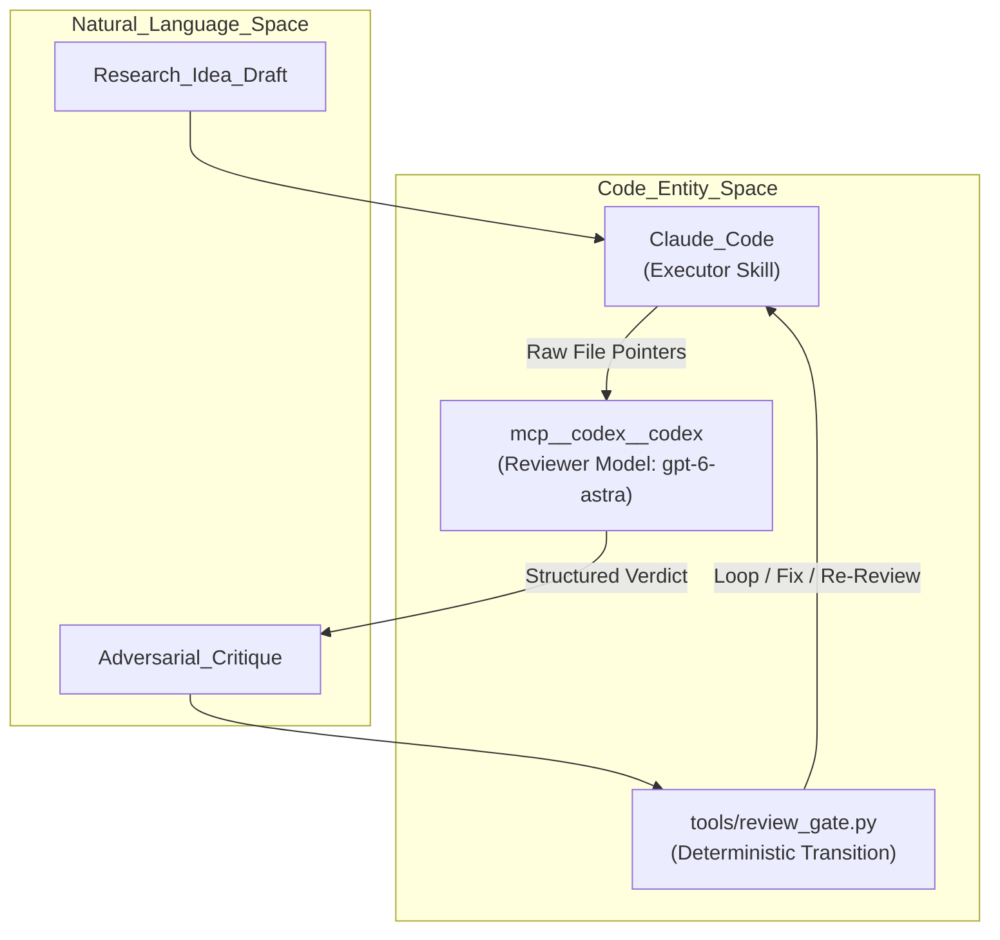
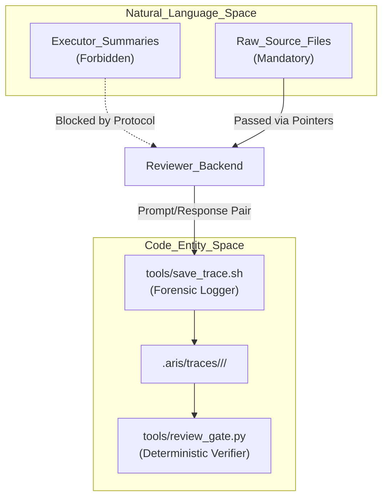
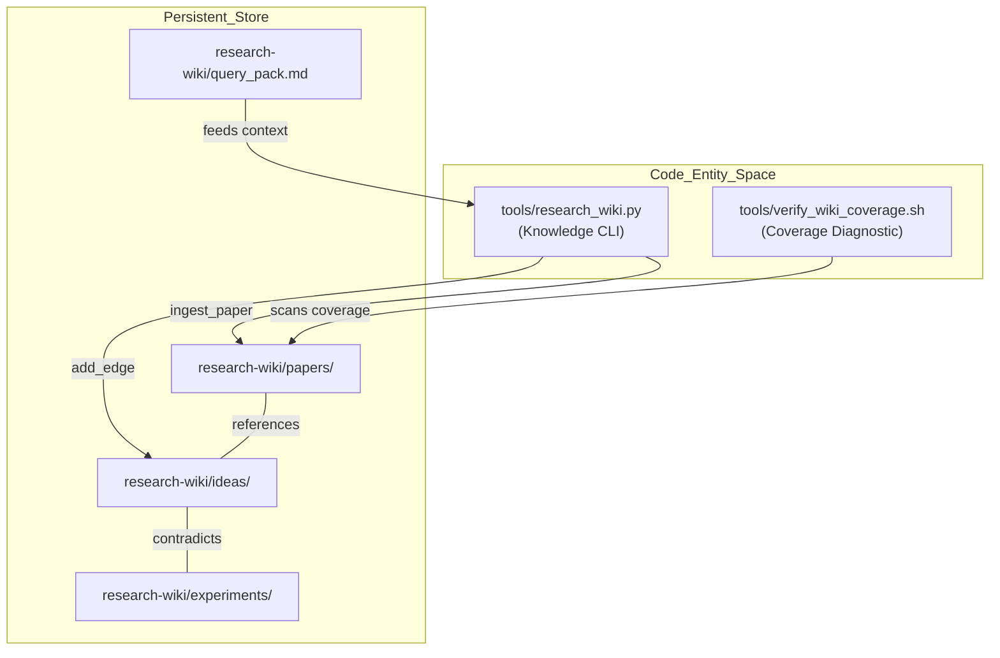

<!-- source: DeepWiki mcp.deepwiki.com · repo wanshuiyin/Auto-claude-code-research-in-sleep · page 1.3 System Design Philosophy · fetched 2026-10-26 -->

# System Design Philosophy

Relevant source files

The following files were used as context for generating this wiki page:

- [docs/MODEL_COMBINATIONS.md](docs/MODEL_COMBINATIONS.md)
- [docs/MODEL_COMBINATIONS_CN.md](docs/MODEL_COMBINATIONS_CN.md)
- [docs/MiniMax-GLM-Configuration.md](docs/MiniMax-GLM-Configuration.md)
- [docs/aris_logo.svg](docs/aris_logo.svg)
- [docs/auto_review_score_curve.png](docs/auto_review_score_curve.png)
- [docs/hero_combined.svg](docs/hero_combined.svg)
- [docs/hero_idea.svg](docs/hero_idea.svg)
- [docs/hero_implement.svg](docs/hero_implement.svg)
- [docs/hero_interaction.svg](docs/hero_interaction.svg)
- [docs/wechat_group.jpg](docs/wechat_group.jpg)
- [skills/auto-review-loop/SKILL.md](skills/auto-review-loop/SKILL.md)
- [skills/shared-references/integration-contract.md](skills/shared-references/integration-contract.md)
- [skills/shared-references/review-tracing.md](skills/shared-references/review-tracing.md)
- [skills/shared-references/reviewer-routing.md](skills/shared-references/reviewer-routing.md)
- [skills/skills-codex-claude-review/research-refine/SKILL.md](skills/skills-codex-claude-review/research-refine/SKILL.md)
- [skills/skills-codex/shared-references/integration-contract.md](skills/skills-codex/shared-references/integration-contract.md)
- [skills/skills-codex/shared-references/reviewer-routing.md](skills/skills-codex/shared-references/reviewer-routing.md)
- [tests/test_copilot_install.py](tests/test_copilot_install.py)
- [tests/test_review_gate.py](tests/test_review_gate.py)
- [tools/review_gate.py](tools/review_gate.py)
- [tools/save_trace.sh](tools/save_trace.sh)

## Purpose and Scope

This page defines the architectural design principles of ARIS (Auto-claude-code-research-in-sleep). It details why the framework relies on cross-model collaboration instead of single-model self-play, formalizes the separation of concerns between the Executor (`Claude Code` or alternative agent implementations) and the Reviewer (`gpt-6-astra` via Codex MCP or Copilot native subagent), and specifies the mechanics of the reviewer independence protocol, the assurance chain design, and state-managed verification gates [skills/shared-references/reviewer-routing.md:1-38](), [skills/auto-review-loop/SKILL.md:1-29]().

Sources: [skills/shared-references/reviewer-routing.md:1-38](), [skills/auto-review-loop/SKILL.md:1-29]()

---

## The Local Minima Problem and Cross-Model Collaboration

Single-model self-review architectures suffer from blind spot convergence: when an LLM evaluates its own outputs, it consistently fails to detect semantic errors, methodological flaws, or hallucinations because both generation and critique share identical inductive biases and training distributions.

### Escape Local Minimum Architecture

**Empirical design choice**: ARIS pairs an execution model (`Claude Code` optimized for tool use, terminal interaction, and multi-file code modifications) with an external review model (`gpt-6-astra` at `xhigh` or `ultra` reasoning effort, or Copilot native `rubber-duck` subagent) [skills/shared-references/reviewer-routing.md:30-41](). This adversarial loop prevents the system from settling into premature convergence on flawed experimental scripts.

Sources: [skills/shared-references/reviewer-routing.md:30-41](), [skills/auto-review-loop/SKILL.md:1-19]()

---

## The Executor vs Reviewer Pattern

The framework explicitly decouples the execution engine from the critique engine. Each component operates within a defined scope and utilizes distinct communication channels.

### System Dimension Comparison

| Dimension | Executor (`Claude Code` / Alt) | Reviewer (`gpt-6-astra` / Copilot Native) |
|-----------|------------------------|--------------------------|
| **Primary Toolset** | `Bash`, `Read`, `Write`, `Edit`, `Grep`, Python environment | `mcp__codex__codex`, `mcp__codex__codex-reply`, host `task` tool |
| **Model Role** | Code generation, experiment execution, patch application | Adversarial auditing, scoring, rigorous critique |
| **Context Access** | Full workspace files, terminal processes, logs | File paths and explicit context chunks passed by executor |
| **Reasoning Tier** | Standard execution profile | Two-tier policy (`xhigh` regular, `ultra` deep-audit) |

**Code entities**:
- **Executor Engine**: Driven by workflow orchestrators like `/idea-discovery` [skills/idea-discovery/SKILL.md:1-10](), `/auto-review-loop` [skills/auto-review-loop/SKILL.md:1-10](), and `/paper-writing` [skills/paper-writing/SKILL.md:1-10]().
- **Reviewer Invocation**: Managed through `REVIEWER_MODEL = "gpt-6-astra"` and tiered reasoning controls in [skills/shared-references/reviewer-routing.md:30-41]().

Sources: [skills/auto-review-loop/SKILL.md:1-38](), [skills/shared-references/reviewer-routing.md:30-41]()

---

## Reviewer Independence Protocol and Tracing

To ensure the reviewer maintains integrity, ARIS enforces the **Reviewer Independence Protocol**. The executor is strictly prohibited from coaching the reviewer or passing subjective summaries of its own code modifications [skills/shared-references/review-tracing.md:1-11]().

### Reviewer Independence Architecture

**Implementation Details**:
- **Trace Persistence**: Every interaction with the reviewer is captured by `tools/save_trace.sh` under `.aris/traces/<skill-name>/` to audit prompt structures and verify non-interference [skills/shared-references/review-tracing.md:21-32](), [tools/save_trace.sh:1-35]().
- **Native Evidence Validation**: When using Copilot CLI native rubber-duck mode, `tools/copilot_native_evidence.py` validates host-event session records to guarantee cross-family identity separation before passing data to [tools/review_gate.py:108-133]().

Sources: [skills/shared-references/review-tracing.md:1-45](), [tools/save_trace.sh:1-40](), [tools/review_gate.py:108-133]()

---

## The Assurance Chain Design

Research validation requires mechanical verification rather than heuristic assessment. ARIS implements a multi-layer assurance chain coupled with strict integration contracts [skills/shared-references/integration-contract.md:1-15]().

### Multi-Layer Assurance Chain

| Layer | Code Entity / Tool | Purpose & Enforcement |
|-------|-------------------|-----------------------|
| **L1: Novelty** | `/novelty-check` | Verifies idea uniqueness against live literature indexes [skills/idea-discovery/SKILL.md:1-20]() |
| **L2: Technical Review** | `/research-review` | Simulates rigorous ML venue peer review [skills/auto-review-loop/SKILL.md:1-30]() |
| **L3: Claim Audit** | `/paper-claim-audit` | Cross-checks empirical claims in LaTeX against `EXPERIMENT_LOG.md` |
| **L4: Citation Audit** | `/citation-audit` | Validates reference existence, BibTeX consistency, and citation context |
| **L5: Final Gate** | `tools/verify_paper_audits.sh` | Hard-blocking verification script required for `assurance: submission` |

### Integration Contract Enforcement
Inter-skill dependencies rely on three engineered components:
1. **Activation Predicate**: An observable environment or file-state test (e.g., `if [ -d research-wiki/ ]`) [skills/shared-references/integration-contract.md:37-47]().
2. **Canonical Helper Resolution**: Resolves tool scripts through a strict four-layer fallback chain (`.aris/tools/`, `tools/`, `$ARIS_REPO/tools/`, and `~/.aris/repo`) [skills/shared-references/integration-contract.md:48-94]().
3. **Failure Policy**: Explicitly defines whether a missing helper triggers a load-bearing block (`exit 1`) or an optional warning (`WARN`) [skills/shared-references/integration-contract.md:110-145]().

Sources: [skills/shared-references/integration-contract.md:1-145](), [tools/review_gate.py:1-50]()

---

## Knowledge Persistence and Spiral Learning

To prevent regression and eliminate repetitive exploration loops across execution sessions, ARIS maintains a persistent knowledge base managed by [tools/research_wiki.py:1-50]().

### Knowledge Graph Architecture

The knowledge graph stores typed entity relationships and compiles a `query_pack.md` index. This index implements **spiral learning**, feeding historical findings and failed hypothesis logs directly into downstream planning skills like `/idea-creator` [tools/research_wiki.py:1-80]().

Sources: [tools/research_wiki.py:1-80](), [tools/verify_wiki_coverage.sh:1-30]()

---

