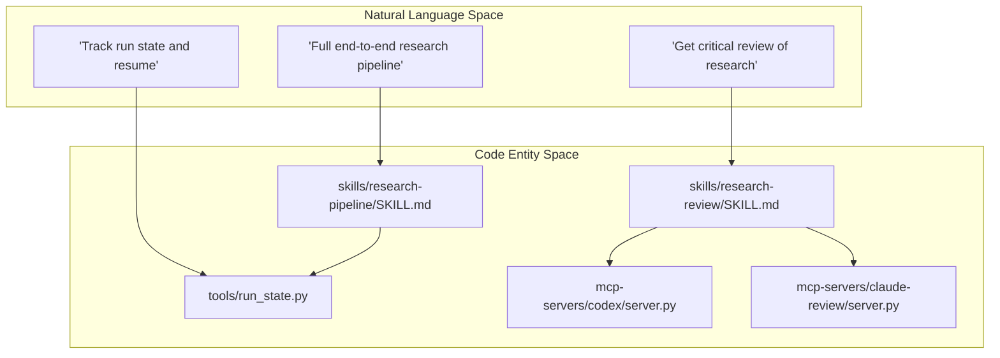

<!-- source: DeepWiki mcp.deepwiki.com · repo wanshuiyin/Auto-claude-code-research-in-sleep · page 2 System Architecture · fetched 2026-10-26 -->

# System Architecture

Relevant source files

The following files were used as context for generating this wiki page:

- [AGENT_GUIDE.md](AGENT_GUIDE.md)
- [docs/ARIS_INTRO.html](docs/ARIS_INTRO.html)
- [docs/ARIS_INTRO.md](docs/ARIS_INTRO.md)
- [docs/CUSTOMIZATION.md](docs/CUSTOMIZATION.md)
- [docs/CUSTOMIZATION_CN.md](docs/CUSTOMIZATION_CN.md)
- [docs/SKILLS_CATALOG.md](docs/SKILLS_CATALOG.md)
- [skills/research-pipeline/SKILL.md](skills/research-pipeline/SKILL.md)
- [skills/skills-codex-claude-review/research-review/SKILL.md](skills/skills-codex-claude-review/research-review/SKILL.md)
- [skills/skills-codex-gemini-review/research-review/SKILL.md](skills/skills-codex-gemini-review/research-review/SKILL.md)
- [skills/skills-codex/README.md](skills/skills-codex/README.md)
- [skills/skills-codex/README_CN.md](skills/skills-codex/README_CN.md)
- [skills/skills-codex/research-pipeline/SKILL.md](skills/skills-codex/research-pipeline/SKILL.md)
- [skills/skills-codex/research-review/SKILL.md](skills/skills-codex/research-review/SKILL.md)
- [tests/test_auto_proceed_contract.py](tests/test_auto_proceed_contract.py)

## Purpose and Scope

This page provides an architectural overview of the ARIS (Auto-claude-code-research-in-sleep) runtime environment, component stratification, and data flow layers. It details how natural language research workflows map to concrete code entities, the separation between execution and adversarial review, and the underlying infrastructure. 

For deep technical details, see the child pages:
- Cross-Model Collaboration [Cross-Model Collaboration](#2.1)
- Skill Ecosystem [Skill Ecosystem](#2.2)
- MCP Server Architecture [MCP Server Architecture](#2.3)
- State Management & Recovery [State Management & Recovery](#2.4)
- Deterministic Gates & Helper Tools [Deterministic Gates & Helper Tools](#2.5)

Sources: [README.md:1-50](), [AGENT_GUIDE.md:1-15]()

---

## Architectural Layers and Component Mapping

ARIS organizes research automation into execution, review, state persistence, and infrastructure layers. The following diagram bridges natural language inputs to their concrete code entity implementations across the repository.

Sources: [skills/research-pipeline/SKILL.md:1-10](), [AGENT_GUIDE.md:12-25](), [skills/skills-codex/research-review/SKILL.md:1-35]()

---

## 2.1 Cross-Model Collaboration

ARIS utilizes a two-tier collaboration model where an executor (Claude Code or Codex CLI) writes code, runs experiments, and drafts papers, while an external reviewer model (such as `gpt-6-astra` via Codex MCP or Claude via `claude-review`) acts as an adversarial critic [README.md:43-50](). To prevent narrative drift and score inflation, reviews adhere to a strict reviewer independence protocol using fresh threads for each round rather than continuation chains (`codex-reply`) [docs/ARIS_INTRO.md:40-45]().

For detailed mechanics, see [Cross-Model Collaboration](#2.1).

Sources: [docs/ARIS_INTRO.md:30-64](), [AGENT_GUIDE.md:5-11]()

---

## 2.2 Skill Ecosystem

The ARIS skill ecosystem consists of over 80 composable Markdown skills located in `skills/<name>/SKILL.md` for mainline hosts and `skills/skills-codex/<name>/SKILL.md` for Codex-native environments [AGENT_GUIDE.md:12-27](). Skills are divided into atomic units (e.g., `/research-lit`, `/run-experiment`) and orchestrators (e.g., `/research-pipeline`, `/auto-review-loop`) that govern execution state and enforce parameter contracts [docs/SKILLS_CATALOG.md:21-45]().

For detailed specifications, see [Skill Ecosystem](#2.2).

Sources: [AGENT_GUIDE.md:12-78](), [docs/SKILLS_CATALOG.md:1-45]()

---

## 2.3 MCP Server Architecture

Model Context Protocol (MCP) servers bridge the executor environment to external LLM providers and auxiliary research tools. Custom MCP servers—such as `claude-review`, `gemini-review`, `llm-chat`, and `codex-image2`—provide tool invocation patterns that enable cross-family evaluation, web-based search, and multi-model routing [README_CN.md:1-20]().

For implementation details, see [MCP Server Architecture](#2.3).

Sources: [docs/SKILLS_CATALOG.md:1-40](), [skills/skills-codex-claude-review/research-review/SKILL.md:32-37]()

---

## 2.4 State Management & Recovery

To withstand context compaction and long-running execution limits, ARIS records execution state through `run_state.py` under `.aris/runs/` and maintains conversational persistence via `REVIEW_STATE.json` [skills/research-pipeline/SKILL.md:82-90](). Pipelines support resumable execution by tracking per-stage completion states (`done` vs. `accepted`) [skills/research-pipeline/SKILL.md:45-46]().

For recovery mechanisms, see [State Management & Recovery](#2.4).

Sources: [skills/research-pipeline/SKILL.md:40-90](), [AGENT_GUIDE.md:98-112]()

---

## 2.5 Deterministic Gates & Helper Tools

The `tools/` directory acts as the deterministic backbone of ARIS, providing standalone scripts that enforce invariants without relying on LLM heuristics. Key utilities include `run_state.py` for orchestration tracking, `iteration_log.py` for finding counts, `watchdog.py` for anomaly detection, and verification scripts like `verify_paper_audits.sh` [tests/test_auto_proceed_contract.py:1-85]().

For a complete inventory of verification utilities, see [Deterministic Gates & Helper Tools](#2.5).

Sources: [skills/research-pipeline/SKILL.md:18-28](), [tests/test_auto_proceed_contract.py:1-85]()

---

