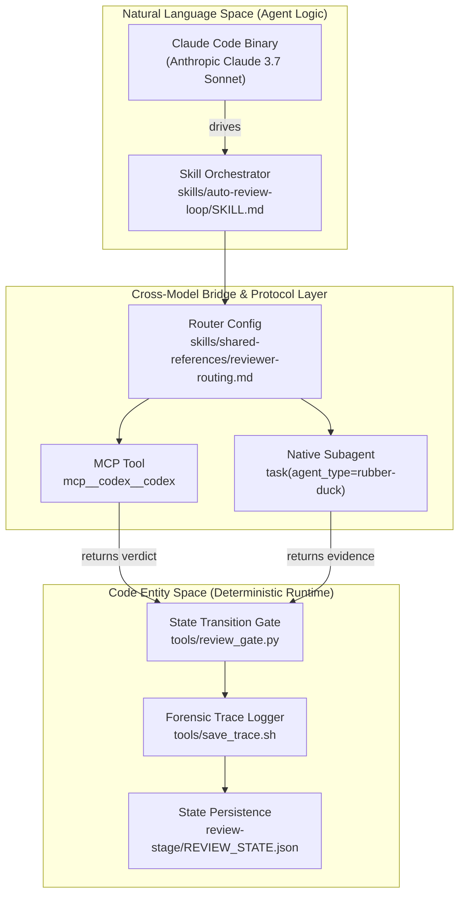
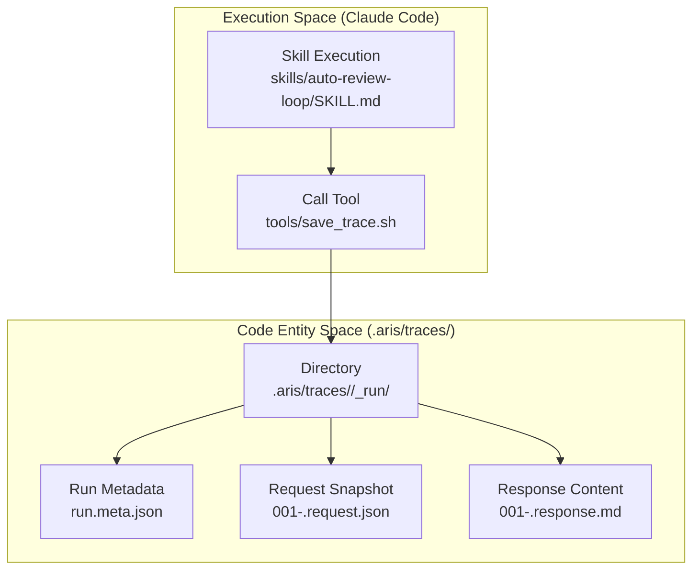

<!-- source: DeepWiki mcp.deepwiki.com · repo wanshuiyin/Auto-claude-code-research-in-sleep · page 2.1 Cross-Model Collaboration · fetched 2026-10-26 -->

# Cross-Model Collaboration

<details>
<summary>Relevant source files</summary>

The following files were used as context for generating this wiki page:

- [docs/MODEL_COMBINATIONS.md](docs/MODEL_COMBINATIONS.md)
- [docs/MODEL_COMBINATIONS_CN.md](docs/MODEL_COMBINATIONS_CN.md)
- [docs/MiniMax-GLM-Configuration.md](docs/MiniMax-GLM-Configuration.md)
- [docs/aris_logo.svg](docs/aris_logo.svg)
- [docs/auto_review_score_curve.png](docs/auto_review_score_curve.png)
- [docs/hero_combined.svg](docs/hero_combined.svg)
- [docs/hero_idea.svg](docs/hero_idea.svg)
- [docs/hero_implement.svg](docs/hero_implement.svg)
- [docs/hero_interaction.svg](docs/hero_interaction.svg)
- [docs/wechat_group.jpg](docs/wechat_group.jpg)
- [skills/auto-review-loop/SKILL.md](skills/auto-review-loop/SKILL.md)
- [skills/shared-references/integration-contract.md](skills/shared-references/integration-contract.md)
- [skills/shared-references/review-tracing.md](skills/shared-references/review-tracing.md)
- [skills/shared-references/reviewer-routing.md](skills/shared-references/reviewer-routing.md)
- [skills/skills-codex-claude-review/research-refine/SKILL.md](skills/skills-codex-claude-review/research-refine/SKILL.md)
- [skills/skills-codex/shared-references/integration-contract.md](skills/skills-codex/shared-references/integration-contract.md)
- [skills/skills-codex/shared-references/reviewer-routing.md](skills/skills-codex/shared-references/reviewer-routing.md)
- [tests/test_copilot_install.py](tests/test_copilot_install.py)
- [tests/test_review_gate.py](tests/test_review_gate.py)
- [tools/review_gate.py](tools/review_gate.py)
- [tools/save_trace.sh](tools/save_trace.sh)

</details>


## Purpose and Scope

This page documents ARIS's core architectural pattern: **executor-reviewer separation** using two independent Large Language Models from different model families. Claude Code (the executor) drives implementation, file editing, and experiment execution, while an external LLM (the reviewer, accessed via Codex MCP, native Copilot subagents, or specialized MCP bridges) provides adversarial evaluation. This design eliminates self-review bias and avoids the local minima inherent in single-model research loops.

---

## 1. Executor-Reviewer Architecture & Data Flow

ARIS enforces a structural separation between the execution and review roles. The executor never evaluates its own work; all quality gates, scoring, and verdict generation are delegated to an independent reviewer model via standardized invocation protocols.

### System-to-Code Mapping (Bridge Diagram 1)



Sources: [skills/auto-review-loop/SKILL.md:1-40](), [skills/shared-references/reviewer-routing.md:1-11](), [tools/review_gate.py:1-40](), [tools/save_trace.sh:1-43]()

---

## 2. Reviewer Backend Selection & Routing

The reviewer backend is resolved dynamically based on project configuration, available MCP servers, and execution environment directives.

### Reviewer Backends and Fallback Hierarchy

The `REVIEWER_BACKEND` parameter supports several operational modes defined in `skills/shared-references/reviewer-routing.md`:
- **`auto`**: The default for `/auto-review-loop`. At Step -1, it attempts to bind to the host Copilot session via `copilot_native_evidence.py`. If bound, it uses `copilot-native` (built-in `rubber-duck` subagent); otherwise, it falls back to `codex` [skills/auto-review-loop/SKILL.md:29-61]().
- **`copilot-native`**: Uses the host's native complementary subagent without pinning a specific model ID, validating via `copilot_native_evidence.py` [skills/auto-review-loop/SKILL.md:62-80]().
- **`codex`**: Uses Codex MCP (`mcp__codex__codex`) with model `gpt-6-astra` [skills/shared-references/reviewer-routing.md:10-32]().
- **`manual`**, **`oracle-pro`**, **`agy`**, **`llm-chat`**: Explicit overrides for alternative model families (OpenAI, Anthropic, Google, DeepSeek, Moonshot, Qwen) [skills/auto-review-loop/SKILL.md:28]().

### Tiered Reasoning-Effort Policy

When using Codex MCP, ARIS applies a strict two-tier reasoning-effort policy to balance speed and critique depth [skills/shared-references/reviewer-routing.md:30-44]():

| Tier | `model_reasoning_effort` | Applicable Skills / Calls |
|------|--------------------------|---------------------------|
| **Deep-audit** | `ultra` | `/proof-checker`, `/kill-argument` (core attack/defense threads), `/research-review`, `/experiment-audit`, `/paper-claim-audit`, `/result-to-claim`, `/meta-apply` [skills/shared-references/reviewer-routing.md:36](). |
| **Regular** | `xhigh` | All multi-round loops including every round of `/auto-review-loop`, and per-item fan-outs like `/citation-audit` [skills/shared-references/reviewer-routing.md:37](). |

*Note: Model and effort must be pinned explicitly in the first call of every thread; downstream follow-ups (`mcp__codex__codex-reply`) inherit the established session context [skills/shared-references/reviewer-routing.md:39-53]().*

Sources: [skills/auto-review-loop/SKILL.md:28-80](), [skills/shared-references/reviewer-routing.md:1-89]()

---

## 3. Reviewer Independence Protocol & Tracing

To preserve the adversarial value of cross-model collaboration, ARIS enforces the **Reviewer Independence Protocol**, governed by strict artifact contracts and forensic logging.

### Core Independence Rules
1. **Raw Artifact Directing**: The executor passes file paths (e.g., `EXPERIMENT_LOG.md`, source files) directly to the reviewer rather than summarizing or filtering the content [skills/shared-references/reviewer-independence.md:1-27]().
2. **No Subjective Coaching**: The executor is prohibited from inserting interpretive commentary or recommending how the reviewer should score the work.
3. **Forensic Trace Recording**: Every review call—including failed capability fallback attempts—is recorded via `tools/save_trace.sh` into structured trace directories [skills/shared-references/review-tracing.md:1-44]().

### Trace Directory Structure and System Mapping (Bridge Diagram 2)



Sources: [skills/shared-references/review-tracing.md:21-38](), [tools/save_trace.sh:1-43]()

---

## 4. Adversarial Review & Deterministic Gates

ARIS scales critique skepticism through three configurable difficulty tiers and delegates stopping conditions to a deterministic Python state machine.

### Reviewer Difficulty Levels
- **`medium` (Default)**: Standard MCP-based cross-model review where the executor structures the provided file context [skills/auto-review-loop/SKILL.md:33-34]().
- **`hard`**: Introduces **Reviewer Memory** (`REVIEWER_MEMORY.md` tracking suspicions across rounds) and a **Debate Protocol** (executor rebuttals adjudicated by the reviewer) [skills/auto-review-loop/SKILL.md:35]().
- **`nightmare`**: Combines `hard` features with direct repository read access via `codex exec` (bypassing executor context filters) and **Adversarial Verification** of code against theoretical claims [skills/auto-review-loop/SKILL.md:36]().

### Deterministic State Transitions (`tools/review_gate.py`)

Rather than relying purely on LLM prose to interpret review scores, ARIS delegates stop/continue/escalate logic to `tools/review_gate.py` [tools/review_gate.py:1-7](). 

The authoritative stop condition requires **both** criteria to be met [skills/auto-review-loop/SKILL.md:26]():
$$\text{Score} \ge 6/10 \quad \text{AND} \quad \text{Verdict} \in \{\text{"ready"},\ \text{"almost"}\}$$

```python
# Core validation snippet from tools/review_gate.py
POSITIVE_VERDICTS = {"ready", "almost"}

def evaluate_transition(
    *,
    round_backend: str,
    score: float,
    verdict: str,
    ...
) -> Transition:
    ...
```
*A high numerical score paired with a `"not ready"` verdict will continue the loop regardless of points.*

Sources: [skills/auto-review-loop/SKILL.md:22-40](), [tools/review_gate.py:1-148]()

---

## 5. Why Cross-Model Collaboration Beats Single-Model Approaches

Relying on a single model for both generation and review introduces systematic blind spots due to shared prior distributions and confirmation bias.

### Stochastic vs. Adversarial Dynamics

| Dimension | Single-Model Self-Review | ARIS Cross-Model Collaboration |
|-----------|-------------------------|--------------------------------|
| **Error Landscape** | Stochastic noise; predictable hallucinations. | Adversarial probing; independent training distribution catches hidden flaws. |
| **Convergence** | Stagnates quickly in local minima. | Drives toward Nash equilibrium through multi-family tension. |
| **Rigor** | Model tends to be lenient with its own generated structure. | External model enforces strict standards and independent code verification. |
| **Model Families** | Single family (e.g., Anthropic only). | Dual-family pairing (e.g., Anthropic Claude + OpenAI GPT / DeepSeek). |

From the system design perspective, two independent models represent the minimal configuration required to break self-play symmetry without incurring the quadratic coordination overhead of n-player multi-model teams.

Sources: [README.md:43-50](), [README_CN.md:21-28]()

---

