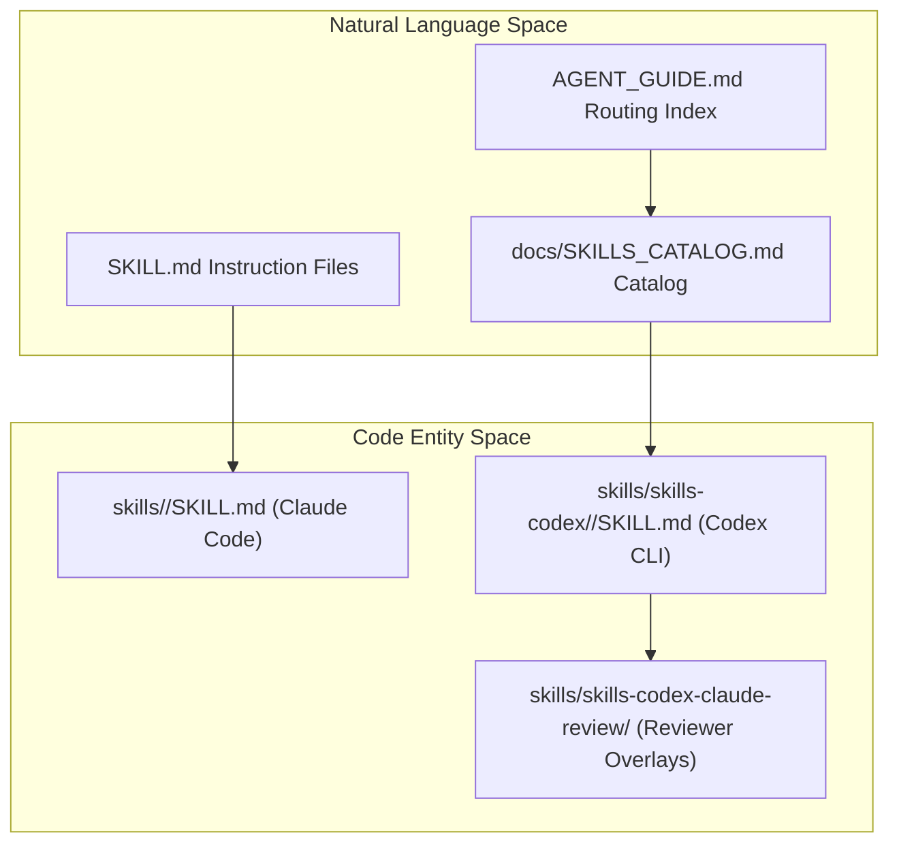
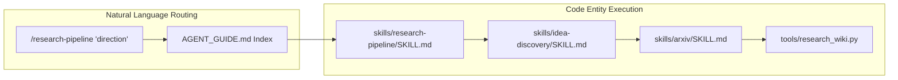
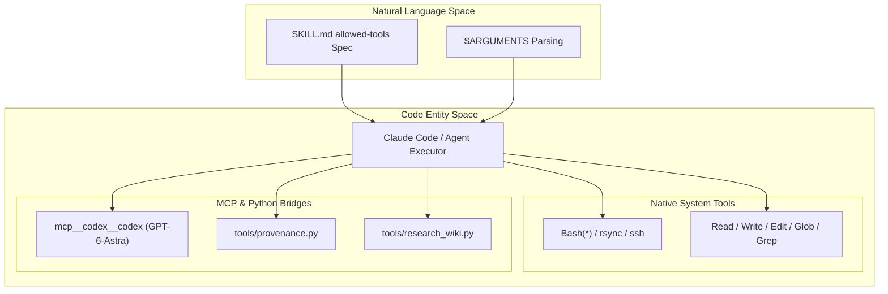

<!-- source: DeepWiki mcp.deepwiki.com · repo wanshuiyin/Auto-claude-code-research-in-sleep · page 2.2 Skill Ecosystem · fetched 2026-10-26 -->

# Skill Ecosystem

Relevant source files

The following files were used as context for generating this wiki page:

- [AGENT_GUIDE.md](AGENT_GUIDE.md)
- [docs/ARIS_INTRO.html](docs/ARIS_INTRO.html)
- [docs/ARIS_INTRO.md](docs/ARIS_INTRO.md)
- [docs/SKILLS_CATALOG.md](docs/SKILLS_CATALOG.md)
- [skills/meta-apply/SKILL.md](skills/meta-apply/SKILL.md)
- [skills/skills-codex/README.md](skills/skills-codex/README.md)
- [skills/skills-codex/README_CN.md](skills/skills-codex/README_CN.md)
- [skills/skills-codex/meta-apply/SKILL.md](skills/skills-codex/meta-apply/SKILL.md)
- [tests/test_codex_skill_mirror.py](tests/test_codex_skill_mirror.py)

This parent page documents the ARIS skill ecosystem, covering the composable skills architecture, orchestrator versus atomic skill patterns, runtime dependencies, allowed tools, the `AGENT_GUIDE.md` routing index, `SKILLS_CATALOG.md`, and skill locations across platforms. 

For deep technical details on governance and execution contracts, see [Shared References & Contracts](#2.2.1). For details on reviewer resolution and model selection, see [Reviewer Routing & Backend Selection](#2.2.2).

## Overview & Platform Skill Locations

ARIS organizes research automation into modular, composable Markdown-based skills (`SKILL.md`) that are interpreted and executed by AI agents [AGENT_GUIDE.md:1-10](). The ecosystem spans mainline environments (Claude Code, Cursor, Trae, Antigravity, Copilot CLI) and Codex-native mirrored packages [AGENT_GUIDE.md:12-20]().

Sources: [AGENT_GUIDE.md:12-27](), [skills/skills-codex/README.md:1-19]()

## Orchestrator vs. Atomic Skills & Routing

ARIS distinguishes between high-level workflow orchestrators that chain multi-stage research lifecycles and atomic skills that execute singular, focused operations [docs/SKILLS_CATALOG.md:21-41]().

Sources: [AGENT_GUIDE.md:79-95](), [docs/SKILLS_CATALOG.md:21-43]()

## Technical Implementation: Tool Permissions & Dependencies

Skills declare strict tool permissions via frontmatter `allowed-tools` blocks, binding natural language procedures directly to concrete code execution paths.

Sources: [skills/meta-apply/SKILL.md:1-6](), [AGENT_GUIDE.md:66-78]()

## Shared References & Contracts

Core rules, governance frameworks, and invariant specifications are maintained globally in `skills/shared-references/`. These contracts govern review routing, integration boundaries, citation discipline, experiment integrity, output versioning, and assurance gates.

For comprehensive documentation on shared references, integration contracts, review scope limits, acceptance gates, fan-out patterns, injection hygiene, experiment integrity, versioning, governance, and resumable runs, see [Shared References & Contracts](#2.2.1).

Sources: [AGENT_GUIDE.md:7-11](), [skills/skills-codex/README.md:8-16]()

## Reviewer Routing & Backend Selection

ARIS supports pluggable reviewer backends through the `REVIEWER_BACKEND` resolution system, enabling auto-routing, copilot-native reviewers, Codex MCP, manual browser UIs, Gemini bridges, and generic `llm-chat` interfaces.

For details on how backend resolution operates, fallback hierarchies, reasoning-effort tiers (lite, balanced, max, beast, ultra), and provenance/identity assurance classifications, see [Reviewer Routing & Backend Selection](#2.2.2).

Sources: [AGENT_GUIDE.md:34-65](), [docs/SKILLS_CATALOG.md:31-33]()

## Skill Catalog Summary

The complete catalog lists 82+ skills spanning orchestrators, literature search, ideation, execution, output generation, and assurance audits [docs/SKILLS_CATALOG.md:3-6]() [AGENT_GUIDE.md:27]().

| Category | Representative Skills | Core Dependencies / Integration |
| :--- | :--- | :--- |
| **Orchestrators** | `/research-pipeline`, `/auto-review-loop`, `/resubmit-pipeline` | Codex MCP, LaTeX toolchain [docs/SKILLS_CATALOG.md:25-37]() |
| **Literature** | `/research-lit`, `/arxiv`, `/deepxiv`, `/openalex` | Network APIs, Zotero, Obsidian [docs/SKILLS_CATALOG.md:48-61]() |
| **Ideation** | `/idea-creator`, `/novelty-check`, `/ablation-planner` | Codex MCP, GPU hardware [docs/SKILLS_CATALOG.md:66-73]() |
| **Execution** | `/run-experiment`, `/experiment-queue`, `/monitor-experiment` | SSH, Conda, Screen [docs/SKILLS_CATALOG.md:76-88]() |
| **Writing** | `/paper-write`, `/paper-figure`, `/render-html`, `/overleaf-sync` | LaTeX, Git, Overleaf bridge [docs/SKILLS_CATALOG.md:91-105]() |
| **Assurance** | `/experiment-audit`, `/paper-claim-audit`, `/kill-argument` | Codex MCP, verification scripts [docs/SKILLS_CATALOG.md:120-145]() |

Sources: [docs/SKILLS_CATALOG.md:21-150](), [AGENT_GUIDE.md:86-112]()

---

