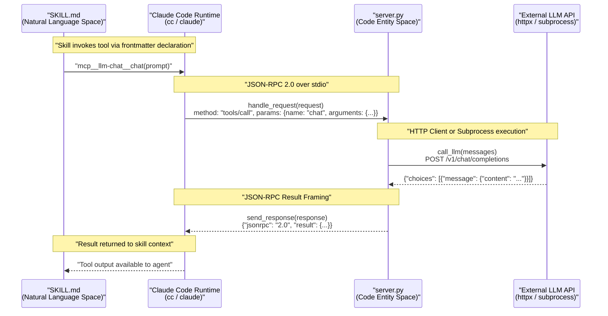
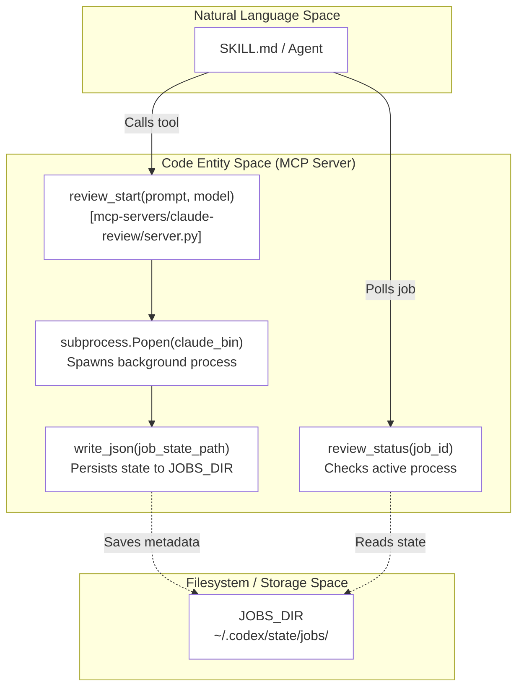

<!-- source: DeepWiki mcp.deepwiki.com · repo wanshuiyin/Auto-claude-code-research-in-sleep · page 2.3 MCP Server Architecture · fetched 2026-10-26 -->

# MCP Server Architecture

Relevant source files

The following files were used as context for generating this wiki page:

- [.github/agents/aris-reviewer-claude.agent.md](.github/agents/aris-reviewer-claude.agent.md)
- [.github/agents/aris-reviewer-openai.agent.md](.github/agents/aris-reviewer-openai.agent.md)
- [docs/ALI_CODING_PLAN_GUIDE.md](docs/ALI_CODING_PLAN_GUIDE.md)
- [docs/CODEX_CLAUDE_REVIEW_GUIDE.md](docs/CODEX_CLAUDE_REVIEW_GUIDE.md)
- [docs/CODEX_CLAUDE_REVIEW_GUIDE_CN.md](docs/CODEX_CLAUDE_REVIEW_GUIDE_CN.md)
- [docs/CURSOR_ADAPTATION.md](docs/CURSOR_ADAPTATION.md)
- [docs/MINIMAX_MCP_GUIDE.md](docs/MINIMAX_MCP_GUIDE.md)
- [docs/MODELSCOPE_GUIDE.md](docs/MODELSCOPE_GUIDE.md)
- [mcp-servers/claude-review/README.md](mcp-servers/claude-review/README.md)
- [mcp-servers/claude-review/run_with_claude_aws.sh](mcp-servers/claude-review/run_with_claude_aws.sh)
- [mcp-servers/claude-review/server.py](mcp-servers/claude-review/server.py)
- [mcp-servers/feishu-bridge/requirements.txt](mcp-servers/feishu-bridge/requirements.txt)
- [mcp-servers/feishu-bridge/server.py](mcp-servers/feishu-bridge/server.py)
- [mcp-servers/gemini-review/server.py](mcp-servers/gemini-review/server.py)
- [mcp-servers/llm-chat/requirements.txt](mcp-servers/llm-chat/requirements.txt)
- [mcp-servers/llm-chat/server.py](mcp-servers/llm-chat/server.py)
- [mcp-servers/manual-review/server.py](mcp-servers/manual-review/server.py)
- [mcp-servers/manual-review/ui.html](mcp-servers/manual-review/ui.html)
- [mcp-servers/minimax-chat/requirements.txt](mcp-servers/minimax-chat/requirements.txt)
- [mcp-servers/minimax-chat/server.py](mcp-servers/minimax-chat/server.py)
- [tests/_minimax_helpers.py](tests/_minimax_helpers.py)
- [tests/test_claude_review_parse.py](tests/test_claude_review_parse.py)
- [tests/test_manual_review.py](tests/test_manual_review.py)
- [tests/test_minimax_chat_server.py](tests/test_minimax_chat_server.py)

This document explains the Multi-Agent Communication Protocol (MCP) pattern used in ARIS to enable Claude Code or Codex executors to interface with external LLMs for research review, cross-model validation, and asynchronous tasks. MCP servers act as protocol adapters that expose external AI models and infrastructure services as structured tools that skills can invoke.

Sources: [mcp-servers/llm-chat/server.py:2-18](), [mcp-servers/claude-review/server.py:2-6](), [docs/CURSOR_ADAPTATION.md:26-46]()

---

## 1. MCP Role & Design Pattern in ARIS

MCP (Multi-Agent Communication Protocol) is a standardized JSON-RPC protocol for exposing tools to LLMs. In ARIS, MCP servers serve three primary architectural goals:
1. **Cross-Model Collaboration & Review**: Enable an executor (such as Claude Code or Codex) to query an independent external reviewer (such as GPT-5, Gemini, MiniMax, or Claude) to enforce adversarial review without direct API access entanglement.
2. **External Service & API Integration**: Provide standardized wrappers for external chat endpoints, human-in-the-loop review UIs, and chat bridges.
3. **Protocol Abstraction**: Decouple atomic skills from underlying API transport differences (OpenAI Responses API, Chat Completions API, or CLI subprocesses).

Sources: [mcp-servers/claude-review/server.py:2-6](), [mcp-servers/llm-chat/server.py:2-18](), [docs/MODELSCOPE_GUIDE.md:31-36]()

---

## 2. Communication Architecture & Protocol Flow

Custom MCP servers communicate via `stdio` using JSON-RPC 2.0 frames. They support dual-format parsing (Content-Length header vs. raw NDJSON) to handle diverse client subprocess launchers.

### Protocol Flow: Natural Language to Code Entity Space

Sources: [mcp-servers/llm-chat/server.py:89-130](), [mcp-servers/minimax-chat/server.py:83-110](), [mcp-servers/claude-review/server.py:64-111]()

---

## 3. Codex MCP vs. Custom Server Implementations

ARIS employs a variety of MCP servers depending on the chosen backend provider and review model.

### Codex MCP (Primary OpenAI Reviewer)
* **Implementation:** Pre-built Node.js package `@openai/codex` exposing `mcp__codex__codex` [docs/CURSOR_ADAPTATION.md:30-46]().
* **Protocol:** OpenAI Responses API (`/v1/responses`) [docs/MODELSCOPE_GUIDE.md:31-36]().
* **Role:** Acts as the default high-assurance reviewer in standard ARIS configurations.

### Custom Python MCP Servers
When non-OpenAI backends or custom wrappers are used, ARIS deploys specialized Python MCP servers located in `mcp-servers/`:

1. **`llm-chat` (`mcp-servers/llm-chat/server.py`)**:
   - Supports any OpenAI-compatible API (DeepSeek, Kimi, ModelScope, OpenRouter) [mcp-servers/llm-chat/server.py:2-18]().
   - Implements automatic retry and 504 fallback to `FALLBACK_MODEL` [mcp-servers/llm-chat/server.py:115-136]().
2. **`claude-review` (`mcp-servers/claude-review/server.py`)**:
   - Exposes a narrow review-only interface wrapping the `claude` CLI [mcp-servers/claude-review/server.py:2-6]().
   - Handles CLI 1.x NDJSON streams and CLI 2.x JSON array structures in `parse_claude_json()` [mcp-servers/claude-review/server.py:120-174]().
3. **`minimax-chat` (`mcp-servers/minimax-chat/server.py`)**:
   - Direct MiniMax API bridge with strict temperature clamping (`clamp_temperature`) [mcp-servers/minimax-chat/server.py:54-71]().
4. **`gemini-review` (`mcp-servers/gemini-review/server.py`)**:
   - Dual-mode Gemini reviewer supporting direct API calls (`gemini-2.5-flash`) or Antigravity/Gemini CLI fallback [mcp-servers/gemini-review/server.py:2-10, 62-65]().
5. **`manual-review` (`mcp-servers/manual-review/server.py`)**:
   - Human-in-the-loop browser UI (`ui.html`) or file-based exchange (`.aris/pending_review`) for zero-cost cross-family model review with identity validation (`model_family`) [mcp-servers/manual-review/server.py:2-12, 82-100]().
6. **`feishu-bridge` (`mcp-servers/feishu-bridge/server.py`)**:
   - Bidirectional Feishu/Lark notification and interactive command bridge.
7. **`codex-image2`**:
   - Multimodal image generation and inspection bridge for paper illustration skills.

Sources: [mcp-servers/llm-chat/server.py:2-18](), [mcp-servers/claude-review/server.py:2-6, 120-174](), [mcp-servers/minimax-chat/server.py:54-71](), [mcp-servers/gemini-review/server.py:2-10, 62-65](), [mcp-servers/manual-review/server.py:2-12, 82-100](), [docs/CURSOR_ADAPTATION.md:30-46]()

---

## 4. Tool Invocation Patterns & Asynchronous Jobs

For resource-intensive or long-running reviews (such as full paper critiques), synchronous JSON-RPC calls risk hitting client timeout limits. Servers like `claude-review` and `gemini-review` implement an asynchronous job pattern.

### Asynchronous Job Architecture

Sources: [mcp-servers/claude-review/server.py:43-52](), [mcp-servers/claude-review/server.py:181-186](), [mcp-servers/claude-review/server.py:257-285]()

---

## 5. Skill Overlays and Backend Swapping

ARIS decouples skill definitions from backend transport layers through **skill override packages** (e.g., `skills-codex-gemini-review`, `skills-codex-claude-review`) [docs/CURSOR_ADAPTATION.md:50-80](). When switching providers (e.g., from Codex to ModelScope or MiniMax), installer tooling or prompt directives rewrite the skill frontmatter and tool invocation blocks (replacing `mcp__codex__codex` with `mcp__llm-chat__chat` or `mcp__minimax-chat__minimax_chat`) [docs/MODELSCOPE_GUIDE.md:139-150](), [docs/MINIMAX_MCP_GUIDE.md:73-85]().

Sources: [docs/CURSOR_ADAPTATION.md:50-80](), [docs/MODELSCOPE_GUIDE.md:139-150](), [docs/MINIMAX_MCP_GUIDE.md:73-85]()

---
Sources: [mcp-servers/llm-chat/server.py:2-18](), [mcp-servers/claude-review/server.py:2-6](), [mcp-servers/minimax-chat/server.py:54-71](), [mcp-servers/gemini-review/server.py:2-10](), [mcp-servers/manual-review/server.py:2-12](), [docs/MODELSCOPE_GUIDE.md:31-36](), [docs/MINIMAX_MCP_GUIDE.md:73-85]()

---

