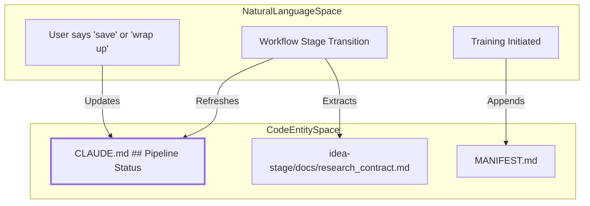
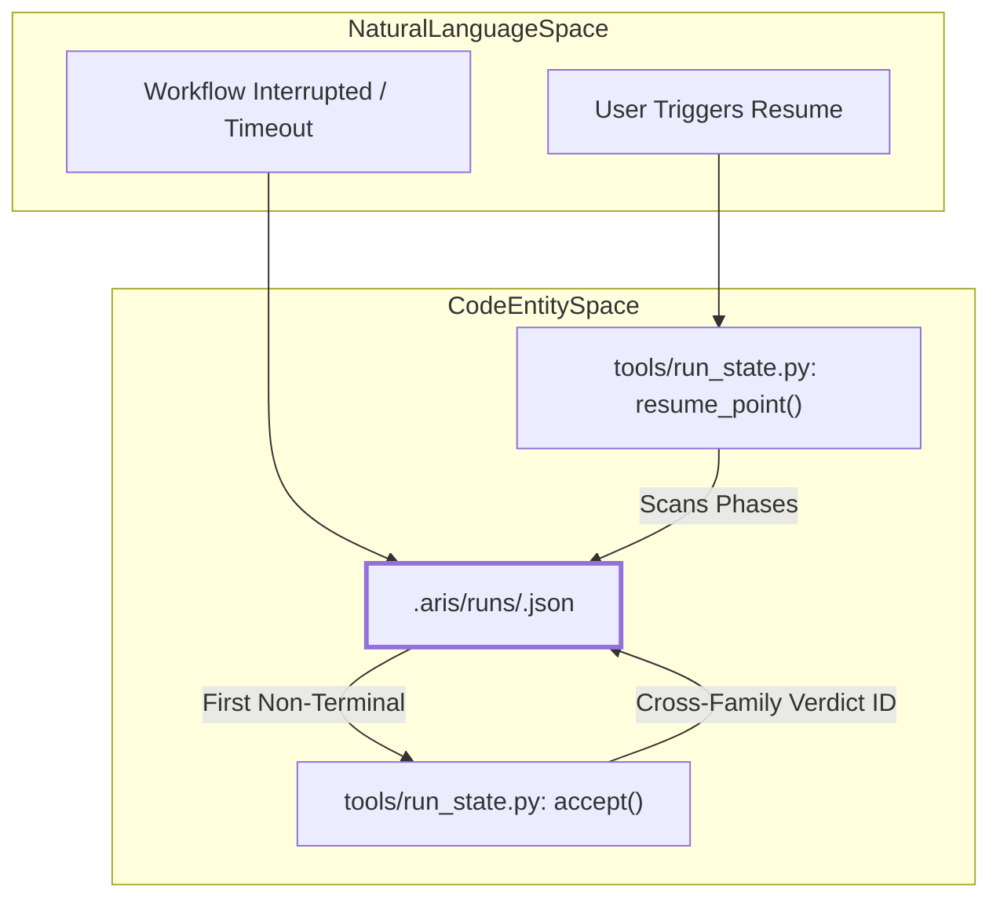

<!-- source: DeepWiki mcp.deepwiki.com · repo wanshuiyin/Auto-claude-code-research-in-sleep · page 2.4 State Management & Recovery · fetched 2026-10-26 -->

# State Management & Recovery

<details>
<summary>Relevant source files</summary>

The following files were used as context for generating this wiki page:

- [docs/PROJECT_FILES_GUIDE_CN.md](docs/PROJECT_FILES_GUIDE_CN.md)
- [docs/SESSION_RECOVERY_GUIDE.md](docs/SESSION_RECOVERY_GUIDE.md)
- [docs/SESSION_RECOVERY_GUIDE_CN.md](docs/SESSION_RECOVERY_GUIDE_CN.md)
- [skills/shared-references/resumable-runs.md](skills/shared-references/resumable-runs.md)
- [skills/skills-codex/shared-references/resumable-runs.md](skills/skills-codex/shared-references/resumable-runs.md)
- [templates/CLAUDE_MD_TEMPLATE.md](templates/CLAUDE_MD_TEMPLATE.md)
- [templates/IDEA_CANDIDATES_TEMPLATE_CN.md](templates/IDEA_CANDIDATES_TEMPLATE_CN.md)
- [templates/MANIFEST_TEMPLATE.md](templates/MANIFEST_TEMPLATE.md)
- [templates/README.md](templates/README.md)
- [templates/RESEARCH_CONTRACT_TEMPLATE.md](templates/RESEARCH_CONTRACT_TEMPLATE.md)
- [tests/test_run_state.py](tests/test_run_state.py)
- [tools/run_state.py](tools/run_state.py)

</details>


This page documents how ARIS persists workflow state across context window compaction and session restarts. State management enables long-running research workflows (idea discovery, auto-review loops, overnight training) to resume seamlessly without losing workflow progress, experiment execution status, or conversational continuity with external reviewer models.

---

## 1. Overview & The Context Compaction Challenge

ARIS workflows can run for hours or days. Two events regularly disrupt state continuity:
1. **Context Compaction**: When the context window fills up, Claude Code auto-compresses prior messages. After compaction, the LLM retains only a compressed summary and may forget its current workflow stage, running experiments, or next steps `[docs/SESSION_RECOVERY_GUIDE.md:9-11]()`.
2. **Proactive New Sessions**: LLM capability degrades noticeably when context usage exceeds ~50%. Users frequently start fresh sessions to restore full model performance, requiring the LLM to reconstruct project state directly from disk `[docs/SESSION_RECOVERY_GUIDE.md:12-13]()`.

To solve this, ARIS implements a layered persistence architecture combining project dashboard tracking (`CLAUDE.md`), durable execution state files (`tools/run_state.py`), and round-specific checkpoints (`REVIEW_STATE.json`).

Sources: `[docs/SESSION_RECOVERY_GUIDE.md:7-15]()`

---

## 2. Pipeline Status in CLAUDE.md

The primary mechanism for human and LLM session orientation is the **Pipeline Status** YAML block maintained inside the project's `CLAUDE.md` file `[docs/SESSION_RECOVERY_GUIDE.md:16-18]()`.

### Pipeline Status Schema & Fields

```yaml
## Pipeline Status
stage: idea-discovery | implementation | training | paper
idea: "one-line description of the current idea"
contract: idea-stage/docs/research_contract.md
current_branch: feature/idea-name
baseline: "representative dataset acc=95.2 (paper reports 95.5)"
training_status: running on server-X, GPU 0-3, tmux=train01
active_tasks:
  - "training exp01 on server-X (tmux=exp01, GPU 0-3)"
language: en
last_updated: "2025-06-15 14:30"
next: what to do next
```

| Field | Purpose | Code Entity / Example |
|-------|---------|-----------------------|
| `stage` | Current workflow phase | `training` `[docs/SESSION_RECOVERY_GUIDE.md:45]()` |
| `idea` | One-line active idea title | `"factorized attention gap in discrete diffusion LMs"` `[docs/SESSION_RECOVERY_GUIDE.md:46]()` |
| `contract` | Pointer to focused context | `idea-stage/docs/research_contract.md` `[docs/SESSION_RECOVERY_GUIDE.md:47]()` |
| `training_status` | Background training state | `running on b2, GPU 0-3, tmux=exp01` `[docs/SESSION_RECOVERY_GUIDE.md:50]()` |
| `active_tasks` | Running tasks with check commands | `- "training exp01 on b2 (GPU 0-3)"` `[docs/SESSION_RECOVERY_GUIDE.md:51]()` |
| `next` | Concrete next action | `"wait for training, then run eval on test set"` `[docs/SESSION_RECOVERY_GUIDE.md:52]()` |

### Update Triggers
The LLM updates Pipeline Status immediately upon stage transitions, idea selection, baseline confirmation, training start/stop, or when the user invokes save/wrap-up commands `[docs/SESSION_RECOVERY_GUIDE.md:58-65]()`.


**Diagram: Pipeline Status Update Flow**
Sources: `[docs/SESSION_RECOVERY_GUIDE.md:56-65]`, `[templates/CLAUDE_MD_TEMPLATE.md:3-16]()`

Sources: `[docs/SESSION_RECOVERY_GUIDE.md:16-65]`, `[templates/CLAUDE_MD_TEMPLATE.md:3-16]()`

---

## 3. Resumable Runs & `run_state.py`

For multi-phase orchestrators (`/research-pipeline`, `/paper-writing`), ARIS provides `tools/run_state.py` to manage resumable runs stored in `.aris/runs/<run_id>.json` `[tools/run_state.py:2-37]()`, `[skills/shared-references/resumable-runs.md:7-15]()`.

### The Done / Accepted Split
Unlike naive session reopening, ARIS separates **execution completeness** from **quality/correctness acceptance** `[tools/run_state.py:9-16]`, `[skills/shared-references/resumable-runs.md:21-36]()`:

| Status | Meaning | Set By | Gate Class |
|--------|---------|--------|------------|
| `pending` | Not started | `start_run()` `[tools/run_state.py:138]()` | — |
| `running` | In progress | Executor via `set_status()` `[tools/run_state.py:61]()` | — |
| `failed` | Executor error | Executor via `set_status()` `[tools/run_state.py:61]()` | — |
| `done` | Artifact generated | Executor via `set_status()` `[tools/run_state.py:61]()` | **Execution-completeness** (same-model self-report) `[tools/run_state.py:12-13]()` |
| `accepted` | Verified by cross-family reviewer or deterministic test | `accept()` `[tools/run_state.py:29]()` | **Quality/correctness** (requires verdict ID + reviewer) `[tools/run_state.py:14-15]()` |
| `provisional` | Same-family reviewer positive verdict | `mark_provisional()` `[tools/run_state.py:29]()` | Terminal only if `provisional_advances=True` `[tools/run_state.py:63-67]()` |
| `skipped` | Phase does not apply | Executor via `set_status()` `[tools/run_state.py:19-20]()` | Deterministic config decision `[tools/run_state.py:20]()` |

### Resumption Forward Logic
`resume_point()` evaluates phases and resolves forward to the first phase that is **not terminal** (`accepted` or `skipped`) `[tools/run_state.py:22-26]`, `[skills/shared-references/resumable-runs.md:37-41]()`. 
* A phase marked `done` by the executor but lacking a cross-family `accepted` verdict is **re-validated** on resume rather than silently bypassed `[tools/run_state.py:23-26]()`.
* `accept()` strictly refuses self-acquittal by same-family executors (e.g., a Claude executor cannot call `accept` on its own artifact without a cross-family reviewer or deterministic verifier like `verify_papers.py`) `[skills/shared-references/resumable-runs.md:52-61]()`.


**Diagram: Resumable Run Resolution Workflow**
Sources: `[tools/run_state.py:22-37]`, `[skills/shared-references/resumable-runs.md:23-41]()`

Sources: `[tools/run_state.py:1-164]`, `[skills/shared-references/resumable-runs.md:1-76]`, `[tests/test_run_state.py:1-82]()`

---

## 4. Autonomous Loop State: `REVIEW_STATE.json` & ThreadId Preservation

For iterative loops such as `/auto-review-loop`, state is persisted locally in `REVIEW_STATE.json` to maintain round counters, score trajectories, and conversational thread handles `[skills/auto-review-loop/SKILL.md:31-46]()`.

### REVIEW_STATE.json Schema
```json
{
  "round": 2,
  "threadId": "019cd392-...",
  "status": "in_progress",
  "difficulty": "medium",
  "last_score": 5.0,
  "last_verdict": "not ready",
  "pending_experiments": ["screen_name_1"],
  "timestamp": "2026-03-13T21:00:00"
}
```

### ThreadId Preservation for External Reviewers
The `threadId` field stores the persistent identifier returned by external model bridges (`mcp__codex__codex`). Subsequent review iterations invoke `mcp__codex__codex-reply` passing this `threadId`, ensuring the external reviewer model retains memory of prior criticisms, rejected hypotheses, and specific instructions `[skills/auto-review-loop/SKILL.md:108-109]()`.

Sources: `[docs/SESSION_RECOVERY_GUIDE.md:183-195]`, `[skills/auto-review-loop/SKILL.md:31-46]()`

---

## 5. Automated Recovery via Hooks

While `CLAUDE.md` conventions operate universally across platforms, Claude Code environments can automate session recovery using shell hooks located in `~/.claude/hooks/` `[docs/SESSION_RECOVERY_GUIDE.md:108-114]()`.

### Available Recovery Hooks
* **`session-restore.sh`**: A `PreToolUse` hook triggered on the first tool call of a new session. It checks the working directory for `CLAUDE.md`, extracts the `## Pipeline Status`, detects active training or pending `REVIEW_STATE.json` files, and injects context directly into the LLM prompt `[docs/SESSION_RECOVERY_GUIDE.md:133-195]()`.
* **`context-refresh.sh`**: A throttled `PreToolUse` hook that periodically injects Pipeline Status updates to prevent context drift during lengthy execution sessions `[docs/SESSION_RECOVERY_GUIDE.md:119]()`.

Sources: `[docs/SESSION_RECOVERY_GUIDE.md:108-122]`, `[docs/SESSION_RECOVERY_GUIDE.md:133-195]()`

---

