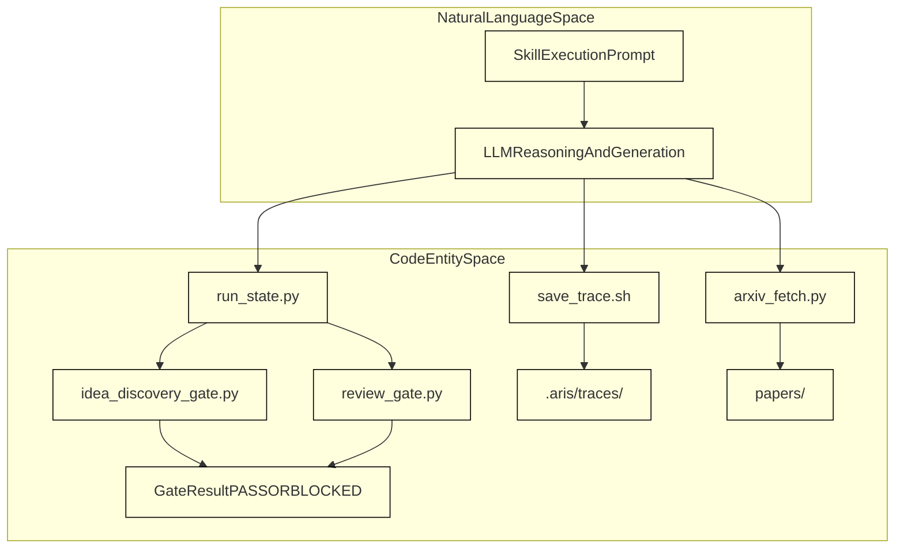
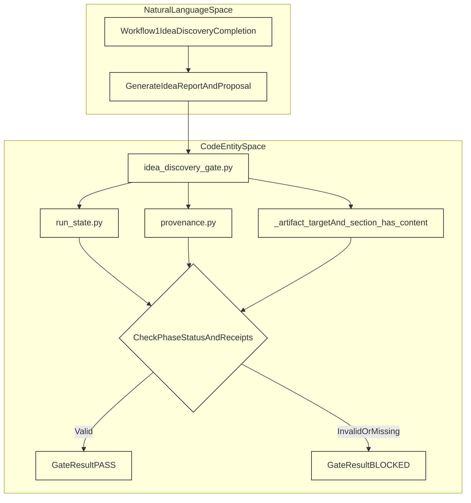

<!-- source: DeepWiki mcp.deepwiki.com · repo wanshuiyin/Auto-claude-code-research-in-sleep · page 2.5 Deterministic Gates & Helper Tools · fetched 2026-10-26 -->

# Deterministic Gates & Helper Tools

Relevant source files

The following files were used as context for generating this wiki page:

- [skills/auto-review-loop/SKILL.md](skills/auto-review-loop/SKILL.md)
- [skills/idea-discovery/SKILL.md](skills/idea-discovery/SKILL.md)
- [skills/shared-references/integration-contract.md](skills/shared-references/integration-contract.md)
- [skills/shared-references/review-tracing.md](skills/shared-references/review-tracing.md)
- [skills/shared-references/reviewer-routing.md](skills/shared-references/reviewer-routing.md)
- [skills/shared-references/skill-governance.md](skills/shared-references/skill-governance.md)
- [skills/shared-references/wiki-helper-resolution.md](skills/shared-references/wiki-helper-resolution.md)
- [skills/skills-codex/idea-discovery/SKILL.md](skills/skills-codex/idea-discovery/SKILL.md)
- [skills/skills-codex/shared-references/integration-contract.md](skills/skills-codex/shared-references/integration-contract.md)
- [skills/skills-codex/shared-references/reviewer-routing.md](skills/skills-codex/shared-references/reviewer-routing.md)
- [skills/skills-codex/shared-references/wiki-helper-resolution.md](skills/skills-codex/shared-references/wiki-helper-resolution.md)
- [tests/test_arxiv_fetch.py](tests/test_arxiv_fetch.py)
- [tests/test_copilot_install.py](tests/test_copilot_install.py)
- [tests/test_http_reviewer_fallback_contract.py](tests/test_http_reviewer_fallback_contract.py)
- [tests/test_http_reviewer_provenance_alignment.py](tests/test_http_reviewer_provenance_alignment.py)
- [tests/test_http_reviewer_review_gate.py](tests/test_http_reviewer_review_gate.py)
- [tests/test_idea_discovery_gate.py](tests/test_idea_discovery_gate.py)
- [tests/test_llm_chat_review_fallback.py](tests/test_llm_chat_review_fallback.py)
- [tests/test_provenance.py](tests/test_provenance.py)
- [tests/test_research_wiki_helper_resolution.py](tests/test_research_wiki_helper_resolution.py)
- [tests/test_review_gate.py](tests/test_review_gate.py)
- [tools/arxiv_fetch.py](tools/arxiv_fetch.py)
- [tools/idea_discovery_gate.py](tools/idea_discovery_gate.py)
- [tools/provenance.py](tools/provenance.py)
- [tools/review_gate.py](tools/review_gate.py)
- [tools/save_trace.sh](tools/save_trace.sh)
- [tools/verify_wiki_coverage.sh](tools/verify_wiki_coverage.sh)

## Purpose and Scope

This page documents the deterministic backbone of ARIS located in the `tools/` directory. While ARIS relies on LLM skills for reasoning, brainstorming, writing, and coding, its core workflows depend on deterministic Python scripts and shell utilities to enforce state transitions, validate review provenance, trace model calls, and manage external data ingestion. These tools eliminate soft-vibe compliance failures by providing rigid gate checks that determine whether a research phase can advance.

---

## 1. Architectural Overview of the Deterministic Backbone

The `tools/` directory implements a strict boundary between probabilistic agent actions and deterministic pipeline guarantees. When skills execute workflows such as Idea Discovery or Auto Review, they do not rely on LLM self-reporting to confirm completion; instead, they invoke state managers (`run_state.py`), review validators (`review_gate.py`, `idea_discovery_gate.py`), provenance classifiers (`provenance.py`), forensic tracers (`save_trace.sh`), and external fetchers (`arxiv_fetch.py`).

*Figure 1: Architectural bridge from natural language skill execution to deterministic state management and verification tools.*

Sources: `tools/idea_discovery_gate.py:1-35]`, `tools/run_state.py:1-50]`, `tools/save_trace.sh:1-40]()`

---

## 2. Run State & Phase Lifecycle Management (`run_state.py`)

Run state persistence is managed by `tools/run_state.py` and stored under `.aris/runs/<run_id>.json`. It tracks phase progression, status markers (`running`, `done`, `accepted`, `provisional`), model provenance, and gating verdicts.

### Key Lifecycle Operations

- **`start_run(root, run_id, phases, ...)`**: Initializes a new run record with ordered phases and policy parameters [tests/test_idea_discovery_gate.py:30-36]().
- **`set_status(root, run_id, phase, status, artifact=...)`**: Updates a phase status and binds its output artifact path [tests/test_idea_discovery_gate.py:64]().
- **`accept(root, run_id, phase, verdict_id, reviewer)`**: Records a cross-family positive review receipt, marking the phase as `accepted` [tests/test_idea_discovery_gate.py:67-73]().
- **`mark_provisional(root, run_id, phase, verdict_id, reviewer)`**: Records a same-family review receipt when allowed by policy (`provisional_advances`), marking the phase as `provisional` [tests/test_idea_discovery_gate.py:75-81]().

Sources: `tools/run_state.py:1-120]`, `tests/test_idea_discovery_gate.py:23-83]()`

---

## 3. Deterministic Evidence Gates & Provenance (`idea_discovery_gate.py`, `review_gate.py`, `provenance.py`)

Evidence gates inspect both persistent run state and physical artifact files before approving a phase or pipeline.

### Idea Discovery Evidence Gate (`idea_discovery_gate.py`)

`tools/idea_discovery_gate.py` validates that all required phases (`research-lit`, `idea-creator`, `novelty-check`, `research-review`, `research-refine-pipeline`) have completed and generated non-empty sections in `idea-stage/IDEA_REPORT.md` and `refine-logs/FINAL_PROPOSAL.md` [tools/idea_discovery_gate.py:19-25](), [tests/test_idea_discovery_gate.py:37-62]().

*Figure 2: Validation flow in `idea_discovery_gate.py` linking artifact verification with run state and provenance checks.*

### Provenance Classification (`provenance.py`)

`tools/provenance.py` extracts model family strings (e.g., `openai`, `anthropic`, `google`, `deterministic`, `unknown`) and enforces review independence rules [tools/idea_discovery_gate.py:97-123](). For a review to be classified as `accepted`, the executor and reviewer must belong to different model families (`cross-family`). If they belong to the same family, status is restricted to `provisional` and requires explicit policy enablement (`provisional_advances: true`) [tools/idea_discovery_gate.py:109-123](), [tests/test_idea_discovery_gate.py:103-118]().

Sources: `tools/idea_discovery_gate.py:1-170]`, `tests/test_idea_discovery_gate.py:84-196]()`

---

## 4. Review Tracing & Forensics (`save_trace.sh`)

To satisfy audit and reproducibility requirements, ARIS requires every cross-model reviewer call to be logged via `tools/save_trace.sh` [skills/shared-references/review-tracing.md:1-18]().

### Trace Directory Structure & Schema

Traces are serialized into `.aris/traces/<skill-name>/<YYYY-MM-DD>_run<NN>/` [skills/shared-references/review-tracing.md:21-31]():
- `run.meta.json`: Run-level metadata (skill name, run ID, executor model, start time) [skills/shared-references/review-tracing.md:25]().
- `<NNN>-<purpose>.request.json`: Structured request payload [skills/shared-references/review-tracing.md:26]().
- `<NNN>-<purpose>.response.md`: Full response text from the reviewer [skills/shared-references/review-tracing.md:27]().
- `<NNN>-<purpose>.meta.json`: Response metadata, including thread IDs, resolved models, reasoning effort, and fallback status [skills/shared-references/review-tracing.md:28]().

`tools/save_trace.sh` parses invocation arguments (`--skill`, `--purpose`, `--model`, `--effort`, `--backend`, `--thread-id`, `--prompt`, `--response`), validates model identities, derives family classifications independently of caller claims, and writes the trace bundle [tools/save_trace.sh:35-151]().

Sources: `skills/shared-references/review-tracing.md:1-143]`, `tools/save_trace.sh:1-151]()`

---

## 5. External Fetch & API Helpers (`arxiv_fetch.py`)

Literature and data ingestion rely on resilient command-line helpers. `tools/arxiv_fetch.py` provides CLI capabilities for searching arXiv and downloading paper PDFs [tools/arxiv_fetch.py:1-16]().

### Key Functions & Mechanisms

- **`_arxiv_user_agent()`**: Constructs a descriptive User-Agent string incorporating `ARIS_VERIFY_EMAIL` if configured, routing requests into arXiv's lenient rate-limit pool rather than blocking generic python-urllib requests [tools/arxiv_fetch.py:47-60]().
- **`_fetch_atom(url)`**: Queries the arXiv Atom API with automatic exponential backoff (retrying up to 3 times on HTTP 429, transient URLErrors, or plain-text `Rate exceeded.` bodies) [tools/arxiv_fetch.py:103-134]().
- **`_validate_pdf(size_bytes, first_bytes)`**: Rejects truncated downloads below `_MIN_PDF_BYTES` (10,240 bytes) or responses missing the `%PDF-` header [tools/arxiv_fetch.py:34-45]().
- **CLI Commands**: Supports `search` (returning JSON paper metadata) and `download` (saving verified PDFs to a designated directory) [tools/arxiv_fetch.py:6-16]().

Sources: `tools/arxiv_fetch.py:1-184]()`

---

## 6. Helper Resolution & Integration Contracts

To ensure skills never fail due to hardcoded helper paths across different project layouts (such as downstream user projects versus the ARIS repository itself), integration contracts mandate the four-layer helper resolution chain [skills/shared-references/integration-contract.md:32-94]().

### The Four-Layer Resolution Chain

When a skill or script needs to invoke a helper (e.g., `save_trace.sh`, `run_state.py`, `idea_discovery_gate.py`), it evaluates paths in order [skills/shared-references/integration-contract.md:52-93]():
1. `<project>/.aris/tools/<helper>` (symlinked by installer) [skills/shared-references/integration-contract.md:56]()
2. `<project>/tools/<helper>` (manual copy or in-repo execution) [skills/shared-references/integration-contract.md:57]()
3. `$ARIS_REPO/tools/<helper>` (resolved via environment variable or install manifest) [skills/shared-references/integration-contract.md:58]()
4. `$ARIS_REPO/tools/<helper>` resolved via global pointer file `~/.aris/repo` (covering global copy-installs without a local `.aris/` manifest) [skills/shared-references/integration-contract.md:59-63]()

Failure policies are strictly categorized per integration: load-bearing gates block execution if unresolved, optional side-effects warn and skip, and forensic helpers (like tracing) write fallback artifacts directly [skills/shared-references/integration-contract.md:110-146]().

Sources: `skills/shared-references/integration-contract.md:1-146]()`

---

