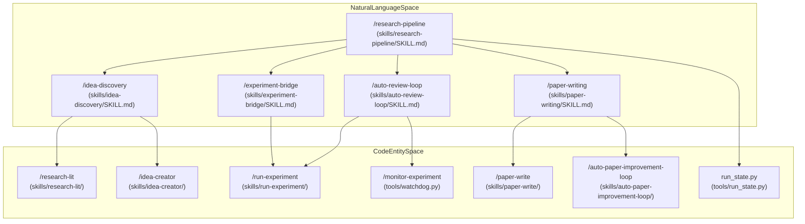
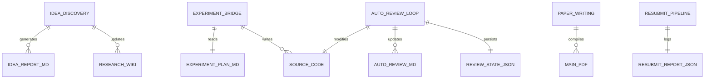

<!-- source: DeepWiki mcp.deepwiki.com · repo wanshuiyin/Auto-claude-code-research-in-sleep · page 3 Research Workflows · fetched 2026-10-26 -->

# Research Workflows

Relevant source files

The following files were used as context for generating this wiki page:

- [README.md](README.md)
- [README_CN.md](README_CN.md)
- [docs/CUSTOMIZATION.md](docs/CUSTOMIZATION.md)
- [docs/CUSTOMIZATION_CN.md](docs/CUSTOMIZATION_CN.md)
- [skills/auto-paper-improvement-loop/SKILL.md](skills/auto-paper-improvement-loop/SKILL.md)
- [skills/paper-write/SKILL.md](skills/paper-write/SKILL.md)
- [skills/paper-writing/SKILL.md](skills/paper-writing/SKILL.md)
- [skills/research-pipeline/SKILL.md](skills/research-pipeline/SKILL.md)
- [skills/skills-codex-claude-review/research-review/SKILL.md](skills/skills-codex-claude-review/research-review/SKILL.md)
- [skills/skills-codex-gemini-review/research-review/SKILL.md](skills/skills-codex-gemini-review/research-review/SKILL.md)
- [skills/skills-codex/research-pipeline/SKILL.md](skills/skills-codex/research-pipeline/SKILL.md)
- [skills/skills-codex/research-review/SKILL.md](skills/skills-codex/research-review/SKILL.md)
- [tests/test_auto_proceed_contract.py](tests/test_auto_proceed_contract.py)

This page provides an overview of ARIS's main research workflows and how they compose into a full research lifecycle pipeline. Each workflow is designed to automate a distinct phase of machine learning research: discovering ideas, bridging ideas to code, iteratively improving quality through adversarial cross-model review, writing publication-ready papers, managing rebuttals, porting papers to new venues, and generating conference talks.

For detailed documentation of each workflow's internal structure, phases, and skills, refer to the respective child pages:
*   [Workflow 1: Idea Discovery](#3.1) — Literature review, idea generation, novelty checking, critical review, parallel pilots, evidence gate, and `IDEA_REPORT.md`.
*   [Workflow 1.5: Experiment Bridge](#3.2) — Translating `EXPERIMENT_PLAN.md` into code, cross-model code review, GPU deployment, milestone system, and result collection.
*   [Workflow 2: Auto Review Loop](#3.3) — Autonomous multi-round review loop, phases A-E, stop conditions, reviewer memory, acquittal log, state persistence, and `AUTO_REVIEW.md`.
*   [Workflow 3: Paper Writing Pipeline](#3.4) — Planning with claims-evidence matrix, acceptance contract, figures, LaTeX writing, compilation, improvement loop, and assurance gates.
*   [Workflow 4: Rebuttal Pipeline](#3.5) — Parsing external reviews, atomizing issues, reviewer strategy, venue-compliant responses, stress-testing, safety gates, and `PASTE_READY.txt`.
*   [Workflow 5: Resubmit Pipeline](#3.6) — Text-only port of a polished paper to a new venue, physical isolation, anonymity scan, audit chain, microedit loop, and `RESUBMIT_REPORT.json`.
*   [Workflow 6: Paper Talk Pipeline](#3.7) — End-to-end conference talk generation, slide outline, Beamer and PPTX formats, `/slides-polish`, and Q&A preparation.
*   [Full Research Pipeline](#3.8) — The `/research-pipeline` orchestrator (`skills/research-pipeline/SKILL.md`) chaining W1 through W3, mandatory human checkpoints, resumable runs, and overnight execution.

---

## 1. Workflow Overview

The workflows represent sequential and parallel stages of the research lifecycle. They can be invoked independently as standalone atomic workflows or chained together via the `/research-pipeline` orchestrator.

| Workflow | Primary Skill | Input | Output | Purpose |
| :--- | :--- | :--- | :--- | :--- |
| **1: Idea Discovery** | `/idea-discovery` | Research direction | `IDEA_REPORT.md` | Literature survey → brainstorm → novelty check → pilot experiments [skills/research-pipeline/SKILL.md:73-78]() |
| **1.5: Exp. Bridge** | `/experiment-bridge` | `EXPERIMENT_PLAN.md` | Executable code & logs | Plan → Code → Cross-model Review → GPU Deployment [skills/research-pipeline/SKILL.md:73-78]() |
| **2: Auto Review Loop** | `/auto-review-loop` | Paper + results | `AUTO_REVIEW.md` | Adversarial review → fix → experiment → iterate [skills/research-pipeline/SKILL.md:73-78]() |
| **3: Paper Writing** | `/paper-writing` | `NARRATIVE_REPORT.md` | `paper/main.pdf` | Narrative → Figures → LaTeX → PDF → Improvement loop [skills/paper-writing/SKILL.md:14-22]() |
| **4: Rebuttal** | `/rebuttal` | Paper + Reviews | `PASTE_READY.txt` | Review parsing → Strategy → Drafting → Stress Test [AGENT_GUIDE.md:80-90]() |
| **5: Resubmit** | `/resubmit-pipeline` | Polished paper | New Venue Dir | Text-only port to new venue under strict constraints [AGENT_GUIDE.md:90]() |
| **6: Paper Talk** | `/paper-talk` | Paper | Beamer / PPTX | End-to-end conference talk generation [README.md:9]() |

Sources: [skills/research-pipeline/SKILL.md:73-78](), [skills/paper-writing/SKILL.md:14-22](), [AGENT_GUIDE.md:80-90]()

---

## 2. Workflow Composition Architecture

The following diagram bridges the "Natural Language Space" (research intent and orchestrator commands) to the "Code Entity Space" (specific skill scripts, runner modules, and gating tools).

### System Flow: Idea to Publication

Sources: [skills/research-pipeline/SKILL.md:73-78](), [skills/paper-writing/SKILL.md:14-22](), [skills/skills-codex/research-pipeline/SKILL.md:70-85]()

---

## 3. Data Flow & File Artifacts

Each workflow persists intermediate states and final deliverables to standardized files. This ensures resilience against context compaction and enables resumable pipeline executions via `run_state.py` [skills/skills-codex/research-pipeline/SKILL.md:29-32]().

### Artifact Dependency Graph

Sources: [skills/research-pipeline/SKILL.md:84-86](), [skills/auto-paper-improvement-loop/SKILL.md:34-36](), [AGENT_GUIDE.md:80-112]()

---

## 4. Control Axes & Assurance Integration

ARIS workflows are modulated by two primary configuration axes that dictate computational budget and audit rigor:
*   **Effort Axis (`effort`)**: Controls execution scale (`lite`, `balanced`, `max`, `beast`), determining literature search breadth, parallel pilot counts, and review iterations.
*   **Assurance Axis (`assurance`)**: Controls verification depth (`draft`, `submission`), executing downstream audit gates (`/experiment-audit`, `/paper-claim-audit`, `/citation-audit`) before final artifact sign-off [skills/paper-writing/SKILL.md:98-113]().

Sources: [skills/paper-writing/SKILL.md:98-113](), [AGENT_GUIDE.md:30-46]()

---

## 5. Execution Modes & Standalone Usage

Workflows support two core execution paradigms depending on autonomy requirements:
1.  **Autonomous Overnight Execution (`AUTO_PROCEED=true`)**: Checkpoints act as informational status broadcasts rather than blocking gates, allowing uninterrupted execution across W1 through W3 [skills/research-pipeline/SKILL.md:34-37]().
2.  **Interactive Checkpoints (`AUTO_PROCEED=false`)**: Halts execution at key transition boundaries to wait for human confirmation, explicit plan adjustments, or Feishu bridge interactive responses [skills/research-pipeline/SKILL.md:54-69]().

Sources: [skills/research-pipeline/SKILL.md:34-69](), [tests/test_auto_proceed_contract.py:37-51]()

---

