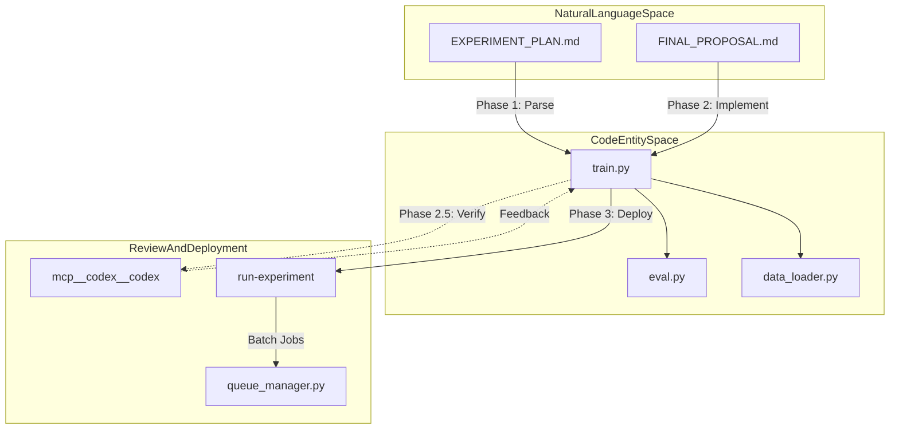
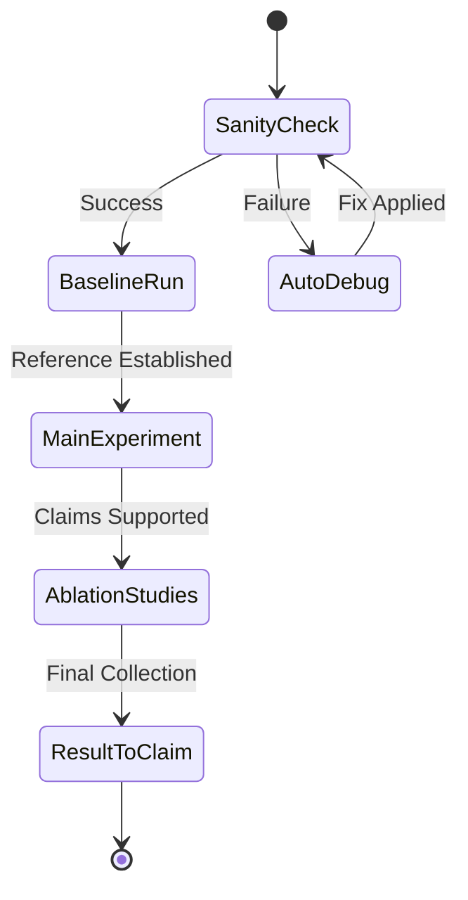

<!-- source: DeepWiki mcp.deepwiki.com · repo wanshuiyin/Auto-claude-code-research-in-sleep · page 3.2 Workflow 1.5: Experiment Bridge · fetched 2026-10-26 -->

# Workflow 1.5: Experiment Bridge

Relevant source files

The following files were used as context for generating this wiki page:

- [skills/experiment-bridge/SKILL.md](skills/experiment-bridge/SKILL.md)
- [skills/meta-optimize/SKILL.md](skills/meta-optimize/SKILL.md)
- [skills/shared-references/review-scope-limits.md](skills/shared-references/review-scope-limits.md)
- [skills/skills-codex-gemini-review/auto-review-loop/SKILL.md](skills/skills-codex-gemini-review/auto-review-loop/SKILL.md)
- [skills/skills-codex/auto-review-loop/SKILL.md](skills/skills-codex/auto-review-loop/SKILL.md)
- [skills/skills-codex/experiment-bridge/SKILL.md](skills/skills-codex/experiment-bridge/SKILL.md)
- [skills/skills-codex/meta-optimize/SKILL.md](skills/skills-codex/meta-optimize/SKILL.md)
- [skills/skills-codex/shared-references/review-scope-limits.md](skills/skills-codex/shared-references/review-scope-limits.md)

**Purpose:** This document describes Workflow 1.5, the "Experiment Bridge." This workflow acts as the transition layer between high-level research planning (Workflow 1) and autonomous iterative refinement (Workflow 2). It translates a natural language `EXPERIMENT_PLAN.md` into executable code, performs cross-model code reviews to catch logic bugs, deploys jobs to GPU infrastructure (Local, Remote, Vast.ai, or Modal), and establishes the initial baseline results required for the auto-review loop.

## Overview

The Experiment Bridge solves the implementation gap by taking the structured output of the idea discovery phase and turning it into a running experiment suite. It follows a milestone-based system (Sanity → Baseline → Main → Ablation → Polish) to ensure code correctness before consuming significant GPU resources [skills/experiment-bridge/SKILL.md:12-21]().

**Key constants and configuration options:**
- `CODE_REVIEW = true` — Invokes secondary Codex reasoning (e.g., `gpt-6-astra` at `xhigh`) to review experiment code before deployment [skills/experiment-bridge/SKILL.md:25]().
- `AUTO_DEPLOY = true` — Automatically deploys experiments after implementation and review [skills/experiment-bridge/SKILL.md:26]().
- `SANITY_FIRST = true` — Executes the sanity-stage experiment first to catch setup or environment bugs early [skills/experiment-bridge/SKILL.md:27]().
- `MAX_PARALLEL_RUNS = 4` — Bounds parallel experiment deployment based on available GPU counts [skills/experiment-bridge/SKILL.md:28]().
- `BASE_REPO = false` — Optional GitHub repository URL used as a base codebase [skills/experiment-bridge/SKILL.md:29]().
- `COMPACT = false` — Reads compact summaries (`idea-stage/IDEA_CANDIDATES.md`) and logs to `EXPERIMENT_LOG.md` when enabled [skills/experiment-bridge/SKILL.md:30]().

Sources: `[skills/experiment-bridge/SKILL.md:1-33](), [skills/skills-codex/experiment-bridge/SKILL.md:21-32]()`

---

## Architecture: Plan to Code Execution

The Experiment Bridge maps items from the Natural Language Space to concrete entities within the Code Entity Space.

Sources: `[skills/experiment-bridge/SKILL.md:48-111](), [skills/run-experiment/SKILL.md:138-175]()`

---

## Implementation Workflow

### Phase 1: Parsing and Research-Contract Fallback

The bridge reads `EXPERIMENT_PLAN.md` to extract execution order, dataset splits, metrics, and compute budgets [skills/experiment-bridge/SKILL.md:48-60](). If `idea-stage/docs/research_contract.md` does not yet exist, it is generated from `templates/RESEARCH_CONTRACT_TEMPLATE.md` to feed downstream tasks like `/result-to-claim` and `/ablation-planner` [skills/experiment-bridge/SKILL.md:75-80]().

Sources: `[skills/experiment-bridge/SKILL.md:48-81]()`

### Phase 2: Code Implementation & Base Repositories

When `BASE_REPO` is provided, the bridge clones the target repository first [skills/experiment-bridge/SKILL.md:84-89](). Otherwise, it scaffolds training scripts with standard `argparse` configuration, fixed random seeds, and structured JSON/CSV result exports [skills/experiment-bridge/SKILL.md:92-103]().

Sources: `[skills/experiment-bridge/SKILL.md:82-111]()`

### Phase 2.5: Cross-Model Code Review

When `CODE_REVIEW = true`, the implementation is passed to `mcp__codex__codex` with `model_reasoning_effort: xhigh` to inspect logic bugs, missing hyperparameters, and evaluation ground-truth mismatches [skills/experiment-bridge/SKILL.md:112-142]().

Sources: `[skills/experiment-bridge/SKILL.md:112-142]()`

---

## Deployment & Monitoring

### Multi-Backend GPU Strategy
Deployments are handled via the `run-experiment` skill across multiple target environments:

| Backend | Execution Path | Characteristics |
|---|---|---|
| **Local/Remote** | `ssh` + `screen` | Pre-flight `nvidia-smi` checks and `rsync` synchronization [skills/run-experiment/SKILL.md:33-63]() |
| **Vast.ai** | `vast-gpu` | Cost-optimized instance provisioning tracked in `vast-instances.json` [skills/vast-gpu/SKILL.md:12-49]() |
| **Modal** | `serverless-modal` | Scale-to-zero serverless execution using `modal.Volume` [skills/serverless-modal/SKILL.md:12-23]() |

Sources: `[skills/run-experiment/SKILL.md:14-175](), [skills/vast-gpu/SKILL.md:12-49]()`

---

## Milestone System & State Machine

Sources: `[skills/experiment-bridge/SKILL.md:52-58]()`

---

