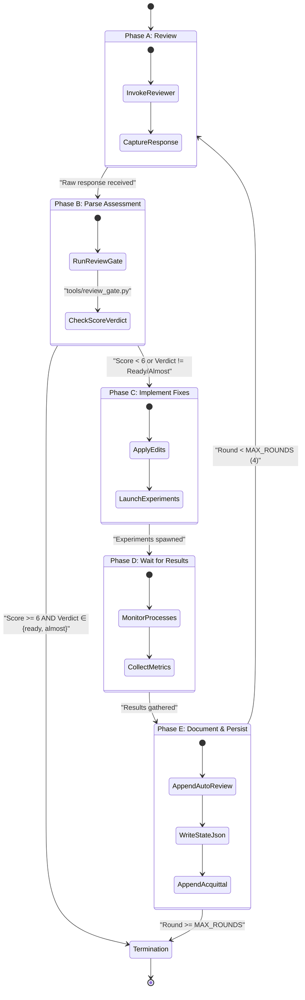

<!-- source: DeepWiki mcp.deepwiki.com · repo wanshuiyin/Auto-claude-code-research-in-sleep · page 3.3 Workflow 2: Auto Review Loop · fetched 2026-10-26 -->

# Workflow 2: Auto Review Loop

<details>
<summary>Relevant source files</summary>

The following files were used as context for generating this wiki page:

- [docs/LLM_API_MIX_MATCH_GUIDE.md](docs/LLM_API_MIX_MATCH_GUIDE.md)
- [skills/auto-review-loop-llm/SKILL.md](skills/auto-review-loop-llm/SKILL.md)
- [skills/auto-review-loop-minimax/SKILL.md](skills/auto-review-loop-minimax/SKILL.md)
- [skills/auto-review-loop/SKILL.md](skills/auto-review-loop/SKILL.md)
- [skills/shared-references/integration-contract.md](skills/shared-references/integration-contract.md)
- [skills/shared-references/review-tracing.md](skills/shared-references/review-tracing.md)
- [skills/shared-references/reviewer-routing.md](skills/shared-references/reviewer-routing.md)
- [skills/skills-codex-claude-review/auto-review-loop/SKILL.md](skills/skills-codex-claude-review/auto-review-loop/SKILL.md)
- [skills/skills-codex/auto-review-loop-llm/SKILL.md](skills/skills-codex/auto-review-loop-llm/SKILL.md)
- [skills/skills-codex/auto-review-loop-minimax/SKILL.md](skills/skills-codex/auto-review-loop-minimax/SKILL.md)
- [skills/skills-codex/shared-references/integration-contract.md](skills/skills-codex/shared-references/integration-contract.md)
- [skills/skills-codex/shared-references/reviewer-routing.md](skills/skills-codex/shared-references/reviewer-routing.md)
- [tests/test_claude_review_artifact_tools.py](tests/test_claude_review_artifact_tools.py)
- [tests/test_copilot_install.py](tests/test_copilot_install.py)
- [tests/test_review_gate.py](tests/test_review_gate.py)
- [tools/generate_codex_claude_review_overrides.py](tools/generate_codex_claude_review_overrides.py)
- [tools/review_gate.py](tools/review_gate.py)
- [tools/save_trace.sh](tools/save_trace.sh)

</details>


**Purpose:** This document covers Workflow 2 (`/auto-review-loop`), the autonomous multi-round iterative review-fix-retest cycle that refines research artifacts from initial drafts to submission-ready quality via cross-model critique [skills/auto-review-loop/SKILL.md:1-20]().

---

## Purpose and Scope

Workflow 2 executes an adversarial feedback loop where Claude Code (acting as the executor in Code Entity Space) and an external reviewer model (acting in Natural Language Space) collaborate across up to 4 rounds [skills/auto-review-loop/SKILL.md:16, 25](). It handles review invocation, state persistence, experiment triggering, and structured stop conditions without manual user intervention unless `HUMAN_CHECKPOINT` is explicitly enabled [skills/auto-review-loop/SKILL.md:31]().

Sources: [skills/auto-review-loop/SKILL.md:1-38]()

---

## Reviewer Backends and Routing

The skill supports multiple reviewer backends determined by `REVIEWER_BACKEND` resolution [skills/auto-review-loop/SKILL.md:29](). When no explicit backend is supplied, it defaults to `auto`, executing a native two-call marker/challenge probe to bind to a running Copilot CLI root session (`copilot-native`), falling back to Codex MCP (`codex`) if unbound [skills/auto-review-loop/SKILL.md:29](), [skills/shared-references/reviewer-routing.md:9]().

```mermaid
graph TB
    subgraph "Natural Language Space (Reviewer)"
        CP[CP["copilot-native<br/>(rubber-duck subagent)"]]
        CX[CX["codex<br/>(gpt-6-astra)"]]
        CR[CR["claude-review<br/>(MCP bridge)"]]
        MC[MC["manual / llm-chat / oracle-pro"]]
    end

    subgraph "Code Entity Space (Executor & Gate)"
        AR["/auto-review-loop"]
        RG[RG["tools/review_gate.py<br/>evaluate_transition()"]]
        ST[ST["tools/save_trace.sh"]]
    end

    AR -->|"resolve backend"| CP
    AR -->|"fallback / explicit"| CX
    AR -->|"overlay / explicit"| CR
    AR -->|"alternative API"| MC
    
    CP -->|"host event evidence"| RG
    CX -->|"threadId / response"| RG
    CR -->|"MCP response"| RG
    MC -->|"raw response"| RG

    RG -->|"transition verdict"| ST
    ST -->|".aris/traces/"| State[(AUTO_REVIEW.md<br/>REVIEW_STATE.json)]

    style AR fill:none,stroke:#000,stroke-width:2px
    style RG fill:none,stroke:#000,stroke-width:2px
    style ST fill:none,stroke:#000,stroke-width:2px
```

*Diagram 1: Bridging Natural Language Reviewer Backends to Code Entity Gate and Trace Infrastructure.*

Sources: [skills/auto-review-loop/SKILL.md:29](), [skills/shared-references/reviewer-routing.md:9](), [tools/review_gate.py:136-158](), [tools/save_trace.sh:1-40]()

---

## The 5-Phase Loop Structure (Phases A–E)

Each round of the loop processes through five strict phases coordinated by the orchestrator and validated by deterministic gates [tools/review_gate.py:1-10]().



*Diagram 2: State Transitions across Phases A–E and Deterministic Gate Checkpoints.*

### Phase A: Review
Initiates the review via the active backend (`mcp__codex__codex`, `mcp__codex__codex-reply`, `task(agent_type=rubber-duck)`, or `mcp__claude-review__review_start`). Passes research context, prior review summaries, and project state without executor spin [skills/auto-review-loop/SKILL.md:46-80](), [skills/skills-codex-claude-review/auto-review-loop/SKILL.md:38-48]().

### Phase B: Parse Assessment & Transition Gate
Extracts the numeric score (1–10) and verdict (`ready`, `almost`, `not ready`). The programmatic gate `tools/review_gate.py` evaluates whether the run meets the stop condition via `evaluate_transition()` [tools/review_gate.py:136-180]().

### Phase C: Implement Fixes
Executes code modifications, reframing, or metric additions prioritizing low-compute changes and queuing necessary GPU training via `/run-experiment` [skills/auto-review-loop/SKILL.md:143-156]().

### Phase D: Wait for Results
Monitors remote processes (`screen`, `tmux`, or background jobs) until metric logs and experiment output files stabilize.

### Phase E: Document Round & State Persistence
Appends round details to `review-stage/AUTO_REVIEW.md`, updates `review-stage/REVIEW_STATE.json` with the current round and `threadId`, and appends positive verdicts to `review-stage/ACQUITTAL_LOG.jsonl` [skills/auto-review-loop/SKILL.md:177-201](), [skills/skills-codex-claude-review/auto-review-loop/SKILL.md:60-100]().

Sources: [skills/auto-review-loop/SKILL.md:61-201](), [tools/review_gate.py:1-186](), [skills/skills-codex-claude-review/auto-review-loop/SKILL.md:60-100]()

---

## Stop Conditions and Acquittal Log

The loop terminates automatically when the stop condition is satisfied or when `MAX_ROUNDS` (4) is exhausted [skills/auto-review-loop/SKILL.md:25-26]().

### Operative Stop Condition (`POSITIVE_THRESHOLD`)
```python
POSITIVE_THRESHOLD = score >= 6/10 and verdict in {"ready", "almost"}
```
Both conditions must hold simultaneously. A high score (e.g., 8/10) paired with a `"not ready"` verdict does *not* trigger early termination [skills/auto-review-loop/SKILL.md:26]().

### Append-Only Acquittal Log (`ACQUITTAL_LOG.jsonl`)
When a positive assessment is achieved, an immutable JSON line is appended to `review-stage/ACQUITTAL_LOG.jsonl` [skills/skills-codex-claude-review/auto-review-loop/SKILL.md:83-100]():
```jsonl
{"run_id":"run_20260713_a1b2c3d4","round":3,"backend":"claude-review","effort":"high-rigor","verdict":"ready","score":7.5,"trace_id":"trace_20260713_run03","timestamp":"2026-07-13T14:22:00Z"}
```
This log is never overwritten and acts as the cryptographic-style audit trail for acceptance [skills/skills-codex-claude-review/auto-review-loop/SKILL.md:91-100]().

Sources: [skills/auto-review-loop/SKILL.md:25-26](), [skills/skills-codex-claude-review/auto-review-loop/SKILL.md:83-100]()

---

## Reviewer Memory, Difficulty Modes, and Debate Protocol

Reviewer behavior is configured via `REVIEWER_DIFFICULTY` [skills/auto-review-loop/SKILL.md:33-36]():

1. **`medium` (Default):** Standard MCP-based review where the executor controls passed context [skills/auto-review-loop/SKILL.md:34]().
2. **`hard`:** Introduces **Reviewer Memory** (`review-stage/REVIEWER_MEMORY.md`) where the reviewer tracks outstanding suspicions across rounds, combined with a **Debate Protocol** allowing executor rebuttals [skills/auto-review-loop/SKILL.md:35]().
3. **`nightmare`:** Combines `hard` features with direct repository-reading capabilities via `codex exec` (bypassing executor filtering) and adversarial verification of code against claims [skills/auto-review-loop/SKILL.md:36]().

Sources: [skills/auto-review-loop/SKILL.md:33-40]()

---

## State Persistence & Traceability

To survive context compaction and ensure provenance tracking, the skill persists state files after every round and records prompt/response traces [skills/auto-review-loop/SKILL.md:33-48](), [skills/shared-references/review-tracing.md:5-18]().

- **`REVIEW_STATE.json`:** Overwritten each round to store `run_id`, `round`, `threadId`, `status`, and `last_score` [skills/skills-codex-claude-review/auto-review-loop/SKILL.md:60-82]().
- **Trace Artifacts:** Saved via `tools/save_trace.sh` under `.aris/traces/auto-review-loop/<YYYY-MM-DD>_run<NN>/`, recording requests, responses, model provenance, and fallback reasons [skills/shared-references/review-tracing.md:21-38]().

Sources: [skills/auto-review-loop/SKILL.md:33-48](), [skills/shared-references/review-tracing.md:1-143](), [tools/save_trace.sh:1-73]()

---

