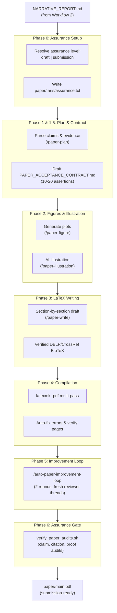
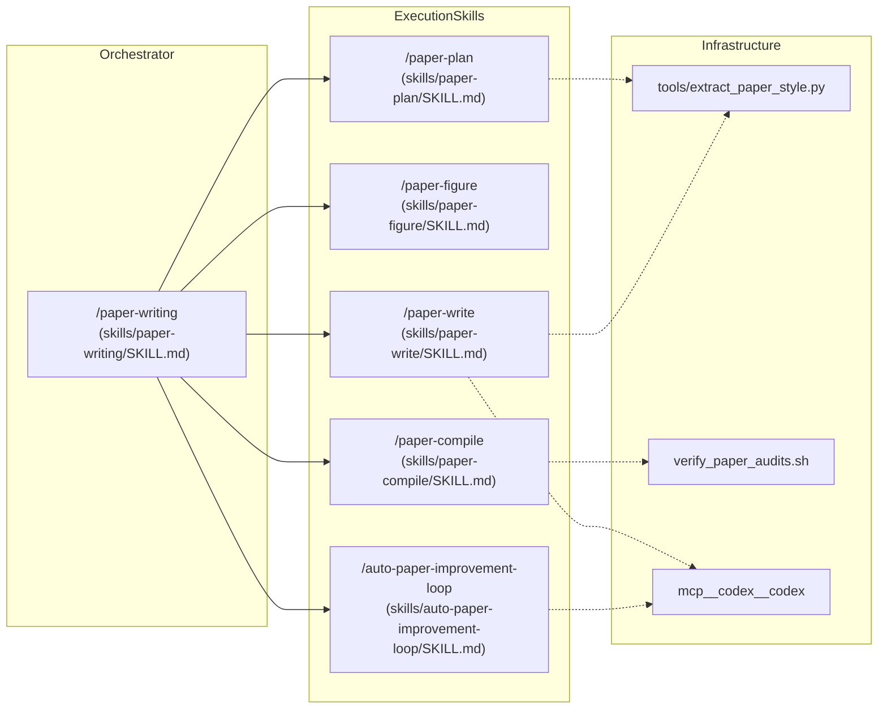

<!-- source: DeepWiki mcp.deepwiki.com · repo wanshuiyin/Auto-claude-code-research-in-sleep · page 3.4 Workflow 3: Paper Writing Pipeline · fetched 2026-10-26 -->

# Workflow 3: Paper Writing Pipeline

Relevant source files

The following files were used as context for generating this wiki page:

- [README.md](README.md)
- [README_CN.md](README_CN.md)
- [skills/auto-paper-improvement-loop/SKILL.md](skills/auto-paper-improvement-loop/SKILL.md)
- [skills/paper-compile/SKILL.md](skills/paper-compile/SKILL.md)
- [skills/paper-figure/SKILL.md](skills/paper-figure/SKILL.md)
- [skills/paper-write/SKILL.md](skills/paper-write/SKILL.md)
- [skills/paper-write/templates/iclr2026.tex](skills/paper-write/templates/iclr2026.tex)
- [skills/paper-write/templates/icml2025.tex](skills/paper-write/templates/icml2025.tex)
- [skills/paper-write/templates/math_commands.tex](skills/paper-write/templates/math_commands.tex)
- [skills/paper-write/templates/neurips2025.tex](skills/paper-write/templates/neurips2025.tex)
- [skills/paper-writing/SKILL.md](skills/paper-writing/SKILL.md)
- [skills/shared-references/citation-discipline.md](skills/shared-references/citation-discipline.md)
- [skills/skills-codex-claude-review/auto-paper-improvement-loop/SKILL.md](skills/skills-codex-claude-review/auto-paper-improvement-loop/SKILL.md)
- [skills/skills-codex-claude-review/paper-write/SKILL.md](skills/skills-codex-claude-review/paper-write/SKILL.md)
- [skills/skills-codex-gemini-review/auto-paper-improvement-loop/SKILL.md](skills/skills-codex-gemini-review/auto-paper-improvement-loop/SKILL.md)
- [skills/skills-codex-gemini-review/paper-write/SKILL.md](skills/skills-codex-gemini-review/paper-write/SKILL.md)
- [skills/skills-codex-gemini-review/paper-writing/SKILL.md](skills/skills-codex-gemini-review/paper-writing/SKILL.md)
- [skills/skills-codex/auto-paper-improvement-loop/SKILL.md](skills/skills-codex/auto-paper-improvement-loop/SKILL.md)
- [skills/skills-codex/paper-figure/SKILL.md](skills/skills-codex/paper-figure/SKILL.md)
- [skills/skills-codex/paper-write/SKILL.md](skills/skills-codex/paper-write/SKILL.md)
- [skills/skills-codex/paper-writing/SKILL.md](skills/skills-codex/paper-writing/SKILL.md)
- [skills/skills-codex/shared-references/citation-discipline.md](skills/skills-codex/shared-references/citation-discipline.md)

## Purpose and Scope

Workflow 3 automates the complete paper writing process, transforming a research narrative into a submission-ready PDF through a multi-phase pipeline. This workflow is primarily invoked via the `/paper-writing` skill (`skills/paper-writing/SKILL.md`) and orchestrates planning, negotiated contracts, figure generation, LaTeX writing, compilation with auto-fix, and iterative improvement loops [skills/paper-writing/SKILL.md:14-22]().

**Workflow boundaries:**
- **Input**: `NARRATIVE_REPORT.md` (typically from Workflow 2), research results, or an existing `PAPER_PLAN.md` [skills/paper-writing/SKILL.md:37-43]().
- **Output**: A polished `paper/` directory containing LaTeX source, compiled PDF, acceptance contracts, and improvement logs [skills/paper-writing/SKILL.md:21]().
- **Prerequisite**: Local LaTeX environment with `latexmk` and PDF verification utilities [skills/paper-compile/SKILL.md:22-34]().

**Sources:** [skills/paper-writing/SKILL.md:1-43](), [skills/skills-codex/paper-writing/SKILL.md:1-90]()

---

## Pipeline Architecture

The pipeline is strictly sequential with optional checkpoints between phases. Each phase builds on the artifacts of the previous one, governed by assurance setup and contract negotiation steps.

Title: Workflow 3 Pipeline Execution Flow

**Sources:** [skills/paper-writing/SKILL.md:14-22, 98-142](), [skills/skills-codex/paper-writing/SKILL.md:54-90]()

---

## Skills and Code Entities

The pipeline maps high-level research tasks to specific code entities (Skills) that interface with external LLMs and local tooling.

Title: Paper Pipeline Code Entity Mapping

**Sources:** [skills/paper-writing/SKILL.md:3-18](), [skills/auto-paper-improvement-loop/SKILL.md:3-5](), [skills/paper-write/SKILL.md:57-80]()

---

## Phase 0 & Phase 1.5: Assurance Setup and Negotiated Contract

Before executing the core writing steps, the pipeline establishes rigorous boundaries and evaluation contracts:

- **Phase 0 (Assurance Setup)**: Resolves the active assurance level (`draft` vs. `submission`) based on user arguments or effort tiers (`lite`/`balanced` map to `draft`; `max`/`beast` map to `submission`). Persists the choice to `paper/.aris/assurance.txt` [skills/skills-codex/paper-writing/SKILL.md:54-90](). In `submission` mode, mandatory audits (proof checker, claim audit, citation audit, kill argument) act as load-bearing gates via `verify_paper_audits.sh` [skills/skills-codex/paper-writing/SKILL.md:79-85]().
- **Phase 1.5 (Negotiated Acceptance Contract)**: Derives a `PAPER_ACCEPTANCE_CONTRACT.md` containing 10–20 testable assertions. Every headline claim must map to an evidence source, and abstract figures or metrics must trace directly to experimental logs prior to writing the first section [skills/skills-codex/paper-writing/SKILL.md:131-142]().

**Sources:** [skills/skills-codex/paper-writing/SKILL.md:54-142]()

---

## Phase 1: Planning with Claims-Evidence Matrix

The `/paper-plan` skill transforms raw results into a structured outline.
- **Inputs**: `NARRATIVE_REPORT.md`, `findings.md`, and `EXPERIMENT_LOG.md` [skills/paper-plan/SKILL.md:22-26]().
- **Claims-Evidence Matrix**: Creates a bidirectional mapping ensuring every scientific claim is backed by data and every figure serves a distinct claim [skills/paper-plan/SKILL.md:40-61]().
- **Style Reference**: Opt-in via `— style-ref: <source>` using `tools/extract_paper_style.py` to extract structural norms (section ordering, theorem density) without copying prose [skills/paper-writing/SKILL.md:47-95]().
- **Gap Report**: Emits `GAP_REPORT.md` if structural elements implied by a style reference lack backing evidence [skills/paper-write/SKILL.md:84-100]().

**Sources:** [skills/paper-writing/SKILL.md:47-95](), [skills/paper-write/SKILL.md:84-100]()

---

## Phase 2: Figure & Illustration Generation

This phase handles data plots, tables, and architectural illustrations.
- **`/paper-figure`**: Generates matplotlib/seaborn plots and LaTeX comparison tables from JSON/CSV data [skills/paper-figure/SKILL.md:16-18]().
- **`/paper-illustration`**: Supports multiple backends (`figurespec`, `gemini`, `codex-image2`, `mermaid`) to produce publication-quality diagrams based on configuration constants [skills/paper-writing/SKILL.md:32]().

**Sources:** [skills/paper-writing/SKILL.md:32](), [skills/paper-figure/SKILL.md:1-112]()

---

## Phase 3 & 4: LaTeX Writing and Compilation

- **`/paper-write`**: Drafts sections sequentially, utilizing verified BibTeX fetches via DBLP/CrossRef (`DBLP_BIBTEX = true`) to eliminate hallucinated citations [skills/paper-write/SKILL.md:18, 148-155](). It enforces strict venue-specific templates (ICLR, NeurIPS, ICML, IEEE Transactions/Conferences) [skills/paper-write/SKILL.md:13-16]().
- **`/paper-compile`**: Compiles source via `latexmk` and features an automated fix loop parsing `compile.log` to resolve missing packages or undefined references, alongside page-limit checks [skills/paper-compile/SKILL.md:14-115, 163-198]().

**Sources:** [skills/paper-write/SKILL.md:1-160](), [skills/paper-compile/SKILL.md:1-204]()

---

## Phase 5: 2-Round Improvement Loop

The `/auto-paper-improvement-loop` skill provides an autonomous polish pass over two iterations:
- **Round 1**: Addresses structural issues and theoretical inconsistencies [skills/auto-paper-improvement-loop/SKILL.md:20, 31-33]().
- **Round 2**: Refines prose presentation and formatting [skills/auto-paper-improvement-loop/SKILL.md:20, 31-33]().
- **Reviewer Bias Guard**: `REVIEWER_BIAS_GUARD = true` enforces that every review round uses a fresh reviewer thread (`mcp__codex__codex`) with no prior context, avoiding positive feedback loops where models overlook persistent flaws [skills/auto-paper-improvement-loop/SKILL.md:33]().
- **Edit Whitelist**: Optional constraints (`— edit-whitelist <path>`) can lock down specific paths or operations (e.g., forbidding `.bib` modifications or new numerical claims during resubmissions) [skills/auto-paper-improvement-loop/SKILL.md:36, 46-70]().

**Sources:** [skills/auto-paper-improvement-loop/SKILL.md:1-101](), [skills/skills-codex-claude-review/auto-paper-improvement-loop/SKILL.md:1-100]()

---

## Phase 6: Assurance Gate (Submission Mode)

When configured with `— effort: max | beast` or `— assurance: submission`, the pipeline enforces a final assurance gate:
- **Audit Chain**: Executes audit verification tools such as `verify_paper_audits.sh` to cross-check claim validity and citation integrity [skills/skills-codex/paper-writing/SKILL.md:79-85]().
- **Verdict**: Assigns an assurance classification (`provisional` for same-family reviews or `accepted` for cross-family/deterministic audits), blocking final submission reporting if mandatory gates fail [skills/skills-codex/paper-writing/SKILL.md:10-14]().

**Sources:** [skills/skills-codex/paper-writing/SKILL.md:10-90]()

---

