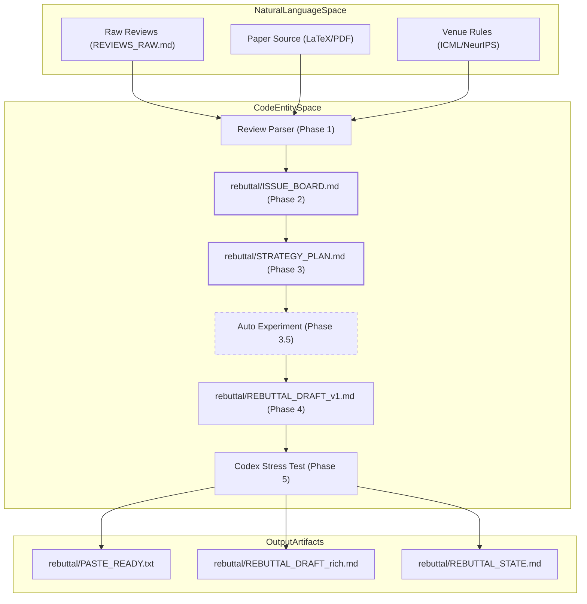
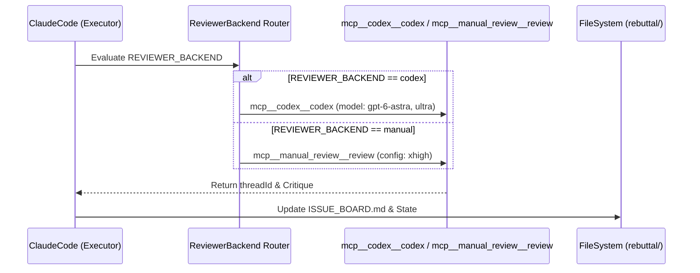

<!-- source: DeepWiki mcp.deepwiki.com · repo wanshuiyin/Auto-claude-code-research-in-sleep · page 3.5 Workflow 4: Rebuttal Pipeline · fetched 2026-10-26 -->

# Workflow 4: Rebuttal Pipeline

Relevant source files

The following files were used as context for generating this wiki page:

- [skills/ablation-planner/SKILL.md](skills/ablation-planner/SKILL.md)
- [skills/citation-audit/SKILL.md](skills/citation-audit/SKILL.md)
- [skills/experiment-audit/SKILL.md](skills/experiment-audit/SKILL.md)
- [skills/kill-argument/SKILL.md](skills/kill-argument/SKILL.md)
- [skills/paper-claim-audit/SKILL.md](skills/paper-claim-audit/SKILL.md)
- [skills/proof-checker/SKILL.md](skills/proof-checker/SKILL.md)
- [skills/rebuttal/SKILL.md](skills/rebuttal/SKILL.md)
- [skills/research-review/SKILL.md](skills/research-review/SKILL.md)
- [skills/result-to-claim/SKILL.md](skills/result-to-claim/SKILL.md)
- [skills/skills-codex/ablation-planner/SKILL.md](skills/skills-codex/ablation-planner/SKILL.md)
- [skills/skills-codex/citation-audit/SKILL.md](skills/skills-codex/citation-audit/SKILL.md)
- [skills/skills-codex/rebuttal/SKILL.md](skills/skills-codex/rebuttal/SKILL.md)
- [skills/skills-codex/result-to-claim/SKILL.md](skills/skills-codex/result-to-claim/SKILL.md)
- [skills/skills-codex/training-check/SKILL.md](skills/skills-codex/training-check/SKILL.md)

The Rebuttal Pipeline (`/rebuttal`) is the fourth major workflow in the ARIS research lifecycle, designed to manage the critical period between initial paper submission and final conference decision [skills/rebuttal/SKILL.md:8-10](). It automates the parsing of raw external reviews (from OpenReview, CMT, or HotCRP), atomizes them into discrete issue cards, builds a strategic response plan, and drafts venue-compliant, grounded rebuttals under strict length and safety constraints [skills/rebuttal/SKILL.md:3-20]().

## Purpose and Scope

The rebuttal workflow is optimized for top-tier machine learning venues (ICLR, NeurIPS, ICML, CVPR) enforcing strict character or word limits and text-only formats [skills/rebuttal/SKILL.md:14-19](). It enforces three core safety gates to eliminate agentic failure modes:
1. **Provenance Gate**: Every factual statement must map explicitly to the paper, raw reviews, user-confirmed results, user-confirmed derivations, or explicitly labeled future work [skills/rebuttal/SKILL.md:88-91]().
2. **Commitment Gate**: Every promise (e.g., adding a baseline or theorem) must map to `already_done`, `approved_for_rebuttal`, or `future_work_only` [skills/rebuttal/SKILL.md:92]().
3. **Coverage Gate**: Every reviewer concern must end as `answered`, `deferred_intentionally`, or `needs_user_input` so no issue disappears silently [skills/rebuttal/SKILL.md:93]().

Sources: [skills/rebuttal/SKILL.md:3-93]()

## System Architecture and Data Flow

The rebuttal pipeline operates as a stateful process persisting its execution state in `rebuttal/REBUTTAL_STATE.md` to support multi-round follow-ups and recovery [skills/rebuttal/SKILL.md:96-100]().

### Entity Transition Diagram: Natural Language to Code Space

The following diagram maps natural language reviewer feedback and venue rules into code-managed artifacts within the `rebuttal/` directory.

Sources: [skills/rebuttal/SKILL.md:96-120]()

### Reviewer Calling Convention & Routing

When the pipeline invokes the reviewer for adversarial stress testing, it branches on `REVIEWER_BACKEND` (`codex` vs `manual`) [skills/rebuttal/SKILL.md:56-76]().

Sources: [skills/rebuttal/SKILL.md:43-76]()

## Configuration Constants

| Constant | Default Value | Description |
| :--- | :--- | :--- |
| `VENUE` | `ICML` | Target venue, governing limits and format (`single_document` vs `per_reviewer_thread`) [skills/rebuttal/SKILL.md:41-46](). |
| `RESPONSE_MODE` | `TEXT_ONLY` | Default response formatting style [skills/rebuttal/SKILL.md:42](). |
| `REVIEWER_MODEL` | `gpt-6-astra` | Internal stress-testing model used via Codex MCP [skills/rebuttal/SKILL.md:43](). |
| `REVIEWER_BACKEND` | `codex` | Backend dispatcher (`codex`, `oracle-pro`, or `manual`) [skills/rebuttal/SKILL.md:44](). |
| `MAX_INTERNAL_DRAFT_ROUNDS` | `2` | Draft-lint-revise cycle count [skills/rebuttal/SKILL.md:45](). |
| `VENUE_MODE` | `single_document` | Determines single shared response vs per-reviewer thread layout [skills/rebuttal/SKILL.md:46](). |
| `STRESS_TEST_ROUNDS_BASE` | `1` | Base critique round on the full response set (hard cap at 5) [skills/rebuttal/SKILL.md:47](). |
| `MAX_FOLLOWUP_ROUNDS` | `3` | Per-reviewer thread follow-up limit [skills/rebuttal/SKILL.md:48](). |
| `AUTO_EXPERIMENT` | `false` | When `true`, automatically invokes `/experiment-bridge` for evidence gaps [skills/rebuttal/SKILL.md:49](). |
| `QUICK_MODE` | `false` | When `true`, stops after Phase 3, outputting `ISSUE_BOARD.md` and `STRATEGY_PLAN.md` without drafting [skills/rebuttal/SKILL.md:50](). |
| `REBUTTAL_DIR` | `rebuttal/` | Directory for all rebuttal state and outputs [skills/rebuttal/SKILL.md:51](). |
| `RENDER_HTML` | `true` | Auto-renders `REBUTTAL_DRAFT_rich.md` via `/render-html` upon finalization [skills/rebuttal/SKILL.md:52](). |

Sources: [skills/rebuttal/SKILL.md:39-54]()

## Workflow Phases

### Phase 0-1: Initialization and Review Normalization
- Loads existing state from `rebuttal/REBUTTAL_STATE.md` if present [skills/rebuttal/SKILL.md:96-100]().
- Normalizes raw text reviews into verbatim entries in `rebuttal/REVIEWS_RAW.md` [skills/rebuttal/SKILL.md:102-108]().

### Phase 2: Atomization and Classification
- Generates `rebuttal/ISSUE_BOARD.md` [skills/rebuttal/SKILL.md:111]().
- Breaks down reviews into atomic concerns with `issue_id` (e.g., `R1-C2`), `issue_type`, `severity`, `reviewer_stance`, and `reviewer_priority` [skills/rebuttal/SKILL.md:113-120]().

### Phase 3.5: Evidence Sprint (`AUTO_EXPERIMENT` Mode)
When `AUTO_EXPERIMENT = true`:
1. Identifies concerns requiring empirical proof.
2. Automatically invokes `/experiment-bridge` to execute supplementary runs [skills/rebuttal/SKILL.md:49]().
3. Uses the `result-to-claim` gate to validate results before incorporating them into the response strategy [skills/result-to-claim/SKILL.md:8-10]().

### Phase 5: Stress Testing and Refinement
- Submits draft responses to an adversarial reviewer model (`gpt-6-astra` via Codex MCP) to simulate critical reviewer pushback [skills/rebuttal/SKILL.md:43-47]().
- Iterates until all critical safety gates pass.

Sources: [skills/rebuttal/SKILL.md:96-120](), [skills/result-to-claim/SKILL.md:8-10]()

## Output Artifacts

The pipeline deposits several output files in the `rebuttal/` directory:
1. `PASTE_READY.txt`: Character-counted, plain-text response ready to paste into OpenReview/CMT [skills/rebuttal/SKILL.md:52]().
2. `REBUTTAL_DRAFT_rich.md`: Comprehensive markdown draft with provenance links and internal notes [skills/rebuttal/SKILL.md:52]().
3. `ISSUE_BOARD.md`: Structured inventory tracking every reviewer concern [skills/rebuttal/SKILL.md:111]().
4. `REBUTTAL_STATE.md`: Machine-readable phase and thread state tracker for context compaction recovery [skills/rebuttal/SKILL.md:98]().

Sources: [skills/rebuttal/SKILL.md:52-111]()

---

