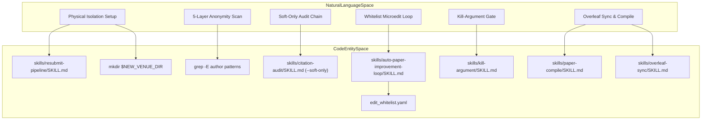
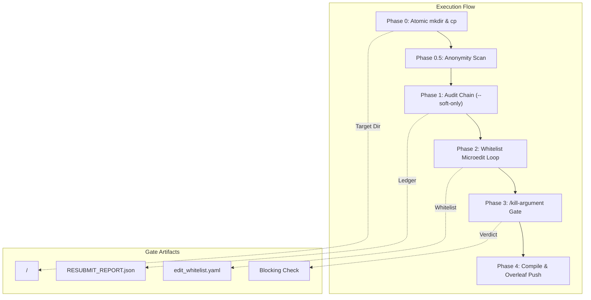

<!-- source: DeepWiki mcp.deepwiki.com · repo wanshuiyin/Auto-claude-code-research-in-sleep · page 3.6 Workflow 5: Resubmit Pipeline · fetched 2026-10-26 -->

# Workflow 5: Resubmit Pipeline

Relevant source files

The following files were used as context for generating this wiki page:

- [docs/RESUBMIT_AND_TALK.md](docs/RESUBMIT_AND_TALK.md)
- [docs/RESUBMIT_AND_TALK_CN.md](docs/RESUBMIT_AND_TALK_CN.md)
- [skills/integrity-forensics/SKILL.md](skills/integrity-forensics/SKILL.md)
- [skills/paper-poster-html/DESIGN_FINAL.md](skills/paper-poster-html/DESIGN_FINAL.md)
- [skills/resubmit-pipeline/SKILL.md](skills/resubmit-pipeline/SKILL.md)
- [skills/skills-codex/integrity-forensics/SKILL.md](skills/skills-codex/integrity-forensics/SKILL.md)
- [skills/skills-codex/resubmit-pipeline/SKILL.md](skills/skills-codex/resubmit-pipeline/SKILL.md)
- [tools/forensics_gate.py](tools/forensics_gate.py)

The **Resubmit Pipeline (Workflow 5)** orchestrates the text-only porting of a polished research paper to a new venue under strict constraints. Unlike primary writing workflows, Workflow 5 operates in a microedit-only mode where experiments, frameworks, and bibliographies are frozen to prevent hallucination and maintain scientific integrity while addressing reviewer feedback from a previous submission [skills/resubmit-pipeline/SKILL.md:12-21]().

## Overview and Constants

Workflow 5 (`/resubmit-pipeline`) bridges the gap between a rejected or withdrawn paper and a new target venue under tight time budgets (≤ 1-2 weeks) [skills/resubmit-pipeline/SKILL.md:25-26](). 

### Core Constants and Invariants
*   **`REVIEWER_MODEL`**: Inherits from `/auto-paper-improvement-loop` defaults (`gpt-6-astra` via Codex MCP) with reasoning effort fixed at `xhigh` [skills/resubmit-pipeline/SKILL.md:38]().
*   **`ROUNDS`**: Default is `2`, matching the diminishing-returns threshold [skills/resubmit-pipeline/SKILL.md:39]().
*   **`EFFORT`**: Default is `max` due to the high-stakes nature of resubmissions [skills/resubmit-pipeline/SKILL.md:40]().
*   **`EDIT_WHITELIST_PATH`**: Defaults to `<paper-base-dir>/../<NewVenue>/.aris/edit_whitelist.yaml` [skills/resubmit-pipeline/SKILL.md:41]().
*   **`NEVER_OVERWRITE`**: `true` (enforces strict directory isolation) [skills/resubmit-pipeline/SKILL.md:42]().

Sources: [skills/resubmit-pipeline/SKILL.md:12-44](), [docs/RESUBMIT_AND_TALK.md:5-9]().

---

## System Architecture: Natural Language to Code Entity Mapping

The following diagram bridges natural language execution concepts to concrete code entities, files, and scripts within the ARIS codebase for Workflow 5.

Sources: [skills/resubmit-pipeline/SKILL.md:1-6](), [skills/citation-audit/SKILL.md:1-10](), [skills/overleaf-sync/SKILL.md:1-15]().

---

## Detailed Pipeline Phases

### Phase 0: Physical Isolation & Setup
Resubmit enforces strict directory isolation. The new venue's submission lives as a sibling directory to all prior venues to prevent cross-contamination [skills/resubmit-pipeline/SKILL.md:64-67]().
*   **Atomic Directory Creation**: Uses a direct `mkdir` command (avoiding `-p`) to fail fast if the directory already exists, preventing TOCTOU race conditions [skills/resubmit-pipeline/SKILL.md:68-79]().
*   **File Composition**: Copies section files (`sec/`) and macro definitions (`math_commands.tex`) via physical `cp` commands rather than symbolic links or cross-directory `\input` statements, ensuring Overleaf zip export compatibility [skills/resubmit-pipeline/SKILL.md:83-87]().

### Phase 0.5: Anonymity Scan
Performs a 5-layer scan checking for author names, explicit affiliations, self-citation leaks, hardcoded GitHub/Overleaf URLs, and in-text "we" or institutional identifiers that violate double-blind review policies [docs/RESUBMIT_AND_TALK.md:11-12]().

### Phase 1: Soft-Only Audit Chain
Invokes downstream assurance skills under restricted modes:
*   **Citation Audit**: Runs `/citation-audit --soft-only` to verify references while freezing the `.bib` file; citation issues are translated into body-text rewrites or `drop_cite_in_body_only` actions [docs/RESUBMIT_AND_TALK.md:13]().
*   **Proof & Claim Audits**: Evaluates logical validity using `/proof-checker` and `/paper-claim-audit` without mutating core theorems [docs/RESUBMIT_AND_TALK.md:13]().

### Phase 2: Microedit Loop & Whitelist Enforcement
Executes the improvement loop via `/auto-paper-improvement-loop` gated by `edit_whitelist.yaml` [skills/resubmit-pipeline/SKILL.md:21](). Edits are strictly filtered against forbidden operations:
*   `new_cite`: Blocks unauthorized citation additions [skills/skills-codex/auto-paper-improvement-loop/SKILL.md:83]().
*   `new_theorem_env`: Freezes theorem and lemma environments [skills/skills-codex/auto-paper-improvement-loop/SKILL.md:85]().
*   `numerical_claim`: Rejects new numeric tokens not present in the source paper [skills/skills-codex/auto-paper-improvement-loop/SKILL.md:86]().

### Phase 3: Kill-Argument Gate & Compilation
Runs `/kill-argument` to simulate the harshest possible adversarial reviewer attack [docs/RESUBMIT_AND_TALK.md:15](). Any unresolved critical finding halts execution. If passed, the document is compiled via `/paper-compile` and optionally pushed via `/overleaf-sync` [docs/RESUBMIT_AND_TALK.md:16]().

Sources: [skills/resubmit-pipeline/SKILL.md:64-110](), [docs/RESUBMIT_AND_TALK.md:11-16](), [skills/skills-codex/auto-paper-improvement-loop/SKILL.md:83-86]().

---

## Execution Flow and Gate Mapping

Sources: [skills/resubmit-pipeline/SKILL.md:68-110](), [docs/RESUBMIT_AND_TALK.md:11-16]().

---

## The Master Ledger: `RESUBMIT_REPORT.json`

Workflow 5 tracks progression and terminal states through `RESUBMIT_REPORT.json`, conforming to the assurance contract schema [docs/RESUBMIT_AND_TALK.md:48]().

| State | Meaning | Trigger Condition |
| :--- | :--- | :--- |
| `ISOLATED` | Sibling directory initialized successfully. | Successful atomic `mkdir` [skills/resubmit-pipeline/SKILL.md:68-81]() |
| `AUDITED` | Soft-only citation and proof audits complete. | Audit report generated [docs/RESUBMIT_AND_TALK.md:13]() |
| `CONVERGED` | Microedit loop completed within target rounds. | Score threshold reached [docs/RESUBMIT_AND_TALK.md:14]() |
| `BLOCKED` | Edit violated `edit_whitelist.yaml` rules. | `reason_code: out_of_scope_microedit` [skills/resubmit-pipeline/SKILL.md:34]() |
| `FAILED_COMPILE` | LaTeX compilation error encountered. | `paper-compile` exit code != 0 [docs/RESUBMIT_AND_TALK.md:16]() |
| `ANONYMITY_VIOLATION`| Double-blind leakage detected in Phase 0.5. | Regex match on author identifiers [docs/RESUBMIT_AND_TALK.md:11]() |
| `SYNCED` | Successfully pushed to Overleaf target. | `/overleaf-sync push` success [docs/RESUBMIT_AND_TALK.md:16]() |

Sources: [skills/resubmit-pipeline/SKILL.md:34](), [docs/RESUBMIT_AND_TALK.md:11-16]().

---

