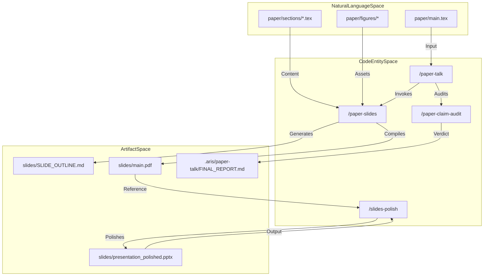
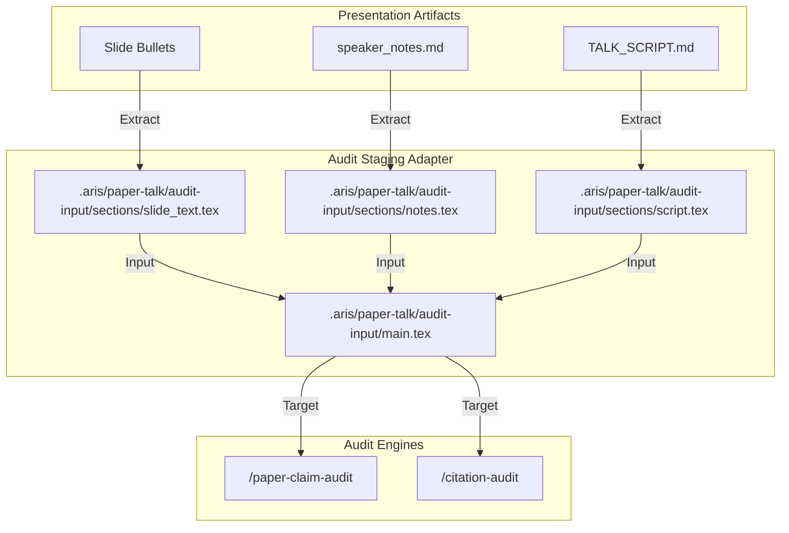

<!-- source: DeepWiki mcp.deepwiki.com · repo wanshuiyin/Auto-claude-code-research-in-sleep · page 3.7 Workflow 6: Paper Talk Pipeline · fetched 2026-10-26 -->

# Workflow 6: Paper Talk Pipeline

Relevant source files

The following files were used as context for generating this wiki page:

- [docs/RESUBMIT_AND_TALK.md](docs/RESUBMIT_AND_TALK.md)
- [docs/RESUBMIT_AND_TALK_CN.md](docs/RESUBMIT_AND_TALK_CN.md)
- [skills/paper-poster-html/DESIGN_FINAL.md](skills/paper-poster-html/DESIGN_FINAL.md)
- [skills/paper-talk/SKILL.md](skills/paper-talk/SKILL.md)
- [skills/skills-codex/kill-argument/SKILL.md](skills/skills-codex/kill-argument/SKILL.md)
- [skills/skills-codex/paper-talk/SKILL.md](skills/skills-codex/paper-talk/SKILL.md)
- [skills/skills-codex/slides-polish/SKILL.md](skills/skills-codex/slides-polish/SKILL.md)
- [skills/slides-polish/SKILL.md](skills/slides-polish/SKILL.md)

The **Paper Talk Pipeline (W6)** orchestrates the end-to-end generation of conference presentation materials from a completed research paper (`PAPER_DIR/`). It bridges the gap between static technical manuscripts and temporal oral narratives by producing slide outlines, LaTeX Beamer sources, editable PowerPoint (`.pptx`) decks, speaker notes, talk scripts, Q&A prep, and visual polish [skills/paper-talk/SKILL.md:8-12]().

## Overview and Data Flow

The pipeline is driven by the `/paper-talk` orchestrator skill, which composes `/paper-slides` for initial generation and `/slides-polish` for per-page visual refinement [docs/RESUBMIT_AND_TALK.md:54-58]().

### Technical Data Flow
1.  **Input Extraction**: Reads the compiled LaTeX source (`paper/main.tex` and `paper/sections/*.tex`) and figures without modifying the source files [skills/paper-talk/SKILL.md:62-64]().
2.  **Outline Generation**: Constructs a claim-first slide outline (`slides/SLIDE_OUTLINE.md`) mapped to talk beats [skills/paper-talk/SKILL.md:76-76]().
3.  **Dual-Track Generation**: Produces both Beamer LaTeX source (`main.tex` + `main.pdf`) and an editable PowerPoint presentation (`presentation.pptx`) via `/paper-slides` [skills/paper-talk/SKILL.md:77-79]().
4.  **Visual Polish**: Passes the deck through `/slides-polish` to execute per-page Codex reviews against a reference PDF, applying projector-readable font scaling and text-frame adjustments [skills/paper-talk/SKILL.md:80-82]().
5.  **Assurance Audits**: Under the `conference-ready` assurance level, stages slide text, speaker notes, and scripts into a synthetic paper adapter to run `/paper-claim-audit` and `/citation-audit` [skills/paper-talk/SKILL.md:90-96]().

### System Architecture Diagram

**Title: Paper Talk Pipeline Entity Mapping**

Sources: [skills/paper-talk/SKILL.md:62-96]()

---

## Key Skills and Implementation

### 1. `/paper-talk` (Orchestrator)
The top-level skill managing state persistence in `.aris/paper-talk/` and enforcing hard invariants across the generation lifecycle [skills/paper-talk/SKILL.md:47-49]().
*   **Hard Invariants**: Preserves original paper read-only state, maintains byte-stable speaker notes, prevents unauthorized content invention, and enforces anonymity fail-closed rules [skills/paper-talk/SKILL.md:34-43]().
*   **Assurance Ladder**: Configurable via `— assurance:` (`draft`, `polished`, `conference-ready`) [skills/paper-talk/SKILL.md:18-24]().

### 2. `/paper-slides` (Generator)
Generates the core structural artifacts including Beamer source, editable PPTX, speaker notes (`speaker_notes.md`), and full word-for-word talk scripts (`TALK_SCRIPT.md`) [skills/paper-talk/SKILL.md:77-84]().

### 3. `/slides-polish` (Refiner)
Performs surgical layout and typography fixes using **per-page Codex review** [skills/slides-polish/SKILL.md:8-14]().
*   **Constants**: Uses `REVIEWER_MODEL = gpt-6-astra` with `REVIEWER_REASONING = xhigh` and `CONTEXT_POLICY = fresh` (using fresh `spawn_agent` reviewer calls per slide to avoid anchoring) [skills/slides-polish/SKILL.md:39-41]().
*   **Scaling & Versioning**: Applies a `1.6×` heuristic multiplier (`PPTX_SCALE_HINT`) for projector readability, writing outputs to `_polished.pptx` while keeping `_pre_polish.pptx` snapshots untouched [skills/slides-polish/SKILL.md:44-46]().

Sources: [skills/paper-talk/SKILL.md:30-57](), [skills/slides-polish/SKILL.md:37-47]()

---

## Workflow Phases and Assurance Ladder

The pipeline executes through sequential phases governed by the chosen assurance level.

| Phase | Task | Key Artifact / Tool |
| :--- | :--- | :--- |
| **Phase 0** | Prerequisites & Input Discovery | `pdfinfo`, `pdftoppm`, `xelatex` [skills/paper-talk/SKILL.md:60-68]() |
| **Phase 1** | Outline Generation | `slides/SLIDE_OUTLINE.md` [skills/paper-talk/SKILL.md:76-76]() |
| **Phase 2** | Scaffold & Script Generation | `/paper-slides` (Beamer + PPTX + Notes) [skills/paper-talk/SKILL.md:77-84]() |
| **Phase 3** | Visual Polish Pass | `/slides-polish` (`_polished.pptx`) [skills/slides-polish/SKILL.md:46-46]() |
| **Phase 4** | Assurance Audits (Optional) | `.aris/paper-talk/audit-input/` (Claim & Citation Audits) [skills/paper-talk/SKILL.md:90-96]() |
| **Phase 5** | Final Export & Staging | `slides/` artifact bundle [skills/paper-talk/SKILL.md:75-85]() |
| **Phase 6** | Final Report Generation | `.aris/paper-talk/FINAL_REPORT.md` [skills/paper-talk/SKILL.md:89-89]() |

### Assurance Levels
*   **`draft`**: Runs Phases 0, 1, 2, 5, 6 (skips polish and audits; for internal practice) [skills/paper-talk/SKILL.md:22-22]().
*   **`polished` (default)**: Runs Phases 0, 1, 2, 3, 5, 6 (includes `/slides-polish`; standard academic talk) [skills/paper-talk/SKILL.md:23-23]().
*   **`conference-ready`**: Runs Phases 0 through 6, incorporating Phase 4 strict claim and citation audits against slide content [skills/paper-talk/SKILL.md:24-24]().

Sources: [skills/paper-talk/SKILL.md:16-29]()

---

## Phase 4 Audit Staging Architecture

When running under `assurance: conference-ready`, Phase 4 constructs a synthetic paper staging adapter inside `.aris/paper-talk/audit-input/` to treat presentation artifacts as an auditable manuscript [skills/paper-talk/SKILL.md:90-96]().

**Title: Synthetic Paper Staging for Slide Audits**

Sources: [skills/paper-talk/SKILL.md:90-96]()

---

## State Management and Recovery

*   **Workflow State**: Maintained in `.aris/paper-talk/PIPELINE_STATE.json` and `.aris/slides-polish/<deck-stem>/POLISH_STATE.json` [skills/paper-talk/SKILL.md:88-88](), [skills/slides-polish/SKILL.md:93-93]().
*   **Resumption**: If interrupted, the pipeline inspects active state pointers and resumes from the incomplete phase without repeating completed generation tasks [skills/paper-talk/SKILL.md:65-65]().

Sources: [skills/paper-talk/SKILL.md:87-96](), [skills/slides-polish/SKILL.md:92-96]()

---

