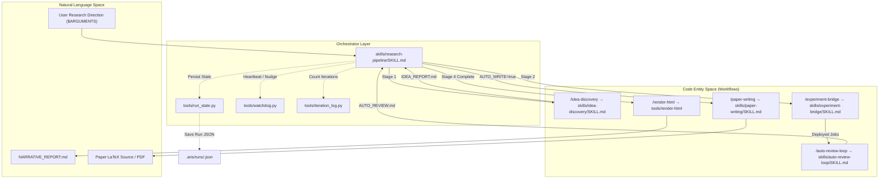
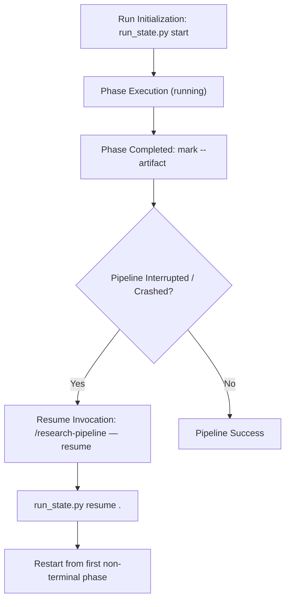

<!-- source: DeepWiki mcp.deepwiki.com · repo wanshuiyin/Auto-claude-code-research-in-sleep · page 3.8 Full Research Pipeline · fetched 2026-10-26 -->

# Full Research Pipeline

Relevant source files

The following files were used as context for generating this wiki page:

- [docs/CUSTOMIZATION.md](docs/CUSTOMIZATION.md)
- [docs/CUSTOMIZATION_CN.md](docs/CUSTOMIZATION_CN.md)
- [skills/research-pipeline/SKILL.md](skills/research-pipeline/SKILL.md)
- [skills/shared-references/acceptance-gate.md](skills/shared-references/acceptance-gate.md)
- [skills/shared-references/external-cadence.md](skills/shared-references/external-cadence.md)
- [skills/shared-references/fan-out-pattern.md](skills/shared-references/fan-out-pattern.md)
- [skills/skills-codex-claude-review/research-review/SKILL.md](skills/skills-codex-claude-review/research-review/SKILL.md)
- [skills/skills-codex-gemini-review/research-review/SKILL.md](skills/skills-codex-gemini-review/research-review/SKILL.md)
- [skills/skills-codex/research-pipeline/SKILL.md](skills/skills-codex/research-pipeline/SKILL.md)
- [skills/skills-codex/research-review/SKILL.md](skills/skills-codex/research-review/SKILL.md)
- [tests/test_auto_proceed_contract.py](tests/test_auto_proceed_contract.py)

## Purpose & Scope

The Full Research Pipeline orchestrates the complete autonomous research lifecycle from a broad research direction to a submission-ready paper. It chains **Workflow 1** (Idea Discovery), **Workflow 1.5** (Experiment Bridge/Implementation), **Workflow 2** (Auto Review Loop), and optionally **Workflow 3** (Paper Writing) into a single end-to-end execution `[skills/research-pipeline/SKILL.md:1-32]()`.

This page documents the `/research-pipeline` orchestrator skill (`[skills/research-pipeline/SKILL.md:2-3]()`), covering workflow chaining, mandatory human or non-blocking selection checkpoints (`[skills/research-pipeline/SKILL.md:34-45]()`), resumable execution via `run_state.py` (`[skills/research-pipeline/SKILL.md:45-45]()`), non-judgmental external cadence / heartbeat (`[skills/research-pipeline/SKILL.md:10-28]()`), and overnight autonomous execution guardrails (`[docs/CUSTOMIZATION.md:18-40]()`).

Sources: `[skills/research-pipeline/SKILL.md:1-32]()`, `[docs/CUSTOMIZATION.md:18-40]()`

---

## Pipeline Architecture & Workflow Chaining

The pipeline coordinates a multi-stage execution model, bridging **Natural Language Space** (research directions, literature surveys, narratives) to **Code Entity Space** (Python experiment scripts, MCP tool bridges, JSON state records, and shell verifiers).

### Component & Data Flow Diagram (Natural Language to Code Entity Space)
The following diagram maps high-level research workflows to the exact code files, skills, and orchestrator scripts that execute them.

Sources: `[skills/research-pipeline/SKILL.md:30-86]()`, `[skills/skills-codex/research-pipeline/SKILL.md:68-94]()`

---

## Constants & Configuration Pass-Through

The orchestrator initializes a set of default configuration constants from `$ARGUMENTS` and passes them down the execution chain `[skills/research-pipeline/SKILL.md:32-47]`, `[docs/CUSTOMIZATION.md:7-40]()`.

| Constant | Default | Description | Downstream Pass-Through |
|----------|---------|-------------|-------------------------|
| `AUTO_PROCEED` | `true` | If `true`, selection checkpoints are informational and continue in the same turn. If `false`, pauses for explicit user confirmation `[skills/research-pipeline/SKILL.md:34]()`. | → `idea-discovery` → `paper-writing` (when `AUTO_WRITE=true`) `[docs/CUSTOMIZATION.md:29]()` |
| `ARXIV_DOWNLOAD` | `false` | When `true`, downloads top relevant arXiv PDFs during literature survey `[skills/research-pipeline/SKILL.md:35]()`. | → `idea-discovery` → `research-lit` `[docs/CUSTOMIZATION.md:30]()` |
| `HUMAN_CHECKPOINT` | `false` | When `true`, auto-review loops pause after each round for custom instructions `[skills/research-pipeline/SKILL.md:36]()`. | → `auto-review-loop` `[docs/CUSTOMIZATION.md:31]()` |
| `REVIEWER_DIFFICULTY` | `medium` | Adversarial level (`medium`, `hard` with reviewer memory, `nightmare` with direct repo execution) `[skills/research-pipeline/SKILL.md:37]()`. | → `auto-review-loop` |
| `CODE_REVIEW` | `true` | GPT-6-Astra xhigh code review prior to experiment deployment `[skills/research-pipeline/SKILL.md:38]()`. | → `experiment-bridge` `[docs/CUSTOMIZATION.md:33]()` |
| `BASE_REPO` | `false` | Optional GitHub repository URL to clone and build experiments upon `[skills/research-pipeline/SKILL.md:39]()`. | → `experiment-bridge` `[docs/CUSTOMIZATION.md:34]()` |
| `COMPACT` | `false` | Generates compact summary files for short-context models and session recovery `[skills/research-pipeline/SKILL.md:40]()`. | → All downstream workflows `[docs/CUSTOMIZATION.md:36]()` |
| `AUTO_WRITE` | `false` | Automatically invoke Workflow 3 (`/paper-writing`) after Stage 4 completion `[skills/research-pipeline/SKILL.md:41]()`. | → `paper-writing` |
| `VENUE` | `(unset)` | Target conference venue (`ICLR`, `NeurIPS`, `ICML`, `CVPR`, etc.). Binds only at Stage 5 `[skills/research-pipeline/SKILL.md:42]()`. | → `paper-writing` |
| `RENDER_HTML` | `true` | Auto-renders `NARRATIVE_REPORT.md` to HTML at Stage 4 completion via `/render-html` `[skills/research-pipeline/SKILL.md:43]()`. | Internal handoff |
| `RESUMABLE` | `true` | Records per-stage state to `.aris/runs/<run_id>.json` for recovery `[skills/research-pipeline/SKILL.md:45]()`. | State manager (`run_state.py`) |

Sources: `[skills/research-pipeline/SKILL.md:32-47]`, `[docs/CUSTOMIZATION.md:24-40]()`

---

## Checkpoint Execution Rule (`AUTO_PROCEED`)

The pipeline enforces strict execution semantics for selection checkpoints governed by `AUTO_PROCEED`:

- **`AUTO_PROCEED=true` (Non-blocking):** Checkpoints function as informational status updates rather than interactive prompts. The agent states the selected result, records the choice, and continues execution in the **same turn**. Asking for confirmation, pausing for input, or terminating the turn at a checkpoint is explicitly prohibited `[skills/research-pipeline/SKILL.md:54-57]`, `[tests/test_auto_proceed_contract.py:37-50]()`.
- **`AUTO_PROCEED=false` (Blocking):** The orchestrator presents options, asks the user for explicit confirmation, and ends the turn. Execution resumes only upon receiving an explicit user reply `[skills/research-pipeline/SKILL.md:58-59]()`.
- **No Silence Timeouts:** `AUTO_PROCEED=true` must never be implemented as a "wait 10 seconds then proceed if no response" timer. Once a turn concludes, silence cannot resume execution `[skills/research-pipeline/SKILL.md:61-63]()`.
- **Explicit Exceptions:** External user-controlled interactive gates (such as Feishu interactive approval mode) are intentional blocking exceptions and wait for external confirmation regardless of `AUTO_PROCEED` `[skills/research-pipeline/SKILL.md:66-70]()`.

Sources: `[skills/research-pipeline/SKILL.md:49-70]`, `[tests/test_auto_proceed_contract.py:37-74]()`

---

## Stage-by-Stage Execution Flow

The pipeline executes up to six logical stages, chaining atomic skills and workflows:

1. **Stage 1 (Idea Discovery - W1):** Invokes `/idea-discovery` with literature survey (`/research-lit`), idea brainstorming (`/idea-creator`), novelty checking (`/novelty-check`), and parallel GPU pilots `[skills/research-pipeline/SKILL.md:76]`, `[skills/idea-discovery/SKILL.md:23-154]()`.
2. **Gate 1 (Mandatory Checkpoint):** Evaluates discovered ideas. If `AUTO_PROCEED=false`, waits for user selection; if `true`, automatically selects the top-ranked viable idea `[skills/research-pipeline/SKILL.md:54-71]()`.
3. **Stage 2 (Implementation & Code Review - W1.5):** Translates the experiment plan into full-scale implementation code. Performs adversarial code review via `CODE_REVIEW=true` before deployment `[skills/research-pipeline/SKILL.md:23-24, 38]()`.
4. **Stage 3 (Experiment Deployment & Monitoring):** Deploys jobs using `/run-experiment` or `/experiment-queue`, monitoring progress via `/monitor-experiment` `[skills/research-pipeline/SKILL.md:93-122]()`.
5. **Stage 4 (Auto Review Loop - W2):** Runs autonomous multi-round review cycles (`/auto-review-loop`) pairing an adversarial reviewer against executor fixes until quality thresholds or round caps are met `[skills/research-pipeline/SKILL.md:124-138]()`.
6. **Stage 5 (Summary & Optional Writing - W3):** Generates `NARRATIVE_REPORT.md` and renders an HTML summary via `/render-html`. If `AUTO_WRITE=true` and `VENUE` is bound, automatically launches Workflow 3 (`/paper-writing`) to produce the final LaTeX manuscript and PDF `[skills/research-pipeline/SKILL.md:41-43]()`.

Sources: `[skills/research-pipeline/SKILL.md:34-146]`, `[skills/idea-discovery/SKILL.md:23-154]()`

---

## Resumable Runs & State Persistence

Long-running research pipelines are susceptible to context compaction, shell disconnects, or hardware timeouts. ARIS provides native resumption support via `run_state.py` and JSON state records `[skills/research-pipeline/SKILL.md:45]`, `[skills/skills-codex/research-pipeline/SKILL.md:29-32]`.

### State Tracking & Resumption Flow

- **State Files:** Stored under `.aris/runs/<run_id>.json` tracking phase statuses (`idea-discovery`, `experiment-bridge`, `auto-review-loop`, `summary`, `paper-writing`) `[skills/skills-codex/research-pipeline/SKILL.md:29-32, 88]()`.
- **Provisional vs Accepted Gates:** Stage completion distinguishes between `done` (executor finished writing) and `accepted` (cross-family or deterministic verification gate passed). Same-family Codex reviews record `provisional` advances that close phases specifically for resumption without violating review independence `[skills/skills-codex/research-pipeline/SKILL.md:30-32, 90-94]()`.

Sources: `[skills/research-pipeline/SKILL.md:45]`, `[skills/skills-codex/research-pipeline/SKILL.md:29-34, 88-94]()`

---

## External Cadence & Overnight Heartbeat

Overnight and long-running pipeline executions rely on external schedulers (such as `/loop`, `CronCreate`, or wall-clock wake mechanisms) strictly for **fire-control**, never for making quality or correctness judgments `[skills/research-pipeline/SKILL.md:10-28]`, `[skills/shared-references/external-cadence.md:1-23]()`.

### The Core Invariant
> **External cadence is pure fire-control. It is never a jury.**
> A scheduler determines *when* an agent wakes up or checks status; it has zero authority to decide whether an experiment is good, a proof holds, or a paper is publishable `[skills/shared-references/external-cadence.md:8-16]()`.

- **Watchdog Integration:** At heartbeat startup, the pipeline touches the run state and registers the run with `tools/watchdog.py` under the `loop` type so silent process deaths surface as `STALE` `[skills/research-pipeline/SKILL.md:18-20]()`.
- **Iteration Logging & Structural Pivots:** Each heartbeat tick records progress via `tools/iteration_log.py`:
  `python3 "$ITER_LOG" note <root> <run_id> <phase> <n>` `[skills/research-pipeline/SKILL.md:21-25]()`.
  - If stagnation persists (`stale ≥ 2`), the heartbeat forces a **structural pivot** to an untried direction `[skills/research-pipeline/SKILL.md:25-27]()`.
  - If stagnation reaches critical limits (`stale ≥ 4`), the run flags for human attention `[skills/research-pipeline/SKILL.md:27-28]()`.
- **Never a Quality Verdict:** Heartbeats and external cron triggers may only nudge execution forward, restart crashed daemons, or force structural pivots; they never grant acceptance verdicts `[skills/research-pipeline/SKILL.md:10-15]`, `[skills/shared-references/external-cadence.md:10-23]()`.

Sources: `[skills/research-pipeline/SKILL.md:10-28]`, `[skills/shared-references/external-cadence.md:1-64]()`

---

## Resource Budgeting & Guardrails

To prevent runaway API costs and infinite GPU loops during autonomous execution, the pipeline enforces strict budget caps:

- **Pilot Budgets:** `PILOT_MAX_HOURS = 2h` (max time per pilot idea) and `PILOT_TIMEOUT_HOURS = 3h` (hard timeout killing runaway pilots) `[docs/CUSTOMIZATION.md:68-69]()`.
- **GPU Budget Caps:** `MAX_TOTAL_GPU_HOURS = 8h` aggregate ceiling across initial idea discovery pilots `[docs/CUSTOMIZATION.md:71]()`.
- **Review Iteration Caps:** `MAX_ROUNDS = 4` limiting the auto-review loop, paired with `POSITIVE_THRESHOLD = 6/10` for publication readiness `[docs/CUSTOMIZATION.md:51-52]()`.

Sources: `[skills/idea-discovery/SKILL.md:25-28]`, `[docs/CUSTOMIZATION.md:46-55, 64-75]()`

---

