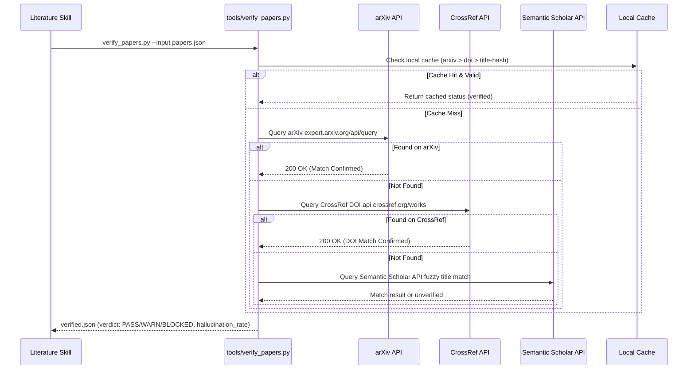

<!-- source: DeepWiki mcp.deepwiki.com · repo wanshuiyin/Auto-claude-code-research-in-sleep · page 4.1 Literature & Analysis Skills · fetched 2026-10-26 -->

# Literature & Analysis Skills

<details>
<summary>Relevant source files</summary>

The following files were used as context for generating this wiki page:

- [skills/alphaxiv/SKILL.md](skills/alphaxiv/SKILL.md)
- [skills/arxiv/SKILL.md](skills/arxiv/SKILL.md)
- [skills/deepxiv/SKILL.md](skills/deepxiv/SKILL.md)
- [skills/exa-search/SKILL.md](skills/exa-search/SKILL.md)
- [skills/gemini-search/SKILL.md](skills/gemini-search/SKILL.md)
- [skills/openalex/SKILL.md](skills/openalex/SKILL.md)
- [skills/research-lit/SKILL.md](skills/research-lit/SKILL.md)
- [skills/research-wiki/SKILL.md](skills/research-wiki/SKILL.md)
- [skills/semantic-scholar/SKILL.md](skills/semantic-scholar/SKILL.md)
- [skills/skills-codex/alphaxiv/SKILL.md](skills/skills-codex/alphaxiv/SKILL.md)
- [skills/skills-codex/arxiv/SKILL.md](skills/skills-codex/arxiv/SKILL.md)
- [skills/skills-codex/deepxiv/SKILL.md](skills/skills-codex/deepxiv/SKILL.md)
- [skills/skills-codex/embodiment-description/SKILL.md](skills/skills-codex/embodiment-description/SKILL.md)
- [skills/skills-codex/exa-search/SKILL.md](skills/skills-codex/exa-search/SKILL.md)
- [skills/skills-codex/figure-description/SKILL.md](skills/skills-codex/figure-description/SKILL.md)
- [skills/skills-codex/formula-derivation/SKILL.md](skills/skills-codex/formula-derivation/SKILL.md)
- [skills/skills-codex/jurisdiction-format/SKILL.md](skills/skills-codex/jurisdiction-format/SKILL.md)
- [skills/skills-codex/research-lit/SKILL.md](skills/skills-codex/research-lit/SKILL.md)
- [tests/test_deepxiv_fetch.py](tests/test_deepxiv_fetch.py)
- [tests/test_research_wiki_encoding.py](tests/test_research_wiki_encoding.py)
- [tests/test_research_wiki_fetch_arxiv_metadata.py](tests/test_research_wiki_fetch_arxiv_metadata.py)
- [tools/check_skills_inventory.py](tools/check_skills_inventory.py)
- [tools/deepxiv_fetch.py](tools/deepxiv_fetch.py)
- [tools/openalex_fetch.py](tools/openalex_fetch.py)
- [tools/research_wiki.py](tools/research_wiki.py)
- [tools/semantic_scholar_fetch.py](tools/semantic_scholar_fetch.py)
- [tools/verify_papers.py](tools/verify_papers.py)

</details>


This page documents the specialized skills and deterministic fetch helpers in ARIS for literature research, novelty verification, citation graphs, multi-source aggregation, and AI-driven literature discovery. These skills form the analytical backbone of the research pipeline, allowing ARIS agents to explore prior work, verify paper existence, inspect deep technical sections, and compound structured insights into the persistent research wiki.

## Skill & Helper Scope

The literature and analysis ecosystem comprises composable skills and robust Python fetch helpers:

| Skill / Helper | Type | Primary Role & Capabilities | Key Dependencies |
|----------------|------|-----------------------------|------------------|
| `/research-lit` | Skill | Multi-source literature search across Zotero, Obsidian, local PDFs, and web | Zotero MCP, Obsidian MCP, `arxiv_fetch.py` |
| `/semantic-scholar` | Skill | Published venue papers (IEEE, ACM, Springer) with structured citation counts & TLDR | `semantic_scholar_fetch.py` |
| `/arxiv` | Skill | arXiv preprint batch search, metadata parsing, and local PDF downloading | `arxiv_fetch.py` |
| `/deepxiv` | Skill | Progressive section-level reading (search → brief → head → section) | `deepxiv_fetch.py`, `deepxiv-sdk` |
| `/gemini-search` | Skill | AI-powered broad literature discovery spanning sub-problems and aliases | `mcp__gemini-cli__ask-gemini`, `gemini-cli` |
| `/openalex` | Skill | Open citation graph search with institutional affiliations and funding metrics | `openalex_fetch.py`, `requests` |
| `/exa-search` | Skill | Broad web search (blogs, docs, companies) with built-in content extraction | `exa_search.py`, `exa-py` |
| `/alphaxiv` | Skill | Instant single-paper lookup via LLM-optimized summaries and LaTeX source fallback | `alphaxiv.org`, arXiv source tarballs |
| `/research-wiki` | Skill | Persistent knowledge graph managing papers, ideas, experiments, and claims | `research_wiki.py`, `threat_scan.py` |
| `verify_papers.py` | Helper | Pre-search hallucination check via 3-layer fallback (arXiv → CrossRef → S2) | `urllib`, `hashlib` |

Sources: [skills/research-lit/SKILL.md:1-23](), [skills/deepxiv/SKILL.md:1-33](), [skills/gemini-search/SKILL.md:1-31](), [tools/verify_papers.py:1-15]()

---

## /research-lit: Multi-Source Literature Search & Fan-Out Architecture

### Purpose and Constants
The `/research-lit` skill aggregates research papers from a prioritized cascade of nine data sources. It implements graceful degradation: if optional MCP servers (Zotero, Obsidian) or specialized CLI tools are absent, they are skipped silently without breaking the core local PDF and web search pipeline [skills/research-lit/SKILL.md:33-79]().

Key execution constants include `PAPER_LIBRARY` (scanning `papers/`, `literature/`, or custom paths), `MAX_LOCAL_PAPERS = 20`, and `SOURCES = all` [skills/research-lit/SKILL.md:12-23]().

### Natural Language Space to Code Entity Space

Title: Multi-Source Retrieval Fan-Out Architecture
```mermaid
graph TB
    subgraph "Natural Language Space"
        UserReq["User Prompt:<br/>'/research-lit \"diffusion models\"'"]
        IntentParse["Parameter & Source Resolution"]
    end

    subgraph "Code Entity Space: research-lit & Fetchers"
        ArgParser["Source Selection Parser<br/>skills/research-lit/SKILL.md:39-44"]
        ZoteroShard["Priority 1: Zotero MCP<br/>mcp__zotero__*"]
        ObsidianShard["Priority 2: Obsidian MCP<br/>mcp__obsidian-vault__*"]
        LocalScan["Priority 3: Local PDFs<br/>Glob: papers/**/*.pdf"]
        WebSearch["Priority 4: Web & arXiv API<br/>tools/arxiv_fetch.py"]
        S2Fetcher["Priority 5: Semantic Scholar<br/>tools/semantic_scholar_fetch.py"]
        DeepXivFetcher["Priority 6: DeepXiv SDK<br/>tools/deepxiv_fetch.py"]
        ExaFetcher["Priority 7: Exa Search<br/>tools/exa_search.py"]
        GeminiFetcher["Priority 8: Gemini Scout<br/>mcp__gemini-cli__ask-gemini"]
        OpenAlexFetcher["Priority 9: OpenAlex Graph<br/>tools/openalex_fetch.py"]
        Deduplicator["Deterministic Deduplication & Verification<br/>tools/verify_papers.py"]
    end

    UserReq --> IntentParse
    IntentParse --> ArgParser
    ArgParser --> ZoteroShard
    ArgParser --> ObsidianShard
    ArgParser --> LocalScan
    ArgParser --> WebSearch
    ArgParser --> S2Fetcher
    ArgParser --> DeepXivFetcher
    ArgParser --> ExaFetcher
    ArgParser --> GeminiFetcher
    ArgParser --> OpenAlexFetcher

    ZoteroShard --> Deduplicator
    ObsidianShard --> Deduplicator
    LocalScan --> Deduplicator
    WebSearch --> Deduplicator
    S2Fetcher --> Deduplicator
    DeepXivFetcher --> Deduplicator
    ExaFetcher --> Deduplicator
    GeminiFetcher --> Deduplicator
    OpenAlexFetcher --> Deduplicator

    Deduplicator --> Output["Unified Literature Report & Wiki Ingest"]
```
Sources: [skills/research-lit/SKILL.md:33-81](), [skills/skills-codex/research-lit/SKILL.md:31-74]()

### Fan-Out and Verification Protocol
Retrieval and extraction operate across breadth-bound shards. When delegation is active, ARIS spawns read-only worker shards that return structured payloads with canonical deduplication keys (DOI, arXiv ID). Source verification relies on deterministic helpers before any literature record is stored or presented [skills/skills-codex/research-lit/SKILL.md:79-90]().

Sources: [skills/skills-codex/research-lit/SKILL.md:79-90]()

---

## Deterministic Fetch Helpers & Hallucination Defense

### verify_papers.py: Pre-Search Hallucination Barrier
To prevent LLM search hallucinations from propagating into downstream research planning, ARIS runs `tools/verify_papers.py` as a mandatory pre-search validation gate [tools/verify_papers.py:1-10]().

Title: Verify Papers 3-Layer Validation Pipeline

Sources: [tools/verify_papers.py:1-76]()

The script categorizes paper verification into four status states: `verified`, `unverified`, `verify_pending` (transient API errors excluded from hallucination metrics), and `error`. Top-level verdicts include `PASS`, `WARN`, `BLOCKED`, and `ERROR` [tools/verify_papers.py:61-75]().

### OpenAlex Integration (`openalex_fetch.py`)
The OpenAlex client (`tools/openalex_fetch.py`) communicates with the OpenAlex API (`https://api.openalex.org`) to fetch scholarly works, citation metrics, open access statuses, and institutional affiliation graphs [tools/openalex_fetch.py:1-46](). It supports year filters, citation thresholds, and inverted index abstract reconstruction [tools/openalex_fetch.py:47-191]().

Sources: [tools/openalex_fetch.py:1-191]()

---

## Progressive Reading & Single-Paper Lookup

### /deepxiv: Layered Section-Level Access
The `/deepxiv` skill provides progressive reading capabilities to avoid loading full paper texts into context prematurely [skills/deepxiv/SKILL.md:14-23](). It resolves `$DEEPXIV_FETCHER` (`tools/deepxiv_fetch.py`) via a strict-safe adapter chain, falling back to raw `deepxiv` CLI commands when needed [skills/deepxiv/SKILL.md:25-31]().

Progression hierarchy:
1. `search` — find candidate papers [skills/deepxiv/SKILL.md:104-114]()
2. `paper-brief` — summary and core thesis [skills/deepxiv/SKILL.md:116-126]()
3. `paper-head` — metadata and section map [skills/deepxiv/SKILL.md:128-138]()
4. `paper-section` — read a specific named section [skills/deepxiv/SKILL.md:140-150]()

Sources: [skills/deepxiv/SKILL.md:14-162](), [skills/skills-codex/deepxiv/SKILL.md:12-115]()

### /alphaxiv: Tiered Single-Paper Reader
The `/alphaxiv` skill delivers instant LLM-optimized summaries of individual papers via `alphaxiv.org` with a three-tier fallback mechanism [skills/alphaxiv/SKILL.md:12-24]().

- **Tier 1 (Fastest)**: Structured overview markdown (`https://alphaxiv.org/overview/{PAPER_ID}.md`) [skills/alphaxiv/SKILL.md:29-68]()
- **Tier 2 (Detailed)**: Full paper markdown (`https://alphaxiv.org/abs/{PAPER_ID}.md`) [skills/alphaxiv/SKILL.md:30-84]()
- **Tier 3 (Deepest)**: arXiv LaTeX source tarball inspection (`https://arxiv.org/src/{PAPER_ID}`) for mathematical proofs, equations, and appendix specifics [skills/alphaxiv/SKILL.md:31-98]()

Sources: [skills/alphaxiv/SKILL.md:12-98](), [skills/skills-codex/alphaxiv/SKILL.md:12-100]()

---

## AI-Driven Discovery & Metadata Indexing

### /gemini-search & /exa-search
- **`/gemini-search`**: Uses Gemini models (via `mcp__gemini-cli__ask-gemini` or `gemini` CLI) to perform broad literature discovery. It automatically decomposes user queries into sub-problems, neighboring aliases, and benchmark settings variants [skills/gemini-search/SKILL.md:14-24]().
- **`/exa-search`**: Leverages the Exa search SDK (`tools/exa_search.py`) for broad web searches covering blogs, documentation, company reports, and research preprints with automatic content extraction [skills/gemini-search/SKILL.md:1-5](), [skills/exa-search/SKILL.md:14-23]().

### /semantic-scholar: Published Venue Metadata
Complements preprint searches by querying the Semantic Scholar API (`tools/semantic_scholar_fetch.py`) for peer-reviewed journal and conference literature, prioritizing citation counts, TLDRs, and official venue publication records [skills/semantic-scholar/SKILL.md:8-19]().

Sources: [skills/gemini-search/SKILL.md:14-24](), [skills/semantic-scholar/SKILL.md:8-19]()

---

## Research Wiki Ingestion & Persistent Memory

When literature skills successfully read or verify papers, they automatically trigger ingestion into the persistent per-project research wiki (`tools/research_wiki.py`) [tools/research_wiki.py:1-37](), [skills/alphaxiv/SKILL.md:128-151](). 

The ingestion workflow resolves the wiki helper script via the canonical resolution chain, generates a unique slug (`author_year_keyword`), registers the paper node under `research-wiki/papers/`, updates relationship edges in `research-wiki/graph/edges.jsonl`, and rebuilds the categorical `index.md` and `/idea-creator` query pack (`query_pack.md`) [tools/research_wiki.py:96-148](), [skills/research-wiki/SKILL.md:82-110]().

Sources: [tools/research_wiki.py:1-152](), [skills/research-wiki/SKILL.md:82-139]()

---

