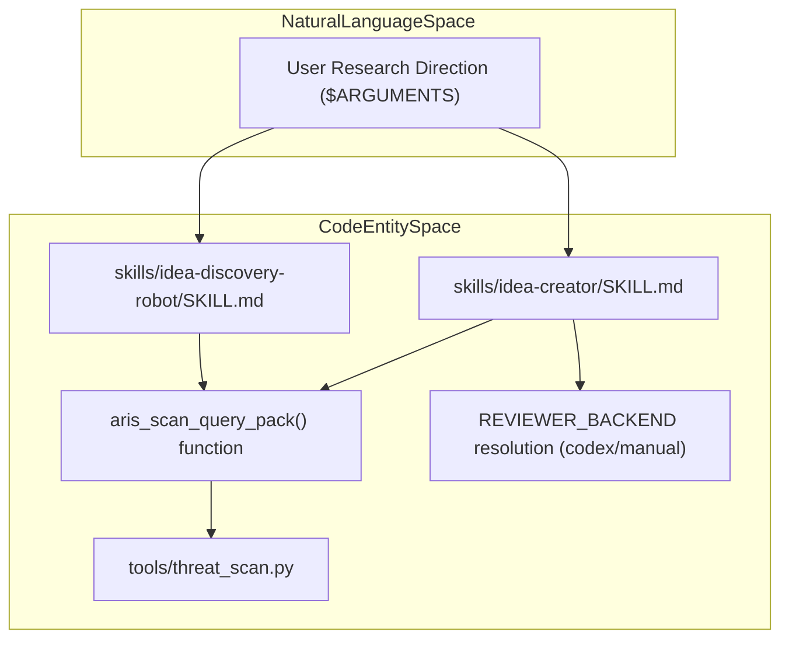
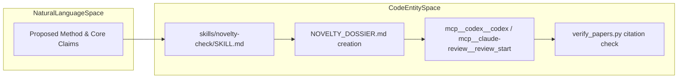
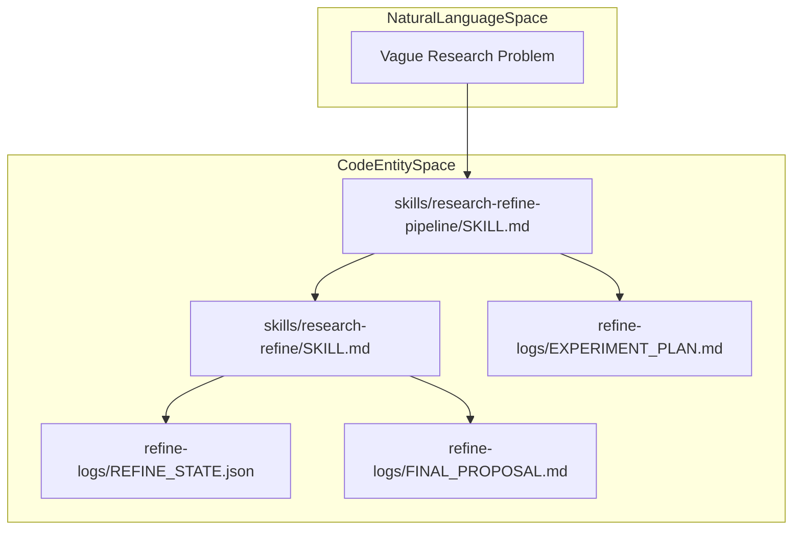

<!-- source: DeepWiki mcp.deepwiki.com · repo wanshuiyin/Auto-claude-code-research-in-sleep · page 4.2 Idea & Review Skills · fetched 2026-10-26 -->

# Idea & Review Skills

Relevant source files

The following files were used as context for generating this wiki page:

- [skills/claims-drafting/SKILL.md](skills/claims-drafting/SKILL.md)
- [skills/experiment-plan/SKILL.md](skills/experiment-plan/SKILL.md)
- [skills/idea-creator/SKILL.md](skills/idea-creator/SKILL.md)
- [skills/idea-discovery-robot/SKILL.md](skills/idea-discovery-robot/SKILL.md)
- [skills/invention-structuring/SKILL.md](skills/invention-structuring/SKILL.md)
- [skills/novelty-check/SKILL.md](skills/novelty-check/SKILL.md)
- [skills/research-refine-pipeline/SKILL.md](skills/research-refine-pipeline/SKILL.md)
- [skills/research-refine/SKILL.md](skills/research-refine/SKILL.md)
- [skills/skills-codex-claude-review/novelty-check/SKILL.md](skills/skills-codex-claude-review/novelty-check/SKILL.md)
- [skills/skills-codex-gemini-review/idea-creator/SKILL.md](skills/skills-codex-gemini-review/idea-creator/SKILL.md)
- [skills/skills-codex-gemini-review/idea-discovery/SKILL.md](skills/skills-codex-gemini-review/idea-discovery/SKILL.md)
- [skills/skills-codex-gemini-review/novelty-check/SKILL.md](skills/skills-codex-gemini-review/novelty-check/SKILL.md)
- [skills/skills-codex/idea-creator/SKILL.md](skills/skills-codex/idea-creator/SKILL.md)
- [skills/skills-codex/novelty-check/SKILL.md](skills/skills-codex/novelty-check/SKILL.md)
- [skills/specification-writing/SKILL.md](skills/specification-writing/SKILL.md)

This section documents the technical implementation, data flow, and orchestration patterns for ARIS's idea creation, novelty verification, method refinement, experiment planning, and critical review skills (`/idea-creator`, `/idea-discovery-robot`, `/novelty-check`, `/research-refine`, `/research-refine-pipeline`, `/experiment-plan`, and `/research-review`).

Sources: `[skills/idea-creator/SKILL.md:1-25]`, `[skills/research-refine/SKILL.md:1-46]`, `[skills/experiment-plan/SKILL.md:1-29]`

---

## Idea Creation & Robotics Adaptation (`/idea-creator`, `/idea-discovery-robot`)

The `/idea-creator` skill translates a broad natural language research direction into systematically validated, ranked concrete ideas. It enforces strict resource bounds via constants defined in `[skills/idea-creator/SKILL.md:18-24]()`:
- `PILOT_MAX_HOURS = 2` — Skip pilots estimated to take > 2 hours per GPU.
- `PILOT_TIMEOUT_HOURS = 3` — Hard timeout for runaway processes.
- `MAX_PILOT_IDEAS = 3` — Maximum ideas to pilot in parallel.
- `MAX_TOTAL_GPU_HOURS = 8` — Total budget for all pilots combined.
- `REVIEWER_MODEL = gpt-6-astra` (via `REVIEWER_BACKEND = codex`).

The `/idea-discovery-robot` skill adapts this workflow for robotics and embodied AI `[skills/idea-discovery-robot/SKILL.md:1-30]`, incorporating a simulation-first policy (`SIM_FIRST`), safety limits (`REAL_ROBOT_PILOTS = explicit approval only`), and a robotics problem framing phase (`Phase 0`) covering embodiment, task family, observation/action interfaces, and benchmarks (e.g., ManiSkill, Isaac Lab, CALVIN) `[skills/idea-discovery-robot/SKILL.md:36-75]()`.

Title: "Idea Generation and Pilot Execution Architecture"

Sources: `[skills/idea-creator/SKILL.md:14-52]`, `[skills/idea-discovery-robot/SKILL.md:14-75]`

---

## Novelty Verification (`/novelty-check`)

The `/novelty-check` skill evaluates proposed methods against existing literature using multi-source searches (WebSearch, arXiv, Semantic Scholar, ICLR/NeurIPS/ICML databases) and cross-model verification (`[skills/novelty-check/SKILL.md:28-44]()`).

It operates under strict **Verdict Limits** (`[skills/novelty-check/SKILL.md:70-93]()`), ensuring that proximity is treated as information rather than rejection, and that an `ABANDON` verdict requires naming a specific published paper. Pre-search verification prevents hallucination via helper utilities (`[skills/novelty-check/SKILL.md:138]()`).

Title: "Novelty Verification and Verdict Flow"

Sources: `[skills/novelty-check/SKILL.md:1-143]`, `[skills/skills-codex-claude-review/novelty-check/SKILL.md:1-144]`

---

## Method Refinement & Pipelines (`/research-refine`, `/research-refine-pipeline`)

The `/research-refine` skill transforms fuzzy problem directions into problem-anchored, minimal-mechanism, frontier-aware proposals through iterative review rounds (up to `MAX_ROUNDS = 5`, target `SCORE_THRESHOLD = 9`, `[skills/research-refine/SKILL.md:34-44]()`). 

To protect against interruptions and context compaction, state is persisted to `refine-logs/REFINE_STATE.json` (`[skills/research-refine/SKILL.md:47-61]()`). The `/research-refine-pipeline` skill chains `/research-refine` and `/experiment-plan` into an end-to-end atomic pipeline (`[skills/research-refine-pipeline/SKILL.md:11-30]()`).

Title: "Refinement Pipeline State and Execution Flow"

Sources: `[skills/research-refine/SKILL.md:34-124]`, `[skills/research-refine-pipeline/SKILL.md:1-103]`

---

## Experiment & Validation Planning (`/experiment-plan`)

The `/experiment-plan` skill operationalizes a stable proposal into a claim-driven experiment roadmap (`[skills/experiment-plan/SKILL.md:7-21]()`). It establishes strict bounds (`MAX_PRIMARY_CLAIMS = 2`, `MAX_CORE_BLOCKS = 5`, `MAX_BASELINE_FAMILIES = 3`, `DEFAULT_SEEDS = 3`, `[skills/experiment-plan/SKILL.md:22-29]()`) and maps claims to specific experiment blocks (anchor results, novelty isolation, simplicity checks, and frontier necessity checks).

Sources: `[skills/experiment-plan/SKILL.md:1-171]`

---

## Critical Review & Reviewer Routing (`/research-review`, Backends)

Review skills rely on the executor-reviewer separation pattern, ensuring independent cross-family or cross-model evaluation (e.g., Codex GPT-6-Astra or Gemini review bridges) rather than self-play (`[skills/idea-creator/SKILL.md:22-50]`, `[skills/novelty-check/SKILL.md:43-57]`). Review traces are saved to `.aris/traces/` for verifiable audit trails.

Sources: `[skills/idea-creator/SKILL.md:28-51]`, `[skills/novelty-check/SKILL.md:140-143]`

---

