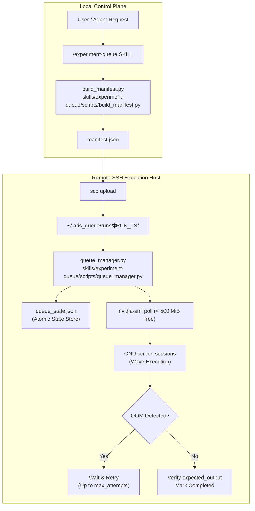

<!-- source: DeepWiki mcp.deepwiki.com · repo wanshuiyin/Auto-claude-code-research-in-sleep · page 4.3 Experiment Execution Skills · fetched 2026-10-26 -->

# Experiment Execution Skills

Relevant source files

The following files were used as context for generating this wiki page:

- [skills/dse-loop/SKILL.md](skills/dse-loop/SKILL.md)
- [skills/experiment-queue/SKILL.md](skills/experiment-queue/SKILL.md)
- [skills/monitor-experiment/SKILL.md](skills/monitor-experiment/SKILL.md)
- [skills/qzcli/SKILL.md](skills/qzcli/SKILL.md)
- [skills/run-experiment/SKILL.md](skills/run-experiment/SKILL.md)
- [skills/serverless-modal/SKILL.md](skills/serverless-modal/SKILL.md)
- [skills/shared-references/compute-env-contract.md](skills/shared-references/compute-env-contract.md)
- [skills/skills-codex/dse-loop/SKILL.md](skills/skills-codex/dse-loop/SKILL.md)
- [skills/skills-codex/experiment-queue/SKILL.md](skills/skills-codex/experiment-queue/SKILL.md)
- [skills/skills-codex/qzcli/SKILL.md](skills/skills-codex/qzcli/SKILL.md)
- [skills/skills-codex/run-experiment/SKILL.md](skills/skills-codex/run-experiment/SKILL.md)
- [skills/skills-codex/serverless-modal/SKILL.md](skills/skills-codex/serverless-modal/SKILL.md)
- [skills/skills-codex/shared-references/compute-env-contract.md](skills/skills-codex/shared-references/compute-env-contract.md)
- [skills/skills-codex/vast-gpu/SKILL.md](skills/skills-codex/vast-gpu/SKILL.md)
- [skills/training-check/SKILL.md](skills/training-check/SKILL.md)
- [skills/vast-gpu/SKILL.md](skills/vast-gpu/SKILL.md)
- [tools/experiment_queue/README.md](tools/experiment_queue/README.md)
- [tools/experiment_queue/build_manifest.py](tools/experiment_queue/build_manifest.py)
- [tools/experiment_queue/queue_manager.py](tools/experiment_queue/queue_manager.py)

This document covers the atomic and specialized skills responsible for executing, monitoring, and evaluating machine learning experiments: `/run-experiment`, `/monitor-experiment`, `/training-check`, `/result-to-claim`, `/ablation-planner`, `/experiment-queue`, `/vast-gpu`, `/serverless-modal`, `/qzcli`, the compute environment contract, and GPU resource management. These skills form the operational backbone of ARIS's autonomous research workflows, enabling Claude Code and Codex to deploy experiments across diverse compute targets, track progress, manage state, and extract statistical insights without manual intervention.

**Sources:** `[skills/run-experiment/SKILL.md:2-6]()`, `[skills/monitor-experiment/SKILL.md:2-6]`, `[skills/training-check/SKILL.md:2-6]`, `[skills/experiment-queue/SKILL.md:2-6]`, `[skills/vast-gpu/SKILL.md:2-6]`, `[skills/serverless-modal/SKILL.md:2-6]`, `[skills/qzcli/SKILL.md:2-6]()`

---

## Overview and Natural Language to Code Entity Mapping

The experiment execution ecosystem bridges high-level natural language intent to concrete orchestration scripts, cluster CLI tools, and state persistence ledgers. 

```mermaid
graph TB
    subgraph "Deployment & Orchestration Skills"
        RunExp["/run-experiment<br/>skills/run-experiment/SKILL.md"]
        Queue["/experiment-queue<br/>skills/experiment-queue/SKILL.md"]
        Vast["/vast-gpu<br/>skills/vast-gpu/SKILL.md"]
        Modal["/serverless-modal<br/>skills/serverless-modal/SKILL.md"]
        Qzcli["/qzcli<br/>skills/qzcli/SKILL.md"]
    end
    
    subgraph "Canonical Scripts & Tooling"
        QM["queue_manager.py<br/>skills/experiment-queue/scripts/queue_manager.py"]
        BM["build_manifest.py<br/>skills/experiment-queue/scripts/build_manifest.py"]
        VastCli["vastai CLI<br/>(vast-instances.json)"]
        ModalSdk["modal.App / modal.Image<br/>(serverless-modal)"]
        QzcliTool["qzcli<br/>(tianyilt/qzcli_tool)"]
    end
    
    subgraph "Monitoring & Judgment"
        Monitor["/monitor-experiment<br/>skills/monitor-experiment/SKILL.md"]
        TrainCheck["/training-check<br/>skills/training-check/SKILL.md"]
        ResultClaim["/result-to-claim<br/>skills/result-to-claim/SKILL.md"]
        AblationPlan["/ablation-planner<br/>skills/ablation-planner/SKILL.md"]
    end
    
    subgraph "Infrastructure & Contracts"
        EnvContract["compute-env-contract.md<br/>skills/shared-references/compute-env-contract.md"]
        ClaudeMD["CLAUDE.md<br/>(Resource Config)"]
        ExpLog["EXPERIMENT_LOG.md<br/>(Results Table)"]
    end
    
    RunExp -->|"reads"| ClaudeMD
    RunExp -->|"delegates"| Vast
    RunExp -->|"delegates"| Modal
    RunExp -->|"delegates"| Qzcli
    Queue -->|"invokes"| QM
    Queue -->|"invokes"| BM
    Vast -->|"manages"| VastCli
    Modal -->|"deploys"| ModalSdk
    Qzcli -->|"executes"| QzcliTool
    
    RunExp -->|"validates via"| EnvContract
    Queue -->|"validates via"| EnvContract
    
    Monitor -->|"parses logs"| ExpLog
    TrainCheck -->|"evaluates"| WandB["Weights & Biases API"]
    ResultClaim -->|"updates"| ExpLog
```

**Sources:** `[skills/experiment-queue/SKILL.md:41-43]()`, `[skills/run-experiment/SKILL.md:14-23]()`, `[skills/vast-gpu/SKILL.md:28-51]()`, `[skills/serverless-modal/SKILL.md:113-152]()`, `[skills/qzcli/SKILL.md:10-21]()`

---

## Compute Environment Contract & Resource Governance

Before any experiment deployment script launches training workloads, ARIS enforces the **Compute Environment Contract** (`skills/shared-references/compute-env-contract.md`) to guarantee environment reproducibility and prevent import-time failures across heterogeneous compute backends.

### Key Tenets of the Compute Contract
*   **Declarative Spec-Hash Ledger**: Every target compute provider maintains an environment ledger (`.aris/compute/<provider>.md`). An unchanged spec hash permits warm-reuse, whereas any configuration modification forces an automated rebuild `[skills/run-experiment/SKILL.md:25-33]()`.
*   **Ordered Pip Phases**: Dependency installation is strictly segregated into ordered phases. Package version pins (e.g., `torch==...`) are installed in Phase 1, preventing later packages from overriding core runtime pins `[skills/run-experiment/SKILL.md:100-112]()`, `[skills/serverless-modal/SKILL.md:117-124]()`.
*   **Kernel Witness**: Environments are never marked ready on import-success alone. A seeded smoke test (kernel witness) must execute successfully to verify hardware-software binding `[skills/run-experiment/SKILL.md:25-33]()`, `[skills/qzcli/SKILL.md:14-21]()`.

**Sources:** `[skills/experiment-queue/SKILL.md:50-55]()`, `[skills/run-experiment/SKILL.md:25-33]()`, `[skills/serverless-modal/SKILL.md:18-23]`, `[skills/qzcli/SKILL.md:14-21]()`

---

## Multi-Backend Deployment (`/run-experiment`, `/vast-gpu`, `/serverless-modal`, `/qzcli`)

The `/run-experiment` skill inspects the project's `CLAUDE.md` to identify the designated compute backend and routes deployment accordingly `[skills/run-experiment/SKILL.md:14-24]()`.

### Supported Compute Backends

| Backend | Configuration Key | Execution Mechanism | State Tracking |
| :--- | :--- | :--- | :--- |
| **Local** | `gpu: local` | Direct subprocess execution with `CUDA_VISIBLE_DEVICES` `[skills/run-experiment/SKILL.md:18-18]()` | Local process table |
| **Remote Server** | `gpu: remote` | SSH connection + `rsync`/`git` sync + GNU `screen` session `[skills/run-experiment/SKILL.md:19-19]()`, `[skills/run-experiment/SKILL.md:64-87]()` | Remote screen list |
| **Vast.ai** | `gpu: vast` | On-demand GPU instance rental via `/vast-gpu provision` `[skills/run-experiment/SKILL.md:20-20]`, `[skills/vast-gpu/SKILL.md:55-57]()` | `vast-instances.json` `[skills/vast-gpu/SKILL.md:28-31]()` |
| **Modal** | `gpu: modal` | Serverless Python functions via `/serverless-modal` `[skills/run-experiment/SKILL.md:21-21]()` | Modal volume mounts `[skills/serverless-modal/SKILL.md:128-136]()` |
| **Qizhi Platform** | `gpu: qzcli` | Kubernetes-style cluster jobs via `/qzcli` `[skills/qzcli/SKILL.md:8-11]()` | `~/.qzcli/jobs.json` `[skills/qzcli/SKILL.md:63-63]()` |

### Cloud & Serverless Infrastructure Integrations
*   **Vast.ai (`/vast-gpu`)**: Analyzes training tasks to determine VRAM and disk requirements, queries available spot/on-demand offers via the `vastai` CLI, ranks them by estimated total cost, and maintains instance metadata in `vast-instances.json` `[skills/vast-gpu/SKILL.md:14-51]`, `[skills/vast-gpu/SKILL.md:92-128]()`.
*   **Modal (`/serverless-modal`)**: Provides zero-config serverless GPU execution with per-second billing and automatic scale-to-zero. Translates dependencies into `modal.Image` spec chains and mounts local code directories and persistent `modal.Volume` instances `[skills/serverless-modal/SKILL.md:14-23]`, `[skills/serverless-modal/SKILL.md:114-147]()`.
*   **Qizhi / 启智 (`/qzcli`)**: Manages distributed training jobs on enterprise/academic Qizhi clusters using a kubectl-style interface (`qzcli login`, `qzcli res -u`, `qzcli avail`, `qzcli create`) `[skills/qzcli/SKILL.md:8-11]`, `[skills/qzcli/SKILL.md:67-81]()`.

**Sources:** `[skills/run-experiment/SKILL.md:14-175]()`, `[skills/vast-gpu/SKILL.md:14-51]`, `[skills/serverless-modal/SKILL.md:14-23]`, `[skills/qzcli/SKILL.md:8-81]()`

---

## Large-Scale Orchestration (`/experiment-queue`)

When running large hyperparameter sweeps or multi-seed grids ($\ge$ 10 jobs), `/experiment-queue` coordinates execution across remote GPUs with OOM retry handling, stale screen cleanup, and wave transition synchronization `[skills/experiment-queue/SKILL.md:12-30]()`.

### Queue Execution Architecture

### Job State Machine & Wave Rules
*   **State Transitions**: Jobs transition through `pending` $\to$ `running` $\to$ `completed`. If an out-of-memory error occurs, jobs transition to `failed_oom` and automatically return to `pending` after a configurable delay (default 120s) up to `max_attempts`. Unhandled failures transition to `failed_other` and park as `stuck` `[skills/experiment-queue/SKILL.md:93-100]()`.
*   **Wave Transitions**: Subsequent job waves will not launch until all active python processes in the current wave have exited, no lingering stale screens remain, GPU memory utilization drops below the free threshold ($\le 500$ MiB), and precondition checks pass `[skills/experiment-queue/SKILL.md:114-119]()`.
*   **Canonical Script Location**: Core execution logic resides in `skills/experiment-queue/scripts/queue_manager.py`, while `tools/experiment_queue/` retains `os.execv` shims for legacy compatibility `[skills/experiment-queue/SKILL.md:153-155]`, `[tools/experiment_queue/queue_manager.py:1-40]()`.

**Sources:** `[skills/experiment-queue/SKILL.md:56-155]()`, `[tools/experiment_queue/queue_manager.py:1-40]()`, `[tools/experiment_queue/README.md:1-112]()`

---

## Monitoring & Health Checking (`/monitor-experiment`, `/training-check`)

ARIS separates infrastructure process monitoring from deep training dynamics evaluation.

### Monitoring Comparison

| Operational Aspect | `/monitor-experiment` | `/training-check` |
| :--- | :--- | :--- |
| **Primary Objective** | Collect process logs, screen hardcopies, and final JSON outputs `[skills/monitor-experiment/SKILL.md:47-63]()` | Detect divergence, NaN values, loss plateaus, or stagnation `[skills/training-check/SKILL.md:30-40]()` |
| **Data Sources** | Screen logs, `vast-instances.json`, Weights & Biases API history `[skills/monitor-experiment/SKILL.md:30-88]()` | W&B loss curves, evaluation metrics, throughput telemetry `[skills/training-check/SKILL.md:30-45]()` |
| **Execution Cadence** | On-demand or scheduled event completion `[skills/monitor-experiment/SKILL.md:10-18]()` | Periodic polling loop (e.g., every 30 minutes) `[skills/training-check/SKILL.md:14-15]()` |
| **Integration Output** | Results comparison table, Feishu notifications `[skills/monitor-experiment/SKILL.md:115-131]()` | Decision to continue, adjust hyperparameters, or abort training `[skills/training-check/SKILL.md:40-62]()` |

**Sources:** `[skills/monitor-experiment/SKILL.md:23-140]()`, `[skills/training-check/SKILL.md:10-62]()`

---

## Judgment & Rigor Skills (`/result-to-claim`, `/ablation-planner`)

Once experiment execution and monitoring conclude, ARIS applies strict judgment gates before promoting empirical data into paper claims.

*   **`/result-to-claim`**: Acts as an interpretive evaluation gate. It ingests W&B history logs and `EXPERIMENT_LOG.md` to evaluate whether empirical results substantiate proposed research claims. If unsupported, it identifies specific evidence gaps and routes execution back to supplementary experiments `[skills/result-to-claim/SKILL.md:25-131]()`.
*   **`/ablation-planner`**: Triggered after claim validation, this skill designs systematic ablation studies to isolate the contribution of individual architectural components or hyperparameters, leveraging adversarial reviewer perspectives to ensure rigor `[skills/ablation-planner/SKILL.md:30-109]()`.

**Sources:** `[skills/result-to-claim/SKILL.md:25-131]()`, `[skills/ablation-planner/SKILL.md:30-109]()`

---

