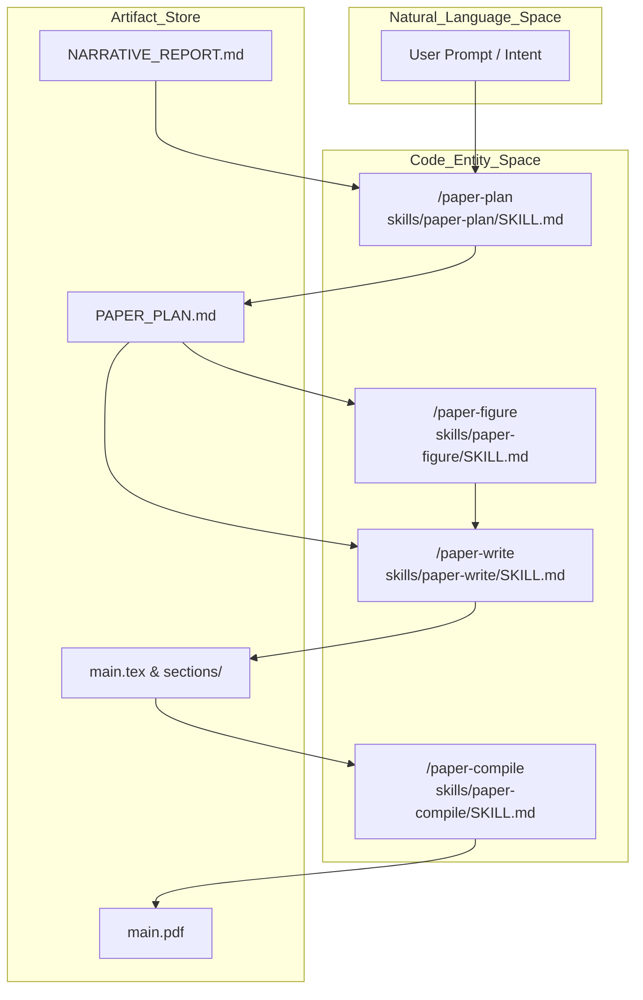
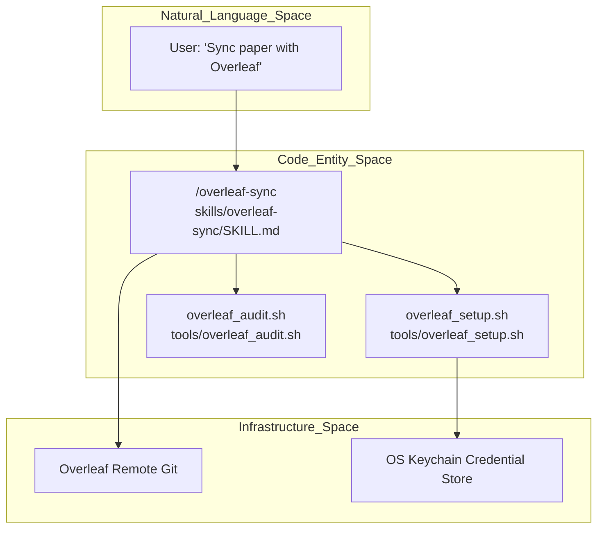

<!-- source: DeepWiki mcp.deepwiki.com · repo wanshuiyin/Auto-claude-code-research-in-sleep · page 4.4 Paper Generation Skills · fetched 2026-10-26 -->

# Paper Generation Skills

<details>
<summary>Relevant source files</summary>

The following files were used as context for generating this wiki page:

- [assets/paper_illustration_demo.png](assets/paper_illustration_demo.png)
- [mcp-servers/codex-image2/README.md](mcp-servers/codex-image2/README.md)
- [mcp-servers/codex-image2/server.py](mcp-servers/codex-image2/server.py)
- [skills/figure-spec/SKILL.md](skills/figure-spec/SKILL.md)
- [skills/figure-spec/scripts/figure_renderer.py](skills/figure-spec/scripts/figure_renderer.py)
- [skills/grant-proposal/SKILL.md](skills/grant-proposal/SKILL.md)
- [skills/mermaid-diagram/SKILL.md](skills/mermaid-diagram/SKILL.md)
- [skills/overleaf-sync/SKILL.md](skills/overleaf-sync/SKILL.md)
- [skills/paper-compile/SKILL.md](skills/paper-compile/SKILL.md)
- [skills/paper-figure/SKILL.md](skills/paper-figure/SKILL.md)
- [skills/paper-illustration-image2/SKILL.md](skills/paper-illustration-image2/SKILL.md)
- [skills/paper-illustration-image2/scripts/paper_illustration_image2.py](skills/paper-illustration-image2/scripts/paper_illustration_image2.py)
- [skills/paper-illustration/SKILL.md](skills/paper-illustration/SKILL.md)
- [skills/paper-plan/SKILL.md](skills/paper-plan/SKILL.md)
- [skills/paper-poster-html/SKILL.md](skills/paper-poster-html/SKILL.md)
- [skills/paper-poster/SKILL.md](skills/paper-poster/SKILL.md)
- [skills/paper-slides/SKILL.md](skills/paper-slides/SKILL.md)
- [skills/paper-write/templates/iclr2026.tex](skills/paper-write/templates/iclr2026.tex)
- [skills/paper-write/templates/icml2025.tex](skills/paper-write/templates/icml2025.tex)
- [skills/paper-write/templates/math_commands.tex](skills/paper-write/templates/math_commands.tex)
- [skills/paper-write/templates/neurips2025.tex](skills/paper-write/templates/neurips2025.tex)
- [skills/shared-references/citation-discipline.md](skills/shared-references/citation-discipline.md)
- [skills/shared-references/taste-calibration.md](skills/shared-references/taste-calibration.md)
- [skills/skills-codex-gemini-review/paper-poster-html/SKILL.md](skills/skills-codex-gemini-review/paper-poster-html/SKILL.md)
- [skills/skills-codex/grant-proposal/SKILL.md](skills/skills-codex/grant-proposal/SKILL.md)
- [skills/skills-codex/overleaf-sync/SKILL.md](skills/skills-codex/overleaf-sync/SKILL.md)
- [skills/skills-codex/paper-figure/SKILL.md](skills/skills-codex/paper-figure/SKILL.md)
- [skills/skills-codex/paper-plan/SKILL.md](skills/skills-codex/paper-plan/SKILL.md)
- [skills/skills-codex/paper-poster-html/SKILL.md](skills/skills-codex/paper-poster-html/SKILL.md)
- [skills/skills-codex/paper-poster/SKILL.md](skills/skills-codex/paper-poster/SKILL.md)
- [skills/skills-codex/paper-slides/SKILL.md](skills/skills-codex/paper-slides/SKILL.md)
- [skills/skills-codex/patent-pipeline/SKILL.md](skills/skills-codex/patent-pipeline/SKILL.md)
- [skills/skills-codex/patent-review/SKILL.md](skills/skills-codex/patent-review/SKILL.md)
- [skills/skills-codex/research-refine/SKILL.md](skills/skills-codex/research-refine/SKILL.md)
- [skills/skills-codex/shared-references/citation-discipline.md](skills/skills-codex/shared-references/citation-discipline.md)
- [tests/test_codex_image2_server.py](tests/test_codex_image2_server.py)
- [tools/figure_renderer.py](tools/figure_renderer.py)
- [tools/overleaf_audit.sh](tools/overleaf_audit.sh)
- [tools/overleaf_setup.sh](tools/overleaf_setup.sh)
- [tools/paper_illustration_image2.py](tools/paper_illustration_image2.py)

</details>


## Purpose and Scope

This page documents the specialized skills within ARIS (Auto-claude-code-research-in-sleep) dedicated to transforming research results, review conclusions, and narrative reports into submission-ready academic artifacts. This encompasses the core LaTeX planning and compilation chain (`/paper-plan`, `/paper-write`, `/paper-compile`), figure and illustration generators (`/paper-figure`, `/figure-spec`, `/paper-illustration`, `/paper-illustration-image2`, `/mermaid-diagram`), print-gated poster pipelines (`/paper-poster-html`, `/paper-poster`), slide presentation generators (`/paper-slides`, `/slides-polish`), and the two-way Overleaf synchronization bridge (`/overleaf-sync`).

These skills leverage a cross-model collaboration architecture, pairing Claude's precise execution capability with high-level reasoning models (such as GPT-6-Astra via Codex MCP or Gemini models) for structural planning, visual review, and aesthetic optimization.

Sources: [skills/paper-plan/SKILL.md:1-16](), [skills/paper-figure/SKILL.md:1-10](), [skills/paper-poster-html/SKILL.md:1-16](), [skills/paper-slides/SKILL.md:1-17]()

---

## Paper Generation Ecosystem and Data Flow

The paper generation workflow operates on a structured multi-stage data flow where each atomic skill consumes upstream artifacts (such as `NARRATIVE_REPORT.md`, `IDEA_REPORT.md`, or raw experiment logs) to produce standardized intermediate files and final document outputs.

Title: Paper Generation Workflow Architecture


Sources: [skills/paper-plan/SKILL.md:18-29](), [skills/paper-figure/SKILL.md:35-42](), [skills/paper-compile/SKILL.md:8-19]()

---

## Core Planning, Writing & Compilation Skills

### /paper-plan: Structural Blueprint
Generates a structured, section-by-section paper outline from research narrative reports, auto-review conclusions, and experiment summaries [skills/paper-plan/SKILL.md:10-28](). It supports an optional style reference (`— style-ref: <source>`) that invokes `extract_paper_style.py` to analyze an exemplar paper's structural density, theorem layout, and citation profile [skills/paper-plan/SKILL.md:38-75](). When style reference is active, it emits a `GAP_REPORT.md` mapping exemplar topological slots against available project assets to prevent hallucination or fabrication [skills/paper-plan/SKILL.md:82-103]().

### /paper-write: Section-by-Section Generation
This skill drafts the complete LaTeX project structure, accommodating venue-specific style files (`iclr2026.tex`, `neurips2025.tex`, `icml2025.tex`) and maintaining consistent notation macro definitions via `math_commands.tex` [skills/paper-write/templates/iclr2026.tex:1-5](), [skills/paper-write/templates/math_commands.tex:1-10](). It incorporates verified citation protocols to eliminate bibliographic hallucinations.

### /paper-compile: Auto-Fixing LaTeX Engine
Invokes `latexmk` with `pdflatex` (or `xelatex`/`lualatex`) to perform multi-pass builds, automatically diagnosing and repairing common compilation failures through an iterative error-parsing loop [skills/paper-compile/SKILL.md:12-20](), [skills/paper-compile/SKILL.md:106-122]().

| Error Category | Automated Diagnostic & Repair Strategy |
| :--- | :--- |
| **Missing Packages** | Detects missing `.sty` files from `compile.log` and attempts installation via `tlmgr` [skills/paper-compile/SKILL.md:64-68](). |
| **Undefined References** | Verifies `\label` presence across `.tex` sections and re-runs multi-pass compilation [skills/paper-compile/SKILL.md:70-74](). |
| **Overfull hboxes** | Identifies severe paragraph overflows (>20pt) and suggests structural rephrasing [skills/paper-compile/SKILL.md:91-96](). |
| **Page Limits** | Uses `pdftotext` analysis to verify main-body and IEEE total page count constraints [skills/paper-compile/SKILL.md:167-190](). |

Sources: [skills/paper-plan/SKILL.md:38-105](), [skills/paper-compile/SKILL.md:12-20](), [skills/paper-compile/SKILL.md:106-122]()

---

## Figure & Illustration Skills

### /paper-figure: Publication-Quality Plots
Parses figure plans from `PAPER_PLAN.md` and generates vector-format plots (`pdf`) using a shared matplotlib style configuration (`paper_plot_style.py`) with 300 DPI resolution, consistent font families, and color-blind safe palettes [skills/paper-figure/SKILL.md:25-96]().

### /figure-spec: Figure Specification & Rendering
Coordinates standalone figure generation scripts using `tools/figure_renderer.py` to ensure precise dimensioning, label positioning, and adherence to venue column widths (`0.48\textwidth` or `0.95\textwidth`).

### /paper-illustration & /paper-illustration-image2: AI Visual Generation
- **`/paper-illustration`**: Utilizes a multi-stage supervised loop where Gemini generates layout prompts and renders images via `gemini-3-pro-image-preview`, while Claude acts as a strict visual reviewer enforcing a minimum score threshold of 9/10 before acceptance [skills/paper-illustration/SKILL.md:66-73]().
- **`/paper-illustration-image2`**: Provides an alternative pipeline leveraging the Codex desktop native image generation path via the `mcp-servers/codex-image2` server implementation [skills/paper-illustration-image2/SKILL.md:1-65](), [mcp-servers/codex-image2/README.md:1-35]().

### /mermaid-diagram: Diagram Generation
Generates programmatic architectural and data-flow diagrams in Mermaid syntax, verifying syntax validity before embedding in documentation or paper appendices.

Sources: [skills/paper-figure/SKILL.md:25-96](), [skills/paper-illustration/SKILL.md:66-73](), [skills/paper-illustration-image2/SKILL.md:1-65]()

---

## Presentation & Poster Pipelines

### /paper-poster-html: Default Measurement-Gated Poster Pipeline
Supersedes the legacy LaTeX poster skill (`/paper-poster`) [skills/paper-poster/SKILL.md:1-19](), [skills/paper-poster-html/SKILL.md:1-16](). It builds conference posters (ICML, NeurIPS, ICLR, CVPR) as a single HTML/CSS document styled for exact print dimensions (`@page { size: W H }`) and renders PDF outputs via headless Chromium/Playwright print emulation [skills/paper-poster-html/SKILL.md:10-12](). It enforces hard machine gates for layout preflight, two-hue design token discipline, figure provenance validation, and measurement-driven layout verification [skills/paper-poster-html/SKILL.md:25-45]().

### /paper-poster: Legacy LaTeX Poster (Deprecated)
Maintained solely as a redirection alias pointing users to `/paper-poster-html` to prevent unstructured multi-color layout failures [skills/paper-poster/SKILL.md:1-19]().

### /paper-slides & /slides-polish: Conference Presentations
- **`/paper-slides`**: Converts a compiled LaTeX paper into conference presentation decks (Beamer LaTeX + editable PPTX) supporting `oral`, `spotlight`, and `poster-talk` formats with integrated `\note{}` speaker blocks [skills/paper-slides/SKILL.md:14-25]().
- **`/slides-polish`**: Refines slide typography, visual rhythm, and bullet-point density.

Sources: [skills/paper-poster/SKILL.md:1-19](), [skills/paper-poster-html/SKILL.md:1-45](), [skills/paper-slides/SKILL.md:14-25]()

---

## External Integration: Overleaf Sync

The `/overleaf-sync` skill establishes a bidirectional Git bridge between local ARIS paper repositories and Overleaf projects, using automated scripts to manage remote authentication and audit compliance [skills/overleaf-sync/SKILL.md:10-16]().

Title: Overleaf Bridge Natural Language to Code Entity Mapping


**Security Invariant:** Authentication tokens are stored exclusively in the OS Keychain and stripped from remote URLs to prevent token leakage into LLM context windows [skills/overleaf-sync/SKILL.md:44-52]().

Sources: [skills/overleaf-sync/SKILL.md:10-16](), [skills/overleaf-sync/SKILL.md:44-52]()

---

## State Persistence and Recovery

Paper generation skills persist their operational progress into state files (such as `slides/SLIDES_STATE.json` and `poster_html/POSTER_STATE.json`) to allow seamless recovery across context compaction events or session interruptions [skills/paper-slides/SKILL.md:99-115](), [skills/paper-poster-html/SKILL.md:76-92]().

```json
{
  "phase": 3,
  "venue": "NeurIPS",
  "talk_type": "spotlight",
  "slide_count": 10,
  "codex_thread_id": "019cfcf4-...",
  "status": "in_progress",
  "timestamp": "2026-03-18T15:00:00"
}
```

**Recovery Protocol:** Upon startup, the skill checks for a valid state file within a 24-hour staleness window. If verified, execution resumes from the saved phase while preserving thread associations [skills/paper-slides/SKILL.md:115-117](), [skills/paper-poster-html/SKILL.md:76-78]().

Sources: [skills/paper-slides/SKILL.md:99-117](), [skills/paper-poster-html/SKILL.md:76-92]()

---

