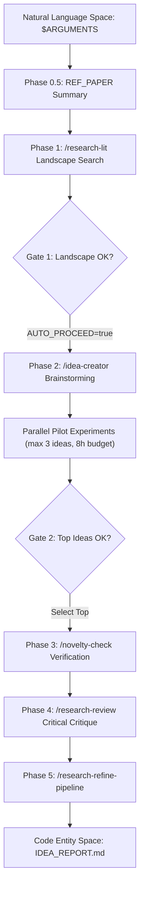
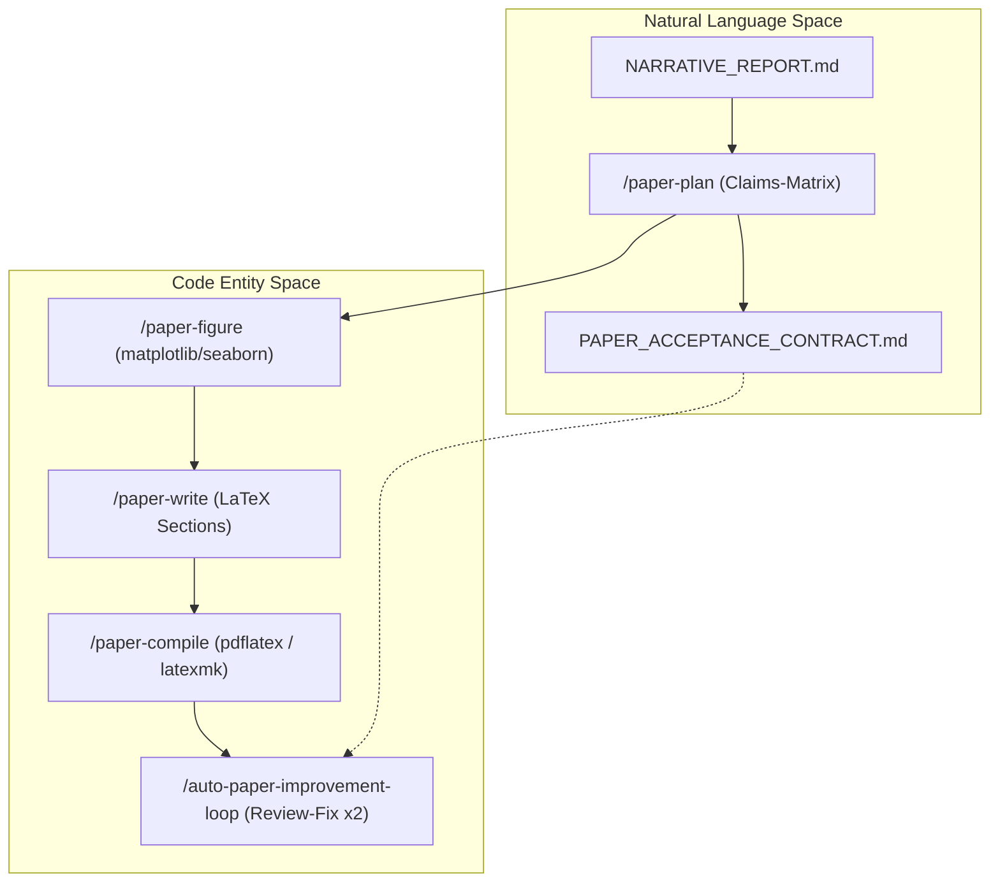

<!-- source: DeepWiki mcp.deepwiki.com · repo wanshuiyin/Auto-claude-code-research-in-sleep · page 4.5 Workflow Orchestration Skills · fetched 2026-10-26 -->

# Workflow Orchestration Skills

Relevant source files

The following files were used as context for generating this wiki page:

- [docs/CUSTOMIZATION.md](docs/CUSTOMIZATION.md)
- [docs/CUSTOMIZATION_CN.md](docs/CUSTOMIZATION_CN.md)
- [skills/experiment-bridge/SKILL.md](skills/experiment-bridge/SKILL.md)
- [skills/meta-optimize/SKILL.md](skills/meta-optimize/SKILL.md)
- [skills/research-pipeline/SKILL.md](skills/research-pipeline/SKILL.md)
- [skills/shared-references/review-scope-limits.md](skills/shared-references/review-scope-limits.md)
- [skills/skills-codex-claude-review/auto-paper-improvement-loop/SKILL.md](skills/skills-codex-claude-review/auto-paper-improvement-loop/SKILL.md)
- [skills/skills-codex-claude-review/paper-write/SKILL.md](skills/skills-codex-claude-review/paper-write/SKILL.md)
- [skills/skills-codex-claude-review/research-review/SKILL.md](skills/skills-codex-claude-review/research-review/SKILL.md)
- [skills/skills-codex-gemini-review/auto-paper-improvement-loop/SKILL.md](skills/skills-codex-gemini-review/auto-paper-improvement-loop/SKILL.md)
- [skills/skills-codex-gemini-review/auto-review-loop/SKILL.md](skills/skills-codex-gemini-review/auto-review-loop/SKILL.md)
- [skills/skills-codex-gemini-review/paper-write/SKILL.md](skills/skills-codex-gemini-review/paper-write/SKILL.md)
- [skills/skills-codex-gemini-review/paper-writing/SKILL.md](skills/skills-codex-gemini-review/paper-writing/SKILL.md)
- [skills/skills-codex-gemini-review/research-review/SKILL.md](skills/skills-codex-gemini-review/research-review/SKILL.md)
- [skills/skills-codex/auto-paper-improvement-loop/SKILL.md](skills/skills-codex/auto-paper-improvement-loop/SKILL.md)
- [skills/skills-codex/auto-review-loop/SKILL.md](skills/skills-codex/auto-review-loop/SKILL.md)
- [skills/skills-codex/experiment-bridge/SKILL.md](skills/skills-codex/experiment-bridge/SKILL.md)
- [skills/skills-codex/meta-optimize/SKILL.md](skills/skills-codex/meta-optimize/SKILL.md)
- [skills/skills-codex/paper-write/SKILL.md](skills/skills-codex/paper-write/SKILL.md)
- [skills/skills-codex/paper-writing/SKILL.md](skills/skills-codex/paper-writing/SKILL.md)
- [skills/skills-codex/research-pipeline/SKILL.md](skills/skills-codex/research-pipeline/SKILL.md)
- [skills/skills-codex/research-review/SKILL.md](skills/skills-codex/research-review/SKILL.md)
- [skills/skills-codex/shared-references/review-scope-limits.md](skills/skills-codex/shared-references/review-scope-limits.md)
- [tests/test_auto_proceed_contract.py](tests/test_auto_proceed_contract.py)

This page details the workflow orchestration skills in ARIS (Auto-claude-code-research-in-sleep). Orchestrator skills compose atomic skills into multi-phase pipelines, handling end-to-end research lifecycles, cross-model state persistence, verification gates, and human-in-the-loop checkpoints.

Sources: [skills/research-pipeline/SKILL.md:1-46](), [AGENT_GUIDE.md:80-90]()

---

## Orchestrators Overview & State Management

ARIS orchestrators manage complex dependencies by sequencing atomic skills, maintaining run state across context compactions, and enforcing cross-model verification contracts. 

| Orchestrator | Workflow Category | Primary Sub-Skills / Components | State Artifacts / Persistence |
|--------------|-------------------|----------------------------------|-------------------------------|
| `/idea-discovery` | Workflow 1 | `/research-lit`, `/idea-creator`, `/novelty-check`, `/research-review` | `IDEA_REPORT.md`, `IDEA_CANDIDATES.md` |
| `/experiment-bridge` | Workflow 1.5 | `/run-experiment`, `/monitor-experiment`, code review | `refine-logs/EXPERIMENT_PLAN.md`, `research_contract.md` |
| `/auto-review-loop` | Workflow 2 | Codex/Claude review agent, `/run-experiment` | `review-stage/REVIEW_STATE.json`, `ACQUITTAL_LOG.jsonl` |
| `/paper-writing` | Workflow 3 | `/paper-plan`, `/paper-figure`, `/paper-write`, `/paper-compile` | `paper/`, `PAPER_ACCEPTANCE_CONTRACT.md` |
| `/research-pipeline` | End-to-End | Chains W1 → W1.5 → W2 → W3 | `.aris/runs/<run_id>.json`, `iteration_log.py` |
| `/rebuttal` | Workflow 4 | `/experiment-bridge`, review agents, stress test | `REBUTTAL_DRAFT_rich.md`, `PASTE_READY.txt` |
| `/resubmit-pipeline` | Workflow 5 | `/citation-audit`, `/kill-argument`, edit-whitelist | `RESUBMIT_REPORT.json` |
| `/paper-talk` | Workflow 6 | `/paper-slides`, `/slides-polish`, Beamer/PPTX generator | `slides/`, `talk_export_report.json` |
| `/patent-pipeline` | Legal / IP | `/prior-art-search`, `/patent-novelty-check`, claims drafting | Patent specification corpus |

Sources: [skills/research-pipeline/SKILL.md:25-45](), [skills/experiment-bridge/SKILL.md:34-42](), [skills/skills-codex/auto-review-loop/SKILL.md:54-94]()

---

## Core Orchestrator Workflows

### `/idea-discovery` (Workflow 1)
The `/idea-discovery` orchestrator guides the transition from a broad research direction to validated, pilot-tested ideas through a multi-phase literature and brainstorming pipeline.

Title: "Idea Discovery Workflow Bridge from Natural Language to Code Artifacts"
Sources: [skills/research-pipeline/SKILL.md:73-80](), [docs/SKILLS_CATALOG.md:21-25]()

### `/experiment-bridge` (Workflow 1.5)
Bridging Workflow 1 and Workflow 2, `/experiment-bridge` ingests experiment roadmaps (`EXPERIMENT_PLAN.md`) and translates them into deployable code, executing pre-deployment code reviews and managing execution milestones [skills/experiment-bridge/SKILL.md:12-22]().

- **Research-Contract Fallback**: If `idea-stage/docs/research_contract.md` is missing, the bridge instantiates it from `templates/RESEARCH_CONTRACT_TEMPLATE.md` to ensure downstream skills like `/result-to-claim` and `/ablation-planner` have a valid claims baseline [skills/experiment-bridge/SKILL.md:75-80]().
- **Code Review Phase**: When `CODE_REVIEW = true`, code is passed to an advanced reviewer model (e.g., `gpt-6-astra` at `xhigh` reasoning effort) to catch logic bugs, dataset splits, metric errors, and ground-truth validation bugs before committing GPU hours [skills/experiment-bridge/SKILL.md:112-143]().

Sources: [skills/experiment-bridge/SKILL.md:12-147](), [skills/experiment-bridge/SKILL.md:75-80]()

### `/auto-review-loop` (Workflow 2)
An autonomous multi-round loop that repeatedly evaluates research artifacts through a secondary reviewer agent, implements fixes, and re-reviews until achieving the positive threshold (`score >= 6/10 AND verdict ∈ {"ready", "almost"}`) or reaching `MAX_ROUNDS = 4` [skills/skills-codex/auto-review-loop/SKILL.md:13-24]().

- **State Persistence**: Persists state to `review-stage/REVIEW_STATE.json` after every round to survive context window compactions [skills/skills-codex/auto-review-loop/SKILL.md:54-73]().
- **Append-Only Acquittal Receipt**: Appends successful positive verifications to `review-stage/ACQUITTAL_LOG.jsonl` with binding `run_id` and trace linkages [skills/skills-codex/auto-review-loop/SKILL.md:77-94]().

Sources: [skills/skills-codex/auto-review-loop/SKILL.md:13-94]()

### `/paper-writing` (Workflow 3)
Chains `/paper-plan`, `/paper-figure`, `/paper-write`, `/paper-compile`, and `/auto-paper-improvement-loop` to generate submission-ready LaTeX code and compiled PDF documents [skills/skills-codex/paper-writing/SKILL.md:15-26]().

Title: "Paper Writing Pipeline Bridge from Narrative to Compiled PDF"
Sources: [skills/skills-codex/paper-writing/SKILL.md:15-140](), [skills/skills-codex-claude-review/auto-paper-improvement-loop/SKILL.md:15-30]()

---

## Specialized Orchestrators

### `/rebuttal` (Workflow 4)
Manages the post-submission rebuttal process, atomizing reviews into issue boards, executing stress-tests via reviewer agents, and exporting venue-compliant responses (`PASTE_READY.txt`) under strict character and structural constraints [AGENT_GUIDE.md:86]().

### `/resubmit-pipeline` (Workflow 5)
Handles text-only porting of a polished paper to a new venue under strict isolation rules. It utilizes `/citation-audit` in `--soft-only` mode and enforces an `edit-whitelist` to freeze bibliographies and structural math environments while allowing microedits [skills/skills-codex-claude-review/auto-paper-improvement-loop/SKILL.md:36-70]().

### `/paper-talk` (Workflow 6)
Orchestrates end-to-end conference talk generation, including slide outlines, Beamer and PPTX compilation, visual polish via `/slides-polish`, and speaker note generation [AGENT_GUIDE.md:88]().

### `/patent-pipeline`
Orchestrates intellectual property workflows, connecting discovery insights to prior art searches (`/prior-art-search`), novelty validation, and multi-jurisdiction claims drafting (CN/US/EP) [docs/SKILLS_CATALOG.md:39]().

Sources: [AGENT_GUIDE.md:86-88](), [skills/skills-codex-claude-review/auto-paper-improvement-loop/SKILL.md:36-70](), [docs/SKILLS_CATALOG.md:39]()

---

## Full End-to-End Orchestration: `/research-pipeline`

The `/research-pipeline` skill chains the entire ARIS ecosystem into a unified lifecycle: `/idea-discovery` → `/experiment-bridge` → `/auto-review-loop` → `/paper-writing` [skills/research-pipeline/SKILL.md:58-64]().

- **Resumable Execution**: Records per-stage state under `.aris/runs/<run_id>.json` via `run_state.py`, allowing failed or interrupted runs to resume without restarting completed phases [skills/research-pipeline/SKILL.md:29-32, 90-94]().
- **External Cadence & Watchdog**: Integrates with `watchdog.py` and `iteration_log.py` to detect stalled phases and trigger structural pivots when no finding progress occurs across iterations [skills/research-pipeline/SKILL.md:10-28]().

Sources: [skills/research-pipeline/SKILL.md:10-45](), [skills/research-pipeline/SKILL.md:73-94]()

---

