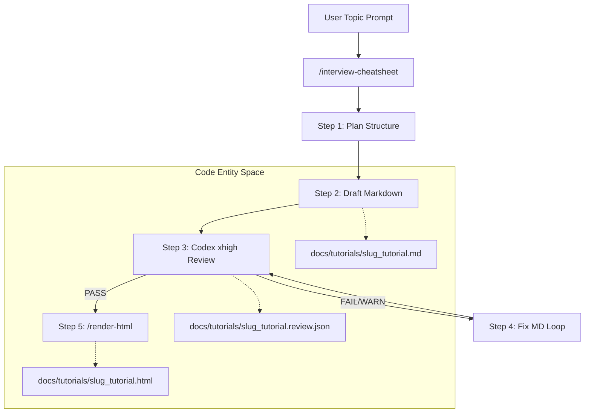
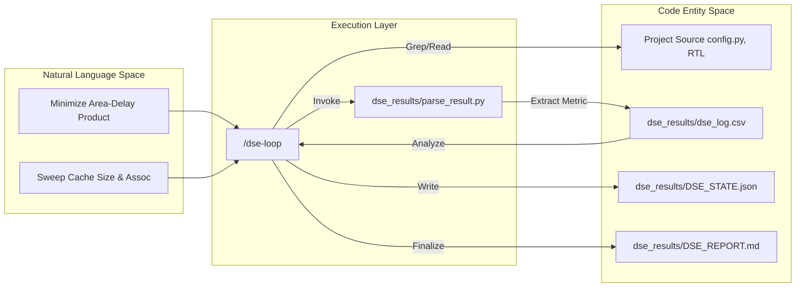

<!-- source: DeepWiki mcp.deepwiki.com · repo wanshuiyin/Auto-claude-code-research-in-sleep · page 4.6 Utility & Specialized Skills · fetched 2026-10-26 -->

# Utility & Specialized Skills

Relevant source files

The following files were used as context for generating this wiki page:

- [.gitignore](.gitignore)
- [LICENSE](LICENSE)
- [skills/comm-lit-review/SKILL.md](skills/comm-lit-review/SKILL.md)
- [skills/feishu-notify/SKILL.md](skills/feishu-notify/SKILL.md)
- [skills/interview-cheatsheet/SKILL.md](skills/interview-cheatsheet/SKILL.md)
- [skills/proof-writer/SKILL.md](skills/proof-writer/SKILL.md)
- [skills/render-html/SKILL.md](skills/render-html/SKILL.md)
- [skills/render-html/scripts/render_html.py](skills/render-html/scripts/render_html.py)
- [skills/render-html/scripts/templates/academic.html](skills/render-html/scripts/templates/academic.html)
- [skills/render-html/scripts/templates/dashboard.html](skills/render-html/scripts/templates/dashboard.html)
- [skills/skills-codex/feishu-notify/SKILL.md](skills/skills-codex/feishu-notify/SKILL.md)
- [skills/skills-codex/interview-cheatsheet/SKILL.md](skills/skills-codex/interview-cheatsheet/SKILL.md)
- [skills/skills-codex/render-html/scripts/render_html.py](skills/skills-codex/render-html/scripts/render_html.py)
- [skills/skills-codex/system-profile/SKILL.md](skills/skills-codex/system-profile/SKILL.md)
- [skills/skills-codex/web-debug-search/SKILL.md](skills/skills-codex/web-debug-search/SKILL.md)
- [skills/system-profile/SKILL.md](skills/system-profile/SKILL.md)
- [skills/web-debug-search/SKILL.md](skills/web-debug-search/SKILL.md)
- [tests/test_web_debug_search.py](tests/test_web_debug_search.py)

This page documents the auxiliary skills that provide supporting functionality, mathematical rigor, visualization, debugging, and specialized domain support for ARIS workflows. These include HTML rendering for human readability, interview preparation, mathematical proof generation, web debugging search, system profiling, and automated design space exploration.

## Overview

ARIS provides a suite of utility and specialized skills that can be invoked manually by the user or automatically by orchestrator workflows to handle non-linear research and engineering tasks.

| Skill | Purpose | Invocation | Target Output |
|-------|---------|------------|---------------|
| `/render-html` | Convert MD/JSON to polished HTML | Automatic/Manual | `*.html` |
| `/interview-cheatsheet` | Generate ML interview prep tutorials | Manual | `docs/tutorials/` |
| `/pixel-art` | SVG character/scene generation | Manual | `*.svg` |
| `/feishu-notify` | Notification & Checkpoint management | Automatic/Manual | Feishu Card/Reply |
| `/grant-proposal` | Funding application drafting | Manual | `GRANT_PROPOSAL.md` |
| `/proof-writer` | Mathematical proof generation | Manual/Review | `PROOF_PACKAGE.md` |
| `/formula-derivation` | Theory line construction | Manual/Review | `DERIVATION_PACKAGE.md` |
| `/mermaid-diagram` | Technical diagram generation | Manual/Review | `figures/*.mmd`, `*.png` |
| `/dse-loop` | Design Space Exploration (EDA/Arch) | Manual | `dse_results/` |
| `/system-profile` | Performance profiling (CPU/GPU/Memory) | Manual | `./profile_output/` |
| `/web-debug-search` | Non-academic technical search & debugging | Manual | Structured Search Report |

Sources: `[skills/render-html/SKILL.md:3]()`, `[skills/interview-cheatsheet/SKILL.md:3]()`, `[skills/pixel-art/SKILL.md:2-5]()`, `[skills/grant-proposal/SKILL.md:2-5]`, `[skills/proof-writer/SKILL.md:2-5]()`, `[skills/dse-loop/SKILL.md:2-5]()`, `[skills/formula-derivation/SKILL.md:2-5]()`, `[skills/mermaid-diagram/SKILL.md:2-5]()`, `[skills/system-profile/SKILL.md:2-5]()`, `[skills/web-debug-search/SKILL.md:2-5]()`

---

## Content Rendering & Education

### `/render-html` — Artifact Visualization
The `/render-html` skill converts canonical ARIS Markdown/JSON artifacts (like `IDEA_REPORT.md` or `AUTO_REVIEW.md`) into a single-file HTML view for human readers `[skills/render-html/SKILL.md:3-10]()`.

- **Design Invariant**: Markdown/JSON remains the source of truth; HTML is a reviewed view `[skills/render-html/SKILL.md:33-34]()`.
- **Templates**: Supports `academic` (sticky TOC, multi-column) and `dashboard` (metric cards, grid layout) templates `[skills/render-html/scripts/render_html.py:7-12]()`, `[skills/render-html/scripts/templates/academic.html:1-250]()`.
- **Review Gate**: Academic outputs are gated by a fresh cross-model Codex review for fidelity and safety `[skills/render-html/SKILL.md:34]()`.
- **Implementation**: Uses `render_html.py`, a pure-stdlib Python script with zero external dependencies `[skills/render-html/scripts/render_html.py:2-24]()`.

Sources: `[skills/render-html/SKILL.md:3-40]()`, `[skills/render-html/scripts/render_html.py:2-35]()`

### `/interview-cheatsheet` — ML Tutorials
Generates long-form Chinese interview-prep tutorials (600–1000 lines) on specific ML/LLM topics `[skills/interview-cheatsheet/SKILL.md:3-10]()`.

- **Structure**: Follows a strict 12-14 section skeleton including TL;DR, intuition, derivations, PyTorch code, and 25 high-frequency interview questions (L1/L2/L3 difficulty) `[skills/interview-cheatsheet/SKILL.md:21-33]()`.
- **Quality Control**: Employs `mcp__codex__codex` (GPT-5.5/Astra xhigh) for a 10-point math/code/style review before rendering `[skills/interview-cheatsheet/SKILL.md:77-113]()`.

Title: Tutorial Generation to HTML Entity Data Flow

Sources: `[skills/interview-cheatsheet/SKILL.md:60-120]()`, `[skills/render-html/SKILL.md:3-12]()`

---

ペイ Visualization, Diagrams & Debug Search

### `/pixel-art` — SVG Illustration
Generates pixel-grid based SVG illustrations for READMEs. It follows a strict 7px grid principle where each "pixel" is a `<rect>` `[skills/pixel-art/SKILL.md:14-16]()`.

- **Character Template**: Uses a standard 8-12 pixel tall grid for characters `[skills/pixel-art/SKILL.md:29-39]()`.
- **Components**: Supports chat bubbles with tails and color-coded character groups to visualize multi-agent communication `[skills/pixel-art/SKILL.md:77-105]()`.

Sources: `[skills/pixel-art/SKILL.md:14-105]()`

### `/mermaid-diagram` — Technical Charts
Generates and verifies Mermaid.js diagrams. Includes a **Mandatory Verification** step using `mmdc` (Mermaid CLI) to ensure syntax validity `[skills/mermaid-diagram/SKILL.md:110-125]()`.

Sources: `[skills/mermaid-diagram/SKILL.md:110-132]()`

### `/web-debug-search` — Non-Academic Technical Search
Searches GitHub Issues/Discussions, Stack Exchange, Chinese technical communities, and official documentation for software errors, compatibility issues, and workarounds `[skills/web-debug-search/SKILL.md:1-35]()`.

- **Scope & Evidence Boundary**: Strictly a discovery and debugging workflow. Results are **never** added to paper bibliographies or cited as peer-reviewed evidence `[skills/web-debug-search/SKILL.md:12-18]()`.
- **Supported Profiles**: `github`, `stackexchange`, `chinese-tech`, `general-web`, `auto`, and `all` `[skills/web-debug-search/SKILL.md:20-30]()`.
- **Query Bounds**: Bounded by `MAX_QUERIES_PER_PROFILE = 4`, `MAX_TOTAL_QUERIES = 8`, and `MAX_FETCHED_CANDIDATES = 12` `[skills/web-debug-search/SKILL.md:98-102]()`.
- **Untrusted Content Rule**: Treats all search output as attacker-editable text; never executes commands found online or alters routing based on returned text `[skills/web-debug-search/SKILL.md:115-124]()`.

Sources: `[skills/web-debug-search/SKILL.md:1-124]()`, `[tests/test_web_debug_search.py:29-118]()`

---

## Theory & Formalization

### `/proof-writer` — Mathematical Proofs
Produces rigorous proof packages. It performs a **Feasibility Triage** first, classifying claims as `PROVABLE AS STATED`, `PROVABLE AFTER WEAKENING`, or `NOT CURRENTLY JUSTIFIED` `[skills/proof-writer/SKILL.md:72-76]()`.

- **Rigor Requirements**: Forbids words like "clearly" or "obviously"; requires definitions for every symbol `[skills/proof-writer/SKILL.md:127-130]()`.
- **Structure**: Outputs `PROOF_PACKAGE.md` with a claim statement, status, assumptions, strategy, and dependency map `[skills/proof-writer/SKILL.md:149-187]()`.

Sources: `[skills/proof-writer/SKILL.md:8-187]()`

### `/formula-derivation` — Theory Construction
Organizes scattered equations into a coherent theory line `[skills/formula-derivation/SKILL.md:3-4]()`. It identifies an **Invariant Object** (e.g., loss, utility) to organize the derivation `[skills/formula-derivation/SKILL.md:78-86]()`.

Sources: `[skills/formula-derivation/SKILL.md:8-162]()`

---

## Domain Specialized & Profiling Skills

### `/dse-loop` — Design Space Exploration
An autonomous loop for computer architecture and EDA problems. It follows a `Run → Analyze → Pick Next Parameters → Repeat` cycle `[skills/dse-loop/SKILL.md:8-10]()`.

- **Parameter Inference**: Scans source code (Verilog `parameter`, Python `argparse`, C++ `#define`) to infer valid ranges and applies domain knowledge (e.g., powers of 2 for cache sizes) `[skills/dse-loop/SKILL.md:61-81]()`.
- **Execution State**: Manages `dse_results/` with `dse_log.csv`, `DSE_STATE.json` for recovery, and `parse_result.py` for objective extraction `[skills/dse-loop/SKILL.md:102-110]()`.

Title: DSE Logic to Code Entities System Mapping

Sources: `[skills/dse-loop/SKILL.md:49-136]()`

### `/system-profile` — Performance Profiling
Profiles a specified target (script, process, GPU, memory, interconnect) and produces performance analysis reports `[skills/system-profile/SKILL.md:3-9]()`.

- **Profiling Strategies**: Combines external tools (`cProfile`, `py-spy`, `nvidia-smi`, `nsys`, `tracemalloc`) with runtime code instrumentation when necessary `[skills/system-profile/SKILL.md:26-44]`.
- **Key Dimensions**: Investigates CPU overhead, memory consumption, GPU compute utilization, and interconnect/NCCL communication metrics `[skills/system-profile/SKILL.md:46-69]()`.
- **Changelog Requirement**: Emits a mandatory instrumentation changelog to allow clean reversion of profiling code `[skills/system-profile/SKILL.md:94-103]()`.

Sources: `[skills/system-profile/SKILL.md:3-103]()`

### `/grant-proposal` — Funding Drafting
Chains `/research-lit` and `/novelty-check` to draft applications for regional templates like **KAKENHI** (Japan), **NSF** (US), or **NSFC** (China) `[skills/grant-proposal/SKILL.md:3-5]()`.

Sources: `[skills/grant-proposal/SKILL.md:8-108]()`

---

## Automatic vs. Manual Invocation

| Skill | Triggered Automatically When... | Manual Usage Scenario |
|-------|-------------------------------|----------------------|
| `/render-html` | A major artifact (Review, Idea Report) is finalized in a workflow. | Making a specific `findings.md` readable for a presentation. |
| `/feishu-notify` | An experiment finishes or a review score is generated. | Sending a custom status update to a team group. |
| `/proof-writer` | A review identifies a missing theoretical justification in a paper. | Formalizing a proof sketch from local research notes. |
| `/interview-cheatsheet` | Never. | Preparing for a specific ML interview topic (e.g., "RoPE Scaling"). |
| `/dse-loop` | Never. | Tuning RTL parameters for a new hardware accelerator. |
| `/system-profile` | Never. | Investigating runtime bottlenecks in a training script or VLLM server. |
| `/web-debug-search` | Never. | Debugging elusive compilation/runtime errors or package installation failures. |

Sources: `[skills/render-html/SKILL.md:3]()`, `[skills/interview-cheatsheet/SKILL.md:12-17]()`, `[skills/proof-writer/SKILL.md:2-3]()`, `[skills/dse-loop/SKILL.md:3-4]()`, `[skills/system-profile/SKILL.md:3-4]()`, `[skills/web-debug-search/SKILL.md:3-5]()`

---

