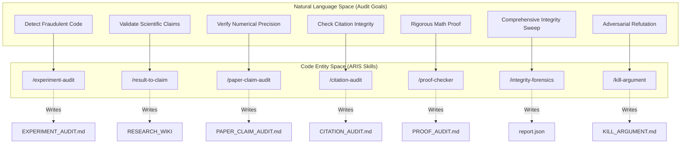
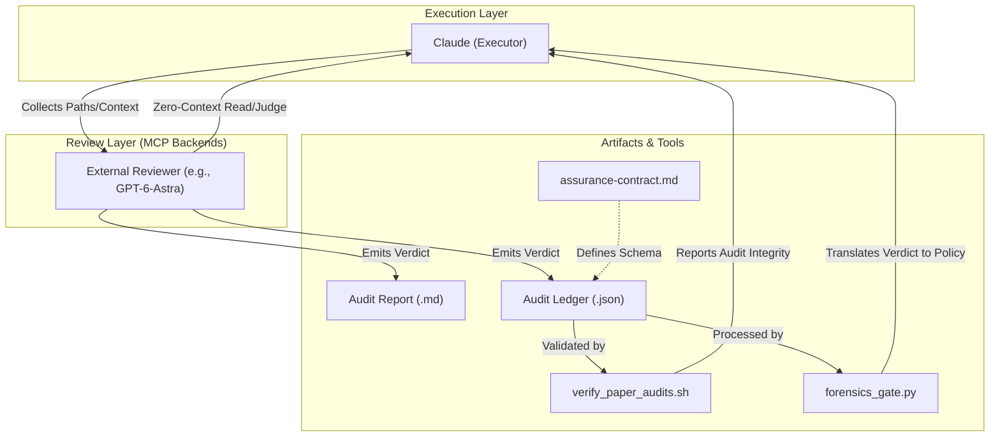

<!-- source: DeepWiki mcp.deepwiki.com · repo wanshuiyin/Auto-claude-code-research-in-sleep · page 4.8 Assurance & Audit Skills · fetched 2026-10-26 -->

# Assurance & Audit Skills

Relevant source files

The following files were used as context for generating this wiki page:

- [skills/ablation-planner/SKILL.md](skills/ablation-planner/SKILL.md)
- [skills/citation-audit/SKILL.md](skills/citation-audit/SKILL.md)
- [skills/experiment-audit/SKILL.md](skills/experiment-audit/SKILL.md)
- [skills/integrity-forensics/SKILL.md](skills/integrity-forensics/SKILL.md)
- [skills/kill-argument/SKILL.md](skills/kill-argument/SKILL.md)
- [skills/paper-claim-audit/SKILL.md](skills/paper-claim-audit/SKILL.md)
- [skills/proof-checker/SKILL.md](skills/proof-checker/SKILL.md)
- [skills/rebuttal/SKILL.md](skills/rebuttal/SKILL.md)
- [skills/research-review/SKILL.md](skills/research-review/SKILL.md)
- [skills/resubmit-pipeline/SKILL.md](skills/resubmit-pipeline/SKILL.md)
- [skills/result-to-claim/SKILL.md](skills/result-to-claim/SKILL.md)
- [skills/shared-references/assurance-contract.md](skills/shared-references/assurance-contract.md)
- [skills/shared-references/effort-contract.md](skills/shared-references/effort-contract.md)
- [skills/skills-codex/citation-audit/SKILL.md](skills/skills-codex/citation-audit/SKILL.md)
- [skills/skills-codex/experiment-audit/SKILL.md](skills/skills-codex/experiment-audit/SKILL.md)
- [skills/skills-codex/figure-spec/SKILL.md](skills/skills-codex/figure-spec/SKILL.md)
- [skills/skills-codex/integrity-forensics/SKILL.md](skills/skills-codex/integrity-forensics/SKILL.md)
- [skills/skills-codex/paper-claim-audit/SKILL.md](skills/skills-codex/paper-claim-audit/SKILL.md)
- [skills/skills-codex/proof-checker/SKILL.md](skills/skills-codex/proof-checker/SKILL.md)
- [skills/skills-codex/research-wiki/SKILL.md](skills/skills-codex/research-wiki/SKILL.md)
- [skills/skills-codex/resubmit-pipeline/SKILL.md](skills/skills-codex/resubmit-pipeline/SKILL.md)
- [skills/skills-codex/shared-references/acceptance-gate.md](skills/skills-codex/shared-references/acceptance-gate.md)
- [skills/skills-codex/shared-references/assurance-contract.md](skills/skills-codex/shared-references/assurance-contract.md)
- [skills/skills-codex/shared-references/effort-contract.md](skills/skills-codex/shared-references/effort-contract.md)
- [skills/skills-codex/shared-references/review-tracing.md](skills/skills-codex/shared-references/review-tracing.md)
- [tests/test_verify_paper_audits.py](tests/test_verify_paper_audits.py)
- [tools/forensics_gate.py](tools/forensics_gate.py)
- [tools/verify_paper_audits.sh](tools/verify_paper_audits.sh)

The ARIS (Auto-claude-code-research-in-sleep) system implements a multi-layer assurance chain designed to provide rigorous, bottom-up integrity verification for autonomous research. This chain transitions from raw execution code to high-level manuscript claims, ensuring that the autonomous agent remains grounded in evidence and free from "agentic fraud" failure modes.

## The Multi-Layer Assurance Chain

The assurance chain is structured to catch specific failure modes at each stage of the research lifecycle. It enforces the "Executor/Reviewer Separation Invariant," where the model performing the research (Executor) is never the final judge of its own integrity (Reviewer).

| Layer | Skill | Purpose | Primary Failure Mode Caught |
| :--- | :--- | :--- | :--- |
| **1. Code** | `/experiment-audit` | Agentic fraud detection in scripts | Fake ground truth, score normalization fraud |
| **2. Science** | `/result-to-claim` | Claim-evidence validation | Overclaiming from weak or partial results |
| **3. Numbers** | `/paper-claim-audit` | Zero-context numerical verification | Cherry-picking, rounding errors, config mismatch |
| **4. Bib** | `/citation-audit` | Reference existence and context | Hallucinated citations, wrong-context support |
| **5. Logic** | `/proof-checker` | Mathematical proof verification | Logical gaps, illegal interchanges, hidden assumptions |
| **6. Integrity Forensics** | `/integrity-forensics` | Comprehensive integrity sweep | Numeric inconsistencies, logical flaws, data manipulation |
| **7. Kill Argument** | `/kill-argument` | Adversarial refutation | Unsound arguments, hidden assumptions, logical fallacies |

Sources: [skills/experiment-audit/SKILL.md:14-20](), [skills/citation-audit/SKILL.md:10-16](), [skills/paper-claim-audit/SKILL.md:22-29](), [skills/integrity-forensics/SKILL.md:12-19](), [skills/kill-argument/SKILL.md:10-16]()

### Logic Space to Code Entity Space Mapping

The following diagram maps the conceptual audit requirements to the specific code entities and skills that implement them.

**Audit Workflow Mapping**

Sources: [skills/experiment-audit/SKILL.md:2-5](), [skills/result-to-claim/SKILL.md:2-5](), [skills/paper-claim-audit/SKILL.md:2-5](), [skills/citation-audit/SKILL.md:2-5](), [skills/proof-checker/SKILL.md:2-5](), [skills/integrity-forensics/SKILL.md:2-5](), [skills/kill-argument/SKILL.md:2-5]()

---

## 1. Experiment Audit (`/experiment-audit`)

This skill targets "agentic fraud"—failure modes where an optimizing agent produces fraudulent results without intentional deception. It utilizes an external reviewer backend (default `codex` with `ultra` reasoning effort) to inspect evaluation scripts.

### Key Failure Modes Inspected
*   **Fake Ground Truth:** Synthetic references generated from the model's own outputs. [skills/experiment-audit/SKILL.md:120-127]()
*   **Score Normalization Fraud:** Dividing metrics by the model's own maximum statistics. [skills/experiment-audit/SKILL.md:129-134]()
*   **Phantom Results:** Numbers claimed from nonexistent files or uncalled functions. [skills/experiment-audit/SKILL.md:136-140]()

### Data Flow
1.  **Executor (Claude):** Scans the project directory for evaluation scripts (`*eval*.py`, `*metric*.py`), result files (`.json`, `.csv`), ground truth paths, experiment trackers, paper claims, and config files. It collects paths without interpreting content. [skills/experiment-audit/SKILL.md:67-74](), [skills/experiment-audit/SKILL.md:81-82]()
2.  **Reviewer (e.g., `gpt-6-astra` via Codex MCP):** Receives file paths and an audit checklist. It reads the code and judges integrity directly. [skills/experiment-audit/SKILL.md:86-117]()
3.  **Output:** Generates `EXPERIMENT_AUDIT.md` with an overall verdict and detailed findings for each check. [skills/experiment-audit/SKILL.md:136-173]()

Sources: [skills/experiment-audit/SKILL.md:9-32](), [skills/experiment-audit/SKILL.md:136-173]()

---

## 2. Result-to-Claim Gate (`/result-to-claim`)

This gate decides what experimental numbers *mean* before they are committed to a paper or review response. It collects results from various sources and uses a Codex judgment to determine if claims are supported.

### Workflow
1.  **Collect Results:** Gathers data from W&B, `EXPERIMENT_LOG.md`, log files, and `research_contract.md`. [skills/result-to-claim/SKILL.md:30-45]()
2.  **Deterministic Evidence Pre-check:** Before involving the LLM, `tools/evidence_check.py` mechanically verifies if cited numbers exist in source files to catch hallucinated evidence. [skills/result-to-claim/SKILL.md:48-108]()
3.  **Codex Judgment:** Sends collected results and pre-check findings to `mcp__codex__codex` (model `gpt-6-astra`, `ultra` reasoning effort) for objective evaluation. [skills/result-to-claim/SKILL.md:113-136]()

### Verdict Routing
The Codex judgment leads to an auto-routing decision:
*   **`claim_supported: yes`**: Claim supported; triggers next actions like ablation planning or paper writing. [skills/result-to-claim/SKILL.md:140-144]()
*   **`claim_supported: partial`**: Claim partially supported; suggests supplementary experiments. [skills/result-to-claim/SKILL.md:146-152]()
*   **`claim_supported: no`**: Claim not supported; triggers postmortem in `findings.md` and potential pivot. [skills/result-to-claim/SKILL.md:154-160]()

Sources: [skills/result-to-claim/SKILL.md:8-20](), [skills/result-to-claim/SKILL.md:81-89]()

---

## 3. Paper Claim Audit (`/paper-claim-audit`)

This skill implements **Zero-Context Verification** to ensure numerical claims in a paper truthfully and precisely reflect raw evidence. The auditor (e.g., `gpt-6-astra`) receives ONLY the LaTeX source and raw result files (`.json`, `.csv`, `.yaml`). It is explicitly denied access to `EXPERIMENT_LOG.md` or any executor-written summaries to prevent confirmation bias. [skills/paper-claim-audit/SKILL.md:30-45]()

### Verification Protocol
The auditor extracts every quantitative claim (numbers, percentages, comparisons) from the paper and traces them to the exact value in raw evidence files. It checks for specific failure modes like number inflation, best-seed cherry-picking, config mismatch, aggregation mismatch, delta errors, caption-table mismatch, and scope overclaims. [skills/paper-claim-audit/SKILL.md:101-149]()

### Output
The audit generates `PAPER_CLAIM_AUDIT.md` detailing each claim's status (e.g., `exact_match`, `rounding_ok`, `mismatch`) and an overall verdict (PASS/WARN/FAIL). [skills/paper-claim-audit/SKILL.md:150-161]()

Sources: [skills/paper-claim-audit/SKILL.md:8-20](), [skills/paper-claim-audit/SKILL.md:49-78]()

---

## 4. Citation Audit (`/citation-audit`)

Verifies every `\cite{...}` in a paper against three independent layers: **Existence**, **Metadata correctness**, and **Context appropriateness**. This skill is typically run before submission to ensure bibliography integrity. [skills/citation-audit/SKILL.md:8-16]()

### Workflow
1.  **Discover Files:** Locates `references.bib` and all `*.tex` files containing `\cite{...}` calls. [skills/citation-audit/SKILL.md:59-64]()
2.  **Extract Pairs:** Extracts `(cite-key, context)` pairs from the LaTeX files. [skills/citation-audit/SKILL.md:67-79]()
3.  **Send to Reviewer:** For each cited entry, a fresh cross-model reviewer (e.g., `gpt-6-astra` via Codex MCP) performs web searches (DBLP, arXiv) to verify existence, metadata, and context. [skills/citation-audit/SKILL.md:83-106]()

### Execution Modes
*   **Standard:** Can mutate the `.bib` file to fix metadata. [skills/citation-audit/SKILL.md:103-108]()
*   **Soft-Only (`--soft-only`):** Forbids `.bib` mutation; findings are translated into per-occurrence sentence-rewrite proposals against the citing `*.tex` files. This mode is used by `/resubmit-pipeline` Phase 1 to honor a "freeze the bib" constraint. [skills/citation-audit/SKILL.md:51-52]()

Sources: [skills/citation-audit/SKILL.md:27-38](), [skills/citation-audit/SKILL.md:75-110]()

---

## 5. Proof Checker (`/proof-checker`)

A rigorous mathematical proof verification and fixing workflow. It reads a LaTeX proof, identifies gaps via cross-model review, fixes each gap with full derivations, re-reviews, and generates an audit report.

### Issue Taxonomy
The skill uses an **Issue Taxonomy** of 20 categories across four groups:
*   **Group A: Logic & Proof Structure** (e.g., `UNJUSTIFIED_ASSERTION`, `LOGICAL_GAP`) [skills/proof-checker/SKILL.md:66-77]()
*   **Group B: Analysis & Measure Theory** (e.g., `ILLEGAL_INTERCHANGE`, `MISSING_DOMINATION`) [skills/proof-checker/SKILL.md:80-88]()
*   **Group C: Model & Parameter Tracking** (e.g., `MISSING_DERIVATION`, `DIMENSION_TRACKING`) [skills/proof-checker/SKILL.md:91-98]()
*   **Group D: Scope & Claims** (e.g., `SCOPE_OVERCLAIM`, `REFERENCE_MISMATCH`) [skills/proof-checker/SKILL.md:101-103]()

### Acceptance Gate
A proof only passes when ALL of the following hold:
1.  Zero open FATAL or CRITICAL issues.
2.  Every theorem/lemma has explicit hypotheses, justified interchanges, and every application discharges hypotheses in the ledger.
3.  All big-O/Θ/o statements have declared parameter dependence and uniformity scope.
4.  Counterexample pass executed on all key lemmas. [skills/proof-checker/SKILL.md:58-64]()

For details, see [Proof Orchestrator](#4.8.1).

Sources: [skills/proof-checker/SKILL.md:8-10](), [skills/proof-checker/SKILL.md:32-74]()

---

## 6. Integrity Forensics (`/integrity-forensics`)

This skill runs a comprehensive integrity forensics sweep against a paper using a SHA-pinned thin launcher for the Anti-Autoresearch tool. It converts the verdict into a typed policy gate (BLOCK/WARN/NO_NEW_BLOCKER) and an append-only obligations ledger.

### Core Principle
The skill acts as a "thin launcher" for an external tool, Anti-Autoresearch, ensuring its execution is pinned to a specific, validated commit. It delegates the actual forensic sweep unchanged and post-processes the verdict into ARIS's policy vocabulary. [skills/integrity-forensics/SKILL.md:12-19]()

### Workflow
1.  **Bootstrap Pin:** Clones and checks out the Anti-Autoresearch repository at a specific SHA-pin, validating it with the upstream eval gate. [skills/integrity-forensics/SKILL.md:48-86]()
2.  **Delegate Sweep:** Runs the upstream Anti-Autoresearch sweep on the target paper, ensuring no modifications to its execution or outputs. [skills/integrity-forensics/SKILL.md:90-111]()
3.  **Typed Gate + Obligations:** Resolves `tools/forensics_gate.py` to translate the upstream verdict (`report.json`) into ARIS policy states (BLOCK/WARN/NO_NEW_BLOCKER) and manages an append-only obligations ledger. [skills/integrity-forensics/SKILL.md:113-123]()

Sources: [skills/integrity-forensics/SKILL.md:2-5](), [skills/integrity-forensics/SKILL.md:26-47]()

---

## 7. Kill Argument (`/kill-argument`)

This skill is designed for adversarial refutation, specifically to identify and exploit weaknesses in an argument or claim. It is used to stress-test claims, especially during the `/resubmit-pipeline` to ensure robustness against reviewer critiques.

### Purpose
The `/kill-argument` skill aims to find the "kill argument" for a given claim or paper. This involves identifying logical fallacies, hidden assumptions, or counter-examples that could undermine the argument's validity. It is a critical step in hardening a paper against adversarial review.

### Integration
This skill is often invoked as part of the `/resubmit-pipeline` to rigorously test the paper's claims before a new submission. [skills/resubmit-pipeline/SKILL.md:10-16]()

Sources: [skills/kill-argument/SKILL.md:2-5](), [skills/resubmit-pipeline/SKILL.md:10-16]()

---

## Assurance Schema & Automation

### Assurance Contract Schema
The `shared-references/assurance-contract.md` defines a standardized schema for audit outputs, ensuring consistency across different audit skills. This contract specifies the structure for recording audit verdicts, findings, and provenance information.

### Verdict States
All audit skills converge on a standardized set of verdict states, which are crucial for automated decision-making and workflow routing:
*   **PASS**: Integrity verified; no issues.
*   **WARN**: Minor issues found (e.g., scope overclaim, rounding typos).
*   **FAIL**: Critical integrity violation (e.g., fake GT, number mismatch).
*   **BLOCKED**: Audit cannot proceed due to missing files or unresolved dependencies.
*   **ERROR**: Technical failure in the audit process.
*   **NOT_APPLICABLE**: No claims of this type found.
*   **REVIEW_UNAVAILABLE**: Semantic review could not be performed (e.g., in deterministic-only mode of `/integrity-forensics`).

Sources: [skills/shared-references/assurance-contract.md]()

### `verify_paper_audits.sh`
This utility script automates the validation of audit artifacts. It checks for the presence of `EXPERIMENT_AUDIT.md`, `PAPER_CLAIM_AUDIT.md`, and `CITATION_AUDIT.md`, ensuring the hashes in the JSON metadata match the current state of the files. This script is a deterministic gate that confirms the integrity of the audit process itself. [tools/verify_paper_audits.sh:1-10]()

**Assurance Data Flow**

Sources: [skills/experiment-audit/SKILL.md:22-26](), [skills/paper-claim-audit/SKILL.md:196-197](), [skills/citation-audit/SKILL.md:45](), [tools/verify_paper_audits.sh:1-10](), [skills/integrity-forensics/SKILL.md:113-123](), [tools/forensics_gate.py]()

---

## Proof Orchestrator

The `skills/proof-orchestrator/` directory contains the detailed implementation for orchestrating mathematical proof verification. This includes the `SKILL.md` for `/proof-checker`, which outlines the multi-round adversarial review process, the issue taxonomy, and the acceptance gates. It also references `deepseek-routing` for specialized mathematical reasoning, stress-tests, and the `audit-output-contract` for standardized reporting. The `NOTICE.md` file within this directory details licensing information. The proof orchestrator works in conjunction with `/proof-checker` for verification and `/proof-writer` for generating proofs.

For details, see [Proof Orchestrator](#4.8.1).

Sources: [skills/proof-checker/SKILL.md:1-103](), [skills/proof-orchestrator/SKILL.md](), [skills/proof-orchestrator/NOTICE.md]()

---

