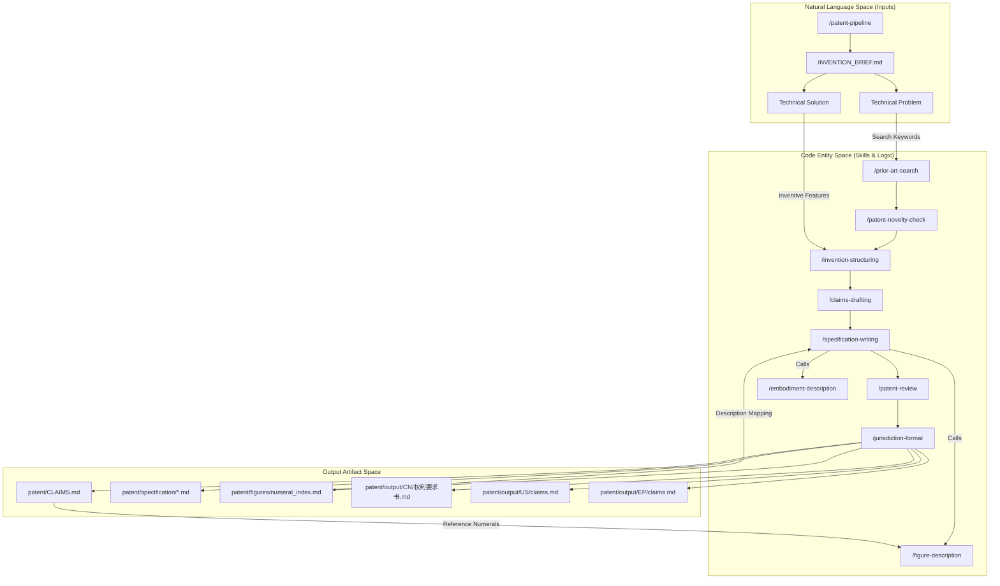
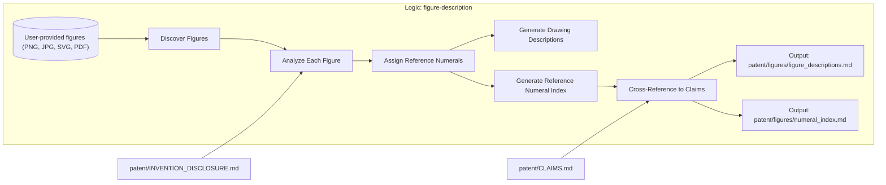

<!-- source: DeepWiki mcp.deepwiki.com · repo wanshuiyin/Auto-claude-code-research-in-sleep · page 4.9 Patent Pipeline Skills · fetched 2026-10-26 -->

# Patent Pipeline Skills

Relevant source files

The following files were used as context for generating this wiki page:

- [skills/embodiment-description/SKILL.md](skills/embodiment-description/SKILL.md)
- [skills/figure-description/SKILL.md](skills/figure-description/SKILL.md)
- [skills/jurisdiction-format/SKILL.md](skills/jurisdiction-format/SKILL.md)
- [skills/patent-novelty-check/SKILL.md](skills/patent-novelty-check/SKILL.md)
- [skills/patent-pipeline/SKILL.md](skills/patent-pipeline/SKILL.md)
- [skills/patent-review/SKILL.md](skills/patent-review/SKILL.md)
- [skills/skills-codex/claims-drafting/SKILL.md](skills/skills-codex/claims-drafting/SKILL.md)
- [skills/skills-codex/invention-structuring/SKILL.md](skills/skills-codex/invention-structuring/SKILL.md)
- [skills/skills-codex/patent-novelty-check/SKILL.md](skills/skills-codex/patent-novelty-check/SKILL.md)
- [skills/skills-codex/specification-writing/SKILL.md](skills/skills-codex/specification-writing/SKILL.md)

The Patent Pipeline is a specialized, parallel branch of the research workflow designed to transform research ideas and experimental results into formal patent applications. While the primary research pipeline targets academic publication, the patent pipeline focuses on legal protection, novelty verification against patent databases, and jurisdiction-specific document formatting for CNIPA (CN), USPTO (US), and EPO (EP).

## Overview and Orchestration

The patent pipeline is typically invoked after Workflow 1 (Idea Discovery) or as a standalone process when a technical invention is already defined. It is orchestrated by the `/patent-pipeline` skill, which chains together atomic skills for searching, drafting, and formatting. [skills/patent-pipeline/SKILL.md:10-21]()

### Core Workflow Phases

1.  **Invention Briefing**: Initial capture of the technical core using `INVENTION_BRIEF_TEMPLATE.md`.
2.  **Prior Art Search**: Deep search across Google Patents, Espacenet, and academic literature.
3.  **Novelty & Inventive Step Check**: Adversarial review of the invention against discovered prior art.
4.  **Drafting**: Parallel generation of Claims, Figure Descriptions, and the full Specification.
5.  **Jurisdiction Formatting**: Compiling the draft into filing-ready formats for specific patent offices.

### System Data Flow

The following diagram illustrates how the patent pipeline bridges the conceptual invention space into structured code and document entities.

**Patent Pipeline Entity Mapping**

Sources: [skills/patent-pipeline/SKILL.md:10-21](), [skills/jurisdiction-format/SKILL.md:21-27](), [skills/patent-pipeline/SKILL.md:130-136](), [skills/patent-pipeline/SKILL.md:142-148](), [skills/patent-pipeline/SKILL.md:154-160](), [skills/patent-pipeline/SKILL.md:166-172](), [skills/patent-pipeline/SKILL.md:178-184](), [skills/patent-pipeline/SKILL.md:190-196]()

---

## Prior Art Search (`/prior-art-search`)

This skill adapts the research literature search (`/research-lit`) for patent-specific requirements. It identifies potential blockers in both the patent landscape and academic publications. The output is `patent/PRIOR_ART_REPORT.md`. [skills/patent-pipeline/SKILL.md:130-136]()

### Key Implementation Details
- **Search Strategy**: Predicts relevant IPC (International Patent Classification) or CPC (Cooperative Patent Classification) codes (e.g., G06N for AI) to narrow results.
- **Database Integration**: Uses `WebSearch` and `WebFetch` to query Google Patents and Espacenet.
- **Analysis**: Assessments are categorized by "Overlap Risk" (HIGH/MEDIUM/LOW) based on whether the reference anticipates specific claim elements.

Sources: [skills/patent-pipeline/SKILL.md:130-136]()

---

## Patent Novelty Check (`/patent-novelty-check`)

This skill assesses the patentability of an invention against prior art, focusing on legal standards of novelty and non-obviousness. It differs from general research novelty checks by applying specific patent law criteria. [skills/patent-novelty-check/SKILL.md:10-12]()

### Workflow
1.  **Define Claim Elements**: Extracts key technical features from the invention description and drafts preliminary claims. [skills/patent-novelty-check/SKILL.md:31-37]()
2.  **Anticipation Analysis (Novelty)**: Tests each preliminary claim against individual prior art references from `patent/PRIOR_ART_REPORT.md` to determine if any single reference discloses all claim elements. [skills/patent-novelty-check/SKILL.md:39-55]()
3.  **Obviousness Analysis (Inventive Step)**: If novel, assesses if 2-3 references can be combined to render the claim obvious, considering the "motivation to combine" for a Person Having Ordinary Skill In The Art (POSITA). [skills/patent-novelty-check/SKILL.md:57-76]()
4.  **Cross-Model Examiner Verification**: Invokes `mcp__codex__codex` with `gpt-6-astra` and `xhigh` reasoning to simulate a patent examiner's review, providing feedback on anticipation, obviousness, and claim scope. [skills/patent-novelty-check/SKILL.md:78-99]()
5.  **Jurisdiction-Specific Assessment**: Provides a patentability assessment tailored to US (35 USC 102/103), CN (Article 22), and EP (Article 54/56) standards. [skills/patent-novelty-check/SKILL.md:101-115]()
6.  **Output**: Generates `patent/NOVELTY_ASSESSMENT.md` with a summary, analysis, examiner feedback, and recommended amendments. [skills/patent-novelty-check/SKILL.md:117-144]()

### Key Rules
- Patent novelty is absolute; any public disclosure before the priority date counts. [skills/patent-novelty-check/SKILL.md:147]()
- Obviousness requires both a combination of references and a motivation to combine them. [skills/patent-novelty-check/SKILL.md:149]()

Sources: [skills/patent-novelty-check/SKILL.md:1-153](), [skills/skills-codex/patent-novelty-check/SKILL.md:1-153]()

---

## Invention Structuring (`/invention-structuring`)

This skill formalizes a raw invention idea into a structured invention disclosure, which is crucial for subsequent drafting steps. [skills/skills-codex/invention-structuring/SKILL.md:10-11]()

### Workflow
1.  **Problem-Solution-Advantage Framework**: Structures the invention by defining the technical problem, the technical solution, and the advantages over prior art, drawing from `patent/NOVELTY_ASSESSMENT.md`. [skills/skills-codex/invention-structuring/SKILL.md:31-51]()
2.  **Invention Decomposition**: Breaks down the invention into Core Inventive Concept (for independent claims), Supporting Features (for dependent claims), and Optional Features (for embodiments). [skills/skills-codex/invention-structuring/SKILL.md:53-70]()
3.  **Claimable Subject Matter Identification**: Determines appropriate claim categories (method, system, product, computer-readable medium) based on the invention's nature. [skills/skills-codex/invention-structuring/SKILL.md:72-82]()
4.  **Drawing Plan**: Outlines necessary figures to support claims and specification, referencing user-provided figures or noting missing ones. [skills/skills-codex/invention-structuring/SKILL.md:84-93]()
5.  **Dependency Mapping**: Plans the claim hierarchy, showing how dependent claims narrow independent ones. [skills/skills-codex/invention-structuring/SKILL.md:95-109]()
6.  **Fresh-Agent Validation**: Uses a dedicated Codex reviewer agent (`gpt-6-astra` with `xhigh` reasoning) to validate the structuring choices, ensuring the core inventive concept is correctly identified and the claim plan is adequate. [skills/skills-codex/invention-structuring/SKILL.md:111-133]()
7.  **Output**: Writes `patent/INVENTION_DISCLOSURE.md` with the structured invention details. [skills/skills-codex/invention-structuring/SKILL.md:135-179]()

### Key Rules
- The Problem must stem from prior art deficiencies. [skills/skills-codex/invention-structuring/SKILL.md:182]()
- The Solution must describe the technical mechanism. [skills/skills-codex/invention-structuring/SKILL.md:183]()
- The core inventive concept must be the minimum set of features for patentability. [skills/skills-codex/invention-structuring/SKILL.md:184]()

Sources: [skills/skills-codex/invention-structuring/SKILL.md:1-188]()

---

## Claims Drafting (`/claims-drafting`)

This is a critical skill that defines the legal scope of protection for the invention. It drafts independent and dependent claims based on the structured invention disclosure and prior art analysis. [skills/skills-codex/claims-drafting/SKILL.md:10-12]()

### Workflow
1.  **Determine Claim Style and Patent Type**: Adapts drafting based on `PATENT_TYPE` (invention vs. utility model) and target jurisdiction (CN, US, EP). For utility models (CN only), only apparatus/device claims are allowed. [skills/skills-codex/claims-drafting/SKILL.md:39-57]()
2.  **Draft Independent Claims**: Formulates broad claims covering the core inventive concept, adhering to jurisdiction-specific formats (e.g., "其特征在于" for CN, "comprising" for US, "characterised in that" for EP). Emphasizes correct claim numbering and avoiding empirical content. [skills/skills-codex/claims-drafting/SKILL.md:59-100]()
3.  **Draft Dependent Claims**: Creates 5-10 dependent claims for each independent claim, narrowing the scope, covering preferred embodiments, and providing fallback positions. [skills/skills-codex/claims-drafting/SKILL.md:102-121]()
4.  **Claim-to-Specification Mapping**: Creates a preliminary mapping to ensure every claim element has support in the specification. [skills/skills-codex/claims-drafting/SKILL.md:123-131]()
5.  **Fresh-Agent Examiner Review**: Initiates an examiner review using a dedicated Codex reviewer agent (`gpt-6-astra` with `xhigh` reasoning) to assess claim quality and patentability against prior art. [skills/skills-codex/claims-drafting/SKILL.md:133-150]()

### Key Rules
- Claims define the legal scope; the specification supports them. [skills/skills-codex/claims-drafting/SKILL.md:11-12]()
- Claims must be numbered continuously. [skills/skills-codex/claims-drafting/SKILL.md:61-66]()
- No empirical content in claims; only structural features or method steps. [skills/skills-codex/claims-drafting/SKILL.md:68-72]()
- Independent claims should be the broadest defensible over prior art. [skills/skills-codex/claims-drafting/SKILL.md:99]()

Sources: [skills/skills-codex/claims-drafting/SKILL.md:1-239]()

---

## Specification Writing (`/specification-writing`)

This skill drafts the complete patent specification, which provides the detailed description necessary to support and enable the claims. It is adapted from `/paper-write` but with patent-specific requirements. [skills/skills-codex/specification-writing/SKILL.md:10-12]()

### Workflow
1.  **Initialize Specification Structure**: Creates a directory `patent/specification/` with standard section files (e.g., `title.md`, `background.md`, `detailed_description.md`). [skills/skills-codex/specification-writing/SKILL.md:37-49]()
2.  **Write Sections**: Populates each section based on `patent/CLAIMS.md`, `patent/INVENTION_DISCLOSURE.md`, and `patent/PRIOR_ART_REPORT.md`.
    -   **Title**: Concise, matches claim scope, no trademarks. [skills/skills-codex/specification-writing/SKILL.md:51-57]()
    -   **Technical Field**: Identifies the technical domain. [skills/skills-codex/specification-writing/SKILL.md:59-63]()
    -   **Background**: Describes prior art deficiencies, setting up the problem. [skills/skills-codex/specification-writing/SKILL.md:65-75]()
    -   **Summary**: Mirrors the Problem-Solution-Advantage framework from `INVENTION_DISCLOSURE.md`, providing support for all claim elements. Avoids formulas or numerical results. [skills/skills-codex/specification-writing/SKILL.md:77-98]()
    -   **Brief Description of Drawings**: Invokes `/figure-description` to generate descriptions for user-provided figures. [skills/skills-codex/specification-writing/SKILL.md:100-111]()
    -   **Detailed Description**: Invokes `/embodiment-description` to write detailed embodiments. [skills/skills-codex/specification-writing/SKILL.md:113-123]()
    -   **Abstract**: Summarizes the invention within jurisdiction-specific word limits. [skills/skills-codex/specification-writing/SKILL.md:125-140]()
3.  **Claim Support Verification**: Ensures every claim element is explicitly supported in the specification. [skills/skills-codex/specification-writing/SKILL.md:142-151]()
4.  **Fresh-Agent Review**: Calls a dedicated Codex reviewer agent (`gpt-6-astra` with `xhigh` reasoning) to check for written description support, enablement, consistency, and language quality. [skills/skills-codex/specification-writing/SKILL.md:153-173]()
5.  **Output**: All sections are written to `patent/specification/`, with a `SPECIFICATION_INDEX.md` summary. [skills/skills-codex/specification-writing/SKILL.md:175-180]()

Sources: [skills/skills-codex/specification-writing/SKILL.md:1-211]()

---

## Patent Review (`/patent-review`)

This skill provides an external patent examiner review of the drafted patent application, similar to an office action. It uses a cross-model approach to identify potential issues before filing. [skills/patent-review/SKILL.md:10-11]()

### Workflow
1.  **Gather Patent Context**: Compiles all claims, specification sections, prior art report, and invention disclosure for the reviewer. [skills/patent-review/SKILL.md:38-43]()
2.  **Round 1 — Full Examiner Review**: Sends the application to `REVIEWER_MODEL` (`gpt-6-astra` via `mcp__codex__codex` with `xhigh` reasoning) with a detailed prompt simulating an office action. The review covers claim clarity, written description, enablement, novelty, non-obviousness, claim scope, and specification quality. [skills/patent-review/SKILL.md:45-108]()
3.  **Implement Fixes (Round 1)**: Based on the examiner's feedback, the system categorizes issues (CRITICAL, MAJOR, MINOR) and suggests amendments to claims or specification. [skills/patent-review/SKILL.md:110-129]()
4.  **Round 2 — Follow-Up Review**: Uses `mcp__codex__codex-reply` with the original `threadId` to send the revised application back to the examiner for re-evaluation. [skills/patent-review/SKILL.md:131-155]()
5.  **Generate Improvement Report**: Writes `patent/PATENT_REVIEW.md` summarizing the office actions, issues found, fixes applied, and updated patentability scores. [skills/patent-review/SKILL.md:157-194]()

### Key Rules
- The reviewer persona is strictly a patent examiner. [skills/patent-review/SKILL.md:197]()
- `model_reasoning_effort: "xhigh"` is always used for deep analysis. [skills/patent-review/SKILL.md:198]()
- CRITICAL and MAJOR issues must be addressed before proceeding. [skills/patent-review/SKILL.md:199]()

Sources: [skills/patent-review/SKILL.md:1-203]()

---

## Jurisdiction Formatting (`/jurisdiction-format`)

This skill acts as the "compiler" for the patent pipeline, transforming raw markdown drafts into legal documents that adhere to the specific formatting rules of different patent offices. [skills/jurisdiction-format/SKILL.md:10-11]()

### Supported Jurisdictions

| Jurisdiction | Key Format Rule | Claim Style |
| :--- | :--- | :--- |
| **CN (CNIPA)** | Two-part form (两部式) | "其特征在于" (Characterized in that) [skills/jurisdiction-format/SKILL.md:50-53]() |
| **US (USPTO)** | Antecedent basis ("a" -> "the") | "comprising" (Open-ended) [skills/jurisdiction-format/SKILL.md:84-86]() |
| **EP (EPO)** | Rule 43(1) Two-part form | "characterised in that" [skills/jurisdiction-format/SKILL.md:118-120]() |

### Implementation Logic
- **CNIPA Requirements**: Combines specification sections in CNIPA order (发明名称, 技术领域, 背景技术, 发明内容, 附图说明, 具体实施方式) and formats claims with Chinese terminology. [skills/jurisdiction-format/SKILL.md:45-62]()
- **USPTO Requirements**: Combines sections in USPTO order and formats claims with US conventions. Generates a skeleton Application Data Sheet (ADS). [skills/jurisdiction-format/SKILL.md:80-112]()
- **EPO Requirements**: Combines sections in EPO Rule 42 order and formats claims in the mandatory two-part form. Requires a Reference Signs List. [skills/jurisdiction-format/SKILL.md:115-132]()
- **Document Generation**: Supports `markdown` for review and `docx` for filing (via `python-docx`). [skills/jurisdiction-format/SKILL.md:18-19](), [skills/jurisdiction-format/SKILL.md:70-76]()
- **Consistency Check**: Verifies that all claims are present, numbering is consistent, and reference numerals match across all generated formats. [skills/jurisdiction-format/SKILL.md:138-145]()
- **Output Summary**: Writes `patent/output/OUTPUT_SUMMARY.md` detailing the generated files for each jurisdiction. [skills/jurisdiction-format/SKILL.md:147-182]()

Sources: [skills/jurisdiction-format/SKILL.md:1-192]()

---

## Embodiment Description (`/embodiment-description`)

This skill writes the detailed description of embodiments, which is a crucial part of the patent specification. Embodiments explain how to make and use the invention, supporting the claims. [skills/embodiment-description/SKILL.md:10-12]()

### Workflow
1.  **Plan Embodiments**: Determines the number and type of embodiments needed, ensuring coverage for various claims and key variations. [skills/embodiment-description/SKILL.md:30-38]()
2.  **Write Each Embodiment**: Describes each embodiment in detail, including component-by-component or step-by-step descriptions for system/method claims. It integrates reference numerals and includes variations to support broader claim interpretation. [skills/embodiment-description/SKILL.md:40-67]()
3.  **Reference Numeral Integration**: Ensures consistent use of reference numerals, with first mentions in parentheses and subsequent uses without. [skills/embodiment-description/SKILL.md:69-81]()
4.  **Claim Support Verification**: Verifies that every claim element is supported by at least one embodiment. [skills/embodiment-description/SKILL.md:83-91]()
5.  **Software/Algorithm Embodiments**: For software inventions, includes pseudocode, algorithmic descriptions, and data structures. [skills/embodiment-description/SKILL.md:93-107]()
6.  **Output**: Embodiment sections are written to `patent/specification/detailed_description.md`. [skills/embodiment-description/SKILL.md:109-111]()

### Key Rules
- Embodiments must enable a POSITA to make and use the invention without undue experimentation. [skills/embodiment-description/SKILL.md:114]()
- **CRITICAL**: No experimental data, test results, accuracy percentages, or comparative performance data. Embodiments teach *how* to make and use, not *how well* it performs. [skills/embodiment-description/SKILL.md:120-126]()
- Do not copy experimental sections from papers; transform them into manufacturing/operation descriptions. [skills/embodiment-description/SKILL.md:127-128]()
- Reference numerals must be consistent with figures. [skills/embodiment-description/SKILL.md:129]()

Sources: [skills/embodiment-description/SKILL.md:1-129]()

---

## Figure Description and Numeral Indexing (`/figure-description`)

Unlike academic figure generation, patent figures require a strict reference numeral system where every component is assigned a unique ID. This skill processes user-provided technical diagrams and assigns these numerals. [skills/figure-description/SKILL.md:10-12]()

### Numeral Series Convention
The system follows a standard 100-series convention to prevent collisions between figures:
- **FIG. 1**: Numerals 100-199 [skills/figure-description/SKILL.md:48-54]().
- **FIG. 2**: Numerals 200-299 [skills/figure-description/SKILL.md:48-54]().
- **Consistency**: If a component (e.g., "Processor") appears in multiple figures, the same numeral is used across all figures. [skills/figure-description/SKILL.md:58-59]()

### Logic Flow for Numerals

Sources: [skills/figure-description/SKILL.md:1-138]()

---

## Template Workflow

The pipeline relies on `INVENTION_BRIEF_TEMPLATE.md` to bootstrap the process. This template ensures the executor has the necessary "Invention Disclosure" context before attempting to draft claims.

### Template Structure
1.  **Technical Field**: Identification of the specific domain.
2.  **Background**: Description of existing deficiencies.
3.  **Core Invention**: The specific "Delta" or technical improvement.
4.  **Embodiments**: Concrete examples of how the invention is implemented.

Sources: [skills/patent-pipeline/SKILL.md:102-127]()

---

