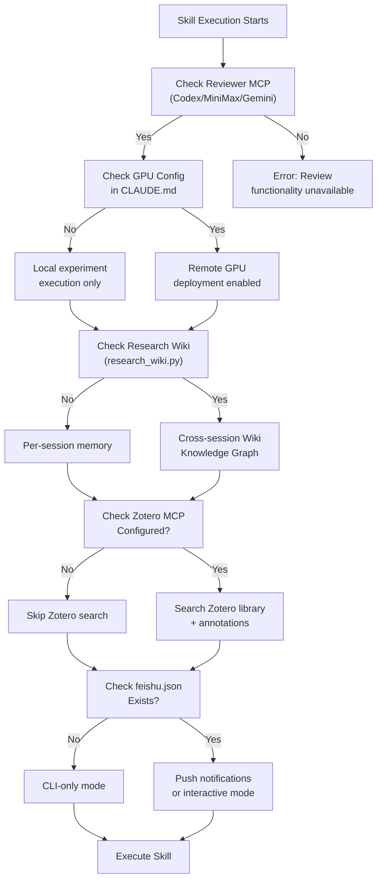
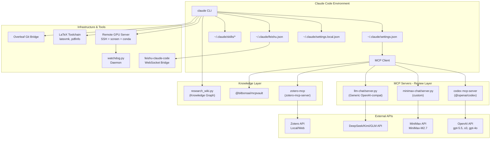
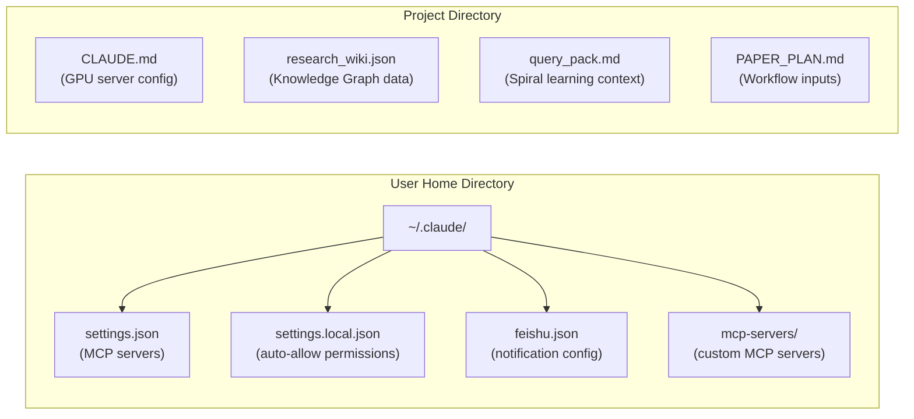
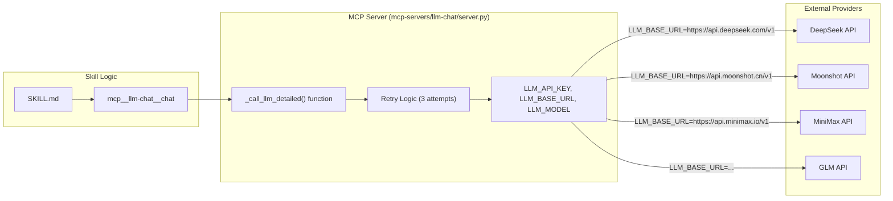
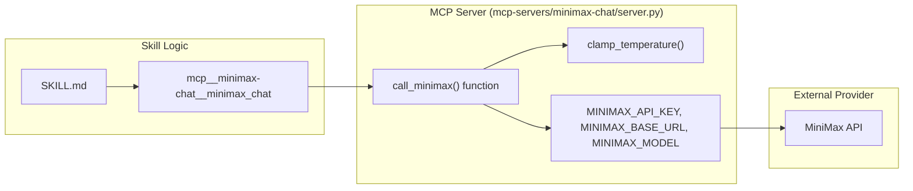
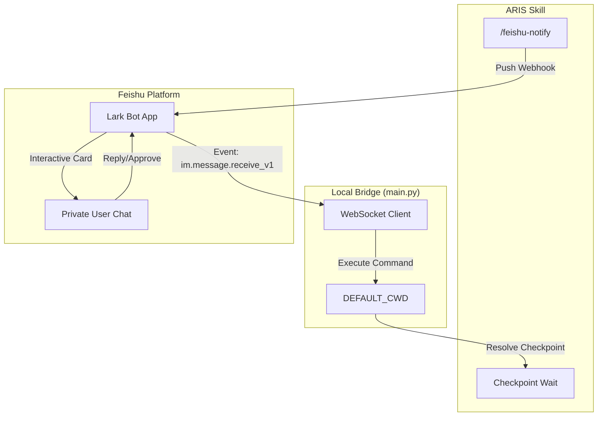

<!-- source: DeepWiki mcp.deepwiki.com · repo wanshuiyin/Auto-claude-code-research-in-sleep · page 5 External Integrations · fetched 2026-10-26 -->

# External Integrations

<details>
<summary>Relevant source files</summary>

The following files were used as context for generating this wiki page:

- [docs/ALI_CODING_PLAN_GUIDE.md](docs/ALI_CODING_PLAN_GUIDE.md)
- [docs/CURSOR_ADAPTATION.md](docs/CURSOR_ADAPTATION.md)
- [docs/MINIMAX_MCP_GUIDE.md](docs/MINIMAX_MCP_GUIDE.md)
- [docs/MODELSCOPE_GUIDE.md](docs/MODELSCOPE_GUIDE.md)
- [docs/integrations/FEISHU.md](docs/integrations/FEISHU.md)
- [docs/integrations/FEISHU_CN.md](docs/integrations/FEISHU_CN.md)
- [docs/integrations/OBSIDIAN.md](docs/integrations/OBSIDIAN.md)
- [docs/integrations/OBSIDIAN_CN.md](docs/integrations/OBSIDIAN_CN.md)
- [docs/integrations/VAST_GPU_GUIDE.md](docs/integrations/VAST_GPU_GUIDE.md)
- [docs/integrations/VAST_GPU_GUIDE_CN.md](docs/integrations/VAST_GPU_GUIDE_CN.md)
- [docs/integrations/ZOTERO.md](docs/integrations/ZOTERO.md)
- [docs/integrations/ZOTERO_CN.md](docs/integrations/ZOTERO_CN.md)
- [mcp-servers/llm-chat/requirements.txt](mcp-servers/llm-chat/requirements.txt)
- [mcp-servers/llm-chat/server.py](mcp-servers/llm-chat/server.py)
- [mcp-servers/minimax-chat/requirements.txt](mcp-servers/minimax-chat/requirements.txt)
- [mcp-servers/minimax-chat/server.py](mcp-servers/minimax-chat/server.py)

</details>


This page documents all external services, tools, and platforms that ARIS integrates with to provide its research automation capabilities. It covers the integration architecture, configuration management, and how each external system contributes to the core research workflows.

For detailed setup instructions for specific integrations, see the individual subsections ([Codex MCP (OpenAI Models)](#5.1) through [Overleaf Integration](#5.8)). For information about how skills compose and depend on these integrations, see [Skill Ecosystem](#2.2). For MCP-specific architecture details, see [MCP Server Architecture](#2.3).

---

## Integration Philosophy

ARIS follows a **progressive enhancement** approach to external integrations. The system is designed to function with minimal dependencies and gracefully degrade when optional integrations are unavailable.

### Required vs Optional Integrations

| Integration | Status | Required For | Graceful Degradation |
|------------|--------|--------------|---------------------|
| **Codex MCP** (OpenAI) | Required* | All review workflows (W1, W2, W3, W4) | N/A - critical path |
| **LaTeX Toolchain** | Required | Workflow 3 (paper writing) | W1, W1.5, and W2 function normally |
| **Alternative Backends** | Alternative | Replaces Codex MCP (MiniMax, Gemini, Claude) | Full feature parity with Codex |
| **GPU Infrastructure** | Optional | Experiment execution in W1.5, W2 | Experiments flagged for manual follow-up |
| **Zotero / Obsidian** | Optional | Enhanced literature search | Falls back to local PDFs + web search |
| **Feishu/Lark** | Optional | Mobile notifications & interactive control | Zero impact - pure CLI mode |
| **Overleaf** | Optional | Two-way paper synchronization | Local LaTeX file management only |

*\*Note: "Required" means at least one Reviewer Backend (Codex, MiniMax, Gemini, or Claude-as-Reviewer) must be configured to break the self-play loop.*

Sources: [README.md:13-28](), [README.md:377-398](), [README.md:460-542](), [skills/paper-write/SKILL.md:14-19]()

### Progressive Enhancement Pattern

The system detects integration availability at runtime and adapts behavior accordingly:

**Integration Discovery Logic**


Sources: [README.md:54-82](), [README.md:379-481](), [docs/integrations/FEISHU.md:12-20]()

---

## Integration Architecture Overview

**System-to-Code Mapping**


Sources: [README.md:377-542](), [README.md:782-870](), [docs/integrations/FEISHU.md:73-102](), [skills/paper-write/SKILL.md:73-74]()

---

## Configuration Management

### Configuration File Locations



Sources: [README.md:444-458](), [README.md:460-481](), [docs/integrations/FEISHU.md:35-44](), [skills/paper-write/SKILL.md:20-28]()

### Auto-Allow Permissions for Overnight Runs

To enable unattended execution, configure `~/.claude/settings.local.json`. This is critical for the `auto-review-loop` to proceed through multiple rounds without human intervention.

```json
{
  "permissions": {
    "allow": [
      "mcp__codex__codex",
      "mcp__codex__codex-reply",
      "mcp__llm-chat__chat",
      "Write",
      "Edit",
      "Skill(auto-review-loop)"
    ]
  }
}
```

Sources: [README.md:444-458](), [README_CN.md:360-374]()

---

## Integration Categories by Function

### Review & Critique Layer (Adversarial Review)

**Purpose:** External LLM access for adversarial review, avoiding self-play blind spots.

| Integration | Tools Provided | Skills Using It |
|------------|----------------|-----------------|
| **Codex MCP** | `mcp__codex__codex`<br/>`mcp__codex__codex-reply` | `/idea-creator`, `/research-review`, `/auto-review-loop`, `/novelty-check`, `/paper-write` |
| **MiniMax MCP** | `mcp__minimax-chat__minimax_chat` | Same as Codex (via backend swap) |
| **LLM Chat MCP** | `mcp__llm-chat__chat` | Generic OpenAI-compatible backend (DeepSeek, Kimi, GLM, etc.) |

For details, see [Codex MCP (OpenAI Models)](#5.1), [Alternative Reviewer Backends](#5.2), and [LLM API Mix & Match](#5.3).

Sources: [skills/paper-write/SKILL.md:14-14](), [skills/idea-discovery/SKILL.md:30-30](), [README.md:13-21]()

### Knowledge & Memory Layer

**Purpose:** Multi-source literature search and persistent cross-session knowledge storage.

| Integration | Tools Provided / Component | Skills Using It |
|------------|----------------|-----------------|
| **Research Wiki** | `research_wiki.py` CLI | `/research-lit`, `/idea-creator`, `/result-to-claim` |
| **Zotero MCP** | `search_items`, `get_annotations` | `/research-lit` |
| **Obsidian MCP** | `search_vault`, `search_tags` | `/research-lit` |

For details, see [Zotero Integration](#5.4), [Obsidian Integration](#5.5), and [Research Wiki Deep Dive](#8.8).

Sources: [docs/integrations/ZOTERO_CN.md:10-22](), [docs/integrations/OBSIDIAN.md:9-15](), [README_CN.md:90-91]()

### Execution & Compute Layer

**Purpose:** Deploy and monitor GPU experiments for auto-review loop.

| Component | Configuration Source | Skills Using It |
|-----------|---------------------|-----------------|
| **Remote GPU** | Project `CLAUDE.md` | `/run-experiment`, `/monitor-experiment` |
| **Vast.ai** | `gpu: vast` in `CLAUDE.md` | `/run-experiment`, `/vast-gpu` |
| **Watchdog** | `watchdog.py` on server | `/monitor-experiment` |

For details, see [GPU Infrastructure](#5.7).

Sources: [docs/integrations/VAST_GPU_GUIDE.md:44-53](), [README_CN.md:377-397]()

---

## Code-to-System Bridges

### LLM Chat (llm-chat)

The `llm-chat` server provides a unified interface for any OpenAI-compatible API, supporting 504 retry and fallback models. This server is implemented in `mcp-servers/llm-chat/server.py` and uses the `httpx` library for HTTP requests [mcp-servers/llm-chat/requirements.txt:1-1](). It can be configured via environment variables such as `LLM_API_KEY`, `LLM_BASE_URL`, and `LLM_MODEL` [mcp-servers/llm-chat/server.py:52-56]().

**Code-to-System Bridge: LLM Chat**


Sources: [mcp-servers/llm-chat/server.py:1-18](), [mcp-servers/llm-chat/server.py:52-59](), [mcp-servers/llm-chat/server.py:103-167](), [docs/MODELSCOPE_GUIDE.md:31-36](), [docs/ALI_CODING_PLAN_GUIDE.md:24-28]()

### MiniMax Chat (minimax-chat)

The `minimax-chat` server is a dedicated MCP server for the MiniMax Chat Completions API. It handles specific MiniMax API requirements, such as temperature clamping [mcp-servers/minimax-chat/server.py:53-71](). It is implemented in `mcp-servers/minimax-chat/server.py` and uses `httpx` [mcp-servers/minimax-chat/requirements.txt:1-1]().

**Code-to-System Bridge: MiniMax Chat**


Sources: [mcp-servers/minimax-chat/server.py:1-18](), [mcp-servers/minimax-chat/server.py:49-52](), [mcp-servers/minimax-chat/server.py:53-71](), [mcp-servers/minimax-chat/server.py:111-147]()

### Feishu Notification Bridge

The `feishu-claude-code` bridge enables bidirectional communication between Claude Code and the Feishu mobile app.

**Code-to-System Bridge: Feishu**


Sources: [docs/integrations/FEISHU.md:73-102](), [docs/integrations/FEISHU.md:148-163]()

---

## Integration Priority Matrix

| Priority | Integration | Checked By | Failure Mode | Impact |
|----------|-------------|------------|--------------|--------|
| **P0** | Reviewer MCP | All review skills | Hard fail | Workflow 1, 2, 3, 4 cannot proceed |
| **P0** | LaTeX toolchain | `/paper-compile` | Hard fail | Workflow 3 cannot proceed |
| **P1** | GPU (remote/vast) | `/run-experiment` | Soft fail → local GPU | Slower experiments or failure |
| **P1** | Research Wiki | `/research-lit` | Silent skip | Loss of cross-session learning |
| **P2** | Zotero/Obsidian | `/research-lit` | Silent skip | Reduced literature coverage |
| **P3** | Overleaf Sync | `/overleaf-sync` | Silent skip | Manual paper upload required |

Sources: [README.md:54-82](), [docs/integrations/VAST_GPU_GUIDE.md:88-91](), [skills/paper-write/SKILL.md:73-74]()

---

