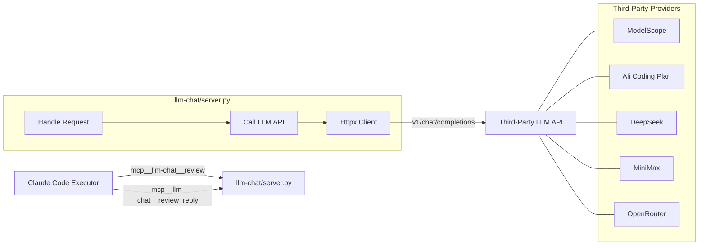

<!-- source: DeepWiki mcp.deepwiki.com · repo wanshuiyin/Auto-claude-code-research-in-sleep · page 5.1 Codex MCP (OpenAI Models) · fetched 2026-10-26 -->

# Codex MCP (OpenAI Models)

<details>
<summary>Relevant source files</summary>

The following files were used as context for generating this wiki page:

- [SETUP_GUIDE.md](SETUP_GUIDE.md)
- [SETUP_GUIDE_CN.md](SETUP_GUIDE_CN.md)
- [skills/auto-review-loop/SKILL.md](skills/auto-review-loop/SKILL.md)
- [skills/shared-references/integration-contract.md](skills/shared-references/integration-contract.md)
- [skills/shared-references/review-tracing.md](skills/shared-references/review-tracing.md)
- [skills/shared-references/reviewer-routing.md](skills/shared-references/reviewer-routing.md)
- [skills/skills-codex/shared-references/integration-contract.md](skills/skills-codex/shared-references/integration-contract.md)
- [skills/skills-codex/shared-references/reviewer-routing.md](skills/skills-codex/shared-references/reviewer-routing.md)
- [tests/test_copilot_install.py](tests/test_copilot_install.py)
- [tests/test_review_gate.py](tests/test_review_gate.py)
- [tests/test_skill_picker.py](tests/test_skill_picker.py)
- [tools/review_gate.py](tools/review_gate.py)
- [tools/save_trace.sh](tools/save_trace.sh)
- [tools/skill_picker.py](tools/skill_picker.py)

</details>


The Codex MCP (Model Context Protocol) server is ARIS's primary mechanism for cross-model collaboration. It enables Claude Code (executor) to request reviews and critiques from OpenAI models (GPT-5.5, o3, gpt-4o, gpt-6-astra) acting as external reviewers. This architecture avoids the "self-play" problem where a single model reviews its own work, leading to blind spots and local minima.

All review-dependent skills in ARIS (`/auto-review-loop`, `/research-review`, `/novelty-check`, `/idea-creator`, `/paper-plan`, `/paper-write`, `/auto-paper-improvement-loop`) require the Codex MCP server to be installed and configured.

Sources: [skills/auto-review-loop/SKILL.md:2-5]()

---

## Architecture Overview

The Codex MCP server acts as a bridge between Claude Code's internal tool system and OpenAI's API. While the native Codex MCP uses the OpenAI Responses API, ARIS also provides the `llm-chat` bridge for standard Chat Completions compatibility.

### Codex MCP Integration Flow
Title: "Codex MCP Integration Flow"
```mermaid
graph TB
    subgraph "Claude-Code-Process"
        [Executor]["Claude Code Executor<br/>(Claude 3.7 Sonnet)"]
        [MCPManager]["MCP Manager"]
        [Skills]["Skills Layer<br/>auto-review-loop<br/>research-review<br/>idea-creator"]
    end
    
    subgraph "Codex-MCP-Server"
        [CodexServer]["codex mcp-server<br/>(Node.js process)"]
        [ToolCodex]["Tool: mcp__codex__codex"]
        [ToolReply]["Tool: mcp__codex__codex-reply"]
    end
    
    subgraph "OpenAI-API"
        [Models]["gpt-6-astra<br/>gpt-5.6-sol<br/>gpt-5.5"]
    end
    
    [Skills] -->|"Read allowed-tools:<br/>mcp__codex__codex"| [Executor]
    [Executor] -->|"Tool invocation"| [MCPManager]
    [MCPManager] -->|"Spawn process<br/>JSON-RPC"| [CodexServer]
    [CodexServer] -->|"Expose tools"| [ToolCodex]
    [CodexServer] -->|"Expose tools"| [ToolReply]
    [ToolCodex] -->|"POST /v1/responses<br/>prompt + config"| [Models]
    [ToolReply] -->|"POST /v1/responses<br/>threadId + new prompt"| [Models]
    [Models] -->|"Structured response<br/>+ threadId"| [CodexServer]
    [CodexServer] -->|"JSON-RPC result"| [MCPManager]
    [MCPManager] -->|"Tool result"| [Executor]
```

**Key Components:**

| Component | Type | Purpose |
|-----------|------|---------|
| `codex mcp-server` | Node.js process | MCP server that translates Claude Code's tool calls into OpenAI API requests [SETUP_GUIDE.md:35-35]() |
| `mcp__codex__codex` | MCP tool | Sends a prompt to OpenAI, starts a new conversation thread [skills/auto-review-loop/SKILL.md:5-5]() |
| `mcp__codex__codex-reply` | MCP tool | Continues an existing conversation thread by `threadId` [skills/auto-review-loop/SKILL.md:5-5]() |
| `~/.claude/settings.json` | Config file | Defines how to launch the Codex MCP server [SETUP_GUIDE.md:30-31]() |
| `OPENAI_API_KEY` | Environment variable | API key for OpenAI (read from `~/.codex/config.toml` or env) [SETUP_GUIDE.md:28-29]() |

Sources: [skills/auto-review-loop/SKILL.md:5-5](), [SETUP_GUIDE.md:28-35](), [SETUP_GUIDE_CN.md:28-35]()

---

## Installation

### Step 1: Install Codex CLI

The Codex CLI provides the MCP server implementation:

```bash
npm install -g @openai/codex
```

This installs the `codex` command globally, which provides the `mcp-server` mode for Claude Code integration.
After installation, authenticate Codex (one-time, opens a browser to log in to ChatGPT) using `codex login`.

Sources: [SETUP_GUIDE.md:21-29](), [SETUP_GUIDE_CN.md:21-29]()

### Step 2: Configure OpenAI API Key

Codex reads your OpenAI API key from either `~/.codex/config.toml` or the `OPENAI_API_KEY` environment variable. For ARIS users using the `llm-chat` bridge for third-party providers (like ModelScope or MiniMax), the `LLM_API_KEY` is used instead.

Sources: [SETUP_GUIDE.md:28-29]()

### Step 3: Register Codex as MCP Server

Tell Claude Code to use Codex as an MCP server. This is typically done using the `claude mcp add` command:

```bash
claude mcp add codex -s user -- codex mcp-server
```
- `codex` (after `add`) is the registered name. ARIS skills hardcode this name, so **do not change it**.
- `-s user` applies globally to all projects.
- `codex mcp-server` is the built-in subcommand that starts the MCP server mode.

After registering or modifying any MCP server, you **must restart Claude Code** for the change to take effect, as MCP configurations are loaded at startup.

Sources: [SETUP_GUIDE.md:30-44](), [SETUP_GUIDE_CN.md:30-44]()

---

## The Two Tools: codex vs codex-reply

The Codex MCP server exposes two distinct tools to maintain stateful conversations with the reviewer model.

### Tool: mcp__codex__codex

**Purpose:** Start a new conversation thread with an OpenAI model.

**Usage Pattern:**
Used in iterative loops to initiate the first round of review. It is explicitly listed in `allowed-tools` for autonomous skills, for example, in `/auto-review-loop`.

Sources: [skills/auto-review-loop/SKILL.md:5-5]()

### Tool: mcp__codex__codex-reply

**Purpose:** Continue an existing conversation thread, preserving context.

**Usage Pattern:**
Used in iterative loops (Round 2+) to provide updates on fixed weaknesses or new experimental results without re-sending the entire initial context. The `threadId` from the initial `mcp__codex__codex` call is crucial for maintaining conversation memory.

Sources: [skills/auto-review-loop/SKILL.md:5-5](), [skills/auto-review-loop/SKILL.md:12-13]()

### Threading Model and State Persistence
Title: "Codex Threading and State Persistence"
```mermaid
graph TB
    subgraph "Execution-Layer-(Claude-Code)"
        [StartSkill]["Skill Start<br/>(e.g. /auto-review-loop)"]
        [CallCodex]["Tool: mcp__codex__codex"]
        [Process]["Implement Changes /<br/>Run Experiments"]
        [CallCodexReply]["Tool: mcp__codex__codex-reply"]
        [StateFile]["REVIEW_STATE.json"]
    end
    
    subgraph "OpenAI-Space-(Reviewer)"
        [ThreadContext]["Server-side Thread Context"]
        [GPTReview1]["GPT-6-Astra Round 1"]
        [GPTReview2]["GPT-6-Astra Round 2"]
    end
    
    [StartSkill] --> [CallCodex]
    [CallCodex] -->|"New Thread"| [GPTReview1]
    [GPTReview1] -->|"Return threadId"| [CallCodex]
    [CallCodex] -->|"Save threadId"| [StateFile]
    [CallCodex] --> [Process]
    [Process] --> [CallCodexReply]
    [CallCodexReply] -->|"Load threadId"| [StateFile]
    [CallCodexReply] -->|"Resume Thread"| [ThreadContext]
    [ThreadContext] --> [GPTReview2]
    [GPTReview2] --> [CallCodexReply]
```

Sources: [skills/auto-review-loop/SKILL.md:12-13]()

---

## Model Selection and Configuration

Skills specify which model to use via the `REVIEWER_MODEL` constant. The default model for the Codex backend is `gpt-6-astra`. ARIS implements a two-tier reasoning-effort policy for Codex MCP calls.

### Reasoning-Effort Policy
When Codex MCP is the active backend, `gpt-6-astra` is used with a two-tier reasoning-effort policy:

| Tier | `model_reasoning_effort` | Which calls |
|------|--------------------------|-------------|
| **Deep-audit** | `ultra` | `/proof-checker`, `/kill-argument` (attack / defense / adjudication threads), `/research-review`, `/experiment-audit`, `/paper-claim-audit`, `/result-to-claim`, `/meta-apply` |
| **Regular** | `xhigh` | Every other reviewer call, including all rounds of `/auto-review-loop` and other multi-round loops. Per-item fan-outs like `/citation-audit` also use `xhigh`. |

Sources: [skills/shared-references/reviewer-routing.md:30-37](), [skills/skills-codex/shared-references/reviewer-routing.md:7-12]()

### Capability Fallback
ARIS implements a capability fallback mechanism for Codex. If the requested model or effort is unavailable, it attempts to downgrade to a compatible configuration. This applies only to the first new Codex session of each tier in a run.

1.  **Effort Downgrade**: If `gpt-6-astra` + `ultra` fails due to unsupported effort (older `codex-cli`), it retries with `gpt-6-astra` + `xhigh`.
2.  **Model Downgrade**: If `gpt-6-astra` is unavailable, it retries with `gpt-5.6-sol` + `xhigh`, then `gpt-5.5` + `xhigh`.
3.  **No Downgrade**: ARIS **never** downgrades on timeout, rate-limit, authentication, transport, server, sandbox, context-length, malformed-request, or response-parse errors. Such errors result in `REVIEW_UNAVAILABLE` or `ERROR` to prevent double-billing.
4.  **Minimum Effort**: A verdict-bearing review is never run below `xhigh`.

Sources: [skills/shared-references/reviewer-routing.md:45-55](), [skills/skills-codex/shared-references/reviewer-routing.md:18-19]()

### Reviewer Independence
By default, when a Codex executor uses a Codex reviewer, the `review_independence` is `same-family`, and `acceptance_status` is `provisional`. For `cross-family` independence and `accepted` status, an overlay package like `skills-codex-claude-review` or `skills-codex-gemini-review` is required.

Sources: [skills/skills-codex/shared-references/reviewer-routing.md:21-31]()

### Codex Model Selection and Reasoning Effort
Title: "Codex Model and Effort Selection"
```mermaid
graph TD
    A[Skill Invocation<br/>(e.g., /auto-review-loop)] --> B{Is it a Deep-Audit Skill?}
    B -- Yes --> C[Requested: gpt-6-astra + ultra]
    B -- No --> D[Requested: gpt-6-astra + xhigh]

    C --> E{Attempt Call with Requested Config}
    D --> E

    E -- Success --> F[Review Performed: gpt-6-astra + ultra/xhigh]
    E -- "Failure: Effort Unsupported<br/>(e.g., old codex-cli)" --> G[Retry: gpt-6-astra + xhigh]
    E -- "Failure: Model Unavailable<br/>(e.g., account/plan)" --> H[Retry: gpt-5.6-sol + xhigh]
    H --> I[Retry: gpt-5.5 + xhigh]

    G -- Success --> F
    H -- Success --> F
    I -- Success --> F

    E -- "Failure: Timeout, Rate-Limit, Auth, etc." --> J[Emit: REVIEW_UNAVAILABLE / ERROR]
    G -- "Failure: Timeout, Rate-Limit, Auth, etc." --> J
    H -- "Failure: Timeout, Rate-Limit, Auth, etc." --> J
    I -- "Failure: Timeout, Rate-Limit, Auth, etc." --> J

    F --> K[Trace Recorded<br/>(save_trace.sh)]
    J --> K
```

Sources: [skills/shared-references/reviewer-routing.md:30-55](), [skills/skills-codex/shared-references/reviewer-routing.md:7-19](), [tools/save_trace.sh:60-70]()

---

## The llm-chat Bridge (Standard Chat Completions)

Because many third-party providers (ModelScope, Ali Coding Plan, MiniMax) do not support the OpenAI-proprietary Responses API used by the native Codex MCP, ARIS includes the `llm-chat` MCP server. This server acts as an opt-in transport fallback when the Codex reviewer cannot be started safely.

### llm-chat Implementation
Title: "llm-chat Bridge Architecture"


**Key Features:**
- **Standard API**: Uses `/v1/chat/completions` instead of `/v1/responses`.
- **Opt-in Fallback**: Enabled by setting `LLM_REVIEW_FALLBACK_ENABLED=true` in the `llm-chat` server configuration.
- **Safe Switch Boundary**: The fallback is pre-dispatch-only. It runs only if the Codex path is known not to have produced a review (e.g., MCP tool absent, process cannot spawn, error explicitly proves request rejected before model execution). It **must not** run if a dispatched Codex call timed out, disconnected, or returned an ambiguous error, to avoid double-running and conflicting verdicts.
- **Multi-Provider**: Configurable via `LLM_BASE_URL` for any OpenAI-compatible endpoint.

Sources: [skills/shared-references/reviewer-routing.md:58-89]()

---

## Troubleshooting

### API Key Issues
If the MCP server launches but calls fail, ensure the key is correctly set in `~/.codex/config.toml` or the `OPENAI_API_KEY` environment variable. For `llm-chat`, check `LLM_API_KEY`.

Sources: [SETUP_GUIDE.md:28-29]()

### Missing Tools
If `mcp__codex__codex` is not available in Claude Code, verify the server registration using `claude mcp list | grep codex`. If it's not listed or shows as disconnected, restart Claude Code.

Sources: [SETUP_GUIDE.md:38-44]()

### Permission Prompts
To avoid interactive permission prompts during overnight runs, tools should be added to the `allow` list in `~/.claude/settings.json` (or `settings.local.json`).

Sources: [SETUP_GUIDE.md:102-103]()

---

