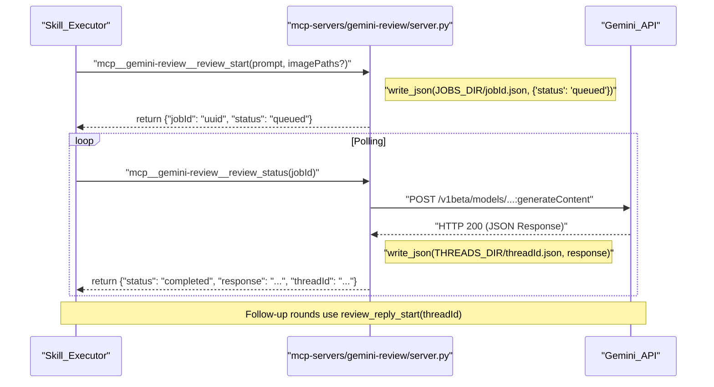
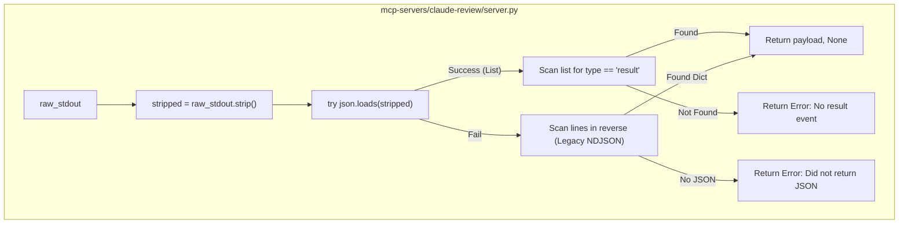

<!-- source: DeepWiki mcp.deepwiki.com · repo wanshuiyin/Auto-claude-code-research-in-sleep · page 5.2 Alternative Reviewer Backends · fetched 2026-10-26 -->

# Alternative Reviewer Backends

<details>
<summary>Relevant source files</summary>

The following files were used as context for generating this wiki page:

- [.github/agents/aris-reviewer-claude.agent.md](.github/agents/aris-reviewer-claude.agent.md)
- [.github/agents/aris-reviewer-openai.agent.md](.github/agents/aris-reviewer-openai.agent.md)
- [docs/CODEX_CLAUDE_REVIEW_GUIDE.md](docs/CODEX_CLAUDE_REVIEW_GUIDE.md)
- [docs/CODEX_CLAUDE_REVIEW_GUIDE_CN.md](docs/CODEX_CLAUDE_REVIEW_GUIDE_CN.md)
- [docs/CODEX_GEMINI_REVIEW_GUIDE.md](docs/CODEX_GEMINI_REVIEW_GUIDE.md)
- [docs/CODEX_GEMINI_REVIEW_GUIDE_CN.md](docs/CODEX_GEMINI_REVIEW_GUIDE_CN.md)
- [docs/MANUAL_REVIEW_GUIDE.md](docs/MANUAL_REVIEW_GUIDE.md)
- [docs/MANUAL_REVIEW_GUIDE_CN.md](docs/MANUAL_REVIEW_GUIDE_CN.md)
- [mcp-servers/claude-review/README.md](mcp-servers/claude-review/README.md)
- [mcp-servers/claude-review/run_with_claude_aws.sh](mcp-servers/claude-review/run_with_claude_aws.sh)
- [mcp-servers/claude-review/server.py](mcp-servers/claude-review/server.py)
- [mcp-servers/gemini-review/README.md](mcp-servers/gemini-review/README.md)
- [mcp-servers/gemini-review/server.py](mcp-servers/gemini-review/server.py)
- [mcp-servers/manual-review/README.md](mcp-servers/manual-review/README.md)
- [mcp-servers/manual-review/server.py](mcp-servers/manual-review/server.py)
- [mcp-servers/manual-review/ui.html](mcp-servers/manual-review/ui.html)
- [skills/skills-codex-claude-review/auto-review-loop/SKILL.md](skills/skills-codex-claude-review/auto-review-loop/SKILL.md)
- [skills/skills-codex-gemini-review/README.md](skills/skills-codex-gemini-review/README.md)
- [skills/skills-codex-gemini-review/README_CN.md](skills/skills-codex-gemini-review/README_CN.md)
- [tests/_minimax_helpers.py](tests/_minimax_helpers.py)
- [tests/test_claude_review_artifact_tools.py](tests/test_claude_review_artifact_tools.py)
- [tests/test_claude_review_parse.py](tests/test_claude_review_parse.py)
- [tests/test_manual_review.py](tests/test_manual_review.py)
- [tests/test_minimax_chat_server.py](tests/test_minimax_chat_server.py)
- [tools/generate_codex_claude_review_overrides.py](tools/generate_codex_claude_review_overrides.py)

</details>


This page documents the alternative reviewer backend integrations in ARIS (Auto-claude-code-research-in-sleep). While the default configuration uses OpenAI's GPT models via Codex MCP, ARIS supports several other backends to enable cross-model collaboration. These include **MiniMax MCP**, **Gemini Reviewer**, **Claude-as-Reviewer**, and the generic **LLM Chat MCP**.

## 1. Architectural Overview

ARIS separates the **Executor** (typically Claude Code or Codex) from the **Reviewer** (an external LLM). This "adversarial" pattern prevents the system from falling into local minima by using different model families for implementation and critique. Alternative backends solve the technical problem where standard executors are often optimized for specific APIs, allowing them to interface with providers like Google, MiniMax, or DeepSeek.

### Reviewer Backend Comparison

| Backend | MCP Server | Protocol / API | Key Features |
| :--- | :--- | :--- | :--- |
| **MiniMax** | `minimax-chat` | MiniMax V1 API | Dual-format JSON-RPC, `clamp_temperature` logic |
| **Gemini** | `gemini-review` | Google AI SDK / API | Async flow, Multimodal (images), Job persistence |
| **Claude (AWS)**| `claude-review` | Bedrock / Anthropic | AWS support, Async review jobs, Shell wrappers |
| **Generic LLM** | `llm-chat` | OpenAI-Compatible | 504 Retry/Fallback, Supports DeepSeek/Kimi/Qwen |

Sources: [mcp-servers/gemini-review/README.md:1-19](), [docs/CODEX_GEMINI_REVIEW_GUIDE.md:1-10](), [mcp-servers/claude-review/server.py:1-6]()

---

## 2. Gemini Reviewer Backend

The Gemini integration allows using Gemini models (e.g., `gemini-2.5-flash` or `gemini-flash-latest`) as the reviewer [mcp-servers/gemini-review/README.md:50-51](). It is designed to maximize reuse of ARIS skills while providing a robust transport layer for long research papers that exceed typical context or timeout limits [docs/CODEX_GEMINI_REVIEW_GUIDE.md:52-57]().

### Async Review Flow
Because research reviews often exceed the 120-second timeout of MCP hosts, the `gemini-review` bridge implements an asynchronous job pattern using `jobId` and `review_status` [mcp-servers/gemini-review/README.md:92-94]().

**Gemini Async Review Sequence**



Sources: [mcp-servers/gemini-review/README.md:95-143](), [mcp-servers/gemini-review/server.py:42-52](), [mcp-servers/gemini-review/server.py:118-127](), [docs/CODEX_GEMINI_REVIEW_GUIDE.md:137-140]()

### Implementation Details
- **Multimodal Support**: The bridge accepts `imagePaths` to allow Gemini to review local PNG/JPG files via `build_inline_image_parts`. This is used by skills for visual critique of posters and figures [mcp-servers/gemini-review/README.md:18-19]().
- **State Persistence**: Conversations are persisted under `~/.codex/state/gemini-review/threads/` to allow multi-round "follow-up" reviews using the same context [mcp-servers/gemini-review/server.py:78-80](), [mcp-servers/gemini-review/README.md:67-68]().
- **Direct API vs CLI**: The bridge defaults to the Direct Gemini API (`GEMINI_REVIEW_BACKEND=api`) but supports a CLI fallback (`GEMINI_REVIEW_BACKEND=cli`) [mcp-servers/gemini-review/server.py:60](), [docs/CODEX_GEMINI_REVIEW_GUIDE.md:69-76]().

Sources: [mcp-servers/gemini-review/server.py:1-198](), [docs/CODEX_GEMINI_REVIEW_GUIDE.md:13-17]()

---

## 3. Claude-as-Reviewer (AWS/Bedrock)

The `claude-review` bridge allows using Claude (via AWS Bedrock or native Anthropic CLI) as the reviewer for a Codex-led execution [mcp-servers/claude-review/server.py:1-6]().

### JSON Output Parsing
The `claude-review` server implements complex logic in `parse_claude_json` to handle the transition between Claude CLI 1.x (NDJSON) and 2.x (single JSON array of events) [mcp-servers/claude-review/server.py:120-175](). It specifically scans for a `result` type event to ensure the terminal output is captured [mcp-servers/claude-review/server.py:141-144]().

**Claude CLI Output Handling Logic**



Sources: [mcp-servers/claude-review/server.py:120-175](), [tests/test_claude_review_parse.py:1-11]()

### Features
- **AWS Claude Support**: Can be configured to run through `run_with_claude_aws.sh` which checks for `claude-aws` or sources `claude-bedrock-env.sh` [mcp-servers/claude-review/run_with_claude_aws.sh:22-45]().
- **Async Pattern**: Matches the `review_start` / `review_status` contract to prevent host-side timeouts during long paper reviews [skills/skills-codex-claude-review/auto-review-loop/SKILL.md:27-31]().
- **Skill Overlay**: Uses the `skills/skills-codex-claude-review/` package to override standard skills [skills/skills-codex-claude-review/README.md:1-27]().

Sources: [docs/CODEX_CLAUDE_REVIEW_GUIDE.md:1-44](), [mcp-servers/claude-review/server.py:120-175]()

---

## 4. Manual Review MCP with Browser UI

The `manual-review` MCP server provides a human-in-the-loop review mechanism. When an automated review is not sufficient or a human touch is required, this server facilitates the process by presenting the review prompt to the user and collecting their response.

### Modes of Operation
The `manual-review` server operates in two primary modes:
- **Browser Mode**: Opens a local web page where the user can copy the prompt, interact with an external LLM, and paste the response back. This is the default mode [mcp-servers/manual-review/server.py:45]().
- **File Mode**: For headless environments, it writes the prompt to a file (`prompt.md`) and waits for the user to provide a response in another file (`response.md`) [mcp-servers/manual-review/server.py:45]().

### Cross-Family Verification
A key feature of the manual review process is the strict verification of reviewer independence. The server ensures that the human-provided review comes from a different model family than the executor. This is achieved by:
1. **Requiring Reviewer Model Identity**: The response must begin with `Reviewer-Model: <exact-model-id>` [mcp-servers/manual-review/server.py:103-107]().
2. **Classifying Model Families**: The `model_family` function attempts to classify the executor and reviewer models into known families (e.g., OpenAI, Anthropic, Google, DeepSeek, Moonshot/Kimi, Qwen) [mcp-servers/manual-review/server.py:83-100]().
3. **Enforcing Cross-Family Rule**: If the executor and reviewer belong to the same family, the review is rejected [mcp-servers/manual-review/server.py:124-128]().

**Manual Review Flow with Cross-Family Check**

```mermaid
graph TD
    A[Executor Calls manual-review MCP] --> B{Review Request Received};
    B --> C{Mode: Browser or File?};

    subgraph Browser Mode
        C -- Browser --> D[Open Browser UI (ui.html)];
        D --> E[User Copies Prompt];
        E --> F[User Interacts with External LLM];
        F --> G[User Pastes Response into UI];
        G --> H[User Submits Review];
    end

    subgraph File Mode
        C -- File --> I[Write prompt.md];
        I --> J[Wait for response.md];
        J --> K[Read response.md];
    end

    H --> L{Validate Reviewer Identity};
    K --> L;

    L -- "Reviewer-Model: <id> missing" --> M[Error: Missing Identity];
    L -- "Unknown Executor/Reviewer Family" --> N[Error: Unknown Family];
    L -- "Executor Family == Reviewer Family" --> O[Error: Same Family];
    L -- "Valid & Cross-Family" --> P[Return Review to Executor];

    M --> Q[Review Rejected];
    N --> Q;
    O --> Q;
```

Sources: [mcp-servers/manual-review/server.py:1-131](), [tests/test_manual_review.py:1-12]()

---

## 5. Skill Rewriting for Alternative Backends

When switching to a non-Codex reviewer, existing skills must be updated to call the new MCP tool (e.g., changing `mcp__codex__codex` to `mcp__gemini-review__review_start`). ARIS provides pre-built "overlays" to automate this.

### Claude-Review Overlay Generation
The `tools/generate_codex_claude_review_overrides.py` script automates the creation of the `skills-codex-claude-review` package. This script performs several key transformations:
- **Frontmatter Rewriting**: Updates the `name` and `description` fields in `SKILL.md` files to reflect the Claude reviewer [tools/generate_codex_claude_review_overrides.py:98-104]().
- **MCP Call Transformation**: Replaces `spawn_agent` and `send_input` blocks targeting a Codex reviewer with `mcp__claude-review__review_start` and `mcp__claude-review__review_reply_start` calls [tools/generate_codex_claude_review_overrides.py:127-166]().
- **Tool Opt-in for Artifacts**: For review prompts that instruct the reviewer to read files (e.g., "read the files yourself"), the script injects `tools: "Read,Grep,Glob"` to grant the Claude reviewer read-only access to the filesystem. This is crucial for artifact-grounded reviews [tools/generate_codex_claude_review_overrides.py:39-46](), [tests/test_claude_review_artifact_tools.py:1-13]().

**Claude-Review Overlay Generation Process**

```mermaid
graph TD
    A[Original Codex Skill (SKILL.md)] --> B{Parse Frontmatter};
    B --> C{Normalize Description};
    C --> D{Rewrite spawn_agent blocks to mcp__claude-review__review_start};
    D --> E{Rewrite send_input blocks to mcp__claude-review__review_reply_start};
    E --> F{Detect Artifact-Grounded Prompts};
    F -- Yes --> G[Inject 'tools: "Read,Grep,Glob"'];
    F -- No --> H[Keep tools: "" (default)];
    G --> I[Generated Claude-Review Overlay Skill];
    H --> I;
```

Sources: [tools/generate_codex_claude_review_overrides.py:1-166](), [tests/test_claude_review_artifact_tools.py:1-142]()

### Gemini Overlay Structure
The Gemini overlay (`skills/skills-codex-gemini-review/`) contains overrides for 15 skills. These are categorized by their interaction pattern:

| Category | Count | Example Skills | Implementation |
| :--- | :--- | :--- | :--- |
| **Direct Consumers** | 12 | `research-review`, `novelty-check`, `paper-write` | Directly call `mcp__gemini-review__review_start` / `review_reply_start` / `review_status` [skills/skills-codex-gemini-review/README.md:74-85]() |
| **Wrappers** | 3 | `idea-discovery`, `paper-writing` | Orchestrate sub-skills and pass `REVIEWER_MODEL=gemini-review` [skills/skills-codex-gemini-review/README.md:86-90]() |

### Installation Logic
Overlays must be installed on top of the base Codex skills to ensure all templates and resources are available:
1. Install `skills/skills-codex/*`
2. Install `skills/skills-codex-gemini-review/*` (overwriting the reviewer-aware files)
3. Register the `gemini-review` MCP server.

Sources: [docs/CODEX_GEMINI_REVIEW_GUIDE.md:12-23](), [skills/skills-codex-gemini-review/README.md:35-67]()

---

