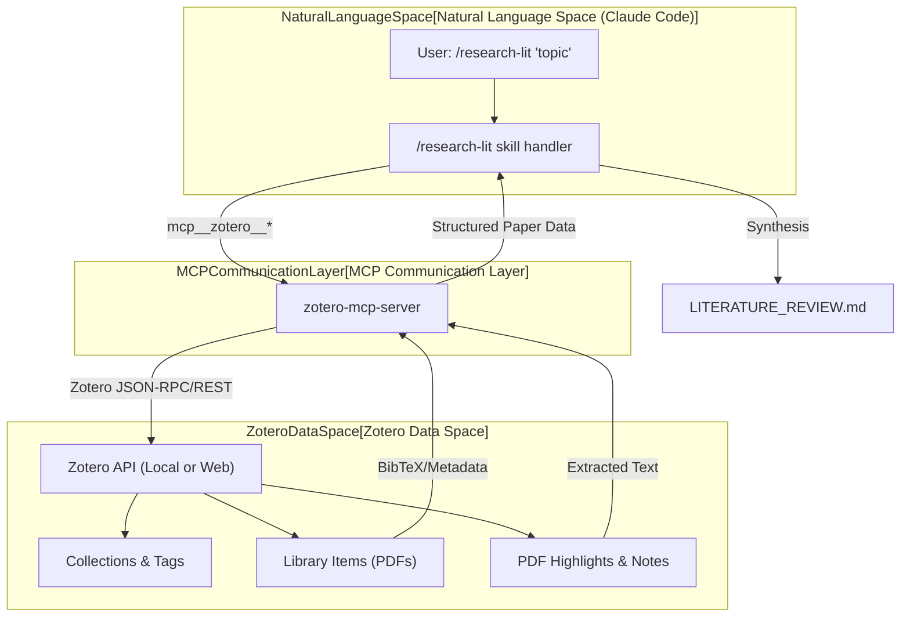
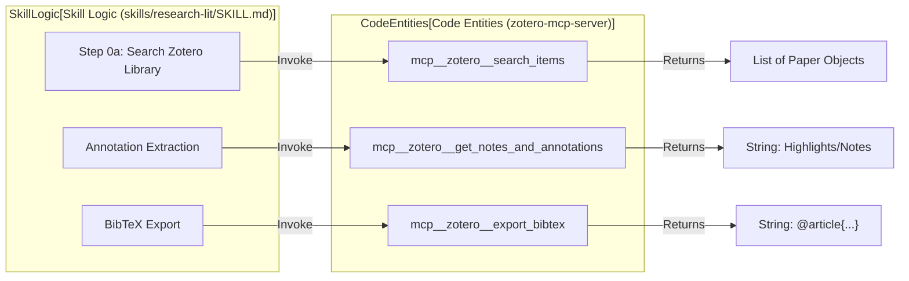

<!-- source: DeepWiki mcp.deepwiki.com · repo wanshuiyin/Auto-claude-code-research-in-sleep · page 5.4 Zotero Integration · fetched 2026-10-26 -->

# Zotero Integration

<details>
<summary>Relevant source files</summary>

The following files were used as context for generating this wiki page:

- [docs/integrations/FEISHU.md](docs/integrations/FEISHU.md)
- [docs/integrations/FEISHU_CN.md](docs/integrations/FEISHU_CN.md)
- [docs/integrations/OBSIDIAN.md](docs/integrations/OBSIDIAN.md)
- [docs/integrations/OBSIDIAN_CN.md](docs/integrations/OBSIDIAN_CN.md)
- [docs/integrations/VAST_GPU_GUIDE.md](docs/integrations/VAST_GPU_GUIDE.md)
- [docs/integrations/VAST_GPU_GUIDE_CN.md](docs/integrations/VAST_GPU_GUIDE_CN.md)
- [docs/integrations/ZOTERO.md](docs/integrations/ZOTERO.md)
- [docs/integrations/ZOTERO_CN.md](docs/integrations/ZOTERO_CN.md)
- [skills/research-lit/SKILL.md](skills/research-lit/SKILL.md)
- [skills/research-wiki/SKILL.md](skills/research-wiki/SKILL.md)
- [skills/skills-codex/research-lit/SKILL.md](skills/skills-codex/research-lit/SKILL.md)
- [tests/test_research_wiki_encoding.py](tests/test_research_wiki_encoding.py)
- [tools/check_skills_inventory.py](tools/check_skills_inventory.py)
- [tools/research_wiki.py](tools/research_wiki.py)
- [tools/verify_papers.py](tools/verify_papers.py)

</details>


This document covers the setup and configuration of Zotero as a primary literature data source for the ARIS system. By integrating the `zotero-mcp-server`, the `/research-lit` skill can search your personal paper library, extract annotations, and fetch BibTeX metadata before falling back to external web searches.

## Purpose and Scope

Zotero integration provides the ARIS ecosystem with access to a researcher's **processed knowledge**. While web searches provide raw information, Zotero contains curated collections and personal highlights that represent the user's specific research focus.

The integration enables:
1.  **Semantic Search**: Finding papers in your local library based on research topics [skills/research-lit/SKILL.md:68]().
2.  **Annotation Extraction**: Pulling PDF highlights and notes to understand what the user previously found important [skills/research-lit/SKILL.md:68]().
3.  **BibTeX Management**: Automatically gathering citation data for use in the `/paper-write` workflow [skills/research-lit/SKILL.md:68]().

Sources: [skills/research-lit/SKILL.md:68]()

---

## Architecture and Data Flow

The Zotero integration operates as an MCP (Model Context Protocol) server. Claude Code acts as the host, invoking Zotero tools to bridge the gap between the LLM's "Natural Language Space" and the user's "Zotero Data Space".

### Literature Search Pipeline

The following diagram illustrates how `/research-lit` leverages Zotero within the broader literature review workflow.

**Title: Zotero Data Integration Flow**

Sources: [skills/research-lit/SKILL.md:5](), [skills/research-lit/SKILL.md:33-42](), [skills/research-lit/SKILL.md:68]()

---

## Setup and Configuration

ARIS supports two modes of Zotero access via the `zotero-mcp-server`: **Local API** (fastest, requires desktop app) and **Web API** (cloud-based).

### 1. Install the MCP Server
The recommended server is the `zotero-mcp-server`.
```bash
uv tool install zotero-mcp-server
# or
pip install zotero-mcp-server
```
Sources: [docs/integrations/ZOTERO.md:13-14]()

### 2. Configure Claude Code
Add the server to your Claude configuration. Choose one of the two modes below.

#### Option A: Local Desktop Access
Requires the Zotero desktop application to be running. It uses the local translation server for high-speed access to PDF attachments.
```bash
claude mcp add zotero -s user -- zotero-mcp -e ZOTERO_LOCAL=true
```
Sources: [docs/integrations/ZOTERO.md:17-18]()

#### Option B: Web API Access
Works without the Zotero app running, ideal for remote GPU servers or headless environments.
```bash
claude mcp add zotero -s user -- zotero-mcp \
  -e ZOTERO_API_KEY=your_api_key \
  -e ZOTERO_USER_ID=your_user_id
```
*Note: Generate your API key at [zotero.org/settings/keys](https://www.zotero.org/settings/keys).*
Sources: [docs/integrations/ZOTERO.md:21-25]()

---

## Skill Implementation Detail

The `/research-lit` skill implements a **priority cascade**. Zotero is the highest priority source because it contains "pre-filtered" knowledge.

### Key Implementation Logic
When `/research-lit` is invoked, it follows this logic for Zotero:

1.  **Tool Detection**: It checks for the existence of tools prefixed with `mcp__zotero__` [skills/research-lit/SKILL.md:5]().
2.  **Collection Search**: It searches Zotero collections and tags [skills/research-lit/SKILL.md:68]().
3.  **Annotation Harvesting**: It specifically targets annotation tools to pull highlights. These are prioritized over raw abstracts because they represent "user-verified" importance [skills/research-lit/SKILL.md:68]().
4.  **Graceful Degradation**: If Zotero is unavailable, the skill skips it and moves to Obsidian, local PDFs, or Web search [skills/research-lit/SKILL.md:78]().

### Data Mapping: Code Entity Space
The following diagram maps the skill's internal logic to the specific MCP tool patterns.

**Title: /research-lit to Zotero Tool Mapping**

Sources: [skills/research-lit/SKILL.md:5](), [skills/research-lit/SKILL.md:68](), [skills/research-lit/SKILL.md:80-83]()

---

## Leveraging Zotero Data in Workflows

Zotero data is not just for reading; it drives the downstream autonomous research pipeline.

### Integration with /research-lit
The `/research-lit` skill serves as the gateway for Zotero data. It accepts a `— sources: zotero` flag to restrict searches purely to the Zotero library [skills/research-lit/SKILL.md:47]().

### Multi-Source Fusion
Zotero is often used in conjunction with Obsidian. `/research-lit` checks Zotero first for raw papers and annotations, then Obsidian for processed notes [docs/integrations/OBSIDIAN.md:37-39]().

### Persistent Knowledge Graph
When papers are read via Zotero integration, they can be ingested into the `research-wiki` using the `ingest_paper` subcommand of `tools/research_wiki.py`, allowing the system to track relationships like `inspired_by` or `extends` across the project lifecycle [skills/research-wiki/SKILL.md:24-26](). The `research_wiki.py` script provides the `ingest_paper` function for this purpose [tools/research_wiki.py:19-21]().

Sources: [skills/research-lit/SKILL.md:47](), [docs/integrations/OBSIDIAN.md:37-39](), [skills/research-wiki/SKILL.md:24-26](), [tools/research_wiki.py:19-21]()

---

