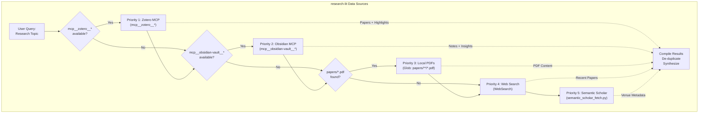
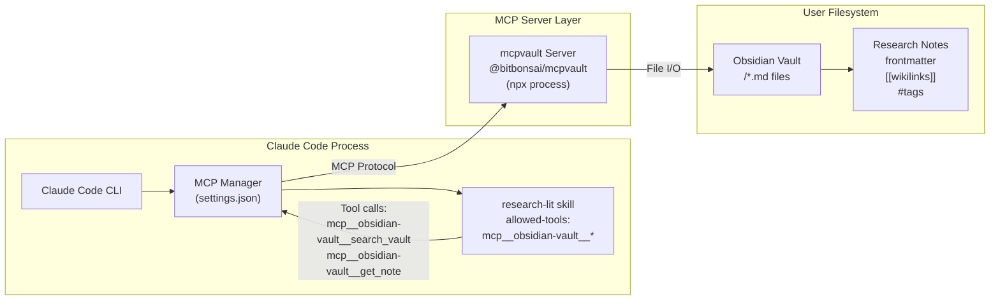
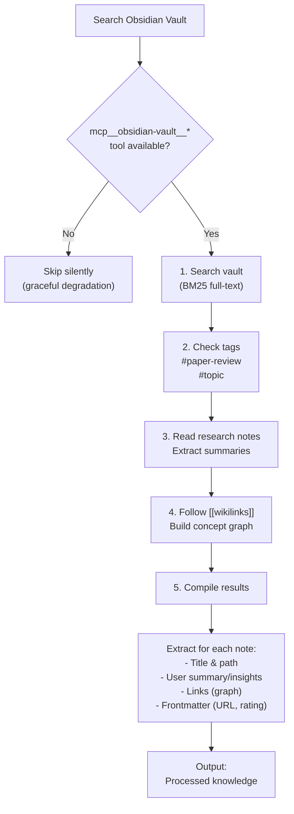

<!-- source: DeepWiki mcp.deepwiki.com · repo wanshuiyin/Auto-claude-code-research-in-sleep · page 5.5 Obsidian Integration · fetched 2026-10-26 -->

# Obsidian Integration

<details>
<summary>Relevant source files</summary>

The following files were used as context for generating this wiki page:

- [docs/integrations/FEISHU.md](docs/integrations/FEISHU.md)
- [docs/integrations/FEISHU_CN.md](docs/integrations/FEISHU_CN.md)
- [docs/integrations/OBSIDIAN.md](docs/integrations/OBSIDIAN.md)
- [docs/integrations/OBSIDIAN_CN.md](docs/integrations/OBSIDIAN_CN.md)
- [docs/integrations/VAST_GPU_GUIDE.md](docs/integrations/VAST_GPU_GUIDE.md)
- [docs/integrations/VAST_GPU_GUIDE_CN.md](docs/integrations/VAST_GPU_GUIDE_CN.md)
- [docs/integrations/ZOTERO.md](docs/integrations/ZOTERO.md)
- [docs/integrations/ZOTERO_CN.md](docs/integrations/ZOTERO_CN.md)
- [skills/research-lit/SKILL.md](skills/research-lit/SKILL.md)
- [skills/research-wiki/SKILL.md](skills/research-wiki/SKILL.md)
- [skills/skills-codex/research-lit/SKILL.md](skills/skills-codex/research-lit/SKILL.md)
- [tests/test_research_wiki_encoding.py](tests/test_research_wiki_encoding.py)
- [tools/check_skills_inventory.py](tools/check_skills_inventory.py)
- [tools/research_wiki.py](tools/research_wiki.py)
- [tools/verify_papers.py](tools/verify_papers.py)

</details>


This document describes the optional integration of [Obsidian](https://obsidian.md/) vaults with ARIS through the MCP (Model Context Protocol) server architecture. Obsidian integration enables the `/research-lit` skill to search the user's research notes, paper summaries, and personal insights stored in their vault, providing processed knowledge that complements raw paper content from other sources.

For information about the Zotero integration, see [5.4 Zotero Integration](). For details on the `/research-lit` skill that uses both integrations, see [4.1 Literature & Analysis Skills](). For the broader external integration architecture, see [5. External Integrations]().

---

## Purpose and Scope

Obsidian integration provides ARIS with access to the user's **processed research knowledge**—notes, summaries, and insights they've written about papers and research topics. Unlike raw PDFs or paper databases, Obsidian vaults contain the user's own understanding, interpretations, and connections between concepts. This makes it particularly valuable for:

1.  **Understanding user perspective**: What topics has the user already studied? What connections have they made? [skills/research-lit/SKILL.md:71]()
2.  **Accessing synthesized knowledge**: User-written summaries are more valuable than re-reading raw papers. [skills/research-lit/SKILL.md:71]()
3.  **Following research graph**: Wikilinks reveal how concepts connect in the user's mental model. [skills/research-lit/SKILL.md:71]()
4.  **Leveraging frontmatter metadata**: Paper URLs, reading status, personal ratings. [skills/research-lit/SKILL.md:71]()

The integration is **entirely optional** with **graceful degradation**—if not configured, `/research-lit` silently skips Obsidian and proceeds to other data sources. [skills/research-lit/SKILL.md:80]()

Sources: [skills/research-lit/SKILL.md:68-81](), [docs/integrations/OBSIDIAN.md:1-7]()

---

## Integration Architecture

### Data Source Priority Hierarchy

Obsidian occupies **priority 2** in the literature search hierarchy used by the `research-lit` skill: [skills/research-lit/SKILL.md:69]()

**Diagram: Obsidian in the Literature Search Priority Chain**



The search proceeds sequentially through available sources. Obsidian searches occur **after Zotero** (which provides raw paper annotations) but **before local PDFs** (which have no user context). [skills/research-lit/SKILL.md:68-73]()

Sources: [skills/research-lit/SKILL.md:68-73](), [docs/integrations/OBSIDIAN.md:37-40]()

---

## MCP Server Architecture

### mcpvault Server Setup

The integration uses `@bitbonsai/mcpvault`, an npm package that exposes an MCP server for Obsidian vaults. This server directly reads the vault's markdown files from the filesystem using BM25 search. [docs/integrations/OBSIDIAN.md:10]()

**Diagram: mcpvault MCP Server Architecture**



Sources: [docs/integrations/OBSIDIAN.md:10-15](), [skills/research-lit/SKILL.md:5]()

---

### Setup Steps

#### Install and Configure mcpvault

To add the Obsidian MCP server to Claude Code, use the following command:

```bash
claude mcp add obsidian-vault -s user -- npx @bitbonsai/mcpvault@latest /path/to/your/vault
```

This command modifies the Claude settings to add the MCP server configuration. [docs/integrations/OBSIDIAN.md:14]()

**Key parameters:**
*   `obsidian-vault`: The MCP server identifier (appears in tool names as `mcp__obsidian-vault__*`).
*   Path argument: Absolute path to the root of the Obsidian vault.

Sources: [docs/integrations/OBSIDIAN.md:12-15]()

#### Optional: Install obsidian-skills

For enhanced Obsidian-specific Markdown understanding (wikilinks, callouts, properties), users can clone the `obsidian-skills` repository into their vault:

```bash
git clone https://github.com/kepano/obsidian-skills.git
cp -r obsidian-skills/.claude /path/to/your/vault/
```

Sources: [docs/integrations/OBSIDIAN.md:17-24]()

---

## Integration with /research-lit

### Tool Invocation Patterns

The `research-lit` skill interacts with the Obsidian vault through MCP tools. [skills/research-lit/SKILL.md:5]()

| Tool Pattern | Purpose | Example Call |
| :--- | :--- | :--- |
| `mcp__obsidian-vault__search_vault` | BM25 full-text search across all notes | Search for "diffusion models" |
| `mcp__obsidian-vault__get_note` | Retrieve specific note by path | Read `/Research/Diffusion Survey.md` |
| `mcp__obsidian-vault__list_tags` | Enumerate all tags in vault | Find all `#paper-review` notes |
| `mcp__obsidian-vault__search_by_tag` | Filter notes by tag | Get notes tagged `#ml-theory` |

Sources: [skills/research-lit/SKILL.md:5](), [docs/integrations/OBSIDIAN.md:10]()

---

### Search Workflow

When `research-lit` executes with Obsidian available, it performs the following sequence:

**Diagram: Obsidian Search Workflow in research-lit**



**Key behaviors:**
*   **Graceful detection**: The skill attempts a tool call. If it fails, execution continues without error. [skills/research-lit/SKILL.md:80]()
*   **Tag-based filtering**: Tags like `#paper-review` help locate relevant notes. [docs/integrations/OBSIDIAN.md:29]()
*   **Wikilink traversal**: Following `[[wikilinks]]` discovers related notes. [docs/integrations/OBSIDIAN.md:31]()
*   **Frontmatter extraction**: Reading Obsidian properties/frontmatter for structured data. [docs/integrations/OBSIDIAN.md:19]()

Sources: [skills/research-lit/SKILL.md:68-81](), [docs/integrations/OBSIDIAN.md:26-32]()

---

## What Obsidian Integration Enables

### Capabilities Added to /research-lit

| Capability | Without Obsidian | With Obsidian |
| :--- | :--- | :--- |
| **Search for papers** | Web search + local PDFs | + vault notes about papers |
| **Access user summaries** | No | Yes—user's own words |
| **Follow concept graph** | No | Yes—via wikilinks |
| **Understand user priorities** | No | Yes—tags, properties |
| **Leverage insights** | No | Yes—synthesis > raw papers |

Sources: [docs/integrations/OBSIDIAN.md:26-32](), [skills/research-lit/SKILL.md:71]()

---

### Source Selection Override

Users can explicitly control which sources to search using the `— sources:` directive: [skills/research-lit/SKILL.md:41-43]()

```bash
# Default: search all available sources (excluding S2, DeepXiv, etc.)
/research-lit "diffusion models"

# Only Obsidian (skip Zotero, local, web)
/research-lit "diffusion models" — sources: obsidian

# Obsidian + web (skip Zotero and local PDFs)
/research-lit "diffusion models" — sources: obsidian, web
```

Sources: [skills/research-lit/SKILL.md:41-64]()

---

